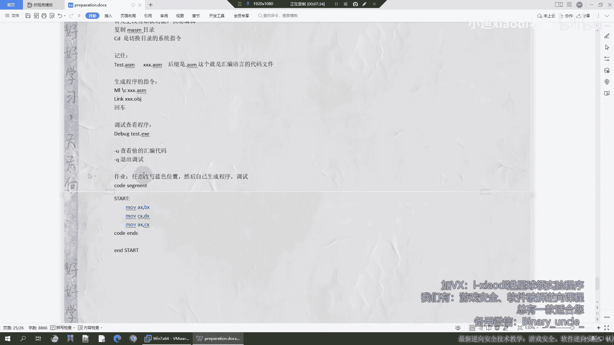

# 🧰 小白软件破解逆向工程师2023最新：4.25：汇编语法基础环境搭建

## 🧭 小白软件破解逆向工程师2023最新：4.25：课程概述

在本节课中我们将要学习汇编语法基础环境搭建，本讲是第二十五讲汇编指令专题讲解。之前我们搭建过一个环境，但那个环境跟这一次还是有差别，之前的写代码环境不是特别好。现在更新写代码环境，这是必须看的内容。这一讲看起来是环境配置，实际上它决定了后面写汇编、生成程序、调试程序能不能顺利进行，所以建议一步一步跟着做。

上一节我们说明了本讲的目标，本节中我们来看看整体操作流程。首先第一步要下载星球的 MASM611 文件，然后在虚拟机里操作，查看操作流程。下面进入文件准备环节，先说明下载与解压。

## 📦 小白软件破解逆向工程师2023最新：4.25：下载与解压MASM611

上一节我们介绍了本讲目标，本节中我们来看看文件准备。首先下载星球的 MASM611 文件，然后解压到一个盘里，比如解压到 D 盘，就解压到 D 盘；如果解压到 C 盘，就按 C 盘处理。推荐解压到 D 盘。这一步看起来简单，但它是后面所有操作的基础，所以不要跳过。

以下是解压和准备文件的要点：

- 下载星球的 MASM611 文件。

- 在虚拟机中操作并查看流程。

- 把文件解压到一个盘，例如 D 盘。

- 推荐解压到 D 盘；如果解压到 C 盘，就按 C 盘处理。

完成文件准备后，下一节我们进入 DOSBox，看看如何挂载 D 盘目录。

## 🖥️ 小白软件破解逆向工程师2023最新：4.25：启动DOSBox与挂载D盘

上一节我们完成了文件解压，本节中我们来看看 DOSBox 的启动和 D 盘挂载。运行 DOSBox，可以清屏，清屏操作用 `cls`。清屏之后要挂载 D 盘目录，为什么要挂载 D 盘？因为文件在 D 盘，所以要挂载一下 D 盘。输入 `D:` 回车，程序会提示是否真的想访问，肯定想访问，选择 `yes`，这样就把 D 盘挂载上了。挂载的意义是让 DOSBox 能够访问你放在 D 盘里的文件。

下面的代码给出清屏和挂载 D 盘的操作示意：

```text
cls
D:
```

在提示是否访问时选择 `yes`。挂载完成后，下一节我们配置剪贴板并切换目录。

## 📋 小白软件破解逆向工程师2023最新：4.25：配置剪贴板并进入MASM目录

上一节我们完成了 D 盘挂载，本节中我们来看看如何配置剪贴板并进入 MASM 目录。挂载上之后就可以切换目录，直接复制目录路径。直接粘贴往往粘贴不上，所以要点击主菜单，找到剪贴板功能，点击快速编辑并勾选。然后输入 `CD`，打一个空格，再单击鼠标右键，右键相当于复制。这里讲细一点，有的同学可能不知道：更改剪贴板功能的方法是点击主菜单，找到剪贴板功能，把快速编辑勾上。然后复制 MASM 目录路径。`CD` 是切换目录的指令，是系统指令，在 Windows 上也是一样的。操作就是 `CD` 加空格，再单击鼠标右键，然后回车，这样就能加载到该目录。快速编辑这个设置很实用，因为 DOSBox 默认不方便直接粘贴。

下面列出剪贴板与切换目录的操作要点：

- 点击主菜单。

- 找到剪贴板功能。

- 勾选快速编辑。

- 复制 MASM 目录路径。

- 在 DOSBox 输入 `CD` 和一个空格。

- 单击鼠标右键粘贴路径。

- 按回车进入该目录。

可以用公式理解：`CD 路径 = 切换当前目录`。进入目录后，下一节我们认识 ASM 代码文件。

## 📄 小白软件破解逆向工程师2023最新：4.25：认识ASM代码文件

上一节我们进入了 MASM 目录，本节中我们来看看目录里的 ASM 文件。目录里有很多文件，其中有一个后缀为 `.ASM` 的文件，这是汇编代码文件，汇编代码就写在这一块。这个内容可以修改，例如把文件名中的 AS 改成 BS，然后保存。这个文件是汇编代码文件，记住 `text.ASM` 或 `xxx.ASM`，只要后缀是 `.ASM`，就是汇编语言的代码文件。代码写在这个位置，暂时先记住，想改就在这个位置改，别的地方不要改。后缀很重要，认后缀就能快速判断文件类型。

下面列出 ASM 文件要点：

- 目录中有一个后缀为 `.ASM` 的文件。

- 这个文件是汇编代码文件。

- 汇编代码写在这个文件里。

- 可以修改文件名和内容，例如把文件名中的 AS 改成 BS，然后保存。

- `text.ASM` 或 `xxx.ASM` 只要后缀是 `.ASM`，就是汇编语言代码文件。

- 暂时先记住：想改代码就在这个位置改，别的地方不要改。

可以用公式表示：`汇编代码文件 = 后缀为.ASM的文本文件`。认识文件后，下一节我们生成可执行程序。

## ⚙️ 小白软件破解逆向工程师2023最新：4.25：生成EXE程序

上一节我们认识了 ASM 文件，本节中我们来看看如何生成 EXE 程序。目录里还会看到一个程序，也就是一个 OBJ 文件，不要紧，那是我生成的。现在把它删掉。我要变一个魔术：靠文件夹里的这个东西生成一个程序，程序后缀是可执行文件，应该是 EXE，原文写作 ESE。我要生成一个 EXE，这很厉害，你也可以成为很厉害的人。生成程序的过程可以理解成先把汇编代码变成中间文件，再把中间文件变成可执行文件。

试一下：输入 `ML`，`ML` 就是针对这个文件生成程序的东西。输入 `ML /C text.ASM` 回车，出现几行代码后，会多出 `text.OBJ`，原文写作 OBG。再用 `LINK`，输入 `LINK text.OBJ` 回车。如果出现类似 `resolve` 的提示，就说明成功了。程序提示 `run` 或提示运行程序时，一路回车即可。回车完成后会多出一个程序，这个程序就是你自己的程序。用公式表示：`ASM -> OBJ -> EXE`。

下面的代码给出生成程序的命令：

```text
ML /C text.ASM
LINK text.OBJ
```

生成程序后，下一节我们用 DEBUG 查看程序。

## 🔍 小白软件破解逆向工程师2023最新：4.25：用DEBUG查看程序并退出

上一节我们生成了 EXE 程序，本节中我们来看看如何用 DEBUG 查看程序。查看程序里写的内容，要用调试器 DEBUG。`DEBUG` 直接加程序名字，例如输入 `DEBUG text.EXE` 回车，就进入调试程序。用 `U` 命令查看反汇编指令，也就是查看程序里的汇编指令。检查 `mov ax,bx`、`mov cs,ds`、`mov ax,cx` 等指令有没有对上；后面没有写代码，所以后面就没有对应指令。这个代码文件就是我们写的代码文件，`U` 查看后面的指令，查看它的汇编指令。`Q` 退出程序，也退出调试。调试器不是用来改代码，而是用来观察程序里的指令。

下面列出 DEBUG 常用操作：

- 输入 `DEBUG text.EXE` 进入调试。

- 输入 `U` 查看反汇编指令。

- 检查 `mov ax,bx`、`mov cs,ds`、`mov ax,cx` 等指令是否对应。

- 后面没有写代码，所以后面没有对应指令。

- 输入 `Q` 退出调试。

查看完成后，下一节我们布置作业并做总结。

## 📝 小白软件破解逆向工程师2023最新：4.25：作业与总结

上一节我们用 DEBUG 查看了程序，本节中我们来看看作业和总结。今天讲的就是这些内容。布置一个作业：自己任意改写代码。任意改写哪里？位置不要乱，任意改写蓝色位置。然后自己生成程序并调试。这就是今天的作业，回去做一下，熟悉以前开发人员是怎么开发代码的。作业的目的不是背命令，而是熟悉流程。慢慢来，下期再见。

为方便回顾，下面列出作业步骤：

- 在蓝色位置任意改写代码。

- 改写时位置不要乱。

- 自己生成程序。

- 自己调试程序。



- 通过作业熟悉以前开发人员开发代码的方式。

本节课中我们一起学习了汇编语法基础环境搭建，包括下载与解压 MASM611、启动 DOSBox 与挂载 D 盘、配置剪贴板并进入 MASM 目录、认识 ASM 代码文件、生成 EXE 程序、用 DEBUG 查看程序并退出，以及完成蓝色位置改写代码的作业。以上内容就是本讲的全部操作流程，建议按顺序练习并熟悉每一步。

