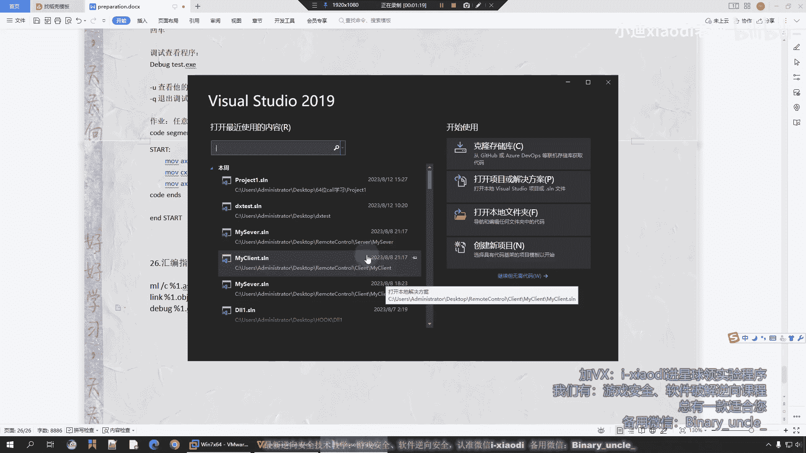
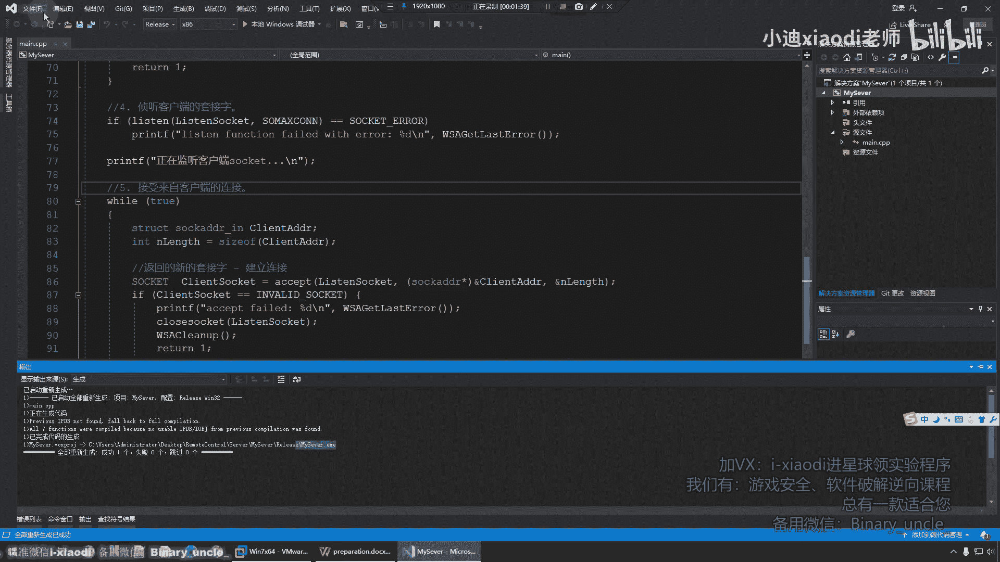
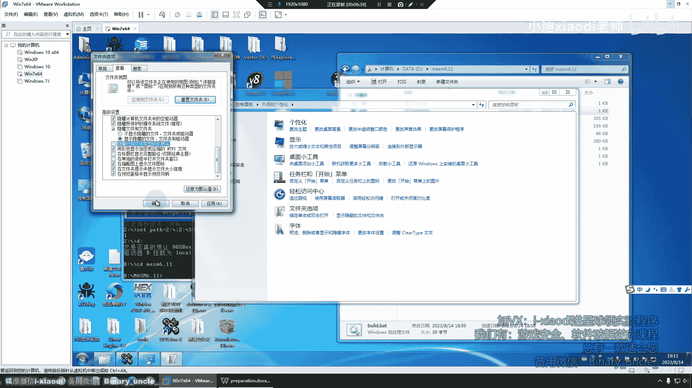

# 🧰 小白软件破解逆向工程师2023：第26课：汇编指令专题讲解——编译脚本


在本节课中我们将要学习编译脚本是什么、为什么需要编译脚本、怎样在 DOSBox 中配置环境路径、怎样从零创建 BAT 编译脚本、怎样运行脚本并进入调试，以及课后作业和实践要求。今天是第26课，主题是汇编指令专题讲解中的编译脚本。下面的内容会把原来口语化的操作过程整理成初学者能照着做的教程。


## 🚀 小白软件破解逆向工程师2023：26.1：编译脚本是什么以及为什么需要


上一节我们介绍了手动生成程序的基本流程，本节中我们来看看编译脚本。编译脚本的作用是帮助我们快速生成程序。上节课说过，生成程序时可以输入这个、再输入那个、再输入另一个，步骤特别麻烦。因此需要写一个自动化脚本，帮助完成输入动作，或者帮助执行这些步骤。这个自动化过程看起来只是省了几次输入，实际使用时会明显减少重复劳动。


这个东西不只是学汇编时会用到。如果去公司工作，也有很大概率用到。原因是写程序时会接触编译器，例如 Visual Studio、Visual Studio 6，以及其他开发平台。但是在一些操作系统上，这些工具无法运行。例如 Visual Studio 2019 大概需要 Windows 7 以上系统，Windows XP 就不支持。电脑配置本来不高，或者系统只支持较低版本，甚至只能用黑窗口，仍然必须生成程序，手动操作就会很慢。这里的关键是：编译脚本把“人手动敲命令”变成“脚本自动敲命令”，换到不同环境时更容易复用。


下面演示生成程序。例如写一个 my client 或 my server 的代码，然后生成程序，程序就生成了一个 EXE。可是有些操作系统不支持这个软件，这时就要写编译脚本。编译脚本主要有两个作用，下面列出来。


1. 第一是快速帮助我们执行操作，把重复的生成步骤自动化。



2. 第二是帮助我们解决跨平台问题，处理某些版本不支持的情况。例如某个操作系统不支持 Visual Studio，不能因为不支持就直接辞职，写一个编译脚本就可以完成跨平台操作。


上一节我们说明了手动操作的麻烦，本节中我们继续看看如何在 DOSBox 中配置环境路径，让后续脚本能直接找到汇编工具。


## 🗂️ 小白软件破解逆向工程师2023：26.2：在DOSBox中配置环境路径




首先点击窗口左下角，点击所有程序，找到 DOSBox，点击它的 Edit configuration，也就是它的配置文件 conf，把配置拉到最后，添加下面这一行。这个配置的作用是自动挂载 D 盘的 MASM6.11 目录，这个目录就是我们的汇编环境。操作时可以把窗口放大查看，方便确认路径有没有写对。


```bat
set PATH=D:\MASM6.11;%PATH%
```


这里用公式理解就是：


```text
PATH = D:\MASM6.11 + 原有PATH
```


`%PATH%` 是占位符，用来占据原有路径的位置；分号后面把 `%PATH%` 给到这个位置，就相当于设置了一个默认路径，让 DOSBox 自动加载这个路径。保存配置后重新执行，可以看到 `PATH` 里有 Z 盘，这些 Z 都是 Z 盘；同时会多出一个 D 盘。D 盘的访问方式是输入 `D:`，不能输入 `CDD`，输入 `CDD` 会出问题。


配置完成后，生成程序时就能看出效果。例如输入 `ML`，可以直接访问到 ML，说明路径挂载成功。如果把刚才的设置清掉，在配置行前加 `#` 注释掉，原文口述为星号或井号，然后重新查看，就会发现挂载路径没有了；这时再加载 D 盘，输入 `ML` 就找不到 ML。因此这个设置是有用处的。这里讲得细一点，节奏稍微放慢一点，目的是让初学者把环境这一步真正做对。


恢复配置后保存，重新进入 DOSBox，直接进入 D 盘，再切换到目录 `CD MASM6.11`，进入后就可以使用 `ML` 等命令。这个操作可以自己实践，觉得好用就用，觉得没用也可以不纠结。上一节我们配置完成环境，本节中我们来看看怎样从零创建一个编译脚本。


## 📜 小白软件破解逆向工程师2023：26.3：创建编译脚本BAT文件


今天主要讲解编译脚本，下面把脚本写出来。新建一个文本文档，例如命名为 111，双击打开后在里面写脚本。脚本内容按原文口述整理如下。`%1` 表示传入的文件名，原文把 OBJ 口述成 OBG、最后一项口述成 ASD，学习时要以实际生成文件名为准。写脚本时不要怕命令少，核心就是把重复的生成和调试步骤按顺序排好。


```bat
ML /C %1.ASM
link %1.OBJ
debug %1.ASD
```


写完以后，把文件后缀改成 BAT。修改后缀后，它就变成批处理脚本。有的同学看不到文件后缀，这时需要先让系统显示已知文件类型的扩展名。显示后缀的步骤按下面顺序操作。


1. 点击控制面板。

2. 点击外观和个性化。

3. 点击文件夹选项。

4. 点击查看。

5. 找到“隐藏已知文件类型的扩展名”，取消勾选；开始可能是勾选状态，需要取消勾选。

6. 点击应用，再点击确定。


完成后文件后缀就会显示出来。把创建好的文件改名为 `build.bat`，原文口述为 beroll 点 BAT、be 点 BAT，这里按批处理脚本习惯写成 build.bat。上一节我们写好了脚本，本节中我们来看看怎样运行脚本并进入调试。


## ⚙️ 小白软件破解逆向工程师2023：26.4：运行编译脚本并调试程序


这里准备一个汇编源文件，用它来生成程序。不要直接双击运行脚本，直接运行会出问题，要在 DOSBox 里运行。运行命令时输入 `BUILD text`，不需要输入 `.ASM`，因为源文件本身自带后缀。下面列出运行和调试的主要步骤。


1. 在 DOSBox 中输入 `BUILD text`，回车执行。

2. 如果出现错误提示，按原文先不要管它，继续回到 DOSBox 操作。



3. 执行后会进入 debug 阶段，输入 `U` 查看调试内容，这样比之前手动输入方便很多。

4. 输入 `-Q` 退出 debug，删掉刚才的内容。

5. 修改代码，把 `mov bx` 改成 `mov ax`，保存文件。

6. 再次输入 `BUILD text`，回车执行。

7. 执行后输入 `-U`，可以看到刚才写的 `mov ax` 等指令已经修改，输出中也能看到与 `mov`、`CS`、`DS` 相关的内容，说明脚本和修改都生效了。


这就是汇编环境的优化，也就是编译脚本的作用。这个技能受益终生，去公司工作也会用到，早晚有一天会用到编译脚本。想一想，小迪老师今天已经讲过，以后遇到类似场景就知道怎样处理。本节作业只有一项，下面说明。


1. 自己动手实践一遍配置 DOSBox、创建 BAT 脚本、运行脚本和进入 debug 调试的流程。


上一节我们运行了脚本并完成调试，本节中我们对整个课程做总结。下节课会正式开始写代码，讲解代码的含义以及怎样写汇编，可以期待下节内容。


## 🧾 小白软件破解逆向工程师2023：26.5：本节总结


本节课中我们一起学习了编译脚本的用途、DOSBox 中 PATH 环境的配置方法、BAT 脚本的创建方法、文件后缀显示方法，以及运行脚本并进入 debug 调试的流程。编译脚本既能快速执行重复操作，又能解决部分操作系统和工具版本不兼容的问题。课后请自己实践一遍，把环境配置和脚本运行真正跑通。下节再见，下节开始正式写代码并讲解汇编代码的含义。

