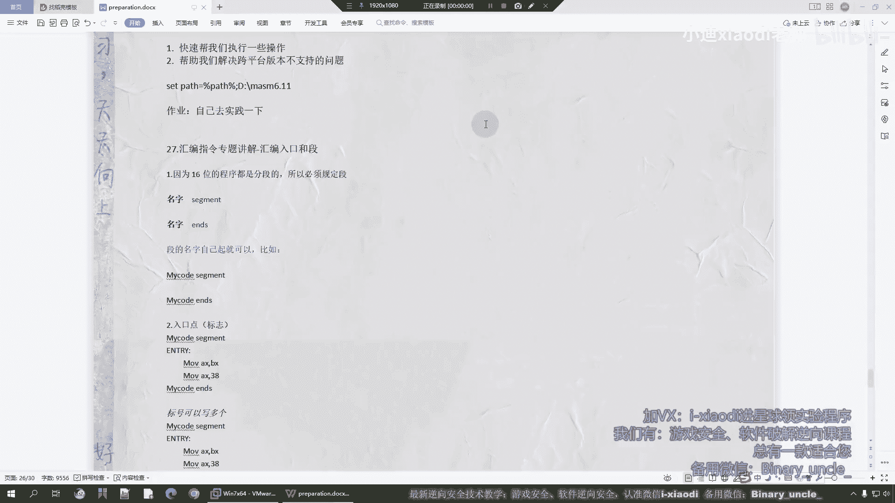
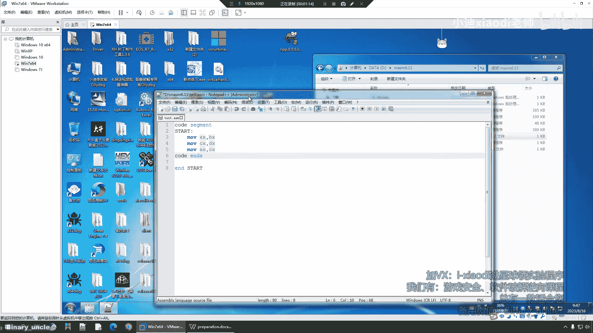
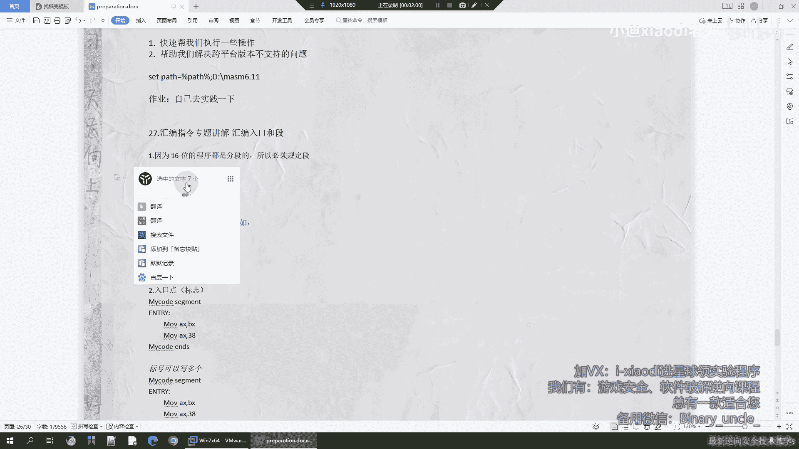
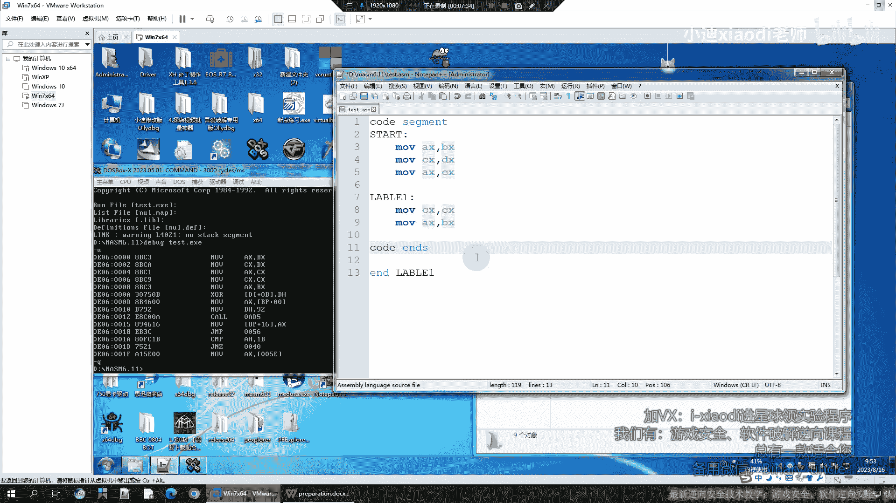
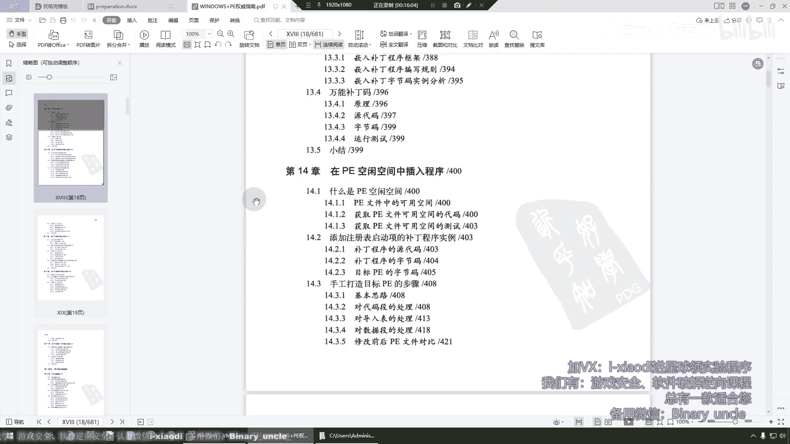

# 🛠️ 小白软件破解逆向工程师2023最新：4.27：汇编入口和段



## 📚 课程概述

在本节课中，我们将学习汇编语言程序的基本结构，重点掌握**段（Segment）**和**入口点（Entry Point）**这两个核心概念。同时，我们会安装一个非常好用的代码编辑器——Notepad++，用它来编写和查看汇编代码。通过本节课的学习，你将对汇编程序的组织方式有一个清晰的认识，为后续编写完整的汇编程序打下坚实的基础。

## 🧰 第一步：安装Notepad++编辑器

在开始今天的正式内容之前，我们首先要解决一个问题，那就是用什么工具来编写汇编代码。之前的课程中，我们可能只是简单地看了看代码，但今天开始，我们要真正动手去写程序了。工欲善其事，必先利其器，一个趁手的编辑器会让我们写代码的效率大大提高。

这个工具就是**Notepad++**，它是一个功能强大且免费的文本编辑器，非常适合编写各种编程语言的代码，尤其是汇编这种比较底层的语言。安装包的文件名是`NPP.7.95_Installer.exe`，老师已经把这个安装包上传到了知识星球，大家可以去知识星球直接下载。



下载好安装包之后，我们只需要双击这个安装程序，然后一路点击“下一步（Next）”就可以了，整个安装过程非常简单，就像安装其他普通软件一样，不需要做任何特殊设置。在安装过程中，有一个步骤会让你选择是否“Create shortcut on desktop”，也就是在桌面上创建一个快捷方式，建议勾选这个选项，这样以后打开Notepad++会更加方便。点击“安装（Install）”按钮，软件就会自动完成安装。因为老师自己已经安装过了，所以这里就不再重复演示一遍了。

安装完成之后，桌面上会出现一个Notepad++的图标，它的样子是一个带有小方块的蓝色文档图标，非常容易辨认。双击这个图标打开程序，界面就是这个样子的，一个简洁明了的文本编辑区域，上面有菜单栏和工具栏。我们可以直接把之前写好的`test.asm`汇编文件拖拽到Notepad++窗口中打开。

之前我们的代码是这样的，大家看一下，内容还是比较简单的。我们可以把代码直接粘贴到这个编辑器里面。粘贴进来之后，你会发现一个很人性化的功能，那就是你可以按住键盘左下角的`Ctrl`键，然后滚动鼠标滚轮，就可以随意调整代码的显示大小，这样不管你的屏幕分辨率是多少，都能找到最适合自己的阅读大小，非常方便，也非常人性化。



现在，我们有了一个舒适的代码编写环境，接下来就开始进入今天的核心内容，讲解汇编源代码的架构问题，也就是代码到底是怎么组织起来的。

## 📐 汇编中的段（Segment）

首先，我们来聊一聊段这个问题。在16位的汇编程序中，代码是**分段（Segment）** 的，这是由处理器的寻址方式和内存管理机制决定的。16位程序不像我们现在的32位或64位程序那样使用平坦的内存模型，而是必须把内存划分成一个个64KB大小的段，程序代码和数据都存放在这些段中。所以，在我们编写16位汇编程序的时候，首先需要做的事情就是**规定程序中有哪些段**。

规定一个段的方法非常简单，只需要使用两个关键字：`SEGMENT`和`ENDS`。`SEGMENT`翻译过来就是“段”的意思，表示一个段的开始；而`ENDS`则是一个段的结束标志。一个段的基本结构就像下面这样：

```assembly
段名 SEGMENT
    ; 这里写段的内容（代码或数据）
段名 ENDS
```

这里需要注意的是，`ENDS` 中的那个 `S` 不要漏掉，它对应的是 `SEGMENT` 这个单词的一部分，表示“段结束（End of Segment）”，我们一定要把这个结构记清楚，不能写错。

现在，我们来看一个实际的例子。在代码中，我们可以这样定义一个代码段：

```assembly
CODE SEGMENT
    ; 这里是代码的部分
CODE ENDS
```

这个用`CODE SEGMENT`和`CODE ENDS`包裹起来的区域，就是一个名为`CODE`的段。在这个段中，我们可以编写各种汇编指令。

这里其实引出了一个很有用的知识点，那就是**段的名字，其实是可以自己随意起的**。比如你完全可以写`MY_CODE SEGMENT`和`MY_CODE ENDS`，或者`ABC SEGMENT`和`ABC ENDS`。但是有个要求，那就是段名虽然可以自由起，但**前后必须完全对应、保持一致**。你上面写了`MY_CODE SEGMENT`，那么下面就必须是`MY_CODE ENDS`，不能一个叫`MY_CODE`，另一个叫`YOUR_CODE`，那样程序就会找不到段在哪里结束，编译的时候就会报错。

不过，虽然名字可以随便起，但我们还是建议用有意义的名字，这样代码的可读性会更好。比如，我们在这个段里面写的是代码，那就可以叫它`CODE`段，因为`CODE`在英文中就是代码的意思。这样以后别人看你的代码，一看段名就知道这个段是干什么用的，非常清晰。

## 🚪 汇编入口点（Entry Point）

接下来，我们来学习一个非常重要的概念——**汇编的入口（Entry Point）**。这就好比我们要去一个地方，比如去一个餐厅吃饭，肯定首先得找到这个地方的大门，然后推门进去，对吧？汇编程序也是一样的，它也需要一个入口点，这个入口点就是程序开始执行的地方，是一个程序的门牌号。

这个入口点在汇编中实际上是一个**标号（Label）**，也就是一个我们自己定义的名字，后面跟一个冒号。它的作用就是给某一条指令所在的位置做一个标记，方便程序从这里开始执行。比如：

```assembly
START:
    MOV AX, 4X
```

这个`START:`就是一个标号，它标记了后面的`MOV AX, 4X`这条指令的地址，也就是说，程序从这里开始执行。



那么，问题来了，程序中有很多个标号的话，CPU怎么知道该从哪个标号开始执行呢？这就需要另一个关键字`END`来指定了。`END`是程序结束的标志，但它的后面还可以跟一个标号，用来**指明程序的入口点**。它的使用方法是这样的：

```assembly
CODE SEGMENT
START:
    MOV AX, 4X
CODE ENDS
END START
```

你看，在程序的最后，我们写了`END START`，这就清楚地告诉了编译器：“程序从`START`这个标号处开始执行”。这个`END`和`ENDS`不一样，`ENDS`是结束一个段，而`END`是结束整个程序，并且指定入口点。这个逻辑一定要搞清楚才行。

如果程序中有多个标号，那么**只有`END`后面跟着的那个标号才是真正的入口点**。比如下面这个例子：

```assembly
CODE SEGMENT
ENTRANCE:
    MOV AX, 4X
LABEL1:
    MOV BX, AX
CODE ENDS
END ENTRANCE
```

我们有两个标号：`ENTRANCE`和`LABEL1`。但因为在`END`后面跟的是`ENTRANCE`，所以程序的入口点是`ENTRANCE`，程序会从`ENTRANCE`下面的`MOV AX, 4X`开始执行，而不会先执行`LABEL1`后面的指令。

为了让大家更加深刻地理解这个入口点的作用，我们来做一个小实验。假设我们写了这样一段代码，并且把入口点设为`START`：

```assembly
CODE SEGMENT
START:
    MOV AX, BX
    MOV CS, DS
    MOV AX, CX
LABEL1:
    MOV CX, 4X
    MOV DS, AX
    MOV AX, CX
CODE ENDS
END START
```

代码中的`LABEL1`也是一个标号，但我们没有在`END`后面写它，所以程序的入口就是`START`。当我们编译并运行这个程序，在Debug模式下查看它的汇编指令时，你会看到程序确实是从`START`标号处的`MOV AX, BX`开始的。如果我们把`END START`改成`END LABEL1`，也就是告诉编译器程序的入口改到`LABEL1`了，你会看到Debug中显示的指令变成了从`MOV CX, 4X`开始执行。这就证明了，`END`后面跟着的标号，才真正决定程序的入口在哪里。

通过这个实验，我们已经非常直观地看到了什么是程序的入口点。入口点就是程序启动时首先要运行的第一条指令的位置，它非常重要。

## 🧩 多段结构与重名段

刚才我们一直是在一个段里面做文章，那如果程序比较复杂，一个段不够用怎么办？其实很简单，**段也是可以写多个的**。

在我们的程序里，除了代码段，我们还可以定义一个数据段，用来存放数据。比如，我们可以在代码段下面再写一个`DATA SEGMENT`和`DATA ENDS`，给它起名叫`DATA`段。接下来，我们在`DATA`段里面写一些数据，在`CODE`段里面写代码，然后在代码中把数据段的地址加载到寄存器中，大概就长这样：

```assembly
CODE SEGMENT
START:
    MOV AX, DATA
    MOV DS, AX
CODE ENDS

DATA SEGMENT
    ; 数据部分
DATA ENDS

END START
```

注意，这里出现了两个段：`CODE`段和`DATA`段。你看，在同一个程序中，我们既定义了代码段，也定义了数据段。那么问题来了，`DATA`段的`ENDS`前面要加空格吗？其实这里有个细节，我们之前说过`ENDS`是对应`SEGMENT`的，所以这里的规则是：`DATA ENDS`，中间有个`ENDS`，而`SEGMENT`和`ENDS`之间的名字要保持一致，这样才表示同一个段的开始和结束。但如果你写了`DATA END`，那意义就完全不一样了，那是程序的结束，而不是段的结束。

我们把包含`DATA`段的程序编译运行一下，你会发现它完全正常，因为程序可以有多个段，CPU会根据段地址去不同的段中取指令和数据。所以，在今后编写程序的时候，你可以根据自己的需求，在程序中编写多个段，这完全不是问题。

再来探讨一个更加深入的问题：如果段的名字重名了，会出现什么情况？这个很有意思，因为**重名的段会被编译器合并到同一块内存区域中**。举个例子，有时候我们会觉得一个代码段里的内容太多了，想分开写，比如按照功能模块，把一部分代码放在一个`CODE`段里，把另一部分代码放在另一个`CODE`段里。这在汇编中是允许的吗？

我们做一个实验。复制一个`CODE SEGMENT`和`CODE ENDS`的代码块，把里面的代码作一些调整，比如把其中一段的`START`标号改成`NEW_CODE`，然后保存程序、编译并生成可执行文件，你会发现程序依然可以正常编译和运行，没有报错。这说明，重复定义`CODE`段是允许的，编译器会把这两个`CODE`段的内容合并处理。

但是，这里有个特别需要注意的地方，如果我们把两段代码中的标号都定义成`START`，并且把`END START`作为程序的入口，那么编译的时候就有可能会报错。老师也做了这个实验，当第二个代码段中也出现了`START`这个标号，编译时就会提示错误，它会指出具体的行数，比如第十三行。原因其实很简单，因为出现了两个同名的`START`标号，编译器就不知道程序的入口到底是哪一个了，就像有两个人都叫“张三”，你喊一声，他们都不知道你在叫谁，所以它就蒙圈了，于是直接报错。

这种情况下，我们只需要把其中一个`START`标号改一个名字，比如改成`START_1`，然后保存、重新编译，你会发现问题就消失了，程序又能正常运行了。所以，当你不打算用某个标号作为入口时，标号的名字可以随便起，只要不重复就行。但如果你要用它作为程序的入口点，那就要确保它是全局唯一的，不能在任何位置重复定义。

到这里，你已经了解了如何通过`END 标号`来指定程序入口，也知道了多个同名段会被合并。这些概念都是汇编语言中非常基础且重要的知识。

## 🌱 汇编的学习意义与课程总结

本节课中，我们一起学习了汇编语言程序的基本框架，重点讲解了**段定义**和**入口点**两个核心概念，并动手实践了如何安装和使用Notepad++这个方便的编辑器。

可能有些初学者会问，学这些东西到底有什么用呢？其实，这些看似基础的语法知识，是通往底层技术世界的钥匙。比如，我们可以去看一些实战的编程书籍，你会发现当你学会了汇编之后，你就可以用纯汇编语言去编写一些非常强大的工具。当你掌握的汇编知识多了之后，你就能够看懂那些书籍和资料中讲解的内容了，比如破解病毒、病毒的保护技术，还有像**反调试**、**反跟踪**、**花指令**这些，它们都和汇编指令息息相关。

这些技术无论是对于病毒的分析破解，还是对于软件的安全防护，都是非常核心的知识。再比如，假如你以后想编写一个木马或者一个文件感染型的病毒，你想弄明白它是怎么实现的，那你就必须知道这些汇编指令是怎么写的。特别是那些**加密解密**技术、**软件安装自动化**、**文件捆绑器**等等，这些高级功能背后的底层实现，都离不开汇编代码。所以，虽然我们现在学的是看似简单的段和入口，但将来它会发挥巨大的作用。

从今天起，我们就正式踏上了逆向破解之路的征程，开始乘风破浪。这些基础的语法知识就是我们的船桨，只有把基础打牢了，我们才能在这条路上走得更加稳健。



本节课的内容就到这里，我们从安装工具出发，了解了`SEGMENT`和`ENDS`的作用，搞清楚了`END`和入口点的关系，也知道了多段和重名段的处理方式。下一节课我们将会继续深入，敬请期待。
