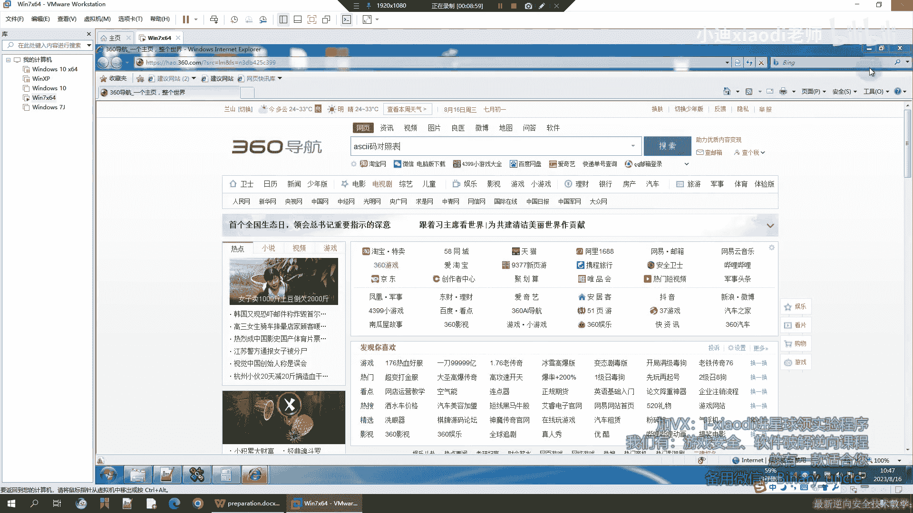

# 🧭 小白软件破解逆向工程师2023最新：4.28：汇编指令专题讲解——注释、常量、字符

本节是第28课，主要学习汇编中的注释、常量和字符。课程会先搭建一个最小程序，再说明注释怎么写、常量有哪些进制写法、字符常量如何表示，最后通过编译和查看结果来验证这些写法。本节内容比较基础，但在后续逆向分析中会反复用到，因此需要把每个细节都看明白。

## 🧱 小白软件破解逆向工程师2023最新：4.28.1：先搭一个最小程序框架

上一节的内容先放在一边，本节先从程序骨架开始。首先把以前的代码全部删掉，重新写一个程序。我们给程序一个`code`段，段名写作`segment`，这个段也叫`code`；段的结束用`ends`表示，其中`end`是英文“结束”的意思。程序骨架如下：


```asm
code segment
START:
    mov ax, 1234
code ends
end START
```

这段代码里，`code segment`表示代码段开始，`code ends`表示代码段结束。写代码之前最好先定义`START`标签，因为定义标签之后，才能说明程序的入口点是哪个标签。也就是说，程序从哪个标签开始执行，需要靠标签来指明。这里先写一行`mov ax, 1234`作为示例，表示在代码段里放一条汇编指令。这个框架虽然简单，但已经包含了段定义、入口标签和一条指令，后面所有注释、常量和字符的示例都可以放在这个框架里理解。

## ✍️ 小白软件破解逆向工程师2023最新：4.28.2：注释的写法与作用

上一节我们搭好了程序框架，本节看看注释怎么写。代码少的时候还能直接看懂，代码一多就可能需要做注解，就像做数学题或者在初高中学习文言文时，遇到晦涩难懂的内容会写上普通话解释一样，汇编代码也需要注释来说明含义。汇编中写注释很简单，用分号表示，分号后边写注释内容，作为解释说明。以下是注释的基本写法：

```asm
; 这里是入口处
; 这里是代码段
START:
    mov ax, 1234
```

注释的颜色和其他代码颜色会有区别，通常显示为绿色。注释可以写在其他位置，例如写在开头说明“这里是入口处”，也可以在上面写分号说明“这里是代码段”。注释的作用就是给程序做注解，对代码进行解释说明。需要注意，注释不是程序指令，它只是给人看的说明文字，因此分号后面的内容不会影响程序逻辑。

## 🔢 小白软件破解逆向工程师2023最新：4.28.3：常量与常见进制写法

上一节介绍了注释，本节来看常量。有常量就有变量，常量的含义是一旦使用之后就不会改变，变量的含义是使用过程中可以改变。今天先讲常量，下节课再讲变量。常量有很多类型，例如十进制、二进制、八进制、十六进制，虽然进制不同，但它们都是数据，也都是常规的数。以下是常见进制的写法：

- 十进制可以直接写成`1234`，也可以写成`1234D`，其中`D`表示十进制，`DEC`也表示十进制；在CE中随便找一个进程，显示数据后右键显示类型，可以看到`DEC`或`D`，看到它们就知道是十进制。写程序时后缀`D`可以写也可以不写，`1234D`和`1234`含义一样。


- 二进制可以写成`1011B`，后面的`B`代表bit，也就是比特位、二进制位，表示这个数是二进制。


- 八进制用`O`表示，这种写法不常用。

- 十六进制用`H`或`HEX`表示，例如`112H`，后面的`H`进一步说明它是一个十六进制数据。

- 如果十六进制数是以字母开头，前面必须加一个零，例如不能直接写`ABCH`，而要写成`0ABCH`；不加零时编辑器不会正常高亮，加上零后才会高亮。


这些进制之间可以互相转换，例如十进制和十六进制之间就有固定换算关系：$1234_{10}=04D2_{16}$，二进制和十六进制之间也可以换算：$1011_2=B_{16}$。掌握这些写法后，再看汇编代码里的数字就不会陌生。

## 🔤 小白软件破解逆向工程师2023最新：4.28.4：字符常量的表示

上一节学习了数字常量的进制写法，本节来看字符。字符也可以赋值，例如用`AL`寄存器，用单引号表示字符，把字符`A`给`AL`。字符之前讲过，它实际上对应ASCII码，因此在内存里边也是一个数，也是一个常量。以下是用单引号和双引号表示字符的示例：

```asm
mov al, 'A'
mov al, "A"
```

如果要用`ABCD`这类字符代表某些内容，也没有问题，用单引号括起来即可；双引号同样可以。字符常量看起来是字母，但在内存中仍然以数值形式存在。原文通过ASCII码对照表查看字符，小写字母`a`对应十六进制`61`，小写字母`b`对应十六进制`62`，因此字符和数值之间可以通过ASCII码建立对应关系：$'a'_{ASCII}=0x61$，$'b'_{ASCII}=0x62$。

## 💾 小白软件破解逆向工程师2023最新：4.28.5：保存、编译与结果验证

上一节说明了字符常量，本节把程序保存并编译生成，验证前面的写法。操作时可以清屏、切换目录并运行程序；程序没有报错。如果存在报错，界面会显示错误所在的行数，并出现`ERROR`一类字样。编译后查看结果，可以确认十进制`1234`在程序里默认转换成十六进制`04D2`，也就是常写的`4D2`。以下是验证时得到的结果：

- 十进制`1234`转换成十六进制是`04D2`，打开计算器`calc`，点击“查看”，选择“程序员”，输入十进制`1234`，再点十六进制，就得到`4D2`。

- 二进制`1011B`转换成十六进制是`B`，这条语句没有问题。


- `112H`作为十六进制数据没有问题。

- 以字母开头的十六进制数需要加前导零，例如`0ABCH`可以正常高亮和使用。

- 字符常量对应ASCII码，小写`a`对应十六进制`61`，小写`b`对应十六进制`62`；如果把程序里的字符改成`b`，对应数值就变成`62`。

这些验证过程可以帮助我们熟悉进制转换，也能帮助理解常量在程序中的实际表现。建议自己回去写一个程序改一改，通过反复修改来熟悉进制、`MOV`指令和计算器。

## 🧠 小白软件破解逆向工程师2023最新：4.28.6：本节复盘与重点总结

上一节完成了编译和结果验证，本节对内容做一次复盘。本节课我们一起学习了汇编中的注释、常量和字符：注释用分号表示，分号后写解释说明；常量有十进制、二进制、八进制和十六进制等写法，后缀`D`、`B`、`O`、`H`分别帮助说明进制；字符用单引号或双引号表示，本质上对应ASCII码，在内存中也是数值常量。以下是本节需要记住的要点：

- 注释用分号`;`表示，注释内容写在分号后面。

- 常量使用后不变，变量使用中可以改变，变量放在下节课讲解。

- 十进制可写`1234`或`1234D`，二进制写`1011B`，十六进制写`112H`，字母开头的十六进制数前面要加`0`。



- 字符可以用`mov al, 'A'`或`mov al, "A"`表示，字符常量的本质是ASCII码对应的数值。

- 寄存器方面，`AL`是低8位，`AH`是高8位，`AX`是完整的16位，可以写成关系式：$AX=AH:AL$。

本节到此结束，下期再见。
