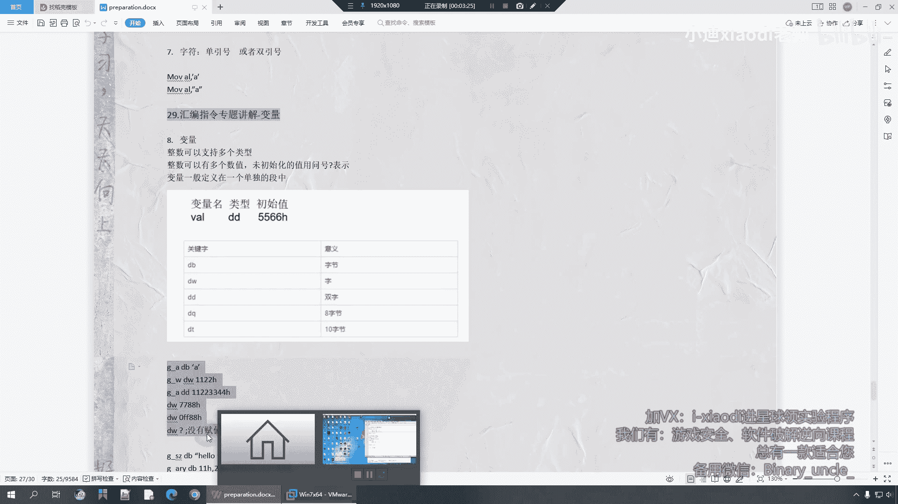
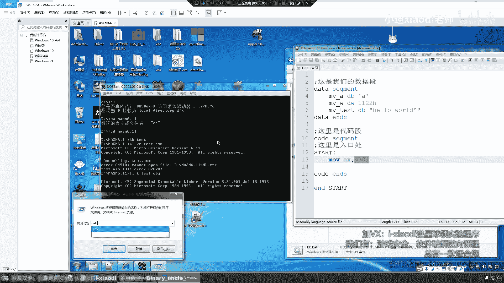
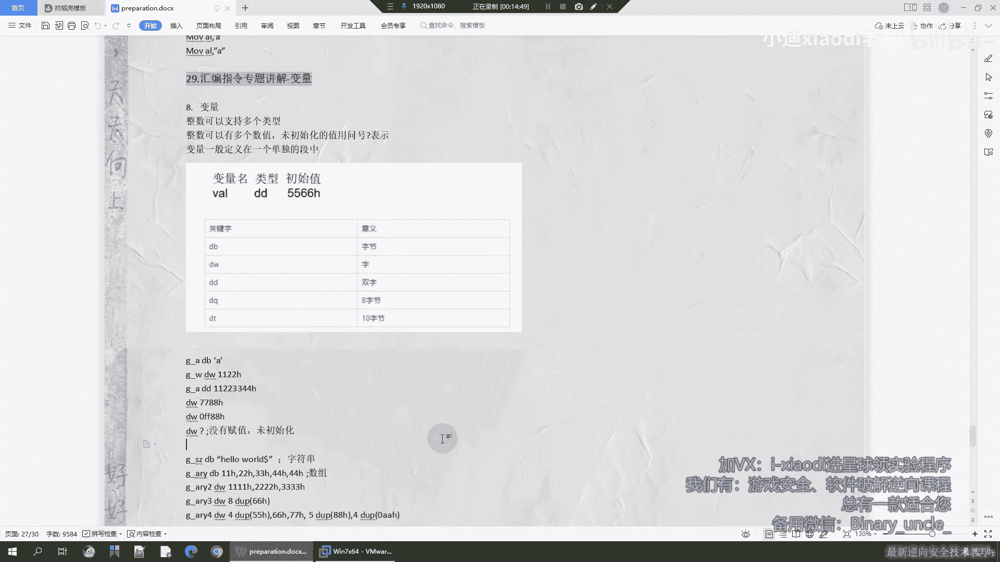

# 小白软件破解逆向工程师2023最新：29：汇编指令专题讲解-变量 🧩

在本节课中我们将要学习汇编里的变量，包括变量是什么、变量和常量有什么区别、变量如何创建、变量如何存放、如何查看变量在内存中的数据，以及如何把变量里的内容取到寄存器中使用。上节课我们讲的是常量，本节我们把视角转到可以变化的量，也就是变量。整节课会围绕一个小例子展开，先写数据段，再写变量，然后生成程序，最后用调试命令查看内存和寄存器。内容会尽量用直白的方式解释，让初学者也能跟上。

## 📌 常量与变量的区别

上节课我们讲的是常量。常量的特点是在写代码的时候一写就写死了，例如写 `1234`、`5678`，这些值在程序里固定下来，不能再变化。常量适合表示那些不需要修改的数据，理解起来比较直接。

本节要看的变量，含义就是可以改变的量。变量在使用过程中可以变化，也可以在程序执行过程中被取出、被赋值。理解常量之后再看变量，重点就从“固定值”转到了“可变化的存储位置”。下面我们先看变量的基本含义、常见类型和存放位置。

## 🧱 变量的含义、类型和存放位置

变量表示可以改变的量。它可以有不同的数据宽度，例如字节、字、双字、八字节、十字节等。对于初学者来说，不需要一开始把所有类型都用一遍，先掌握最常用的字节、字、双字即可。变量的创建可以概括为下面这个公式。

`变量 = 变量名 + 类型 + 初始值`

变量一般定义在一个单独的段里。代码放在代码段，通常叫 `code` 段；变量这种数据放在数据段，通常叫 `data` 段。数据段的基本结构如下。

```asm
data segment
    ; 变量写在这里
data ends
```

数据段里可以写入我们定义的变量。常用类型可以按数据宽度来记，下面列出本课会遇到的几种类型。

- `DB`：Define Byte，定义字节，宽度为 1 字节。
- `DW`：Define Word，定义字，宽度为 2 字节。
- `DD`：Define Doubleword，定义双字，宽度为 4 字节。
- `QWORD`、`TWORD`：分别对应八字节、十字节，本课用不到，先了解即可。

知道了变量要放在数据段，也知道了常见类型，接下来就正式看变量如何创建。创建变量时要同时考虑名字、类型和初始值，这三部分配合起来，程序才能正确理解这个数据。

## 🏷️ 创建变量：名字、类型和初始值

创建变量的基本写法是“名字、类型、初始值”。例如可以定义一个名字叫 `G_A` 的变量。这里的 `G` 可以理解为 global，表示全局；`A` 是名字的一部分。名字也可以写成 `myA` 这类形式，只要符合命名规则即可。名字不能随便使用特殊名称，普通合法的标识符没有问题。



下面是一个数据段示例，里面定义了字节变量、字变量和字符串变量。

```asm
data segment
    G_A  db 'a'
    myW  dw 1122H
    text db 'hello world$'
data ends
```

创建变量时有几条实用规则，下面简单列出。

- 变量可以没有名字，程序不一定会因此出错。
- 变量可以不初始化，不初始化时用问号表示。
- 看到 `DW ?` 或类似“类型后面跟问号”的写法，就表示这个变量没有赋值、没有初始化。

例如下面这种写法就表示变量暂时没有初始化。

```asm
myW dw ?
```

这些规则先了解并记住即可。普通变量创建之后，字符串变量还有额外注意点，本节继续看字符串如何定义和结束。



## 🔤 字符串变量和美元符号结尾

字符串变量也可以放在数据段里。例如可以定义一个 `text` 变量，用 `DB` 类型保存文本。字符串的关键点是结尾：字符串要以美元符号 `$` 结尾，表示这句话已经结束。

```asm
text db 'hello world$'
```

如果没有加上美元符号，程序就不知道字符串在哪里结束，可能一直往后读，导致程序出错。也就是说，`$` 在这里起到结束标记的作用。字符串定义好之后，需要生成程序并验证，下一节看生成过程中常见的数据宽度错误。

## ⚙️ 生成程序与数据宽度错误

写完之后要生成程序。操作时进入 DOSBox，切换到 D 盘，再切换到 `611` 这个目录，使用 `CD` 命令进入对应位置，然后生成程序。生成过程中曾出现第 13 行报错，问题出在类似 `mov al, 1234H` 这样的代码上。

```asm
mov al, 1234H
```

`1234H` 是两个字节的数据，而 `AL` 只有 1 字节，放不下这个值，所以会出错。这里可以用 `CLC` 做计算演示，帮助理解数据宽度。正确的做法是使用能够容纳两个字节的寄存器，例如 `AX`。

```asm
mov ax, 1234H
```

示例中曾忘记修改，所以第 13 行报错；修改后程序就没有问题。放数据时一定要注意数据宽度和数据大小，否则容易出问题。程序生成成功之后，还需要查看变量是否真的进入内存，接下来用调试命令查看内存。

## 🔍 查看变量在内存中的数据

使用 `-d` 可以查看内存。程序入口在 `107` 时，直接查看不一定能看到前面的数据，因为数据段需要往前放。可以把数据段往前走到 `100` 的位置，再使用 `-d 100:0000` 查看。

```text
-d 100:0000
```

执行查看后，可以从结果里确认下面几件事。

- 定义的字符数据能在内存中看到，示例中看到 `61`，对应定义的字符 `A`；具体数值会因大小写和实际写法不同而变化。
- `1122H` 在内存中按小端方式显示为 `22 11`，按双字节读仍然是 `1122H`。
- `hello world` 也能在内存中看到，说明字符串确实写进了内存。

这些变量数据实实在在存在于内存里，是肉眼可见的。内存的排列也遵循先来后到的原则：上面写的变量靠前，下面写的代码靠后。理解了这个顺序，再看如何把变量内容取到寄存器，就更容易了。

## 📥 取变量内容并设置数据段

接下来做取内容的实验，也就是调用数据。例如想把变量 `myW` 的内容取到 `AX`，可以写 `mov ax, myW`。

```asm
mov ax, myW
```

但只写这一句时，生成程序可能在第 13 行报错，提示找不到相关内容。原因是程序还不知道谁是数据段。虽然代码里写了数据段，但程序本身不知道这个段就是数据段，所以需要告诉程序。

告诉程序的方法是使用 `assume`，假设某个段是数据段，然后通过寄存器中转设置 `DS`。示例代码如下。

```asm
assume ds:data
mov ax, data
mov ds, ax
mov ax, myW
```

不能直接写 `mov ds, data`，因为 `DS` 是段寄存器，段寄存器比较特殊，不能直接用这种方式赋值。需要先把 `data` 给 `AX`，让 `AX` 作为中转，再把 `AX` 给 `DS`。这样操作之后，程序才知道 `data` 是数据段，也就真正拥有了数据段。有了数据段之后，再取变量内容就不会报错。

保存并重新生成后，程序没有 error。用 `-r` 查看寄存器，可以看到 `DS` 等值能够对应；继续用 `-t` 单步执行，`AX` 会从 0 开始变化，依次出现类似 `E06`、`106`，最后变成 `1122`。这说明变量是在代码执行过程中才被赋值、才被取出来的。当执行到对应代码行时，变量里的数据才会进入寄存器。不同调试环境显示的具体中间值可能有差异，核心是观察变量在单步执行时被取出。

## 📏 再次提醒寄存器宽度和变量类型

还要注意数据宽度和寄存器宽度要匹配。例如变量要取到 `AL` 中，就应该定义成 `DB` 类型，因为 `AL` 是 1 字节寄存器。数据宽度不要搞错，否则容易出现放不下或取值不完整的问题。

```asm
data segment
    myB db 'a'
data ends
```

测试时可以先用 `-q` 退出，再重新加载程序，用 `-r` 查看寄存器，用 `-t` 单步执行。执行后 `AL` 可能变成 `61`，这个 `61` 对应示例中的字符 `A`，上节课也看过 `61` 和字符 `A` 的关系。通过这个测试，可以再次体会变量类型、寄存器宽度和实际数据之间的对应关系。

## 🧾 总结



本节课中我们一起学习了汇编里的变量。我们知道了常量是写死的值，而变量是可以改变的量；变量创建的基本形式是“变量名、类型、初始值”；常见类型包括 `DB`、`DW`、`DD` 等；变量通常放在 `data` 数据段中；变量可以没有名字，也可以不初始化，类型后面的问号表示未赋值；字符串要以 `$` 结尾；生成程序时要注意数据宽度，`AL` 放不下的数据要用 `AX` 等更宽的寄存器；查看内存时可以用 `-d 100:0000` 看到变量数据；取变量内容前要使用 `assume` 和 `DS` 设置数据段，并且不能直接给段寄存器赋值，需要借助 `AX` 中转；通过 `-t` 单步执行，可以观察变量在程序运行过程中被取出。字符串数据已经能在内存中看到，真正使用字符串的方法后续还会继续讲；数组将在下节课简单了解。下节课再见。 
