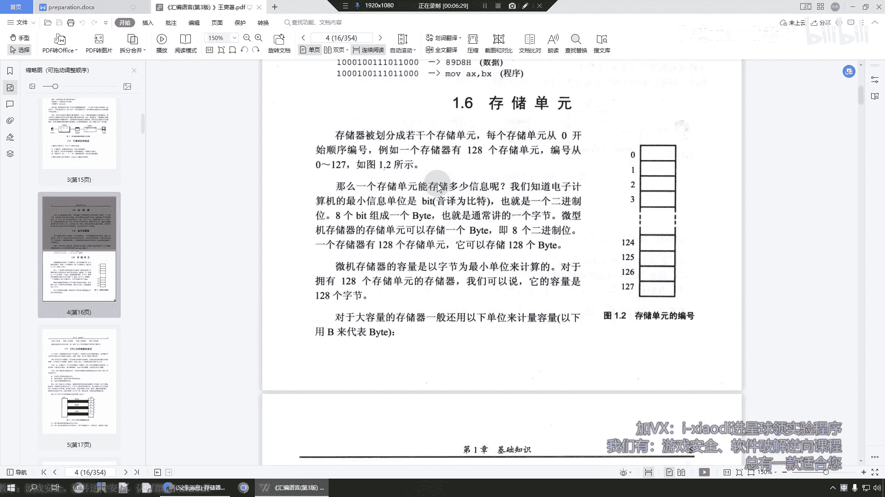
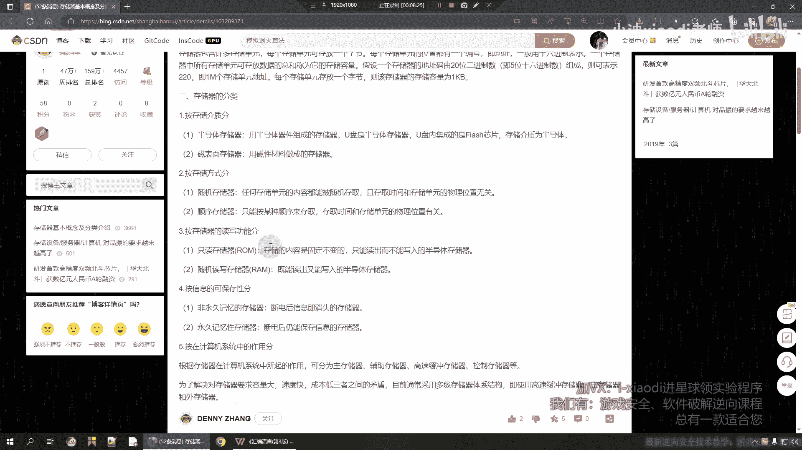
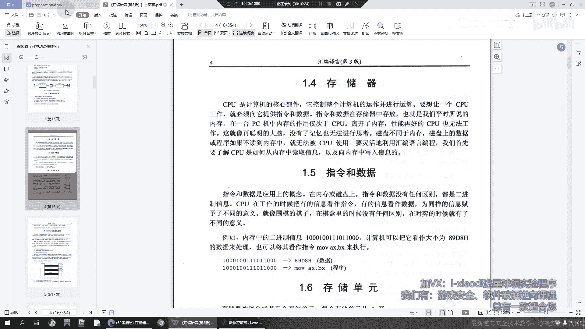

# 📚 小白软件破解逆向工程师2023最新：4.3：基础知识串讲：存储器、指令和数据、存储单元

在本节课中，我们将要学习计算机底层三个基础概念：存储器、指令和数据、存储单元。我们会弄清楚CPU到底是什么、指令和数据到底存放在哪里、存储单元是怎么划分的，以及容量单位之间如何换算。除此之外，我们还会实际打开x64dbg，亲眼看看内存中的一个字节长什么样子。这些知识虽然看起来偏理论，但都是后面做逆向分析时天天都要用到的基础。课程内容对应教材的1.4章节，让我们正式开始。

## 🧠 CPU：计算机的核心部件

教材一上来就指出，CPU是计算机的核心部件，它控制整个计算机的运作，并且进行运算。那么CPU到底是什么东西呢？大家可能从来没有亲眼见过CPU，这里提前给大家展示一下。比如说有一块板子，这块板子是一个单片机的板子，那么上面哪一块是CPU呢？答案就是这一块。这块CPU对整个设备进行控制，包括这个屏幕在内，所有外设都由它统一调度。

如果你把这块CPU拆下来观察，它大概是这个样子的：芯片四周伸出很多细长的金属线，这些线有一个专门的名称，不叫线，而叫引角。关于引角的详细解释，我们下节课再展开，这节课先简单了解一下。所谓引角，就是一个一个的针脚，CPU通过它们从外部读取信息，或者把数据写入外部设备。为什么需要这么多引角呢？因为CPU分为输入端和输出端，有输入就有输出，有进就有出，这样才能构成一个完整的计算机设备。也就是说，一台设备既能接受数据，也能输出数据，这才是合格的计算设备。这就是CPU，一个看起来很小块的芯片，却是计算机的核心部件，相当于人的大脑，控制整个计算机的运作并进行运算。

## 📥 指令和数据：从哪里来、存在哪里

既然CPU要工作，我们就需要给它提供指令和数据。那么问题来了，指令和数据总得有个地方存放吧？你让CPU处理一些数据，总得告诉它处理谁、数据在哪里放着。这里打一个比方：数据就像水，存放在杯子里，杯子就是存放数据的地方。那么在真实的硬件设备中，指令和数据到底放在哪里呢？答案就是存储器。

存储器这个东西，实际上就是我们平时常说的内存。内存这个词大家应该经常听到，电脑内存的作用仅次于CPU。离开了内存，性能再好的CPU也无法工作，因为它没有要处理的东西，也没有要思考的问题，那就等于废掉了，就像得了老年痴呆一样。所以整个流程可以这样理解：CPU负责处理指令和数据，指令和数据存放在存储器中，而存储器实际上就是内存。大家能把这个流程顺下来，就足够了。

## 🔢 指令和数据的本质：都是零和一

接下来我们细说指令和数据。指令和数据是应用层面上的概念，在内存或者说磁盘上，指令和数据没有任何本质区别，它们都是二进制数据。什么是二进制？就是只有零和一两种数字。在内存中查看数据的时候，你会看到一大堆十六进制数字，比如某些内容看起来像数据，实际操作中它的确就是数据。而另外一些内容，比如第二行显示的字节，你光看零和一根本看不出它到底是数据还是代码。只有经过翻译之后，你才发现它实际上是一段代码。所以从本质上来说，指令和数据在存储层面没有任何区别，都是二进制。

但是在执行的时候，两者就有区别了。在代码运行的过程中，有的信息会被看作指令，有的信息会被看作数据，这正是CPU强大的地方。CPU可以把一串特殊的零和一当作指令来执行，也可以把另一串零和一当作普通数据来处理。因此，在内存中以二进制形式表示的内容没有区别，全都是数据。但是，有一部分数据是可以执行的，这种可以执行的东西，就叫做代码。记住指令和数据的本质：本质上没有区别，但在CPU执行的时候有区别。

## 🗂️ 存储单元：内存的基本单位

前面说了，存储器就是用来存东西的。存储器可以被分成若干个存储单元，所谓若干个，就是说存储器是被划分成很多很多个小单元的，每个小单元就是一个存储单元。举个例子，假设有一个存储器，它一共有128个存储单元，那么这些存储单元就有编号，这个编号实际上就是内存地址。内存地址从几开始编号呢？答案是从零开始，这一点是确定的。128个存储单元，编号就是0到127，而不是1到128，这是需要记住的规律。

那么一个存储单元能存多少信息呢？一个存储单元能存一个字节。字节的英文是Byte，简写为B。大家在笔记上记下这个结论：一个存储单元就是一个字节。无论多么强大的存储器，无论它的容量有多大，它的基本单位都是存储单元，而一个存储单元就是一个字节，也就是8个二进制位。关于二进制位具体怎么计算，我们后边会单独开一节计算课来讲，这里先记住结论即可。这意味着，如果一个存储器有128个存储单元，那么它就能存储128个字节。不管是微机存储器还是其他任何存储器，现在都是以字节为最小单位来计算容量的。所以对于拥有128个存储单元的存储器，它的容量就是128个字节。

## 📐 容量单位换算

下面来看容量单位之间的换算关系，这是存储器相关的基础知识。换算规则其实非常简单，核心就一句话：相邻两个单位之间都是1024倍的关系。以下是常见的存储容量单位换算公式：

```text
1KB = 1024B
1MB = 1024KB
1GB = 1024MB
1TB = 1024GB
```

这里需要说明一下，B就是Byte，也就是字节。这些换算关系在计算机领域非常常见，大家看着眼熟就行，不用刻意去死记硬背。反正1024这个数字在计算机或者说编程里边是一个出现频率很高的东西，见多了自然就记住了。

## 🧩 存储器的分类详解



讲到这儿，有些同学对存储器可能还是比较模糊，脑海中对存储器这个概念没有具体的形象。这里我引用网上一个帖子，这个帖子写得非常详细，帮助大家加深理解。

存储器就是计算机系统中的记忆设备，用来存放程序和数据，这就是存储器的定义，它的英文单词是memory。计算机的全部信息，不管多么杂乱，全部都放在存储器里边。接下来我们主要看它的分类，以下是根据不同维度对存储器的分类：

- 按存储介质划分，存储器分为半导体存储器和磁表面存储器。比如U盘，U盘内部集成的是Flash闪存芯片，它的存储机制就是半导体。所以说当你想不到存储器是什么东西的时候，就想想U盘。不管U盘具体属于哪种存储器，反正它就是一种存储器，因为它可以存东西。除了这个维度，还有随机存储器和顺序存储器的划分，不过这个我们先不管，后边用到再说。
- 按读写方式划分，有只读存储器和随机读写存储器。只读存储器的特点是存储内容固定不变，只能读出而不能写入，这是一类只能读不能写的半导体存储器，确实有一些设备就是这样的。与之相对的，还有既能读又能写的半导体存储器，这就是我们计算机所用的类型。大多数设备使用的都是这种既能读又能写的存储器。
- 按断电后信息是否保留划分，有非永久记忆和永久记忆两类。非永久记忆的存储器断电之后信息就消失了，停电就没了。永久记忆的存储器断电之后信息仍然保存，比如硬盘就是这种类型。

以上这些分类内容，大家大概了解一下就可以了。这个帖子的链接会发到星球里面，感兴趣的同学可以自己去看。另外像CF卡、SM闪存卡、SD闪存卡这类东西，大家先了解一下就好，因为它们大部分属于硬件层面的东西，相关资料我也会发到星球里。

## 🔬 实例演示：用 x64dbg 查看内存字节

理论讲了这么多，我们实际操作一下，看看字节在内存调试工具中到底是什么样的。下面使用x64dbg这个工具来做演示，具体操作步骤如下：



1. 打开x64dbg，加载一个目标程序。
2. 点击内存窗口，切换到内存查看界面。
3. 切换显示格式为十六进制。

切换完成之后，你会看到内存中的数据按字节排列。在界面上，每四个字节被划为一组显示，比如某一组显示的四个字节，它们就是4个字节。所以我们在x64dbg里看数据的时候，看到的全部都是以字节为单位的内容。在我们做逆向分析的时候，同样也是以字节为单位来查看和操作的。再往上看左边这一列，比如55这一个字节，8B 1这是两个字节，6A FF这也是两个字节，总之界面上显示的内容全部都是以字节为单位的。

那么左边这一列字节是不是数据呢？它实际上是数据，但是这些字节又可以被翻译成代码。例如55 8B 1这一段字节，被CPU翻译成了push BP这样的汇编指令。所以说，本质上大家都是数据，但是有些数据可以被CPU看作代码来执行，这些代码本来就是代码，生来就是可以执行的。而另一些数据则单纯只是数据而已。这就是指令和数据的关系：本质没有区别，区别只在于CPU怎么看待它们。

## 📝 本节课重点总结

本节课中我们一起学习了存储器、指令和数据、存储单元这三个基础概念。现在把重点内容再梳理一遍，以下全是本课的核心考点：

- 存储器的最小单位是B，也就是字节，不管多么强大的存储器，基本单位都是字节。
- 容量换算要眼熟：1KB = 1024B，1MB = 1024KB，1GB = 1024MB，1TB = 1024GB。
- 内存地址从零开始编号，无论多么强大的存储器，地址都是从0开始的。
- 指令和数据在内存和磁盘上没有任何本质区别，都是零和一；但其中一部分可以被看作数据，另一部分可以被看作代码。
- CPU的外观特点是带有引角，引角分为输入端和输出端，负责从外部读写信息。
- 在x64dbg中查看内存时，一切内容都以字节为单位显示，逆向分析时也是以字节为基本单位。



回去之后，大家可以好好理解一下这些概念，尤其是存储单元和地址编号这两块，后面学习逆向分析时会经常用到。这节课的内容就到这里，我们下期再见。
