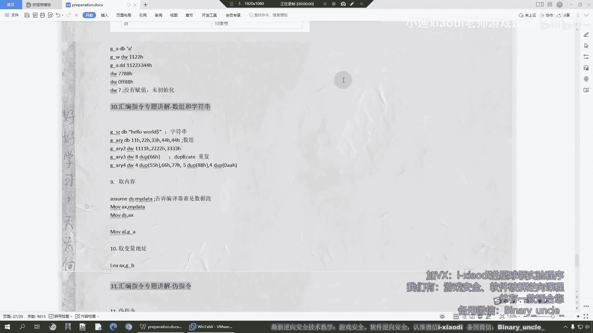
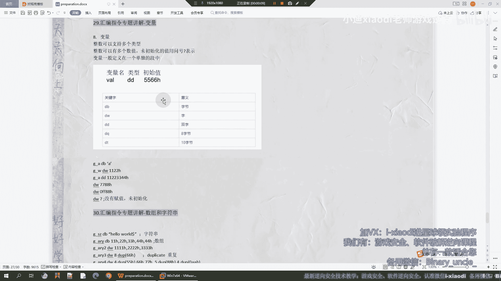
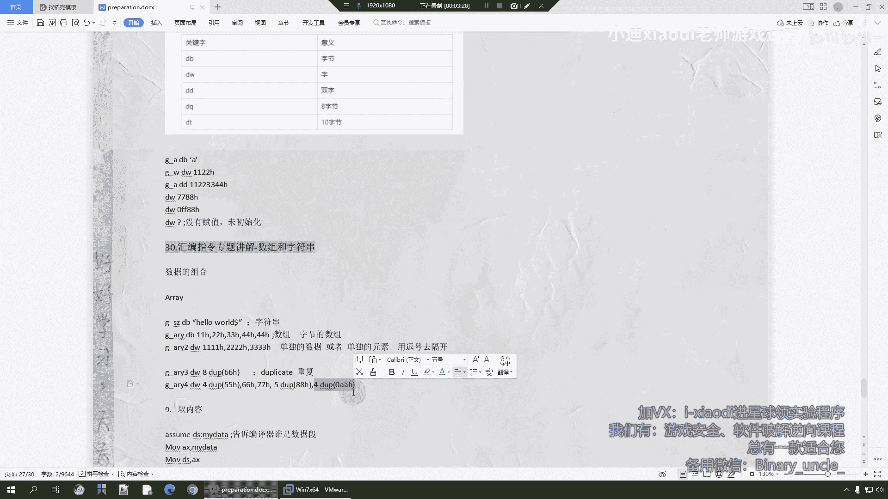
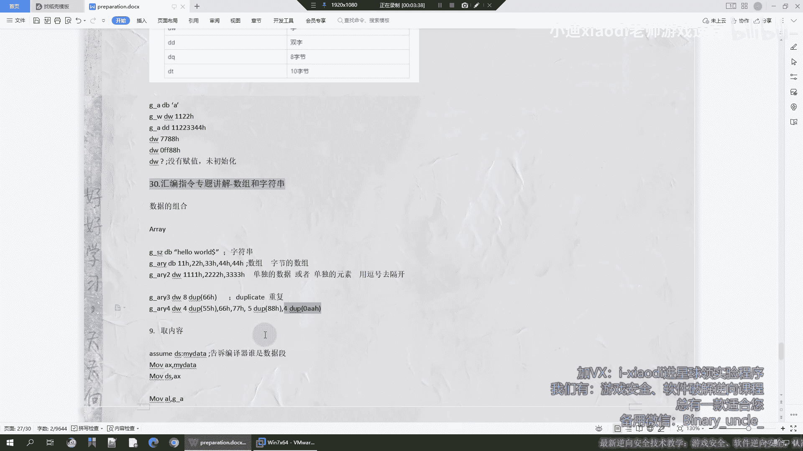

# 🧩 小白软件破解逆向工程师2023最新：4.30：汇编指令专题讲解数组和字符串




## 📌 小白软件破解逆向工程师2023最新：4.30.1：课程概述


在本节课中，我们将要学习汇编指令专题中的数组和字符串。本课是第三十课，对应的视频编号为 BV1r8411975e。上一节课我们介绍了变量的一些初始化方式，以及变量如何赋值；本节中我们来看看数组和字符串。字符串在上一节课其实已经提到过，但今天特意把它和数组放到一起讲，因为这两者在底层联系很紧密，理解其中一个有助于理解另一个。下面我们先从字符串的样子入手，再逐步过渡到数组定义、变量地址，以及动手练习。


## 🍡 小白软件破解逆向工程师2023最新：4.30.2：字符串和数组的基本概念


我们首先观察一个字符串。例如 `"HELLO WORLD$"` 由 HELLO、WORLD 以及一个美元符号组成，这个美元符号用于表示字符串结尾。它实际上由一个个字符构成，是一个个字符的组合，也就是字符的集合。因此字符串可以理解为“一串字符”，像糖葫芦一样，一串山楂串在一起。这里的措辞是字符串，强调它是一串字符，而不是单独一个字符。




理解了字符串是由字符串起来之后，数组就比较好理解了。数组的简单定义就是数据的组合。字符串是单个字符的组合，组合之后成为字符串。核心关系可以用下面的公式表示。


\[
\text{数组} = \text{数据的组合},\qquad \text{字符串} = \text{字符}_1 + \text{字符}_2 + \cdots + \text{字符}_n
\]


也就是说，字符串可以看成一种特殊的数组，它的元素是字符。字符串在数组中比较特殊，它有专门的名词叫“字符串”。接下来我们看看纯数据数组，以及字符串在数组大类中的位置。


## 🔢 小白软件破解逆向工程师2023最新：4.30.3：纯数据数组与DUP重复定义


在数组这个大类里，字符串是字符数组，而纯数据数组存放的是字节、字等数据。`ARRAY` 是英文单词，意思就是数组；例如 `global_ARY` 这种名字中的 ARY、ARRAY 都表示数组含义。有的同学可能不熟悉这个英文单词，记住它表示“数组”即可。下面按元素类型列出几种常见数组定义方式，方便初学者对照。


- 字节数组使用 `byte` 或 `db` 定义，每个元素占一个字节。无论写成 `11H`、`22H` 还是 `33H`，其中的 H 只是十六进制标记，每个元素仍然是单个字节。


- 字数组使用 `word` 或 `dw` 定义，原文把它叫作双字，也就是两个字节。每个元素占两个字节，元素之间用逗号隔开。


- 重复数组使用 `DUP` 定义，`DUP` 是 duplicate 的缩写，翻译过来就是重复。例如 `8 DUP(66H)` 表示 8 个十六进制的 66H。


- 混合数组可以把普通元素和 DUP 重复元素混在一起写，不同部分之间用逗号隔开，这种写法在实际汇编代码中很常见。


下面是字节数组和字数组的定义示例。


```asm
global_ARY db 11H, 22H, 33H
array2     dw 1111H, 2222H, 3333H
```




在上面的字节数组里，每个单独的数据或者单独的元素都是字节，单位是字节；在字数组里，每个元素都是 word，也就是两个字节。写数组时，单独元素之间要用逗号隔开。理解了普通数组之后，我们再看重复定义数组和混合定义数组。




```asm
global_array3 dw 8 DUP(66H)
G_DW          dw 4 DUP(55H), 6677H, 5 DUP(88H), 4 DUP(0AAH)
```


`global_array3` 是 word 数组，其中 `8 DUP(66H)` 表示 8 个 66H，也就是 8 个十六进制的 66。`DUP` 不仅可以单独使用，还可以和普通元素混着用；例如先写 4 个 55H，再写一个 6677H，再写 5 个 88H，再写 4 个 0AAH，这样写没有问题。数组里最特殊的就是字符串，因为字符串本质上是字符的数组。了解了数组定义之后，本节我们来看看如何取变量的内存地址。


## 🧭 小白软件破解逆向工程师2023最新：4.30.4：使用LEA取变量内存地址


变量最终都放在内存中，数据和代码都放在内存里，因此变量中的数据也可以查看它的内存地址。取地址使用 `LEA` 指令，`LEA` 的意思就是取地址。基本用法可以用下面的公式描述。


\[
LEA\ \text{寄存器},\ \text{变量} \quad \Rightarrow \quad \text{取得该变量的内存地址}
\]


例如我们定义了 `myA`、`myW`、`myTest` 这几个变量，可以查看它们的内存地址。先看 `myA`，保存代码后进入调试环境，用查看命令观察地址。执行 `LEA AX, myA` 后看到地址为 `0000`，说明 `myA` 这个 byte 变量的内存地址是 0，也就是从 0 开始，程序也从 0 开始布局。接着看 `myW`，它不出意外应该从 1 开始，因为 `myA` 占一个字节，地址向下推进后 `myW` 的地址就是 1。


再看 `myW` 的类型，它是 word，占两个字节；而 `myA` 是 byte，占一个字节。可以先用公式算一下地址关系。


\[
addr(myW)=addr(myA)+1=1
\]


查看 `myW` 的地址，结果就是 1。接下来看 `myTest`，可以先在心里猜一个答案，再和实际结果对照。`myA` 占一个字节，`myW` 占两个字节，两者加起来是三个字节，因此 `myTest` 应该从第三个字节开始，也就是内存地址为 3 的位置。继续用查看命令确认，地址果然是 3。这个地址就是 `myTest` 这个字符串变量的内存地址。对应公式如下。


\[
addr(myTest)=addr(myA)+1+2=3
\]


到这里，今天的内容可以先简单了解。数组部分需要自己动手写一下，这里不代写，因为数组写法和字符串其实差不多。可以随便粘贴一个数组定义过来，保存后查看能否生成成功；原文演示中生成成功没有问题。也可以再添加一个定义继续尝试。自己动手写一遍，比只看更容易掌握。


## ✅ 小白软件破解逆向工程师2023最新：4.30.5：课程总结


本节课中我们一起学习了汇编指令专题里的数组和字符串。我们知道了字符串由一个个字符组合而成，美元符号可以表示字符串结尾；数组是数据的组合，字符串是特殊的字符数组。我们还学习了 byte 数组、word 数组、`DUP` 重复定义以及混合定义数组的写法。随后我们使用 `LEA` 指令查看变量地址，并通过 `myA`、`myW`、`myTest` 的例子理解了 byte 占一个字节、word 占两个字节，以及变量地址如何依次推算。最后我们说明数组练习要自己动手写，保存后检查能否生成成功。下期再见，拜拜。

