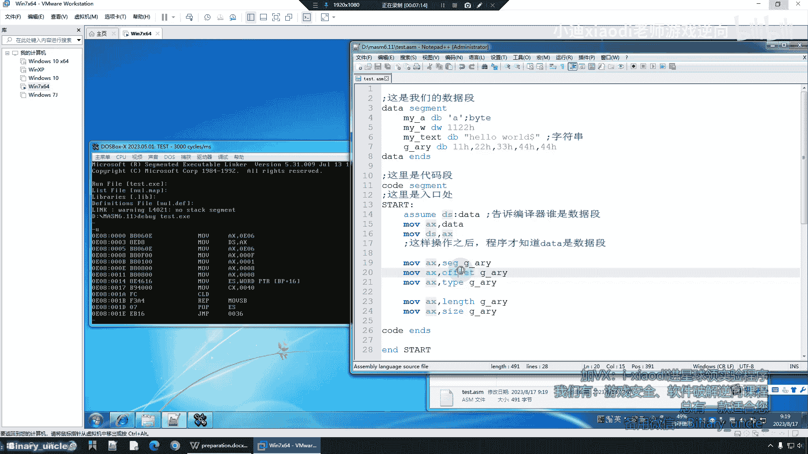

# 🧩 小白软件破解逆向工程师2023最新：4.31：汇编指令专题讲解——伪指令


在本节课中我们将要学习汇编指令专题中的伪指令，重点理解 `SEG`、`OFFSET`、`TYPE`、`LENGTH`、`SIZE` 这些标记的作用。伪指令看起来像指令的一部分，但它本身不是一条真正执行的指令，而是用来描述变量属性或辅助编译器工作的内容。我们还会结合代码和内存查看过程，验证这些属性的取值方式，并说明其中哪些属性好用、哪些属性存在局限。

## 📌 小白软件破解逆向工程师2023最新：4.31.1：伪指令是什么

上一节内容已经进入汇编指令专题，本节中我们来看看伪指令的基本概念。伪指令里的“伪”代表假的、不是真的，因此伪指令不是真正独立执行的一条机器指令。比如有类似 `MOV AX, G_V3` 的写法，假设我们定义了一个数组，按正常道理来说，这个数组不能直接复制过来，或者说在原本情况下，它好像是一条完整的指令。`SEG` 这样的东西更像一个辅助性的、附加性的内容，它可以附加在变量或数组前面，用来取得变量的某种属性。

以下是伪指令中常见的附加属性，我们先从整体上认识它们。

- `SEG`：获取数组的段基值，例如把数组的段基值给到 `AX`。
- `OFFSET`：获取数组的段偏移，例如 `OFFSET G_V3`，它相当于一个附加性的东西。
- `TYPE`：查看数组的类型，`type` 是种类、类型的意思，英文单词就是 type。
- `LENGTH`：获取数组元素的个数。
- `SIZE`：获取数组的总大小。

这里以 `G_V3` 为例，它是 date 段中的 byte 字节数组。`byte` 表示字节，因此可以通过 `TYPE` 获取这个 byte 类型的大小。不管取得的是数组的段基值、数组的段偏移，还是数组类型 byte 的大小，这些内容都可以理解为变量的属性。后边还有 `LENGTH` 和 `SIZE` 两个属性，它们分别获取数组元素个数和数组总大小，但这两个属性不好用，我们待会结合代码来看。

## 🏗️ 小白软件破解逆向工程师2023最新：4.31.2：程序入口与数据段

上一节我们说明了伪指令和常见附加属性，本节中我们来看看程序入口和数据段的设置。程序入口位于 code 段，`start` 是程序的一个入口。程序中还需要告诉编译器谁是数据段，做法是把 `date` 给到 `AX`，再把 `AX` 给到 `DS`，这样之后程序就知道 `date` 段是数据段了。

以下是设置数据段的基本代码形式，它体现了数据段地址装入 `DS` 的过程。

```asm
start:
    mov ax, date
    mov ds, ax
```

在上边我们还定义了一个数据段，数据段里边有 4 个数据项，原文中出现了 `AW`、`tt`、`aree` 等名称。其中 `tt` 和 `aree` 两个都是数组，都可以理解为数组，只不过它们比较特殊，它们是字符串。因为是字符串，所以本质上是字符的数组，而字符是 byte 类型，因此它们是 byte 数组。

## 📍 小白软件破解逆向工程师2023最新：4.31.3：SEG 取段基值

上一节我们看了程序入口和数据段，本节中我们来看看 `SEG` 如何取得段基值。在 `G_V3` 前面加上 `SEG`，意思就是查它的段基值，得到它的段基值。这个段基值有点像把 `DS` 里的内容给到 `AX` 的过程。因为在 16 位程序中，地址都是由段基值和段偏移构成的，左边是段基值，右边是段偏移。

以下是 `SEG` 取段基值的示意代码，以及 16 位地址的构成公式。

```asm
mov ax, seg G_V3
mov ds, ax
; 16 位地址 = 段基值:段偏移
```

我们把这个程序生成一下，程序生成没有问题。用 `U` 命令查看，首先 `date` 数据段被标记出来，`0106` 给到 `AX`，然后 `AX` 再给到 `DS`，这样就得到段基值，实际上这个段基值就是 `0106`。再看它怎么取：`SEG G_V3` 给到 `AX`，对应的是这里，上面我们看到的是段基值，这边就是段基值，没有问题，因此段基值就取到了。

## 🧭 小白软件破解逆向工程师2023最新：4.31.4：OFFSET 取段偏移

上一节我们通过 `SEG` 取得了段基值，本节中我们来看看如何取段偏移。取段偏移可以使用 `OFFSET G_V3`，数据在内存中都是顺着存放的。也就是说，`A` 这类数据按一个字节、两个字节、三个字节的顺序排列。具体每个数据占几个字节这里不逐一查，我们直接去内存里边看。

以下是查看内存时观察到的结果，它们能帮助我们理解偏移的位置。

- `61` 对应字符 `A`。
- `1122` 对应数值 `112`。
- 内存中出现 `hello world`。
- 内存中出现 `11223344H`，其中能看到 `44`。
- 在 `00123456789ABCDEF` 这样的内存行中，偏移了 `F` 个字节，因此 `OFFSET` 对上了这个 `F`。

查看内存可以使用 `d` 命令，例如查看从 `0106` 开始的内容，因为 `0106` 是数据段，说明数据都在这一块存着。我们看 `G_V3` 从哪里开始，口述中读作 `0E06` 的段基值对应这里，然后偏移了 `F` 个字节，所以 `AX` 里的 `F` 对上了，`OFFSET` 也对上了。

## 🧮 小白软件破解逆向工程师2023最新：4.31.5：TYPE 取类型大小

上一节我们验证了段偏移，本节中我们来看看 `TYPE` 获取类型大小的作用。`TYPE` 也对上了，`G_V3` 是 byte 类型，byte 是字节，单个字节就是一个字节，因此 `TYPE` 得到的就是一个字节。

以下是 byte 数组类型大小的公式表达，它说明单个 byte 元素的类型大小。

```text
TYPE(byte 数组) = 1 字节
```

到这里，段基值、段偏移和类型大小都能对应上。不过要注意，后边两个属性对不上，使用起来有问题，这两个属性就是 `LENGTH` 和 `SIZE`。

## ⚠️ 小白软件破解逆向工程师2023最新：4.31.6：LENGTH 与 SIZE 的局限

上一节我们确认了 `TYPE` 的取值，本节中我们来看看 `LENGTH` 和 `SIZE` 为什么不好用。`LENGTH` 和 `SIZE` 虽然分别表示获取数组元素个数和数组总大小，但实际使用中存在 bug，不推荐使用，暂时不要用。

以下是修改数据的示例，把原来的 `11` 改成 8 个 `DUP(11)`。

```asm
; 原数据项中的 11 改为：
8 DUP(11)
```

保存程序后再用 `U` 查看，这个时候 8 就出来了。因此这个东西使用起来有点 bug。原因是你只有以这样的形式去编写时，才会把第一个数据或者第一个元素搞出来，但后边还有元素。所以获取到的长度并不是真实的长度，获取到的大小也不是真实的大小，只是第一个元素的。如果什么都不写，第一个元素肯定就是一个；如果写了 8 个并重复 `11`，那肯定就是 8 个。因此它有点 bug，有点问题，简单了解即可。

> 注意：`LENGTH` 和 `SIZE` 在这里不推荐依赖，重点应关注 `SEG`、`OFFSET`、`TYPE` 这三个属性。



## ✅ 小白软件破解逆向工程师2023最新：4.31.7：本节总结

上一节我们说明了 `LENGTH` 和 `SIZE` 的局限，本节中对整课内容做总结。重点要关注的是 `SEG`、`OFFSET`、`TYPE` 这三个属性。我们在写代码的时候可以带上这样的标记，可以带标记。本节课中我们一起学习了伪指令的基本含义，理解了伪指令不是真正执行的指令，而是辅助描述变量属性的内容；还学习了 `SEG` 取段基值、`OFFSET` 取段偏移、`TYPE` 取类型大小，以及 `LENGTH` 和 `SIZE` 在实际使用中的问题。下一节将讲解堆栈相关专题，我们下一节再见。
