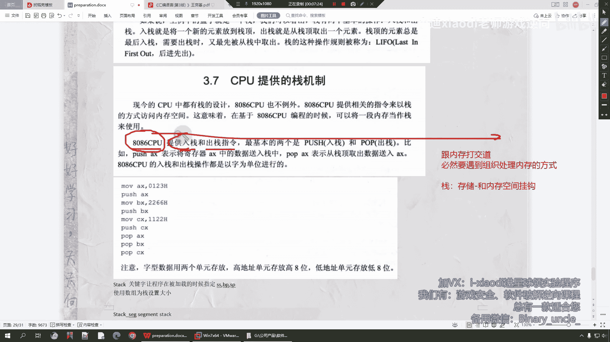
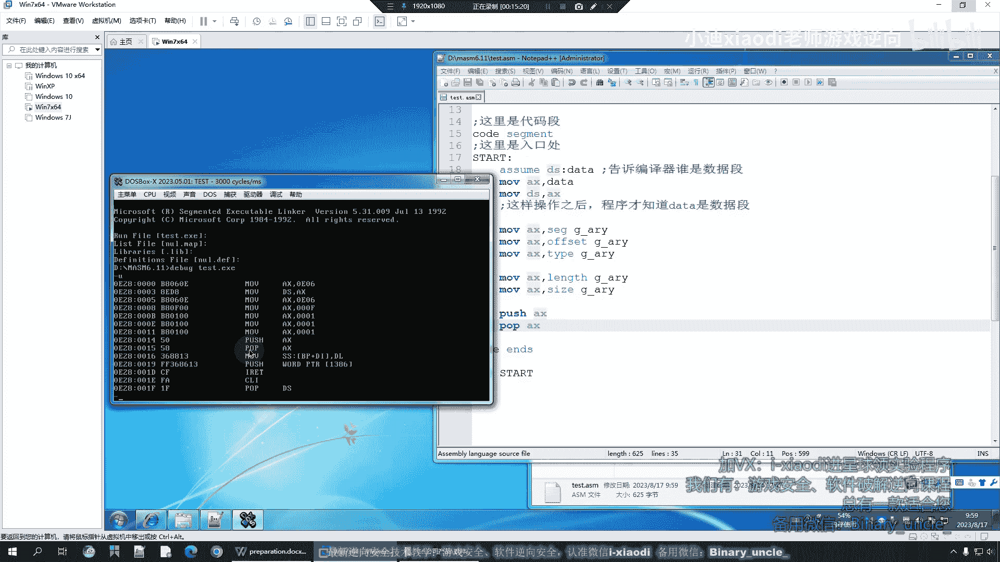
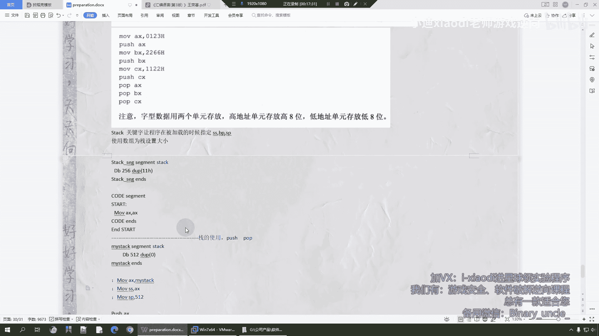

# 🧱 小白软件破解逆向工程师2023最新：4.32：汇编指令专题讲解-堆栈

在本节课中我们将要学习汇编指令专题中的堆栈概念。课程标题写的是“堆栈”，正文里写的是“栈”，这里先说明一下：在当下的语义里，堆栈和栈已经分得没有那么清楚，所以看到“堆栈”时，可以先把它理解成“栈”。本课会通过“栈”这个概念去了解堆栈。接下来翻到教材第56页，教材在这一页开始介绍栈，本课也会围绕这一页的内容展开，把栈的基本概念、入栈出栈、CPU指令以及代码写法逐步讲清楚。

## 📚 小白软件破解逆向工程师2023最新：4.32：栈的基本概念

上一段已经说明了本课要翻到教材第56页了解栈，本节中我们来看看教材对栈的定义。教材对栈的研究只限于这个角度：栈是一种具有特殊访问方式的存储空间。这里把这个定义拆开理解：它首先是一种存储空间，可以访问，占据内存，也有内存地址；它的特殊之处在于，最后进入这个空间的数据，最先出去。先暂时放下这些定义，直接说明栈是什么：栈是一种数据结构。

数据结构可以理解成组织、处理数据的方式。公式可以写成下面这样：

```text
数据结构 = 组织、处理数据的方式
```

如果已经学过数据结构，可以跳过这段说明；这里只给没学过的读者解释。栈作为一种数据结构，也要按某种规则组织和处理数据。可以先把栈想成一个盒子，这个盒子就是栈空间。栈空间是存储空间，可以存东西，也有内存地址，是比较特殊的内存区域。到这里，栈的基本定位就清楚了：它能存数据，也有地址，但存取数据的方式和普通内存区域不同。

## 🧩 小白软件破解逆向工程师2023最新：4.32：用三个数据看入栈和出栈

上一节我们介绍了栈是数据结构和特殊存储空间，本节中我们来看看栈到底怎样存数据、怎样取数据。先假设有一个栈空间，也就是一个盒子，再假设有三个数据：高等数学、C语言、软件工程。先存高等数学，高等数学进入栈空间；再存C语言，C语言压在高等数学上面；最后存软件工程，软件工程压在C语言上面。这个过程像搭积木，把数据挨个摞上去，这就是“进”，也就是入栈。

再看出栈。软件工程处在最上面，出栈时不是从最下面的高等数学开始抽，而是谁在最上面谁先出去：软件工程先出去，然后C语言出去，最后高等数学出去。这个规则可以概括为：先进去的最后出，最后进去的先出；永远把最上面的东西先出去。这个规则称为 LIFO，也就是 Last In First Out，后进先出。公式可以写成下面这样：

```text
入栈：把新数据放到最上面
出栈：从最上面取走数据
LIFO：Last In First Out，后进先出
```

栈里面还有两个位置标记：最上面的位置叫栈顶，最下面的位置叫栈底。当前状态里，软件工程处在栈顶，高等数学处在栈底；第二次状态里，C语言处在栈顶，高等数学处在栈底；第三次状态里，高等数学既是栈顶也是栈底。栈顶永远在最上面，栈底像地基，整个结构像一栋高层建筑。以下是栈的两个基本操作和两个位置标记的归纳：

- 入栈：把新的元素放到栈顶。
- 出栈：从栈顶取出一个元素。
- 栈顶：栈最上面的位置，永远在最上面。
- 栈底：栈最下面的位置，像地基。
- LIFO：栈顶元素总是最后入栈，出栈时先被拿出去，规则是后进先出。

通过以上内容可以看到，栈的存取规则并不复杂，核心就是“从栈顶进、从栈顶出”。接下来把视角从数据结构转到CPU，看看8086 CPU怎样用指令操作栈。

## ⚙️ 小白软件破解逆向工程师2023最新：4.32：8086 CPU 的 PUSH 和 POP

上一节我们从数据组织处理的逻辑上介绍了栈，本节中我们来看看CPU相关的栈操作。8086 CPU也提供了入栈和出栈的指令。原因在于CPU要和内存打交道，和内存打交道就必然遇到处理或组织内存的方式；栈可以存储数据，和内存空间挂钩，又具备入栈和出栈这种比较抽象的操作，所以8086设计了专门指令或代码去操作栈空间。



入栈指令是 `PUSH`，出栈指令是 `POP`。核心写法可以写成下面这样：

```asm
PUSH 源操作数   ; 入栈
POP  目的操作数 ; 出栈
```

理解 `PUSH` 和 `POP` 时，可以先把代码想成炒菜。炒菜要准备材料、准备数据、准备锅，汇编里的栈操作也可以按这个思路理解。接下来用炒菜类比把“先给值再 PUSH，用完再 POP”讲清楚。

## 🍳 小白软件破解逆向工程师2023最新：4.32：用炒菜理解先赋值再 PUSH，用完再 POP

上一节介绍了8086 CPU提供 `PUSH` 和 `POP` 指令，本节中我们用炒菜来理解这两个指令。炒菜要准备材料，材料相当于寄存器，寄存器里有 AX、BX、CS 等；还要准备数据，例如油多少克、盐多少克、菜多少、肉多少；还要准备一个锅，锅可以理解成承载这些材料的地方，对应栈空间。原文用5克油、5克盐、二两菜、六两肉举例，并通过 `MOV` 指令把数值送入寄存器，让这些“材料”生效。

材料准备好以后，不能干吃，要往锅里放，放进锅里的动作就是入栈。对应到指令上，`PUSH AX` 可以把油放进去，`PUSH BX` 可以把盐放进去，`PUSH CX` 可以把菜放进去；如果不吃肉，就可以不准备肉，只放素食材料。炒完菜要出锅，出锅就是出栈，对应 `POP`。所以常规用法是先用 `MOV` 给寄存器赋值，再用 `PUSH` 入栈，使用完再用 `POP` 出栈。以下是炒菜类比中各项与汇编概念的对应关系：

- 材料：对应寄存器，例如 AX、BX、CX 等。
- 油、盐、菜、肉：对应要处理的数据，通过 `MOV` 指令送入寄存器。
- 锅：对应栈空间，用来承载入栈的数据。
- `PUSH`：把准备好的数据放进栈，相当于把材料放进锅里。
- `POP`：把数据从栈里取出来，相当于炒完菜出锅。
- 使用顺序：先给值再 `PUSH`，用完了再 `POP`，常规用法都遵循这个顺序。

这种操作一般什么时候会用到？可以想成饿了才会吃饭，招待客人才会炒菜；在程序里，一般是在函数相关场景会用到。栈是一种非常特殊的组织处理数据的方式，普通数据可以直接用内存地址操作，栈之所以有特殊处理方式，是因为它有特殊用法，这个特殊用法会体现在函数调用等场景中，后面讲到时会更清楚。当前先记住：先给值再 `PUSH`，用完再 `POP`，就像炒菜一样。接下来看看在代码里怎样定义栈段并使用 `PUSH`、`POP`。

## 💻 小白软件破解逆向工程师2023最新：4.32：在代码里定义栈段并使用 PUSH/POP

上一节用炒菜类比说明了先赋值再入栈、用完再出栈，本节中我们来看看代码里怎样定义一个栈段。写代码使用栈时，可以先定义一个段，把这个段叫栈段，并给栈段一个标记 `STACK`。为了节省时间，可以直接复制已有代码，原文也提到手打较慢，已经过去十多分钟。定义栈段时需要写 `SEGMENT`，并在段中写 `DB` 来准备数据。示例代码如下：

```asm
STACK SEGMENT
    DB 512 DUP(0)
STACK ENDS
```

这里的 `DB 512 DUP(0)` 表示512个0，也就是512个字节。栈是存储空间，存储空间必然有空间大小，也必然有数据，这里把数据清空，相当于给栈清空，或者理解为开辟栈空间，空间大小是512字节。原文写作“DB512 512”，含义就是512个0。有了这个栈空间，才可以使用 `PUSH` 和 `POP` 命令。示例操作如下：

```asm
PUSH AX
POP  AX
```

写完以后保存并编译生成，程序正常生成，没有报错；使用调试命令查看 `PUSH AX`、`POP AX`，也可以直接得到结果，没有问题。以下是定义栈段和使用 `PUSH/POP` 时需要记住的关键点：

- 定义栈段：用 `SEGMENT` 定义段，用 `STACK` 作为栈段标记。
- 准备栈空间：用 `DB 512 DUP(0)` 准备512个0，相当于开辟512字节栈空间。
- 清空数据：这段写法把栈空间里的数据清空，方便后续使用。
- 使用指令：有栈空间以后才能使用 `PUSH` 和 `POP`。
- 验证程序：编译生成正常，调试查看 `PUSH AX`、`POP AX` 可以正常执行。

通过以上代码可以看到，栈段定义好以后，`PUSH` 和 `POP` 就可以拿来操作栈空间。接下来对本节课内容做一个总结。

## 📝 小白软件破解逆向工程师2023最新：4.32：本节总结

本节课中我们一起学习了汇编指令专题中的堆栈概念。课程标题写“堆栈”，正文写“栈”，当下语义里二者区分不严，看到堆栈可以先理解成栈。教材第56页把栈定义为一种具有特殊访问方式的存储空间，它占据内存、有内存地址，最后进入的数据最先出去；从数据结构角度看，栈是组织、处理数据的方式。通过高等数学、C语言、软件工程的例子，我们理解了入栈像搭积木一样把数据摞到栈顶，出栈永远从栈顶取数据，规则是 LIFO，也就是后进先出；最上面叫栈顶，最下面叫栈底。





我们还学习了8086 CPU提供的 `PUSH` 入栈和 `POP` 出栈指令，理解了CPU要和内存打交道，所以需要组织和处理内存的方式，栈正好提供了这种特殊操作。通过炒菜类比，我们记住了材料对应寄存器、数据对应要送入寄存器的值、锅对应栈空间，先给值再 `PUSH`，用完再 `POP`，这种操作一般会在函数相关场景中用到。最后我们看了代码里定义栈段的方法，用 `STACK SEGMENT` 和 `DB 512 DUP(0)` 开辟512字节栈空间，之后就可以使用 `PUSH AX`、`POP AX` 这样的指令，编译和调试验证均正常。原文课程到此结束，感谢观看，下期再见。

