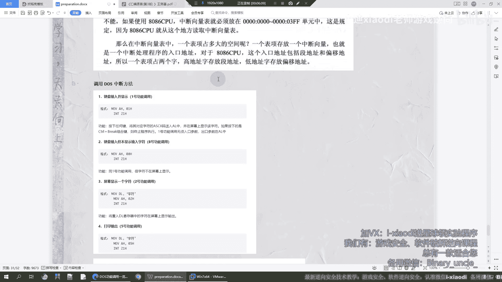
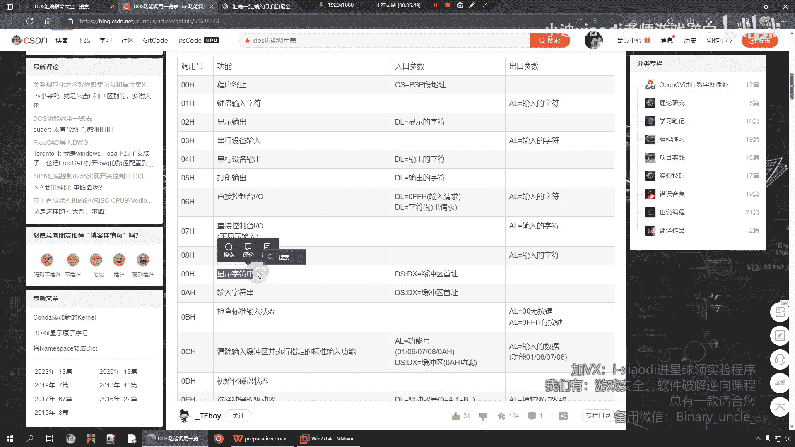
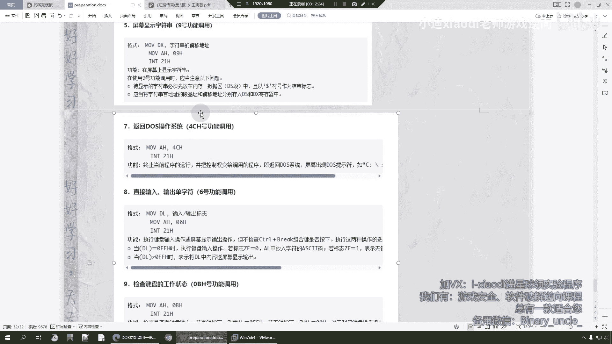

# 🧩 小白软件破解逆向工程师2023最新：第33课：使用DOS系统功能与中断打印字符串

本节课我们学习汇编指令专题中的一个重要内容：使用DOS系统中的功能。此前写汇编代码时，代码大多是在处理数据，还没有真正实现屏幕打印这类功能。本节我们要弄清楚这些功能由谁提供、怎样调用，并通过中断在屏幕上打印字符串，最后给程序补上正常退出。理解这些内容后，后面学习逆向工程会更容易把程序行为和系统功能对应起来。

## 📌 小白软件破解逆向工程师2023最新：第33课：为什么需要调用DOS系统功能

上一节我们关注的是汇编代码处理数据的过程，本节先看一个现实问题：代码怎样把字符串打印到屏幕上。写汇编代码时可以发现，所有代码似乎都在处理数据，却没有直接实现打印字符串这类功能。打印字符串到屏幕上的功能，并不是原始汇编指令本身直接完成的，它需要专门的人提供，也就是由DOS操作系统提供。

可以把这件事理解成请人做了一桌好菜。菜已经做好，但如果家里没有门，别人无法进去吃。DOS系统提供打印字符串功能时，也必须提供接口。没有接口，程序就无法使用这个功能。DOS操作系统在设计时提供了这样的接口，接口的用途就是给程序使用，而使用接口就要遵循使用方法。对于DOS操作系统来说，使用这些功能的方法就是利用中断。例如DOS操作系统提供中断机制，程序通过中断来调用系统功能。

## 📌 小白软件破解逆向工程师2023最新：第33课：中断、INT指令与中断向量表

上一节说明了DOS功能需要接口，本节来看这个接口的核心概念：中断。中断由CPU提供，是系统提供的流程跳转指令，类似函数调用。函数调用可以理解为功能调用，也可以理解为功能的使用。操作系统功能很多，就像吹风机有吹冷风和吹热风两个功能，复杂的操作系统功能更多。功能众多时，中断就需要一个表来组织，这个表叫中断向量表。

中断就是功能。在DOS操作系统里，中断对应后面的代码是 `INT`。看到 `INT` 就立刻想到中断。`INT 3` 也是中断，同时它还是断点，以后会讲软件断点的本质。当前先了解 `INT` 就是中断，暂时不深入断点。

`INT` 后面经常带一个数，这个数表示从第N个元素获取地址，然后执行。中断向量表可以理解成一张菜单或表单，里面有0号中断、1号中断、2号中断、3号中断等。`INT 3` 就找3号，`INT 0` 就找0号，`INT 1` 就找1号，`INT 2` 就找2号。程序里的0位置存储一个双字节数组，大小为256，称作中断向量表。这个细节当前了解即可，现阶段不看也无所谓。核心是记住：

```asm
INT n        ; 调用 n 号中断，从中断向量表第 n 项取得地址并执行
INT 21H      ; 调用 21H 号中断，H 表示十六进制
```

## 📌 小白软件破解逆向工程师2023最新：第33课：用INT 21H的9号功能打印字符串



理解了中断就是功能之后，本节看如何调用DOS的一个常用中断功能。先讲打印输出字符串，其他功能暂不展开。目标是在屏幕上打印 `hello world`。做法是把字符串的偏移地址放入 `DX`，偏移地址要用 `offset` 标记取得。示例字符串可以叫 `mytest`，代码写成 `mov dx, offset mytest`。这里用 `DX` 接收偏移地址，不要写成 `DS`；原文口述中把 `DX` 和 `DS` 混在一起，实际代码以 `DX` 为准。

接着把功能号 `09H` 放入 `AH`，再调用 `INT 21H`。`INT 21H` 是21号中断，属于系统功能调用。21号中断里面有很多功能，其中9号功能就是打印字符串。因此这段代码的含义是：使用21号中断里的9号功能显示字符串。21号中断是常用中断，DOS中断大全中还能看到其他中断，例如20号中断用于程序退出，21号中断用于系统功能调用，22号中断用于程序结束处理，24号中断用于严重错误处理，25号中断用于绝对磁盘读，26号中断用于绝对磁盘写，27号中断用于常驻退出。常用的是21号中断，系统功能调用中包含输入、显示字符串等操作，显示字符串就是21号中断系统功能调用里的9号功能。



打印字符串的核心代码如下：

```asm
mov dx, offset mytest    ; 取得字符串偏移地址，放入 DX
mov ah, 09h              ; 选择 21H 中断中的 9 号功能：打印字符串
int 21h                  ; 调用 21H 号中断
```

## 📌 小白软件破解逆向工程师2023最新：第33课：运行程序并补上正常退出

上一节写好了打印字符串的调用代码，本节把程序跑起来观察结果。先进入命令行环境，进入C盘后切换到D盘，执行 `cd MASM611` 进入目录，再运行 `BBtext`。程序没有发现问题，用 `-U` 查看反汇编，代码都写进去了。可以看到 `mov dx, offset ...` 这样的指令，字符串数据所在内存地址是3，数据区里有 `hello world`。这里涉及 `byte` 占1字节、`word` 占2字节等数据宽度，当前数据从地址3开始。运行程序用 `-G`，执行后屏幕上直接出现 `hello world`。

但此时按回车再输入任何内容都不管用，因为程序已经崩溃，系统也崩溃了。原因是程序没有写退出。没有写程序退出，程序执行完后控制权没有正常返回。可以把这个道理理解成钥匙插进去还要拔出来，去别人家里也不能一直待着不出来，否则别人会烦。程序同样必须写退出。

程序退出要返回DOS系统，终止当前程序运行，并把控制权交给调用程序，也就是返回DOS系统。这个需求可以直接调用：把 `4CH` 放入 `AH`，再调用 `INT 21H`。完整程序如下：

```asm
mov dx, offset mytest    ; 字符串偏移地址
mov ah, 09h              ; 9号功能：打印字符串
int 21h                  ; 调用21H中断

mov ah, 4ch              ; 4CH号功能：程序退出，返回DOS
int 21h                  ; 调用21H中断
```

## 📌 小白软件破解逆向工程师2023最新：第33课：验证打印与退出效果

上一节补上了退出功能，本节验证完整程序。重启DOS系统，切换盘符，再执行程序。用 `-U` 先查看，两个功能调用都在，都是 `INT 21H`，也就是两个中断、两个系统功能调用。用 `-G` 运行后，屏幕上出现 `hello world`，并提示 `program normally`，表示程序正常退出。程序正常退出后，返回权又交给用户，可以继续查看数据，也可以继续用 `-D` 查看内存，继续反汇编查看代码也没有问题。

不过此时不要再继续用 `-G` 往后执行，因为后面的代码不属于我们的程序范围。继续 `-D` 查看内存没有问题，继续反汇编也没有问题，但执行到程序最开始的位置即可，然后返回DOS系统。后面的内容看起来不像我们的程序，我们从来没有碰过那段代码，不要冤枉好人。我们只写了当前这段操作代码，后面的部分不要执行。



本节课我们一起学习了使用DOS系统中的功能：功能通过中断调用，中断由CPU提供，也可以理解为DOS系统提供的功能调用接口，类似函数调用。中断有很多，因此系统提供中断向量表。我们使用21号中断，它属于系统功能，包含打印、屏幕输入等功能。21号中断表里又有众多功能号，例如1号、2号、3号、4号、5号、6号、7号、8号、9号，我们用了9号功能打印字符串，也用了 `4CH` 号功能退出程序。`H` 表示十六进制。掌握中断后，今后学习逆向工程会理解得更深。下期再见。

