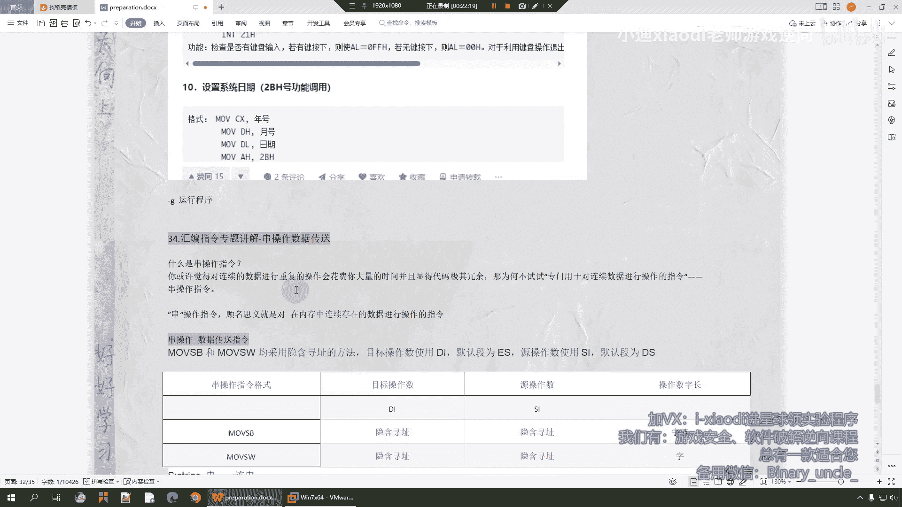

# 小白软件破解逆向工程师2023最新：4.34：汇编指令专题讲解-串操作数据传送

## 📖 概述

在本节课中，我们将学习汇编语言中的一个重要主题：串操作数据传送。上一节课我们介绍了单个数据的操作方式，而本节课将在此基础上，探讨如何对一连串数据进行操作。我们会详细讲解串操作的概念、常用的传送指令（MOVSB和MOVSW）、隐含寻址方式，以及标志位如何影响操作方向。通过实际演示，你将看到这些指令如何在内存中连续传送多个数据，并理解如何灵活运用它们来解决实际问题。为了让初学者也能轻松跟上，我会用最直白的大白话逐行解释每一个概念和演示步骤。

## 🎯 什么是串操作

### 串操作的基本概念

关于串操作，我们从一个最基本的问题开始：什么是串操作？简单理解一下，串操作就是**对一连串的数据进行操作**。

以前的学习中，我们处理的都是单个数据，比如把一个数从寄存器搬到内存，或者把内存中的一个数加载到寄存器。我们从来没有对一连串、成组的数据进行过统一的处理。串操作指令的出现，就是为了解决这个问题——它让我们能够方便地处理一串连续的数据。


串操作处理的数据在内存中是连续存在的，这一点需要特别注意。因为处理的对象是一连串数据，所以这些数据在内存布局上必须是紧挨着的，不能是零散分布的。


### 串操作与数组的关系

串操作主要应用在哪个方向上？回顾一下我们已经学过的所有数据类型，哪种类型最符合这种"一连串数据"的特征？答案是数组。数组就是一连串的数据集合，它的元素在内存中也是连续存放的。因此，串操作指令可以说是专门针对数组这一类数据结构而产生的工具。

## 🧩 串操作传送指令

### 两个常用指令


常用的串操作数据传送指令有两个：

1. **MOVSB** —— 以字节（Byte）为单位传送
2. **MOVSW** —— 以字（Word，即双字节）为单位传送

这两个指令都是**单独的指令**。这个"单独"是什么意思？我们来看一看。

之前的 MOV 指令，比如 `MOV AX, BX`，一般在指令里明确写出两个操作数，左边是目标操作数，右边是源操作数，一目了然。但是 MOVSB 和 MOVSW 这些串操作指令不一样，它们的操作数不会显示在指令中。这是一种**隐含寻址**方式。

隐含寻址方式意味着指令本身已经写死了操作对象，不需要在汇编代码中额外指定操作数。当我们写下 `MOVSB` 或者 `MOVSW` 时，指令内部已经约定了它要操作哪些寄存器。你不需要告诉它"把谁传给谁"，因为它自己就知道该干什么。

举个代码对比，更容易理解：

```asm
; 普通传送指令 - 需要显式写出两个操作数
MOV AX, BX

; 串操作指令 - 不需要显示写出操作数，操作数隐含在指令内部
MOVSB
MOVSW
```

### 隐含的操作数：SI 和 DI


MOVSB 和 MOVSW 这两个隐含操作数分别是：


- **SI** —— 源操作数（Source Index），存放源数据的地址
- **DI** —— 目标操作数（Destination Index），存放目标位置的地址

指令执行的内容，就是把 SI 指向的源数据传送到 DI 指向的目标位置。

### 段寄存器的默认规则

这里有一个非常重要的细节：SI 和 DI 默认使用的段寄存器是不同的。

- 源操作数 SI 默认使用的是 **DS 段**（数据段）
- 目标操作数 DI 默认使用的是 **ES 段**（附加段）

这两个段寄存器竟然不一样，这一点需要特别标记一下。那么在实际编程中，我们应该怎么处理这个差异呢？下面我们通过一段代码来说明。


## 📝 代码演示：段寄存器的设置

### 定义数据段

假设我们编写这样一段程序：

```asm
; 定义一个数据段
DATA    SEGMENT
G_SRC   DB 11H, 22H, 33H, 44H, 55H    ; 原操作数数组
G_DST   DB 5 DUP(0)                    ; 目标操作数数组，预留5个字节空间
DATA    ENDS
```

在这个数据段中，我们定义了两个数组。上面的是原操作数，取名为 SOURCE，下面的是目标操作数，取名为 DESTINATION。源操作数数组有 11H、22H、33H、44H、55H 这 5 个数据。目标操作数是一个预留了 5 个字节空间的空数组，准备接收传送过来的数据。


可以看到，这两个数组都在同一个 DATA 段内。

### 设置 DS 和 ES

以前处理单个数据的时候，我们只需设置好 DS 段就可以操作数据段中的内容了。但现在不行，因为 SI 默认用 DS 段，而 DI 默认用 ES 段。如果两个数组都在 DATA 段内，我们需要让 **DS 和 ES 都指向 DATA 段**。

设置方法如下：

```asm
; 程序入口
MOV AX, DATA
MOV DS, AX      ; DS 指向 DATA 段
MOV AX, DATA
MOV ES, AX      ; ES 也指向 DATA 段
```

因为 DS 不能直接用一个立即数来赋值，所以我们必须通过 AX 寄存器中转一下。先把 DATA 段地址给 AX，再从 AX 给 DS，最后用同样的方式把 AX 的值给 ES。这样处理之后，DS 和 ES 就都指向 DATA 段了，两个数组的段基址问题就解决了。

## 🛠️ 实操演示：MOVSB 的执行过程

### 准备工作

写好了段设置代码之后，接下来我们进入调试阶段。为了让我们能看清楚数据是怎么传送的，在调用串操作指令之前，需要先把源操作数的地址给 SI，再把目标操作数的地址给 DI。只有把这两个地址寄存器设置好，指令才知道从哪里取数据、放到哪里去。

代码写法如下：

```asm
; 接着设置地址指针
LEA SI, G_SRC      ; SI 指向源数据
LEA DI, G_DST      ; DI 指向目标缓冲区
```

设置好之后，我们在调试器中查看当前的状态。用 D 命令查看内存，可以看到：

- SI 指向的源数据地址是从 0 开始的
- DI 指向的目标数据地址是从 5 开始的

内存中的原始数据排列是：11 22 33 44 55。

### 单步执行 MOVSB

现在我们开始执行指令。在调试工具中，我们让程序运行到关键位置，然后开始单步执行。

第一次执行 `MOVSB` 之后，我们再查看内存，会发现两个明显的变化：

第一，**SI 自动加了 1**。原本 SI 指向 0 号地址，现在变成了 1。我们没有写任何 `ADD SI, 1` 这样的指令，是 MOVSB 指令自动完成了地址的递增。

第二，**DI 也自动加了 1**。目标地址从 5 变成了 6。

再看看数据区域：原来目标位置是空的，现在第一个字节变成了 11H。原来源数据中的第一个数据 11H，被复制到了目标位置。

继续执行第二次，再次查看：

- 数据变成了 11 22 33 44 55，前面多了一个 22
- 原来的时候目标区域只有 11，现在变成了 11 22

接着执行第三次：


- 33 被复制过去了
- SI 自动指向了 3
- 此时目标区域是 11 22 33


再执行第四次：

- 44 被复制过去了
- 目标区域变成了 11 22 33 44

最后执行第五次：

- 55 也复制过去了
- 目标区域变成了完整的 11 22 33 44 55

到这里，整个程序的串操作传送就全部完成了。特别有意思的地方在于，整个过程我们只写了 MOVSB 这一条指令，它却自动把一串数据全部传送过去了，完全不需要我们手动调整地址。

### MOVSW 的执行过程

接下来我们来看 MOVSW 的情况。我们把指令改成 MOVSW 试试看。

```asm
MOVSW    ; 每次传送一个字（2个字节）
```

程序开始时，内存中的源数据依然是 11 22 33 44 55。

第一次执行 `MOVSW`：

- **SI 一次性加了 2**
- **DI 也一次性加了 2**
- 数据传送过去的是 **1122H** 这两个字节

这验证了 MOVSW 确实是以字为单位进行操作的，一次处理两个字节。

继续执行第二次：

- 3344 被传送过去了
- 目标区域变成了 1122 3344

再执行第三次会怎样？这时候要注意，源数据一共只有 5 个字节。正常情况下，这个 5 字节的数组用 MOVSW 的话只能完整传两次（每次占2个字节，共4个字节）。第三次再执行的时候，指令会怎么处理？


执行第三次之后，查看数据区域：


- 目标区域变成了 1122 3344 5511
- 原来源位置剩下的数据是 55，但是因为 MOVSW 一次要读两个字节，所以它把 55 后面紧接着的 11 也一起读走了

这就是串操作指令的一个特性：**它在内存中连续地读取数据，不管数据边界在哪里**。不会因为我们是手动定义的数组就停下来，只要指令要求读两个字节，它就读两个连续的字节。所以第三次执行的时候，它把 55 和 11 一起传送了过去。这个特性在实际使用中需要注意。

## 🚦 DF 标志位与传送方向


### DF 标志位的作用

通过前面的演示，我们已经看到了串操作指令的基本行为：数据从前往后传送。那么大家有没有想过一个问题：能否从后往前传送呢？答案是肯定的。串操作传送的方向由一个标志位控制，这个标志位叫做 **DF 标志位**（Direction Flag，方向标志位）。

DF 标志位的值决定了串操作移动的方向：

- **DF = 0**：从低地址向高地址移动（顺着来）
- **DF = 1**：从高地址向低地址移动（反着来）

打个比方，就好比我们从1数到5是顺着来，从5数到1是反着来。DF=0 时，SI 和 DI 每次自动加 1 或 2；DF=1 时，SI 和 DI 每次自动减 1 或 2。

### 修改 DF 标志位的指令


在汇编语言中，我们可以通过两条专用指令来修改 DF 标志位：

```asm
CLD    ; Clear Direction Flag，将 DF 设为 0，串操作向前移动
STD    ; Set Direction Flag，将 DF 设为 1，串操作向后移动
```

记住一点：标志位不仅可以通过状态判断来读取，也可以通过指令主动修改。这两条指令就是专门用来控制 DF 标志位的。

### 反向传送的实操陷阱

现在我们尝试反向传送。在代码中加上 STD 指令：

```asm
STD        ; 设置 DF = 1，让串操作反向移动
MOVSB      ; 执行反向的串操作传送
```

**第一次尝试：什么都没改就执行**

我们直接运行程序，执行了几条 MOVSB 之后，查看数据。发现数据被覆盖了，看起来不太对劲。为什么会出现这种情况？

仔细分析一下：当我们把 DF 设为 1 之后，**SI 和 DI 不是加，而是减**。原本 DI 指向 5，第一条执行后 DI 变成了 4，它跑到了原操作数的位置！这就出大问题了。同时 SI 也一直在减，执行几次之后 SI 变成了负数（FFFF），指向了完全错误的位置。

**问题的根源**：如果要从后往前传送，我们不能让 SI 和 DI 指向数组的起始位置，而应该指向数组的**末尾位置**。比如数组有 5 个元素，那么 SI 应该指向 4（最后一个元素的位置），DI 应该指向 9（目标区域最后一个位置）。

**正确的做法**：在设置地址指针时，要把数组的长度加进去。

```asm
LEA SI, G_SRC
ADD SI, 4        ; 加上数组长度 - 1，让 SI 指向最后一个元素
LEA DI, G_DST
ADD DI, 4        ; 同样处理目标地址
STD              ; 设置反向传送
MOVSB            ; 执行传送
```

这样修改之后，再执行：

- 第一次传送：55 被复制到了目标区域的最后一个位置
- 第二次传送：44 被复制到了目标区域的倒数第二个位置
- 后续依次把 33、22、11 复制过去

最终目标区域被填充为：11 22 33 44 55，顺序完全正确。

### 执行过程中的标志位动态修改

还有一个更有趣的玩法：在串操作指令执行的过程中，动态地修改 DF 标志位。

我们来看一个例子。假设原本程序完全没有 STD 指令，是一个正常的前向传送程序。程序一共执行了 5 次 MOVSB：

```asm
MOVSB
MOVSB
MOVSB
MOVSB
MOVSB
```

正常情况下，这 5 条指令会依次把 11、22、33、44、55 从源地址传送到目标地址，两个数组内容最终一致。

现在我们在这 5 条 MOVSB 中间加一条 STD：

```asm
MOVSB
MOVSB
STD        ; 中途改变方向
MOVSB
MOVSB
MOVSB
```

执行这个程序的时候，前两条指令正常传送 11 和 22。第三条指令之前把 DF 改成了 1，后面的三条 MOVSB 全部反向执行。这时会发生什么？

首先，SI 和 DI 的移动方向反了，地址往回走，源数据和目标数据都会被再次读取，数据被覆盖。最终运行结果就是：目标区域的前面几个数据被清空了，同时目标区域剩余的部分与源数据的后半部分一致。

这种特性可以产生有趣的效果。比如你想清空前面几个数据，或者让目标区域与源区域产生部分一致，通过动态切换 DF 标志位就能做到。当然，这种技巧在实际使用中需要非常谨慎，因为它容易造成数据混乱。但它确实展示了串操作指令灵活的玩法。

## 🔍 串操作指令的更多思考

### 从代码体积看串操作的优势

为什么我们要使用串操作指令？除了处理一串数据方便之外，还有一个重要原因：**指令体积小**。

从内存占用角度来看，串操作指令非常紧凑。比如 STD 指令，在机器码中仅占 1 个字节。MOVSB 等串操作指令也都是单字节指令。

想象这样一个场景：程序在运行时，内存中有一段固定的代码区域。如果我们要用传统方式完成一个传送任务，可能需要写好多条指令，占据大量字节空间。但使用串操作指令，只需要 1 个字节，就把整个传送逻辑表达清楚了。指令占的字节越少，我们在修改和调整代码时就有越多的操作空间，可以施展更多的技巧。对于逆向工程和漏洞利用的从业者来说，这是一个值得留意的细节。

### 串操作的应用思路

串操作指令在实际应用中，特别是在游戏检测和逆向分析中，可以大显身手。设想一下：

游戏程序在运行时，可能会对内存中的某段数据进行检测和校验。如果程序使用串操作指令来拷贝或处理这些数据，那么它的检测模式就可能与普通的逐条拷贝不同。我们假设游戏通过串操作指令把内存数据复制到某个校验区域，然后比对结果。

如果我们修改了源数据，校验很可能会失败，程序就会检测到异常。但是如果我们理解了串操作指令的工作方式，就可以利用它的特性来解决问题。比如在合适的位置动态改变 DF 标志位，让数据在拷贝之后"左右相等"，从而让校验通过。或者利用串操作指令方向反转的特性，把修改过的数据与原始数据巧妙地关联起来。

当然，这些属于后汇编代码配合的进阶内容，现在只需要建立一个基础的认知框架。

### 串操作的两种并行应用

综合前面的分析，串操作指令可以用在以下两个方向：

1. **清空数据**：可以通过反向操作或方向反转，快速清空内存区域中的部分数据
2. **让目标与源头一致**：通过正向的 MOVSB 或 MOVSW，把一块数据完好地复制到另一块区域，保证两边内容相等

这些模式为我们解决问题提供了更多的方向性，无论是做数据拷贝还是内存操作，都有一个高效的新工具。

## 📝 核心指令速查

为了便于复习，整理本节课涉及的指令如下：

| 指令 | 含义 | 说明 |
|------|------|------|
| MOVSB | 串操作传送字节 | 以字节为单位传送，SI 和 DI 自动增减 1 |
| MOVSW | 串操作传送字 | 以字为单位传送，SI 和 DI 自动增减 2 |
| CLD | 清除方向标志 | DF = 0，串操作向前（低地址到高地址） |
| STD | 设置方向标志 | DF = 1，串操作向后（高地址到低地址） |

## 💡 总结

本节课中，我们一起学习了汇编语言中串操作数据传送的相关知识。首先我们认识了串操作的基本概念：所谓串操作，就是对内存中连续存放的一连串数据进行操作，最典型的应用场景就是数组。接着我们详细介绍了两个常用的串操作指令 MOVSB 和 MOVSW，它们分别以字节和字为单位进行数据传送，并且采用隐含寻址方式，操作数由 SI 和 DI 寄存器隐含指定。我们通过实际调试，亲眼观察了执行 MOVSB 时 SI 和 DI 如何自动递增，以及每次传送后数据的变化情况。我们还探讨了 MOVSW 一次传送两个字节能带来的高效数据复制，同时也发现了它在处理奇数个字节数据时可能产生的越界读取现象。


然后我们深入学习了 DF 标志位如何控制串操作的方向，以及通过 CLD 和 STD 两条指令修改方向标志位的具体方法。在反向传送的实操中，我们看到了一个容易犯的错误——直接设置 STD 而不调整指针会导致 SI 变成负数、数据被覆盖，并学会了通过给 SI 和 DI 加上数组长度来正确实现反向传送。我们还探讨了在串操作执行过程中动态修改 DF 标志位带来的应用效果，包括数据清空、目标与源头相等这些特殊模式。最后，我们讨论了串操作指令在游戏检测等逆向工程场景中的应用思路，以及单字节指令在代码体积上的优势。

串操作指令是汇编语言中一个非常强大且灵活的工具，希望各位同学课后多加练习，亲手调试几遍程序，体会地址指针自动变化的微妙之处。



好，我们下节课再见。

