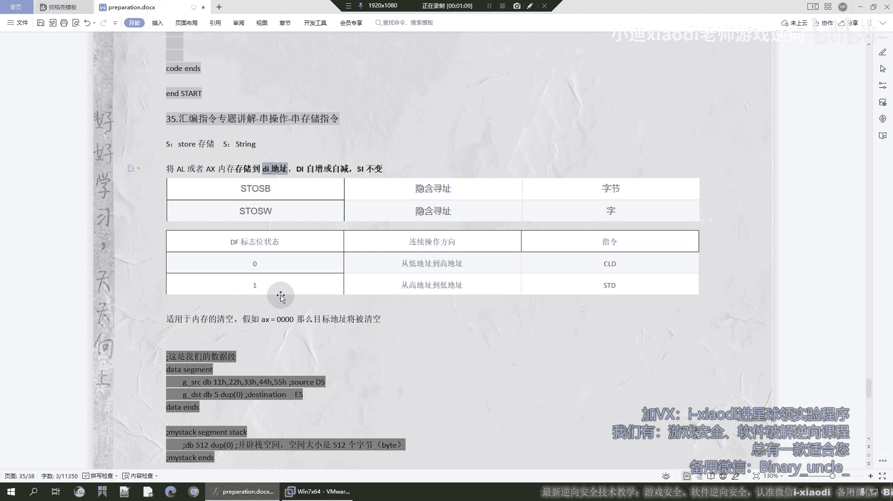
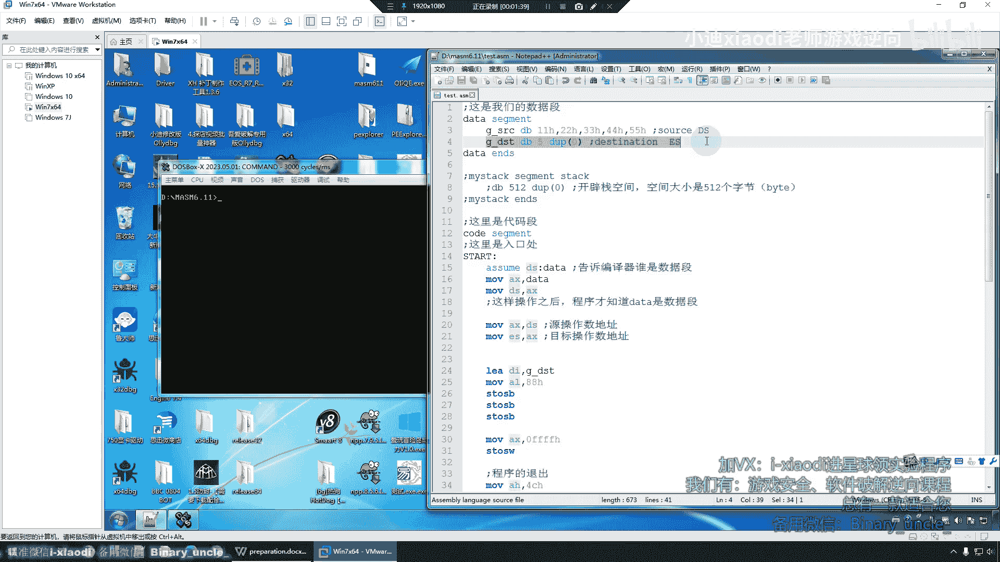
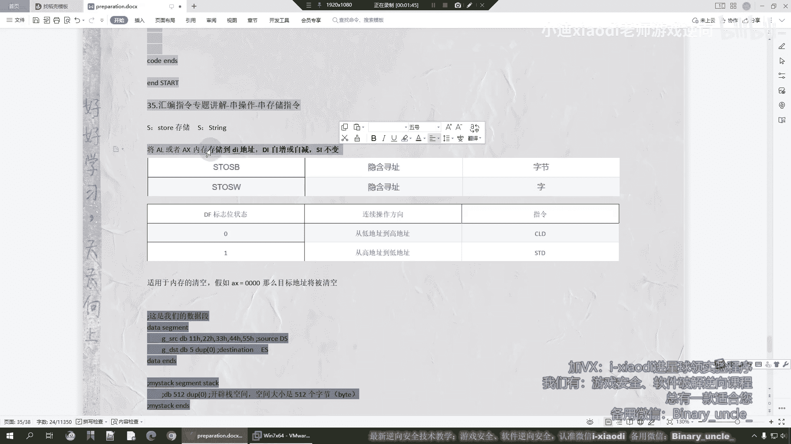
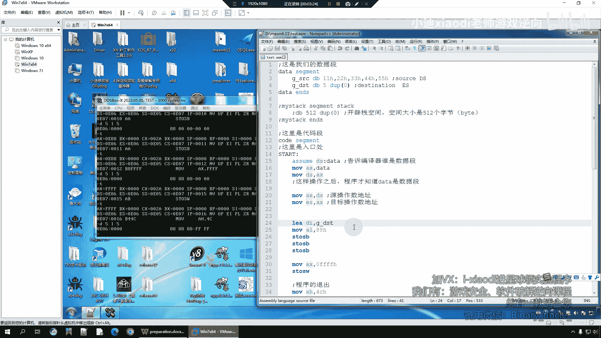
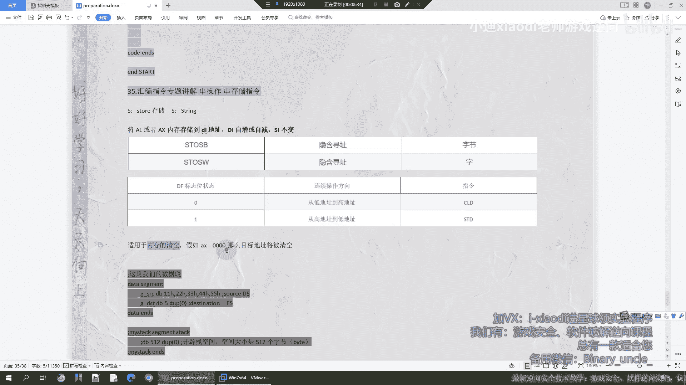
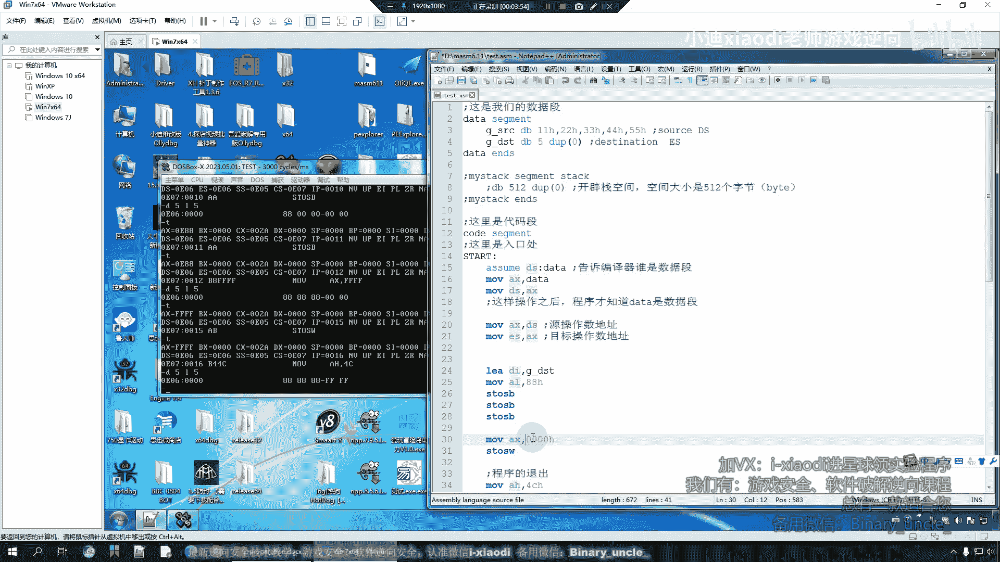
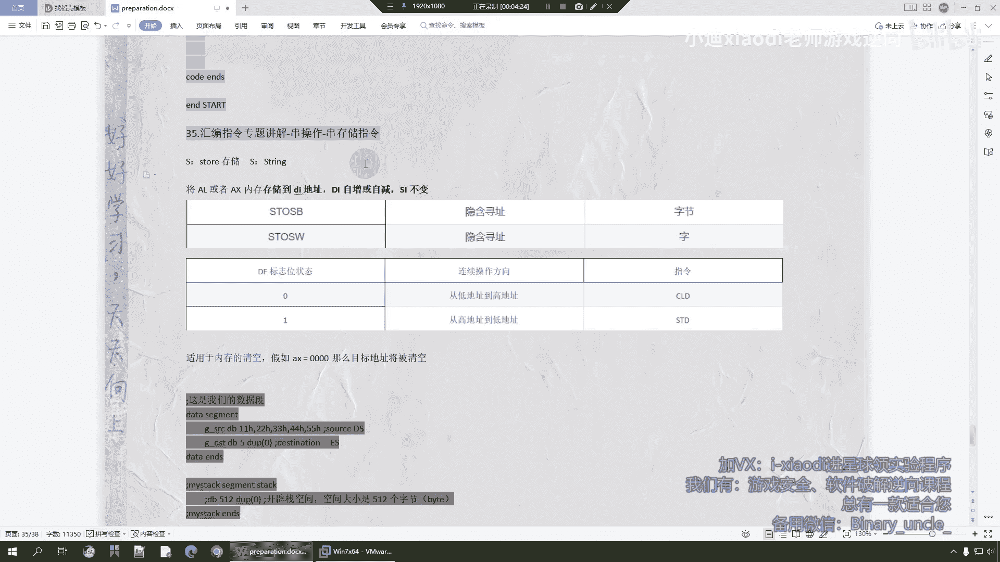

# 🧩 小白软件破解逆向工程师2023最新：4.35：汇编指令专题讲解-串操作-串存储指令

在本节课中我们将要学习汇编里的串存储指令。所谓存储指令，简单理解就是往内存里写入数据。本节课是第三十五课，重点围绕两条指令展开：`STOSB` 和 `STOSW`。它们一个按字节处理，一个按两个字节处理，使用方法基本一致。我们会先认识指令名称和基本作用，再观察 `DI` 寄存器如何变化，然后看一段代码怎样把数据连续写进内存，最后说明它在内存清空场景中的用途。名字看起来有点陌生，但核心逻辑并不复杂，只要抓住“把 `AL` 或 `AX` 写进 `DI` 指向的地址”这一句话，就能把整节课串起来。

前面已经接触过串操作的基础概念，本节中我们来看看串存储指令到底怎么用。为了把这条指令讲清楚，我们先从名字、操作数和基本行为入手，再逐步过渡到代码观察。

## 📌 小白软件破解逆向工程师2023最新：4.35.1：串存储指令的基本概念

先看两条指令的名称。原文口语里写作 `STUSB` 和 `STUSW`，标准写法通常记作 `STOSB` 和 `STOSW`。它们两个基本一样，差别主要在结尾字母：`B` 表示字节，`W` 表示按一个字也就是两个字节来处理。原文把 `W` 说成双字，学习时可以抓住“`W` 一次处理两个字节”这个关键点。两条指令的使用方法一模一样，不需要把它们当成两套完全不同的东西。

名称前面的 `S` 可以理解为 `store`，也就是存储、往里面存数据。这是一个英文单词，多背几遍就能熟悉。名称后面的 `S` 可以理解为 `string` 或 `stream`，意思是一连串、连续的数据，可以想象成一串葫芦娃，重点在于“连续内存”。因此，串存储指令不是只写一个孤立位置，而是围绕连续内存进行写入。

它的存储逻辑可以概括为：把 `AL` 或 `AX` 里面的值，写入 `DI` 指向的内存地址。`DI` 是目标操作数，`destination` 就是目标的意思，多念几遍有助于记忆。在这个过程中，`DI` 会根据方向标志 `DF` 自增或自减；自增是默认方向，自减是反方向，当 `DF=1` 时就会反方向变化。与此同时，`SI` 不发生变化。

核心公式可以写成下面这样：

\[
\begin{aligned}
STOSB &: [DI] \leftarrow AL,\quad DI \leftarrow DI \pm 1\\
STOSW &: [DI] \leftarrow AX,\quad DI \leftarrow DI \pm 2
\end{aligned}
\]

> 注意：原文里的 `STUSB`、`STUSW` 属于口语化写法，标准写法通常记作 `STOSB`、`STOSW`；原文里的 `AS` 也应按 `AX` 理解。



了解了指令名称和基本行为后，本节中我们来看看执行方向如何影响 `DI`，以及为什么 `SI` 在这个过程中保持不变。

## 🧭 小白软件破解逆向工程师2023最新：4.35.2：执行方向与寄存器变化

串存储指令每次写入数据后，都会调整目标地址。调整方向由方向标志 `DF` 决定。`DF=0` 时，`DI` 按默认方向自增；`DF=1` 时，`DI` 反方向自减。也就是说，地址既可以往上走，也可以往下走，具体看 `DF` 的状态。原文强调“自增可以理解，自减就是反方向”，这句话就是理解地址变化的关键。

方向变化可以用公式表示：



\[
DF=0 \Rightarrow DI \leftarrow DI + n,\quad DF=1 \Rightarrow DI \leftarrow DI - n
\]



其中，`STOSB` 的 `n` 是 1，`STOSW` 的 `n` 是 2。与此同时，`SI` 不参与变化，可以写成：

\[
SI_{after}=SI_{before}
\]

下面把核心变化列出来，方便对照：

- `STOSB`：把 `AL` 写入 `[DI]`，然后 `DI` 加 1 或减 1。
- `STOSW`：把 `AX` 写入 `[DI]`，然后 `DI` 加 2 或减 2。
- `DF=0`：`DI` 自增，属于默认方向。
- `DF=1`：`DI` 自减，属于反方向。
- `SI`：在整个串存储过程中保持不变。

这些变化看起来只是地址加一减一，但放到连续内存上，就是“连续写一串数据”。理解这里后，本节中我们来看看一段实际代码如何执行，以及怎样在调试器里观察内存变化。

## 🧪 小白软件破解逆向工程师2023最新：4.35.3：代码示例与内存观察

先设置段寄存器。目标操作数使用 `ES` 作为段寄存器，原操作数使用 `DS` 作为段寄存器。不过本例中其实用不到 `DS`，因为我们不是从 `DS` 指向的内存里取数据，而是直接把 `AL` 或 `AX` 的值写进去。因此，执行前要先给 `AL` 或 `AX` 赋值。`AL` 对应一个字节，`AX` 对应两个字节，长度不要搞错。

示例代码可以写成下面这样：

```asm
; ES 指向目标内存段
; DS 指向源数据段，本例实际不依赖 DS

mov al, 88h
stosb
stosb
stosb
```

执行前可以先取出目标操作数的地址，方便后面查看。把 `88` 赋给 `AL`，然后执行一条 `STOSB`，就会有一个 `88` 写进目标内存。连续执行三条，就会写入三个 `88`。在调试器里可以跳到对应地址观察，例如查看地址 `05` 开始的内存。初始时可能看到五个 `00`，使用类似 `D 05`、`L 5` 的查看方式，可以显示五个字节。

执行一条指令后，一个 `88` 就进去了；再执行、再执行，三行代码执行完后就是三个 `88`。接下来把 `AX` 赋值为 `FFFF`。此时原来的 `AX` 还是类似 `0188` 的状态，重新赋值后就变成 `FFFF`。然后再执行一条 `STOSW`，后面两个字节就会变成 `FF`。再次查看 `D 5 L5`，可以看到类似 `88 88 88 FF FF` 的结果。这个过程很直接，核心就是“写值”和“移动地址”。

下面按执行顺序整理观察点，便于复现：

- 查看目标地址开始的五个字节，初始内容通常是五个 `00`。
- 把 `88` 放入 `AL`，执行一次 `STOSB`，内存中出现一个 `88`。
- 连续执行三次 `STOSB`，内存中出现三个 `88`。
- 把 `AX` 改为 `FFFF`，再执行 `STOSW`，后续两个字节变成 `FF`。
- 最终内存结果可以理解为 `88 88 88 FF FF` 这样的连续字节序列。

到这里，串存储指令的基本用法已经清楚。接下来看看它在实际场景里能做什么，尤其是内存清空这种常见需求。

## 🧹 小白软件破解逆向工程师2023最新：4.35.4：适用场景与内存清空



一个常见场景是清空内存。如果有一块内存需要把里面的数据清掉，就可以考虑使用串存储指令。例如使用 `STOSW` 写入 `0000`，就能把目标位置的内容变成零。给 `0000` 是一种直接的处理方式，内存也会按要求被覆盖。



示例代码如下：

```asm
mov ax, 0000h
stosw
```

这样写可以用于内存清空。不过如果只是逐条执行，清空一大块内存会比较麻烦。后面会讲到循环，还会讲到重复前缀，用循环去反复赋值或存储，就可以批量处理连续内存。循环内容在后面章节再展开，这里先了解串存储指令本身的用法即可。串存储的用法比较简单，先把单条指令的作用和地址变化搞清楚，后面再叠加循环就会更容易理解。



下面把清空内存场景的要点列出来，方便归纳：

- 内存清空可以用 `STOSW` 写入 `0000`。
- `STOSW` 一次处理两个字节，适合按两个字节覆盖。
- 逐条写入比较麻烦，后续可以结合循环完成批量清空。
- 重复前缀和循环会在后面的内容中继续讲解。

以上场景说明，串存储不只是“写一个值”，还可以作为后续批量处理连续内存的基础。把这一节的操作逻辑掌握后，再看循环和重复前缀会更顺畅。

## ✅ 小白软件破解逆向工程师2023最新：4.35.5：本节总结



本节课中我们一起学习了串存储指令 `STOSB` 和 `STOSW`。我们知道了 `S` 可以理解为存储，后面的 `S` 可以理解为一连串连续数据；`B` 对应字节，`W` 对应两个字节。核心逻辑是把 `AL` 或 `AX` 写入 `DI` 指向的地址，然后根据 `DF` 让 `DI` 自增或自减，而 `SI` 保持不变。我们还通过代码观察了三个 `88` 的写入过程，以及把 `AX` 改为 `FFFF` 后写入 `FF` 的过程。最后说明了串存储可以用于内存清空，后续还可以结合循环和重复前缀进行批量处理。本节内容到这里结束，下一节继续学习。

