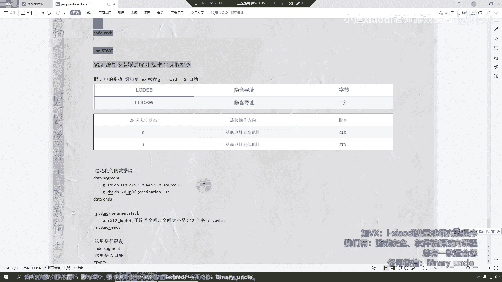

🔧 **小白软件破解逆向工程师2023最新：4.36：汇编指令专题讲解-串操作-串读取指令**


在本节课中，我们将学习汇编串操作指令中的串读取指令（LODS）。串操作是一类专门用来处理连续内存数据的指令，上一节课我们已经接触过串存储指令 STOS，而这一节课要讲的是它的逆向过程。我们会从指令的方向、寄存器变化、字节与字的宽度区分，以及一个完整的调试实例来理解它。串读取指令本身并不复杂，但它是串操作体系里非常基础的一环，掌握好它，后续再学习其他的串操作指令就会轻松很多。

在开始动手之前，我们先来回顾一下上节课的内容。串存储指令的作用是把 AX 或者 AL 中的数值存储到 DI 寄存器指向的内存地址中，也就是说，数据是从寄存器流向内存的。当时我们使用的方向是“寄存器到内存”，涉及的寄存器是 DI。而今天要讲的串读取指令，在方向上完全反过来了：它是把内存中的数据读取到寄存器中。同时，涉及的寄存器也从 DI 换成了 SI。所以你可以这样理解：串存储是“写内存”，串读取是“读内存”，两者互为镜像。

具体来说，串读取指令会把 SI 寄存器指向的内存数据读取到 AX 或者 AL 中。和串存储指令一样，它也有两个具体的形态，分别对应字节宽度和字宽度。这两个形态的助记符是 LODSB 和 LODSW，其中 LODS 是 Load String 的缩写。L 就是 Load，意思是加载、读取。在英文中，Load 通常翻译成“装载”或者“加载”，所以这条指令本质上就是一个加载指令。LODSB 中的 B 代表 Byte，对应 AL 寄存器；LODSW 中的 W 代表 Word，对应 AX 寄存器。用公式描述就是：

```asm
LODSB: AL = [SI]; SI = SI + 1
LODSW: AX = [SI]; SI = SI + 2
```

需要特别注意的是，这里的方括号表示“取 SI 所指向内存地址中的值”。另外，LODSB 和 LODSW 执行后，SI 会自动变化，默认情况下是增加，也就是往后移动一个或两个字节。如果搭配方向标志 DF 使用，也可能是减少，不过本节课我们先不展开，只需要知道它默认会向后推进即可。在写代码的时候，宽度的选择一定要仔细：字节操作对应 8 位寄存器 AL，字操作对应 16 位寄存器 AX。如果宽度搞错了，读出来的数据就会不符合预期，甚至可能导致程序逻辑混乱。所以，这里要反复强调：B 和 W 千万别看错。


明白了指令的定义之后，我们来实际看一个调试例子。假设内存中从地址 0 开始连续存放着几个字节，值分别是 11、22、33。我们先把 SI 的地址设置到起始位置 0，这样它就能指向第一个字节。在调试器中，我们先定位到代码对应的内存位置，然后单步执行 LODSB。执行之前，AX 寄存器保持原来的值不变。执行之后，内存地址 0 处的字节 11 就会被读取到 AL 寄存器中。因为 AL 是 AX 的低 8 位，所以这个 11 会出现在寄存器的右侧，也就是低字节的部分，而高 8 位则保持原来的值不动。从调试器里看，AL 的值变成了 11，而且 SI 也自动增加到了 1。

接下来，我们继续执行 LODSW。LODSW 是一下子读取两个字节的指令，它会把当前 SI 所指向的连续两个字节加载到 AX 中。注意，在执行完 LODSB 之后，SI 已经自增了，所以现在 SI 指向的是地址 1。因此，LODSW 读取的是地址 1 和地址 2 的内容，也就是 22 和 33，而不是 11 和 22。在 x86 的小端存储模式下，读取后低字节存放的是 22，高字节存放的是 33，所以 AX 的实际数值是 0x3322。如果你在调试器中看到 AX 变成了 0x3322，那就说明指令执行正确了。整个过程里，DI 寄存器保持不变，只有 SI 在自动往后推。


为什么读到的是 22 和 33，而不是 11 和 22 呢？原因就在于 SI 的自增行为。SI 每执行一次 LODSB 就会加 1，每执行一次 LODSW 就会加 2。因为内存地址是连续排列的，所以 SI 自增后自然就指向了下一个数据。在上面的例子中，LODSB 执行完后 SI 从 0 变成了 1，再执行 LODSW 时，就从地址 1 开始连续取两个字节。由于地址 1 和地址 2 里存放的是 22 和 33，所以最终 AX 装的就是这两个数。需要注意的是，这种读取方式不会产生数据重叠，因为每读一次，SI 都会自动向后跳过已经读过的区域，所以数据是依次向后推进的，不会重复，也不会乱掉。



总结一下，本节课我们一起学习了串读取指令 LODS 的两个形态：LODSB 和 LODSW。我们知道了它和串存储指令在方向上是相反的，寄存器也从 DI 换成了 SI。同时，我们通过一个简单的内存示例，观察了字节读取和字读取的具体过程，也搞明白了 SI 为什么会自动变化，以及数据重叠问题是如何避免的。串读取指令本身并不难理解，关键是记住“从内存到寄存器”这条数据流向，以及根据宽度选择正确的助记符。下一节课，我们可能会继续讲解其他的串操作指令，这样整个串操作指令的体系就会越来越清晰了。

