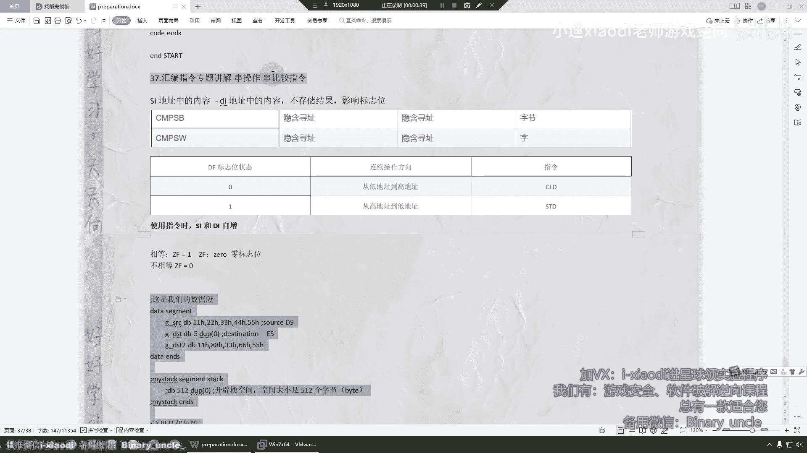
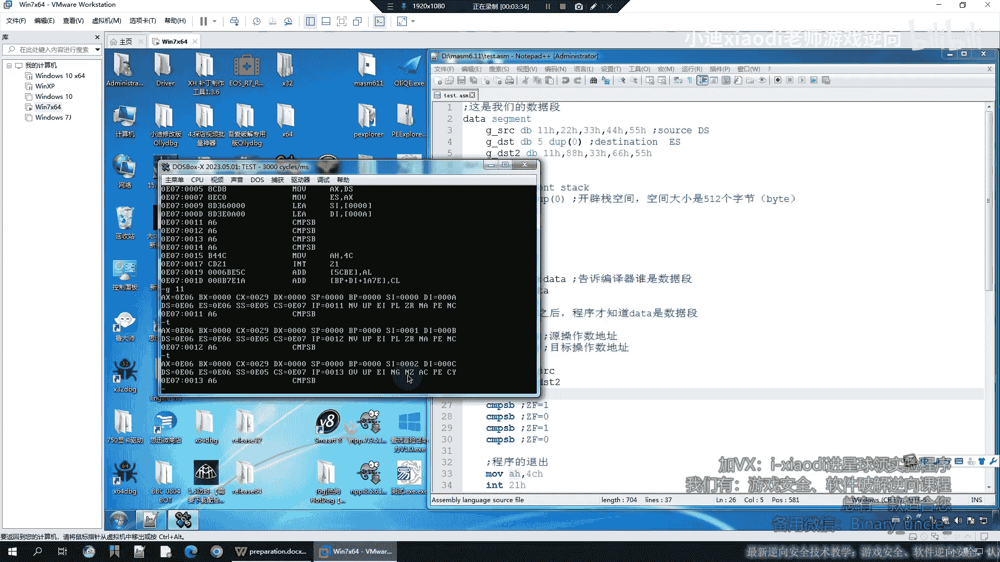
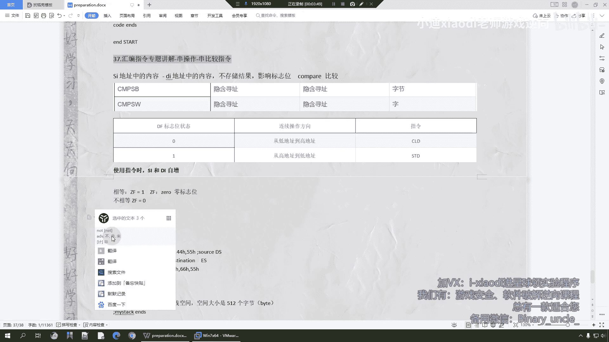
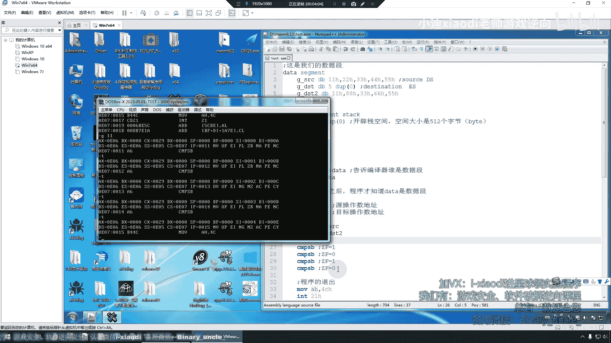
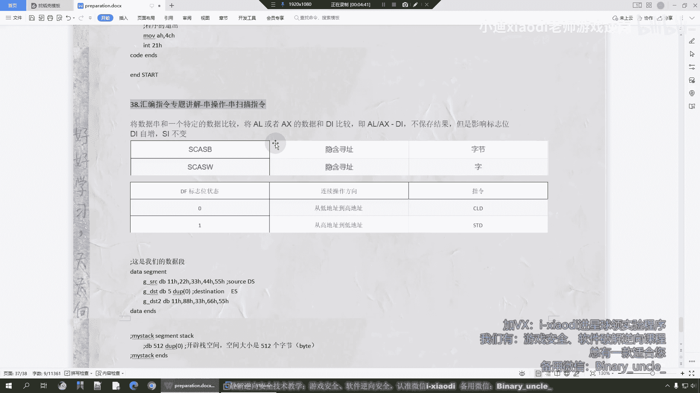

# 🧩 小白软件破解逆向工程师2023最新：4.37：汇编指令专题讲解-串操作-串比较指令

在本节课中，我们将学习汇编指令里的串比较指令。串比较指令是串操作专题中的一部分，它的作用是逐个比较两个串中的数据元素。课程会先说明串比较的基本逻辑，再说明标志位的变化，随后结合方向标志、SI 和 DI 的变化以及一段调试示例，把这条指令的运行过程讲清楚。最后还会布置练习，并为下一节课的串扫描指令做铺垫。

上一节我们已经进入串操作专题，本节中我们来看看串比较指令到底在比较什么。

## 🔍 小白软件破解逆向工程师2023最新：4.37.1：串比较指令的基本含义

串比较指令，也就是串比较，核心含义是对两个串中的数据元素进行一对一比较。这里的“串”可以理解为一串连续存放的数据，比较时不是一个整体直接比较，而是按元素逐个比较。它的比较方法和判断逻辑并不复杂，可以先用一个生活化的例子理解。

例如，小明和张三比较成绩。小明考了 100 分，张三考了 98 分。用 100 减去 98，结果是 2，结果大于零，因此可以判断小明的分数比张三高。串比较指令也是类似的减法逻辑：用 SI 地址中的内容减去 DI 地址中的内容，再根据减法结果产生的标志位判断两个元素的关系。

这里有一个关键点：串比较指令不保存减法结果，只影响标志位。因为比较的重点不是得到差值，而是判断两个元素是否相同。相等时，减法结果为 0，零标志位 ZF 会被置为 1；不相等时，ZF 会被清为 0。下面把核心逻辑列出来，方便你对照理解。

- 串比较对两个串中的元素进行一对一比较。
- 比较逻辑是 SI 地址中的内容减去 DI 地址中的内容。
- 减法结果不保存，只影响标志位。
- 相等时结果为 0，ZF = 1。
- 不相等时 ZF = 0。



可以用下面的公式表示判断思路。

```text
如果 (SI内容 - DI内容) == 0，则 ZF = 1
如果 (SI内容 - DI内容) != 0，则 ZF = 0
```

上一节我们说明了串比较的基本含义，本节中我们继续看看指令形式以及标志位如何观察。

## 🧭 小白软件破解逆向工程师2023最新：4.37.2：CMPS、CMPSB 和 CMPSW

串比较指令的英文含义来自 compare，compare 就是“比较”的意思。汇编中的串比较指令通常写作 CMPS，它比较的是两个串中的数据。根据比较单位的不同，还可以分为按字节比较和按字比较两种形式。

如果指令写成 CMPSB，表示按字节比较；如果写成 CMPSW，表示按字比较。原文里提到的 B 就是自己，这里整理为按字节处理；提到的 W 就是字，这里整理为按字处理。无论按字节还是按字，判断是否相等的核心仍然看 ZF 标志位。

下面把常见形式列出来，便于你记忆。

- CMPS 表示串比较。
- CMPSB 表示按字节进行串比较。
- CMPSW 表示按字进行串比较。
- 比较结果不存储，主要通过 ZF 判断是否相等。
- 相等时 ZF = 1，不相等时 ZF = 0。

可以用下面的代码形式理解这些指令。

```asm
CMPSB   ; 按字节比较 SI 指向的内容和 DI 指向的内容
CMPSW   ; 按字比较 SI 指向的内容和 DI 指向的内容
```

需要特别注意的是，串比较指令还会受到方向标志 DF 的影响。方向标志决定 SI 和 DI 在比较后是自增还是自减，这一点会直接影响连续比较的方向。

上一节我们介绍了指令形式，本节中我们来看看方向标志以及 SI、DI 为什么会变化。

## 🔄 小白软件破解逆向工程师2023最新：4.37.3：方向标志与 SI、DI 的变化

串比较过程中，SI 和 DI 会发生变化。原因很直观：两个串要逐个元素比较，第一个元素比较完成后，需要继续比较第二个元素，因此两个指针都要向前移动。原文强调 SI 和 DI 是自增的，这里的“自增”是在默认方向下发生的变化。

不过，这个变化方向受方向标志 DF 控制。CLD 会把 DF 清零，默认情况下从低地址向高地址比较，也就是从低到高；STD 会把 DF 置为 1，强制改变方向，使比较从高地址向低地址进行，也就是从高到低。下面把这些变化关系列出来。

- SI 和 DI 指向两个串中待比较的元素。
- 比较完一个元素后，需要继续比较下一个元素，所以指针要移动。
- CLD 使 DF = 0，默认从低到高比较。
- STD 使 DF = 1，从高到低比较。
- DF 不同，SI 和 DI 的移动方向也不同。

可以用下面的公式描述默认情况下的指针变化。

```text
DF = 0 时：SI = SI + 步长，DI = DI + 步长
DF = 1 时：SI = SI - 步长，DI = DI - 步长
```

理解了方向标志以后，再去看具体的代码和调试过程，就更容易明白为什么每次比较后都要关注 SI、DI 以及 ZF 的变化。

上一节我们说明了指针移动和方向标志，本节中我们通过示例代码和调试过程观察 ZF 的变化。

## 🧪 小白软件破解逆向工程师2023最新：4.37.4：示例数据与调试观察

原文给出的示例中，SRC 是原操作数，目标操作数是另一个用于比较的数据。原操作数写为 112212345，目标操作数写为 18365。原文还给出了一组比较关系：第一个元素相同，第二个元素不同，第三个元素相同，第四个元素不同，第五个元素相同。这里我们按照原文含义保留这组比较关系，重点观察每次比较后 ZF 的变化。

下面把示例中的比较关系列出来，方便你理解调试时应该看什么。

- 原操作数是 SRC，目标操作数是另一个串。
- 原操作数示例为 112212345。
- 目标操作数示例为 18365。
- 第一组比较相同，因此 ZF = 1。
- 第二组比较不同，因此 ZF = 0。
- 第三组比较相同，因此 ZF = 1。
- 第四组比较不同，因此 ZF = 0。
- 第五组比较相同。



可以用下面的伪代码表示观察重点。

```text
比较第1个元素：相同 -> ZF = 1
比较第2个元素：不同 -> ZF = 0
比较第3个元素：相同 -> ZF = 1
比较第4个元素：不同 -> ZF = 0
比较第5个元素：相同
```

在调试时，先加载并保存程序，检查代码里是否已经写入串比较相关指令。随后使用执行命令将程序运行到地址 11 的位置，再单步执行一条语句，观察 ZF 的变化。执行到相同比较时，可以看到 Z 标志为 1，也就是 ZF = 1。接着执行与 NZ 相关的判断，NZ 表示 Not Zero，也就是“不为零”或“非零”。N 表示 Not，Z 表示 Zero，Not 的含义是“不”或“非”，因此 NZ 就是不要按 Zero 的含义理解，也就是 ZF 不为 1 的情况。



继续执行后，遇到相同比较时又会出现 Z 标志，表示 ZF = 1；遇到不同比较时又会出现 NZ，表示 ZF = 0。通过这样反复观察，就能把串比较指令和 ZF 标志位对应起来。

上一节我们结合示例观察了调试过程，本节中我们来看看课后练习和下一节内容。

## 📚 小白软件破解逆向工程师2023最新：4.37.5：课后练习与下一节预告



本节课的内容到这里就完整了。原文要求回去以后亲手把代码敲一遍，然后进行编译、链接、执行，并自己调试分析。这个练习的目的不是只看结论，而是让你亲手观察 SI、DI 如何移动，以及 ZF 如何随着比较结果变化。

下面把课后任务列出来，便于你按步骤完成。

- 亲手敲一遍课堂示例代码。
- 对代码进行编译。
- 完成链接并执行程序。
- 使用调试器逐步分析。
- 重点观察 ZF 在相同和不同比较中的变化。
- 理解 SI 和 DI 在比较过程中的移动。

下一节课将讲解串扫描指令。原文说明串扫描也比较简单，因此本节先打好串比较的基础，下一节再继续学习串扫描。



## ✅ 小白软件破解逆向工程师2023最新：4.37.6：本节总结

本节课中我们一起学习了串比较指令的基本含义、CMPS 以及 CMPSB、CMPSW 的形式、方向标志 DF 对 SI 和 DI 的影响，还通过示例数据观察了 ZF 在相同和不同比较中的变化。核心结论是：串比较用 SI 内容减去 DI 内容进行判断，不保存结果，只影响标志位；相等时 ZF = 1，不相等时 ZF = 0。课后需要亲手敲代码、编译链接、执行并调试分析，为下一节串扫描指令做好准备。
