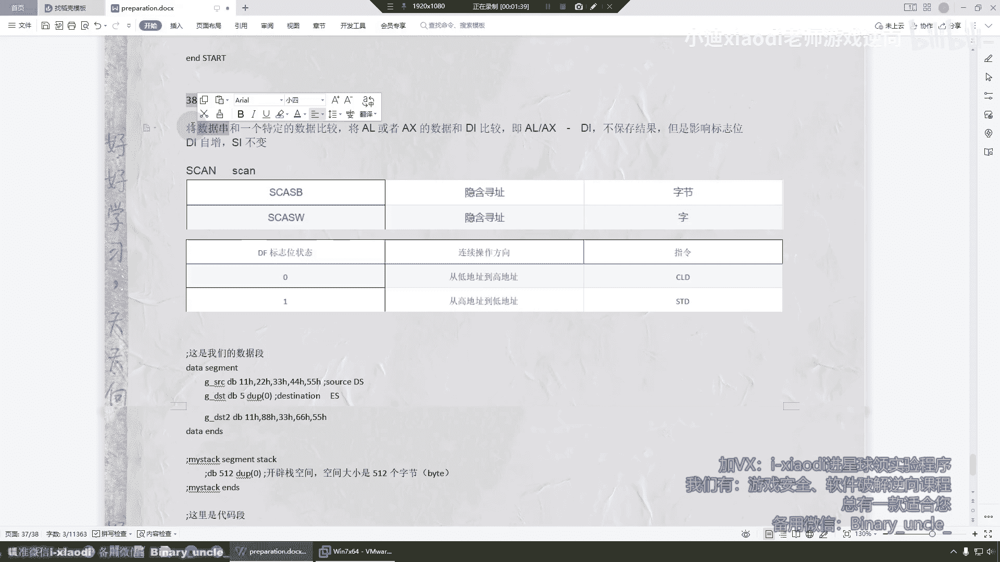
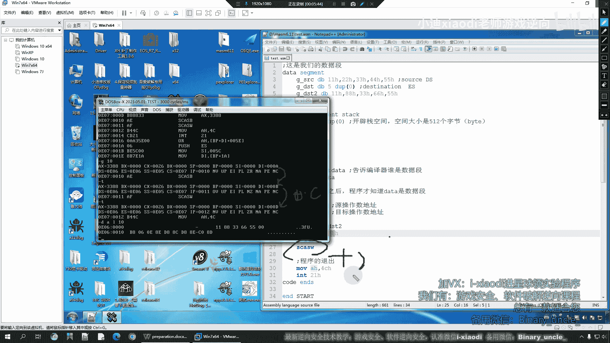
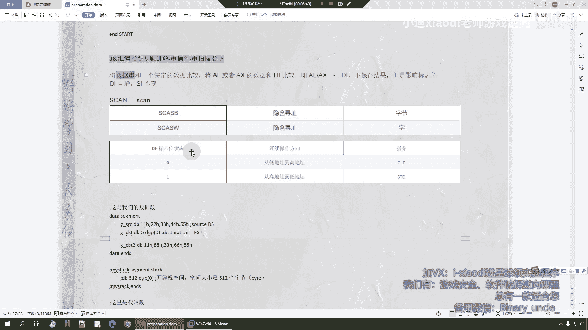
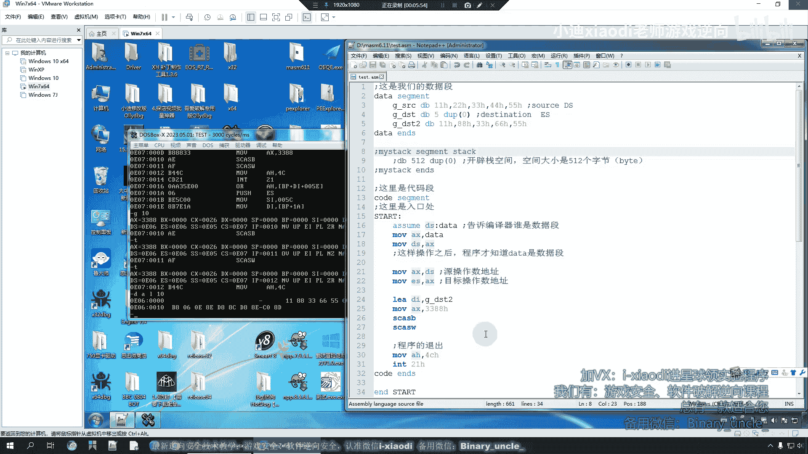
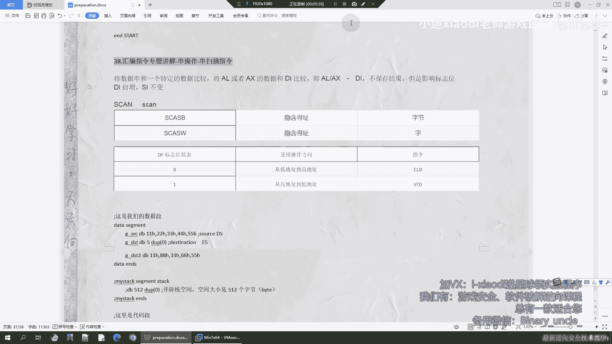

# 🔍 小白软件破解逆向工程师2023最新：4.38：汇编指令专题讲解-串操作-串扫描指令

在本节课中，我们将学习汇编语言中的串扫描指令。上一节课我们介绍了串比较指令，串比较是两个串逐元素进行对比。而串扫描指令则是把一个串中的每一个数据，与另一个特定的单独数据进行比较。通过本节课的学习，你会理解串扫描的基本原理、常用指令以及实际调试时的注意事项。

## 一、什么是串扫描指令

串比较指令处理的是“串 vs 串”的关系，两个串里的元素一个个拿出来做比较。而串扫描处理的是“串 vs 单个数据”的关系。打个比方：假设有一队人在排队，现在你手里拿着一张张三的照片，然后从队头开始，挨个看队伍里的每一个人是不是张三。串扫描就是做这件事：一个串里有很多数据，这些数据依次去和某一个固定的数据比较。

那么具体是谁和谁比较呢？在汇编中，参与比较的一方是 AL 或 AX 中的数据，另一方是 DI 寄存器指向的内存数据。也就是说，用 AL 或 AX 的值去减 DI 指向的那个值。为什么用减法？因为在计算机底层，没有直接的“比较”电路，所有比较最终都是通过减法实现的。加减乘除本质上就是最底层的数学运算，这也是数学支撑科技发展的一个缩影。

## 二、串扫描的底层操作方式

串扫描的核心操作是减法，公式表达如下：



- 字节扫描：`AL - [DI]`，结果不保存，但会改变标志位。
- 字扫描：`AX - [DI]`，结果不保存，但会改变标志位。

注意，这里的减法结果不会写回任何寄存器或内存，它只是用来影响标志位。如果结果为零，则 ZF（零标志位）被置为 1；如果不为零，ZF 为 0。在调试时，我们就是通过 ZF 来判断当前数据是否匹配的。

另外，每次扫描之后，DI 会自动增加或减少，具体取决于方向标志位 DF。通常情况下 DF=0，所以 DI 是递增的。如果使用字节扫描（SCASB），DI 加 1；如果使用字扫描（SCASW），DI 加 2。用代码表示就是：

```asm
; 字节扫描
SCASB   ; 比较 AL 与 [DI]
        ; DI = DI + 1 (若 DF=0)

; 字扫描
SCASW   ; 比较 AX 与 [DI]
        ; DI = DI + 2 (若 DF=0)
```

## 三、常用的串扫描指令

常用的串扫描指令有两个：`SCASB` 和 `SCASW`。

- `SCASB`：B 表示字节，一次扫描一个字节，用 AL 参与比较。
- `SCASW`：W 表示字，一次扫描一个字，用 AX 参与比较。

其中 `SCAS` 的全称是 `SCAN`，意思就是扫描。把它翻译成中文，有“审视、细查、详细调查”等含义，但核心意思就是“扫描”。从队列中挨个找人这个比喻，正是对 SCAS 指令行为的最好描述：从串的头部开始，逐个元素与目标数据做减法比较。

## 四、示例分析：字节扫描

下面我们通过一个具体的例子来理解串扫描。假设我们准备了一个串，串中存放的数据依次是 `11、88、33、65`。为了便于观察，我们先把串的首地址取出来。然后让 AL 的值等于 88，用 `SCASB` 去扫描这个串。

在调试器中运行这段代码，第一次执行 `SCASB` 时，拿 AL（88）减去 DI 指向的第一个元素（11），结果不为零，所以 ZF 不置位，这时调试器显示状态为 `NZ`，也就是 Not Zero（不相等）。接着 DI 自动加 1，指向下一个元素。第二次执行 `SCASB`，拿 AL（88）减去 DI 指向的第二个元素（88），结果为 0，ZF 置位，状态变为 `ZR`（Zero，相等）。这样我们就找到了匹配的数据。

这个过程用伪代码描述如下：

```asm
; 数据段
data: db 11h, 88h, 33h, 65h

; 代码段
mov al, 88h    ; AL 存放要查找的数据
lea di, data   ; DI 指向串首
scasb          ; 第一次：88 - 11 ≠ 0，NZ，DI+1
scasb          ; 第二次：88 - 88 = 0，ZR，DI+1
```

## 五、示例分析：字扫描与字节序

再来看字扫描的情况。如果参与比较的数据是 16 位的，就要用 `SCASW`。此时 `DI` 每次增加 2，而不是 1。比如目标地址从 A 开始：A、B、C、D 是连续的四个地址。当你执行完一次字节扫描后，DI 从 A 变到 B；如果接下来执行字扫描，由于要取两个字节，DI 会从 B 跳到 D，中间隔了一个 C 地址，所以跨度是 2。

这里有一个特别容易搞错的地方，就是小端存储。x86 内存中，字数据是倒着存放的：低字节在低地址，高字节在高地址。假设内存中从某个地址开始的两个字节，按照地址顺序看到的是 `33、88`，那么这两个字节组成一个字的时候，实际数值并不是 `3388h`，而是要把顺序反过来。由于这个原因，在设置 AX 时，要按照反序后的值来写。原视频中的例子是这样：要匹配的数据在内存中表现为 `3388` 的顺序，那么 AX 中就应该写 `3388h`；如果你写成了 `8833h`，那必然对不上，因为内存是倒序存储的。

所以，字扫描常用于以下的场景：



```asm
mov ax, 3388h   ; 注意这个值是根据内存字节序反推出来的
lea di, data    ; DI 指向某个字数据
scasw           ; 比较 AX 与 [DI]，然后 DI = DI + 2
```



如果你在调试时看到第一次比较不相等，不要急着下结论，先检查一下 AX 的值是不是按照小端序正确设置。真正相等时，标志位 ZF 会置 1，这时调试器显示 `ZR`，表示匹配成功。



## 六、总结



本节课我们一起学习了串扫描指令。串扫描的核心思想是：用一个特定的数据（AL/AX），逐个去和串中的每一个元素做减法比较，根据结果影响标志位，从而判断是否相等。常用的指令是 `SCASB`（字节）和 `SCASW`（字），执行后 DI 自动变化，变化步长与扫描宽度有关。特别要注意的是字操作时的小端字节序问题，这是初学者最容易掉进去的坑。希望你把示例代码亲手敲一遍，加深对串扫描流程和标志位变化的理解。下节课我们再继续学习别的汇编指令。
