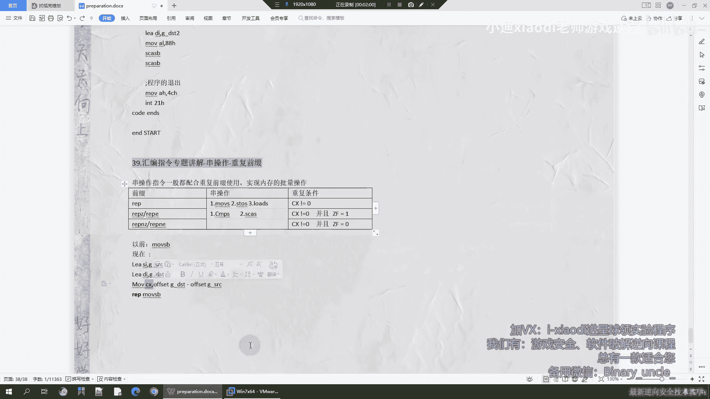
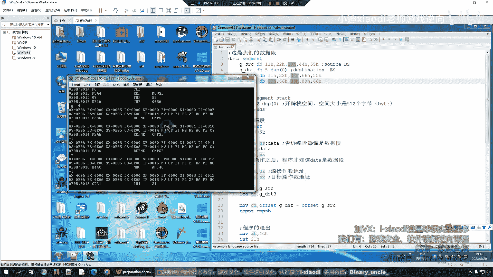

# 🧭 小白软件破解逆向工程师2023最新：4.39：汇编指令专题讲解-串操作-重复前缀


在本节课中我们将要学习汇编里的重复前缀，重点是把“串操作指令只执行一次”变成“按次数循环执行”，从而实现内存的批量操作。对于初学者来说，可以先把它理解成给一条串操作指令加一个“循环开关”：开关打开后，指令就会根据计数器寄存器的值反复执行，直到条件不满足为止。下面我们会从重复前缀是什么、重复条件由谁控制、REP 配合 MOVSB 的调试过程、比较类重复前缀 REPE/REPZ 与 REPNE/REPNZ，以及常见应用场景几个方面展开。


## 📌 小白软件破解逆向工程师2023最新：4.39：本节概述


重复前缀的核心作用，是让串操作指令循环重复执行。以前单独执行一条串操作指令时，执行完一句就会停下来；加上重复前缀后，就可以实现内存的批量操作。本节课会围绕这个核心展开，先讲清楚 `REP` 的基本用法，再讲比较类前缀和调试现象，最后说明它在软件破解与攻防对抗中的常见思路。


下面先列出本节要掌握的关键点，方便建立整体印象。

- `REP` 可以让串操作指令循环执行。
- 重复次数或长度通常由计数器寄存器 `CX` 控制。
- `REP MOVSB` 可以按 `CX` 的次数重复搬运数据。
- `REPE/REPZ` 在相等条件满足时继续循环。
- `REPNE/REPNZ` 在不相等条件满足时继续循环。
- 调试时要观察 `CX` 和 `ZF` 的变化，理解循环为什么继续、为什么停止。


## 🧩 小白软件破解逆向工程师2023最新：4.39：重复前缀是什么


重复前缀就是加在串操作指令前面的一个前缀，作用是让串操作指令循环重复执行，从而实现内存的批量操作。之前使用串操作指令时，执行完一句之后它就停了；例如 `MOVSB` 以前只执行一次。要让 `MOVSB` 循环执行，就在前面加上 `REP`，`REP` 表示循环的意思，这样它就会循环执行。

下面用代码对比“只执行一次”和“循环执行”的基本形式。



```asm
MOVSB        ; 只执行一次
REP MOVSB    ; 按 CX 次数重复执行
```

循环时要先写好 `MOVSB` 这条指令，然后在前面加上前缀。另外，串操作的重复是有条件的，加上重复前缀之后并不是无限循环，而是由计数器寄存器决定是否继续。原文口述中容易把 `CX` 听成 `CS`，在16位汇编里重复次数通常看 `CX`，学习时要把这两个概念区分开。


> 原文中提到的“CS 决定重复条件”应理解为计数器寄存器 `CX` 决定重复条件和次数。


理解了基本形式后，可以做一个简单的引申：如果看到重复的内存批量操作，一般可能是游戏检测、软件数据检测等场景。若不想让它继续检测，而检测点里又有这种循环结构，就可以考虑修改 `CX`。因为重复条件通常是不等于0，所以把 `CX` 改成0，就可以让重复操作中断。


## ⚙️ 小白软件破解逆向工程师2023最新：4.39：重复条件与计数器 CX


使用重复前缀时，要先准备前缀，再准备 `CX` 寄存器。`CX` 可以理解为重复的次数或长度，它决定这条串操作指令要循环几次。可以用下面的伪代码表示基本逻辑。


```text
while (CX != 0) {
    执行串操作指令;
    CX = CX - 1;
}
```


下面列出使用 `REP` 时需要明确的几个要点。

- 先写串操作指令，例如 `MOVSB`。
- 在串操作指令前加上 `REP` 前缀。
- `CX` 表示重复次数或长度。
- 每次重复后 `CX` 会递减，减到0就不再重复。
- 长度要计算正确，不能多算，否则会超出目标数据范围。


`MOVSB` 的方向是 `SI` 给到 `DI`，也就是源地址 `SI` 指向的数据送到目标地址 `DI`，这个方向不要弄乱。示例里有5个元素，就要循环5次，因此长度要按实际元素数量计算。如果长度算多了，就会超出原本的目标范围，超出的数据就不再是目标地址原本的数据了。长度可以用结束地址减去起始地址得到，同时要把地址正确切出来。


```text
长度 = OFFSET destination_end - OFFSET destination_start
```


## 🧪 小白软件破解逆向工程师2023最新：4.39：REP 配合 MOVSB 的操作与调试


在具体调试时，可以先执行到第14行的位置，然后单步执行。单步后可以看到 `SI` 和 `DI` 都往后推移，例如出现 `SI` 变为1、`DI` 变为6这种效果，同时指令仍然停在当前语句上。再执行一次，仍然停在这条语句；继续执行，`CX` 会发生变化，呈现 4、3、2、1、0 的递减过程。`CX` 变为0之后就不会再重复了，这就是重复执行串操作的过程。

下面列出调试时值得观察的现象。

- 单步执行后 `SI` 和 `DI` 会往后推移。
- 指令会重复停留在同一条语句上。
- `CX` 会按 4、3、2、1、0 递减。
- `CX` 到0后循环停止。
- 这说明 `REP` 确实让串操作重复执行了。


除了 `MOVSB`，也可以使用 `STOSB` 做存储操作。使用 `STOSB` 时要记住它和 `AL` 或 `AX` 寄存器有关，具体写法可以自己练习。这个例子说明重复前缀是配合串操作指令使用的，核心仍然是“按次数循环执行”。


## 🔍 小白软件破解逆向工程师2023最新：4.39：比较类重复前缀 REPE/REPZ 与 REPNE/REPNZ


除了 `REP` 这种重复前缀，还有用于重复比较的前缀。前面的 `REP` 多用于数据存储和数据传送，后面的这些前缀对应比较或扫描操作。比较类前缀里，`REPZ` 和 `REPE` 本质一样：`Z` 强调零标志 `ZF`，`E` 强调相等；两者都表示相等条件满足时继续循环。`REPNE` 和 `REPNZ` 本质一样，表示不相等条件满足时继续循环。

下面用公式描述两类比较前缀的继续条件。

```text
REPE/REPZ:    (CX != 0) 且 (ZF == 1) 时继续循环
REPNE/REPNZ:  (CX != 0) 且 (ZF == 0) 时继续循环
```

相等时，两个数相减结果为0，会触发零标志位 `ZF=1`，所以 `REPE/REPZ` 会继续比较；不相等时 `ZF=0`，`REPE/REPZ` 就停止。相反，`REPNE/REPNZ` 是在 `ZF=0` 即不相等时继续循环，相等时就停止，因此适合在众多字符串里查找一个相等的数据。


下面列出比较类前缀的典型写法，便于对照记忆。

- `REPE CMPSB`：相等时继续比较。
- `REPZ CMPSB`：与 `REPE CMPSB` 等价。
- `REPNE CMPSB`：不相等时继续比较。
- `REPNZ CMPSB`：与 `REPNE CMPSB` 等价。
- `CMPSB` 比较时不保存减法结果，只影响标志位。


比较示例中，可以让 `SRC` 和 `DEST` 对应位置进行比较，本质上可以理解为 `SI` 指向的字节减去 `DI` 指向的字节。加上重复前缀后，就是循环做减法比较，但 `CMPSB` 不保存减法结果。比较次数同样要计算长度，因为两个串一样长，所以算其中一个的长度即可，长度仍然可以用结束地址减起始地址得到。


在写比较类重复前缀时，不能随手只写 `REP`，示例第28行就会报错；这里要写 `REPE` 或 `REPZ`。习惯上可以写 `REPE`，因为 `E` 代表相等；写 `REPZ` 也可以，因为 `Z` 代表零标志。保存后运行，程序就没有问题了。


> 比较场景中按本课示例要写 `REPE` 或 `REPZ`，不要只写 `REP`；示例第28行会提示错误。


调试 `REPE/REPZ` 时，可以执行到第14行的位置。刚开始语句还没有开始执行，观察 `ZF`：相等时 `ZF=1`，继续比较；再执行仍然相等，就继续；当遇到44和66这种不相等的数据时，会出现 `NZ` 即不相等，`ZF=0`，此时 `REPE` 就不再重复了。有人会想能不能再比较下一个55，实际不会，因为已经出现不相等，循环到66就停了，不要对后续继续比较抱有期待。这个例子说明 `REPE/REPZ` 是相等才继续、不相等就停止。


接下来看 `REPNE/REPNZ`。它是在不相等时继续循环，也就是 `ZF=0` 时继续；相等时停止。这个前缀适合在众多字符串里找一个相等的数据。示例可以定义一个数组，例如第三个元素让它相等，后面再写88也无所谓，因为碰到相等就会停下来。


```asm
DST3 DB 33, 66, 33, 88
```


下面列出 `REPNE/REPNZ` 示例的调试现象。

- 前面加 `N`，表示按不相等条件循环。
- 第一个元素不相等，所以继续循环。
- 第二个元素也不相等，所以继续循环。
- 第三个元素相等，循环停止并直接退出。
- 整个比较只执行了三次，说明它是不相等才循环、相等就停止。




## 🛡️ 小白软件破解逆向工程师2023最新：4.39：应用场景与攻防思路


总的来说，重复前缀要配合串操作指令使用，用来实现内存的批量操作。它的应用场景主要体现在对抗方面：如果在关键代码处看到这种结构，首先要弄清楚它的操作逻辑，再判断它可能出现在什么地方，以及能不能通过修改计数器或数据来影响它的行为。

下面列出常见应用场景和攻防思路，帮助把前面学的内容串起来。

- 它可能出现在算法中，例如账号密码、机器码、注册码相关算法，需要先看懂它的操作逻辑。
- 在攻防对抗中，它可能用于检测数据；如果想让检测不继续循环，可以用修改重复条件的方式处理。
- 也可以对它进行内部修改，配合其他相关指令改变执行结果。
- 常见修改点是 `CX`，因为 `CX` 控制重复次数；把 `CX` 改成0，循环就会中断。
- 还可以考虑对原串做拷贝等方式，具体要结合上下文选择。
- 无论采用哪种方式，都要知道重复前缀的使用规则，不能只会套格式。


这些内容现在先简单了解，课程里还没有实际碰到具体案例，后面遇到相关场景时会继续讲。学习汇编指令时，先掌握规则和调试现象，比死记硬背更有用。


## ✅ 小白软件破解逆向工程师2023最新：4.39：本节总结


本节课中我们一起学习了重复前缀：`REP` 可以让串操作指令循环执行，实现内存批量操作；重复次数或长度通常由 `CX` 控制，`CX` 递减到0就停止；`REP MOVSB` 可以按次数搬运数据；`REPE/REPZ` 在相等时继续，`REPNE/REPNZ` 在不相等时继续；调试时要观察 `CX` 和 `ZF` 的变化。最后还了解了它在算法分析和攻防对抗中的常见思路。本节内容就是重复前缀，下集再见。
