# 小白软件破解逆向工程师2023最新：4.4：CPU对存储器的读写 🧠

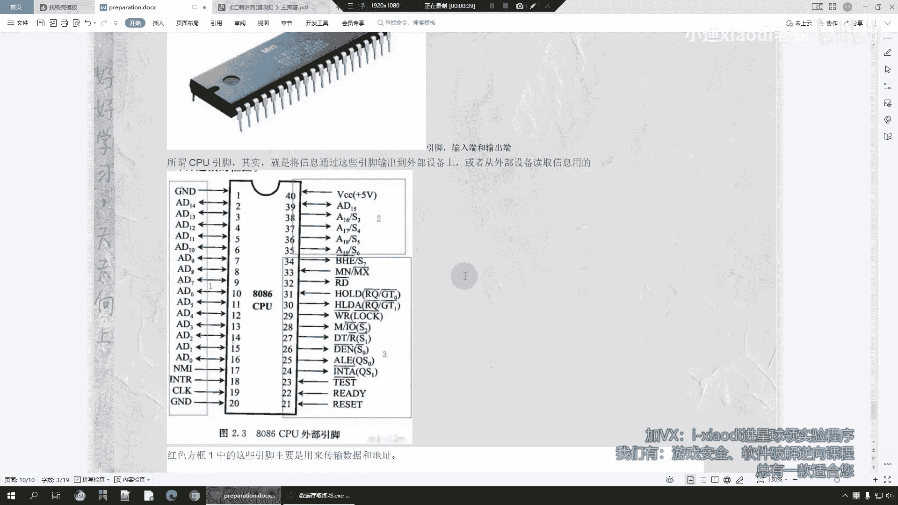

在本节课中我们将要学习CPU如何对存储器进行读写。内容会从CPU引脚讲起，再说明存储器地址、读写流程和总线的基本概念。本节内容比较基础，但非常重要，理解以后再看内存读写、调试分析和后面的总线内容会轻松很多。

上一节我们已经接触过CPU的位置，本节先来看看CPU引脚的作用。把CPU拆下来后，会发现它长了很多角，这些角叫作引脚。引脚是CPU的输入端或输出端，信息可以通过引脚输出到外部设备，也可以从外部设备读取信息，既能出去也能进来，比较灵活。信息进出就实现了信息交互，人类能设计出这样的东西非常伟大。

下面看看CPU引脚的具体分类。如果把CPU整体剖析，例如8086型号的CPU，会发现每一个引脚都有特定功能。人类设计时是精心设计的，虽然CPU很小，但包含很多内容，这也是CPU为什么那么贵的原因之一。

以下是CPU引脚按红色方块和蓝色方块划分后的两类作用。

- 红色方块这些引脚主要用来传输数据和地址。
- 蓝色方块比较复杂，字母比较多，暂时叫它功能配置，这种说法不是特别专业。它主要用来说明当前是输入还是输出，可以理解为一种状态，用来说明低电平还是高电平、是读还是写。

这些引脚各司其职，通过配合实现信息交互。CPU这个东西比较复杂，也引出一个现实问题：为什么我们暂时还造不出好的芯片。确实有一些地方比较落后，需要我们一起努力、一起学习，中国的未来需要大家一起努力。

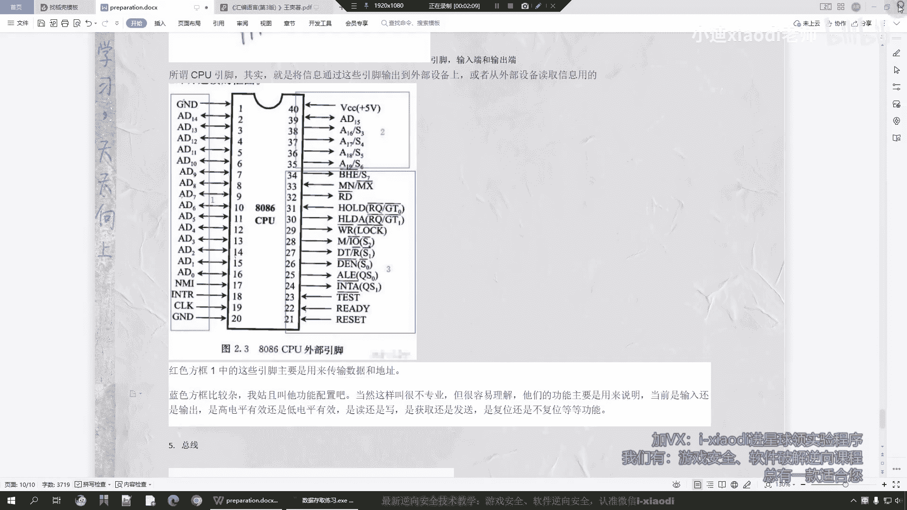

上一节说到存储器被划分为很多存储单元，从0开始顺序编号，这些编号可以理解为内存地址。内存地址是顺序编号的，这里把内存地址写出来，避免忘记。

以下是CPU操作存储器前必须先明确的内容。

- 从内存中读数据，必须指定存储单元的地址，也就是先告诉CPU要读哪里。
- 修改代码时，要说明修改的是哪个内存地址上的代码。例如修改460581这个内存地址的代码；如果要修改下一个位置，就说明修改460582这个内存地址的代码。
- 修改数据时也要说明地址。例如点击内存2，要修改4D5A，那么4D所在地址是0040000，这个内存地址对应一个数据。

所以在修改、读取或操作数据时，都要先指定地址。CPU要想进行数据读写，教材说需要进行三类信息交互，分别是存储单元的地址、读或写的命令、读或写的数据。下面按照顺序过程图来看。

上一节我们说明了存储器地址，本节来看看CPU读存储器的流程。假设CPU从3号单元读取数据，存储单元从0开始编号，依次是0、1、2、3。

以下是CPU读3号单元时用到的三类信息。

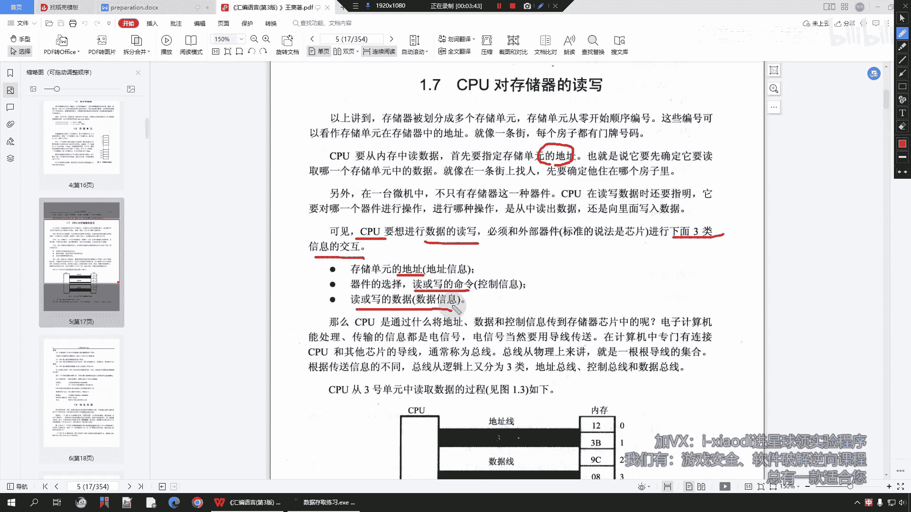

- 存储单元的地址：CPU先通过地址线把地址信息3发出，表示要对3号单元进行操作。
- 读或写的命令：CPU通过控制线发出内存读命令，读还是写由控制线实现，这里是读，所以发出读命令。
- 读或写的数据：存储器把3号单元的数据8通过数据线传入CPU，CPU由此知道读出的数据。

读操作过程可以用下面的代码表示。

```text
CPU --地址线(地址3)--> 存储器
CPU --控制线(读命令)--> 存储器
存储器 --数据线(数据8)--> CPU
```

读一个东西时会出现三种线，分别是地址线、数据线、控制线。这种线叫作总线。这里先记住总线的存在，总线是下节课要讲的内容。

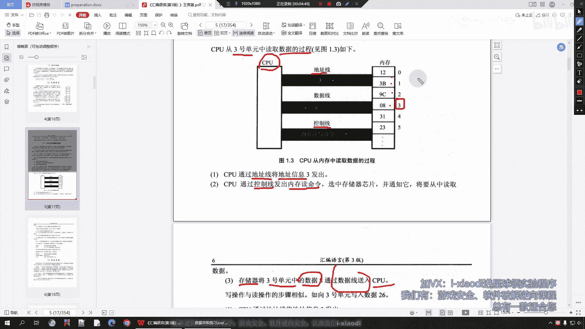

> 大白话记法：先告诉存储器“访问哪个单元”，再告诉它“是读还是写”，最后通过数据线把数据搬进或搬出。

上一节我们看到了读流程中的三类线，本节来认识总线。计算机能够处理和传输的信号都是电信号，电信号要通过导线传送。买电脑要插电，通电后电通过线来传送。计算机中专门有连接CPU和其他芯片的导线，这种线叫作总线。

总线从逻辑上分为三类，公式可以写成：`总线 = 地址总线 + 控制总线 + 数据总线`。

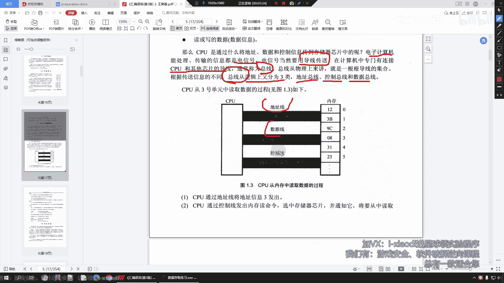

以下是总线在逻辑上的三种分类。

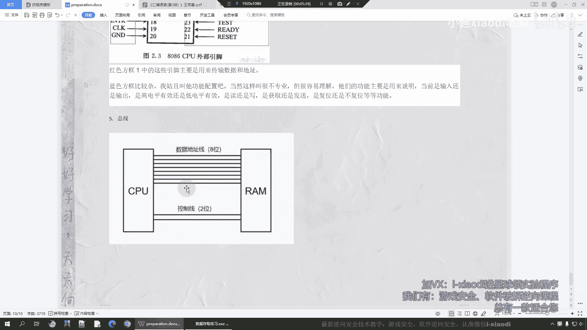

- 地址总线：用来传送地址信息。
- 控制总线：用来传送读或写等控制命令。
- 数据总线：用来传送数据。

知道这三类总线的存在即可，总线的细节下节课再讲。一次存储器访问也可以用公式概括：`一次存储器访问 = 地址信息 + 读/写命令 + 读/写数据`。

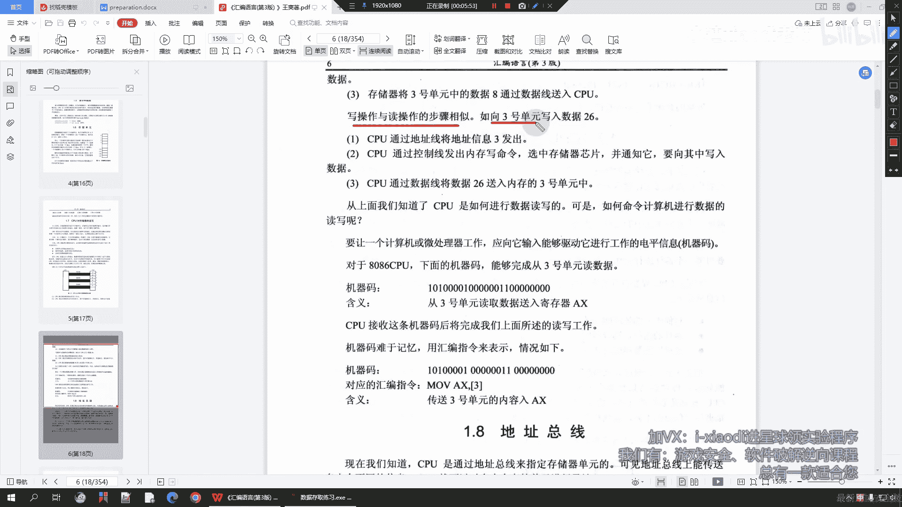

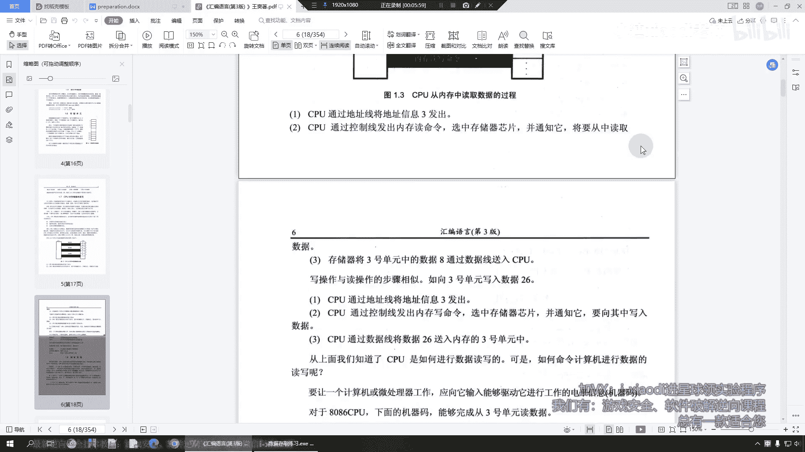

上一节我们介绍了总线，本节来看看写操作。写操作和读操作的整体思路一样，只是数据传送方向不同。例如向3号单元写入数据，先通过地址线发出地址信息3，告诉存储器要对内存地址3进行写操作。然后通过控制线发出写命令。再通过数据线将数据26传进去。

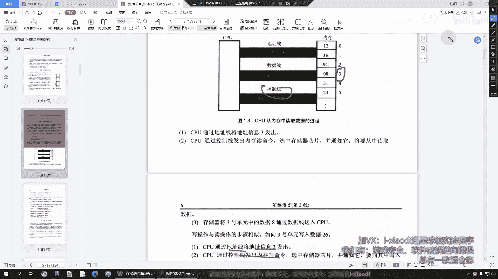

写操作过程可以用下面的代码表示。

```text
CPU --地址线(地址3)--> 存储器
CPU --控制线(写命令)--> 存储器
CPU --数据线(数据26)--> 存储器
```

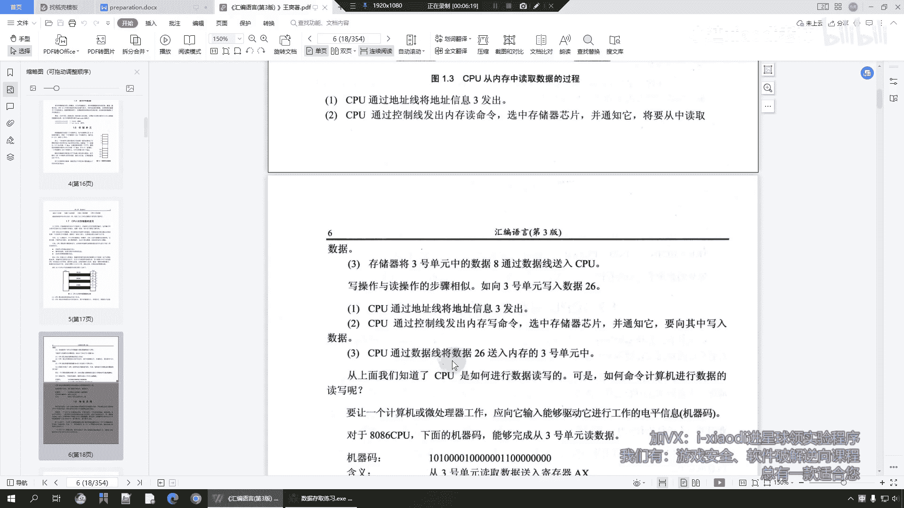

写操作时数据传送方向不一样，是把数据传进去。数据线可以往左传，也可以往右传，所以读和写都能通过数据线完成。

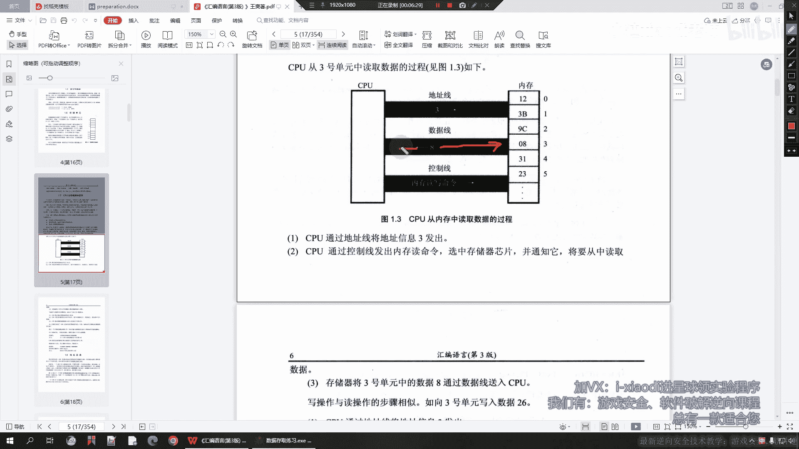

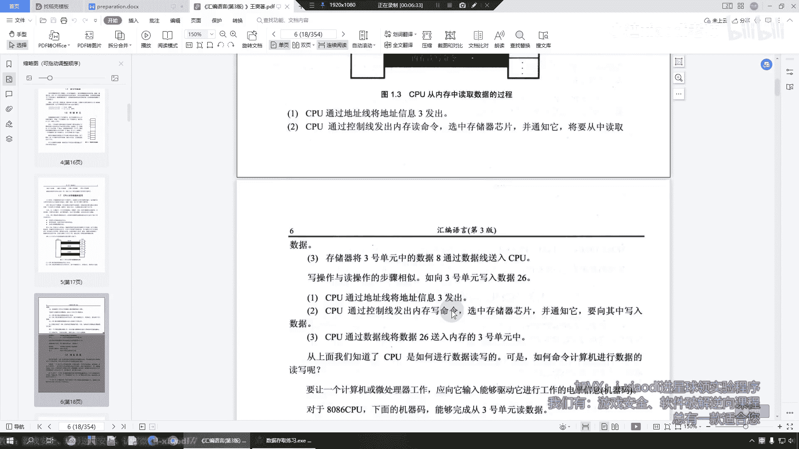

本节课我们一起学习了CPU对存储器的读写。我们了解了CPU引脚分为传输数据和地址的引脚以及说明状态的功能配置引脚；知道了存储器单元从0开始顺序编号，操作数据前必须先指定内存地址；掌握了读操作和写操作都要先给地址、再给读或写命令、最后通过数据线传送数据；还认识了地址线、控制线和数据线组成的总线，以及总线分为地址总线、控制总线和数据总线。下一节会继续学习总线相关内容。

