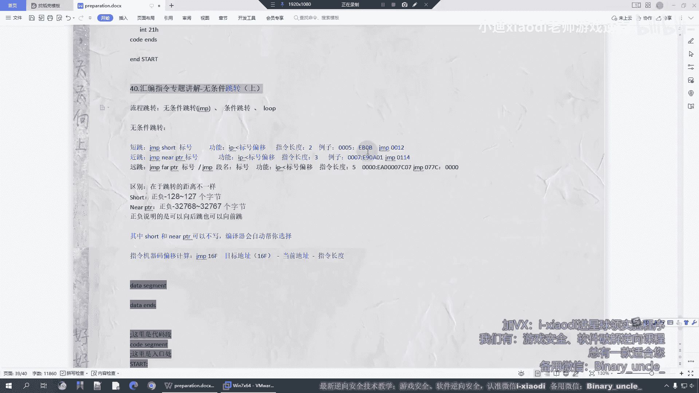
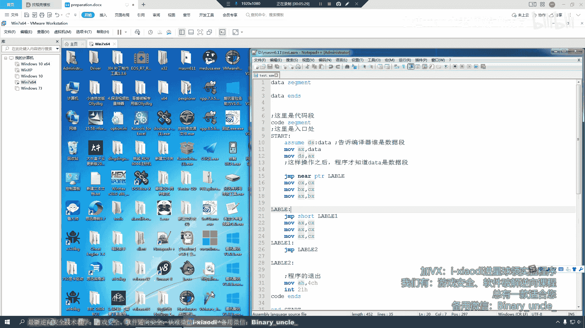
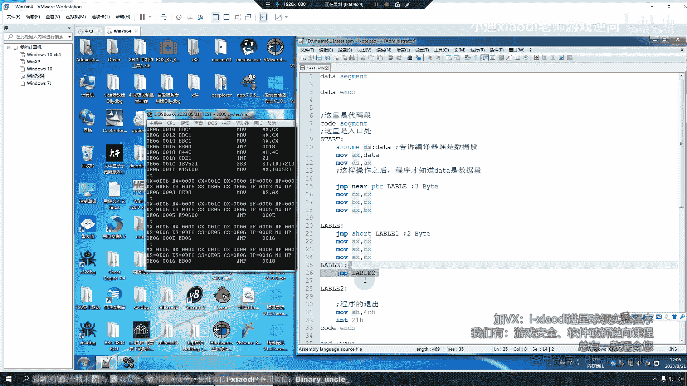
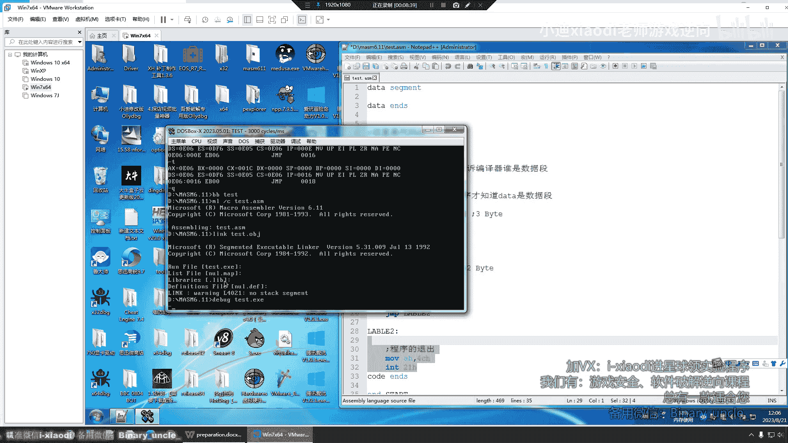
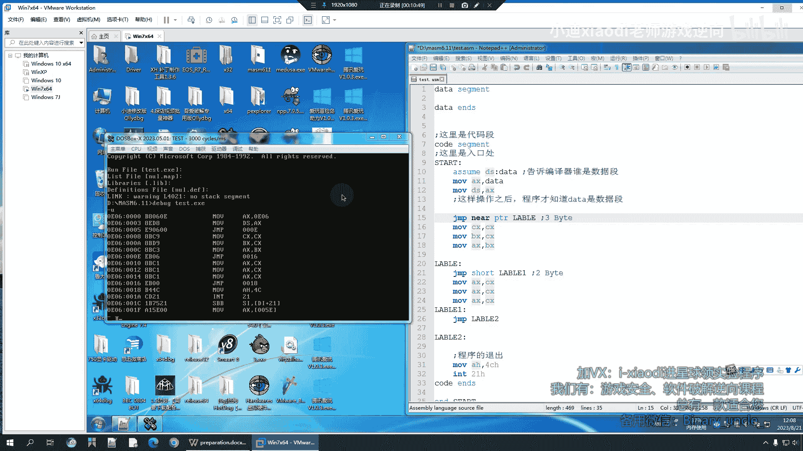

# 小白软件破解逆向工程师2023最新：4.40：汇编指令专题讲解——无条件跳转（上）🚀


## 一、课程概述📚



本节课是第 40 课，主要讲解汇编语言中的**无条件跳转**，并重点介绍无条件跳转中的三种距离类型：**短跳、近跳和远跳**。

在正式学习指令之前，我们会先从编写程序和日常生活中的“排队”现象入手，理解“跳转”到底是什么。随后，我们会分析跳转指令在内存中的表现、指令长度、机器码格式，以及短跳指令后面的偏移量如何计算。

本节课还会通过 DOSBox 和汇编代码进行验证，让抽象的概念变成可以直接观察的结果。


## 二、什么是程序中的跳转🔀

上一部分我们先说明了本节课的学习内容，接下来从程序执行的基本顺序开始理解跳转。

通常情况下，我们编写程序时，代码是按照从前往后的顺序排列的。程序执行时，也会按照代码出现的顺序，一行一行向后执行。

这种执行方式很像日常生活中的排队：

```text
第1行代码
第2行代码
第3行代码
第4行代码
第5行代码
```

程序默认会按照以下顺序执行：

```text
第1行 → 第2行 → 第3行 → 第4行 → 第5行
```

也就是说，前面的代码先执行，后面的代码再执行。代码通常不会无缘无故跳过中间内容。


### 1. 用排队理解跳转

为了让这个概念更容易理解，可以把程序代码想象成排队的人。

如果一个人按照顺序排队，他会先经过前面的人，再轮到自己。可是，如果某个人直接越过其他人，去到了队伍前面，这就可以理解为“插队”。

在程序中，跳过中间的一部分代码，直接执行其他位置的代码，就叫作**跳转**。

可以用下面的方式理解：

```text
正常执行：A → B → C → D

发生跳转：A → D
```

这里的 `B` 和 `C` 被跳过，程序直接从 `A` 执行到了 `D`。


### 2. 跳转的本质

跳转的本质是：

> 程序不再按照当前的顺序继续执行，而是把执行位置修改为另一个地址。

在计算机中，程序代码都存放在内存中。每一条指令都有自己的内存地址，因此跳转实际上就是：

```text
修改下一条要执行的指令地址
```

例如，当前执行位置是地址 `0x0007`，跳转目标是地址 `0x0002`，那么程序执行流程就会从：

```text
0x0007 → 0x0002
```

这就是从一个内存地址跳到另一个内存地址。


## 三、跳转的三种基本类型🧭

上一节我们通过排队理解了跳转的含义，本节继续介绍跳转的分类。

汇编语言中的跳转主要可以分成以下几类。下面这些类型的核心区别在于：跳转是否需要条件，以及跳转的距离有多远。

以下是常见的跳转类型：

1. **无条件跳转**

2. **条件跳转**

3. **循环跳转**


### 1. 无条件跳转

无条件跳转表示：只要程序执行到这条指令，就一定会跳转，不需要判断任何条件。

可以把它理解为一个强行插队的人。无论前面有多少人在排队，他都直接跳到指定位置，不考虑其他因素。

其执行逻辑可以表示为：

```text
执行到 JMP 指令
        ↓
直接跳转到目标地址
```

无条件跳转不会给程序留下选择空间。程序只要执行到这条指令，就必须按照指令指定的位置继续执行。


### 2. 条件跳转

条件跳转需要先判断某个条件是否成立，然后决定是否跳转。

它更像是在某种特殊情况下允许插队。例如，队伍中的人因为身体状况特殊，其他人可以选择让他先通过。

条件跳转的基本逻辑可以表示为：

```text
如果条件成立：
    跳转到目标地址
否则：
    继续执行下一条指令
```

因此，条件跳转给程序提供了选择空间。条件满足时跳转，条件不满足时则继续按照原来的顺序执行。


### 3. 循环跳转

循环也是一种常见的程序控制方式。程序可以通过跳转返回到前面的位置，重复执行某一段代码。

例如：

```text
执行代码A
执行代码B
跳回代码A
```

循环跳转的具体内容会在后续课程中介绍。本节课先重点学习无条件跳转。


## 四、无条件跳转的三种距离类型📏

本节课的重点是无条件跳转。无条件跳转按照跳转距离，可以分为三种：

1. **短跳：Short Jump**

2. **近跳：Near Jump**

3. **远跳：Far Jump**

它们最直观的区别就是跳转距离不同。短跳的距离较短，近跳的距离更远，远跳则可以跨越更大的地址范围。


### 1. 内存中的“距离”是什么

在日常生活中，距离可以用米、千米或者其他长度单位表示。

但是在计算机中，程序存放在内存中，计算机没有操场、跑道这一类现实空间。计算机通常使用两个内存地址之间相差多少个字节，来表示距离。

例如：

```text
目标地址 - 当前地址 = 跳转距离
```

如果当前地址是 `0x000E`，目标地址是 `0x0016`，两者之间相差一定数量的内存字节，这个差值就是跳转的距离。


### 2. Short、Near 和 Far 修饰符

汇编语言中，`short`、`near` 和 `far` 可以理解为用于说明跳转范围的修饰符。

对应关系如下：

| 类型 | 英文名称 | 常见修饰符 |
|---|---|---|
| 短跳 | Short Jump | `short` |
| 近跳 | Near Jump | `near` |
| 远跳 | Far Jump | `far` |

近跳有时会使用 `near ptr` 表示，远跳有时会使用 `far ptr` 表示。

实际编程中，短跳和近跳比较常用，远跳通常不需要深入理解，先知道它代表更远范围的跳转即可。


### 3. 短跳和近跳的距离范围

短跳和近跳的可跳转范围不同。

根据课程中的说明：

```text
Short：-127 到 +127 字节
Near：-32767 到 +32767 字节
```

也就是说：

- `short` 的跳转范围较小。

- `near` 的跳转范围较大。

- `far` 的跳转范围更远。

其中，正数和负数表示跳转方向。


### 4. 正数和负数表示方向

跳转偏移量中的正数和负数，表示跳转方向不同。

可以理解为：

```text
正数：向后跳
负数：向前跳
```

也就是说，程序既可以跳到后面的地址，也可以跳回前面的地址。

例如：

```text
当前地址  →  后面的目标地址
当前地址  ←  前面的目标地址
```

因此，跳转不一定只能向前，也可以向后。只要目标地址处于允许的范围内，程序就可以根据偏移量改变执行方向。


## 五、标号与内存地址的关系🏷️

上一节介绍了跳转距离和方向，本节继续说明跳转指令中的目标位置是如何表示的。

在汇编代码中，通常不会直接写一大串复杂的内存地址，而是使用**标号**表示目标位置。

例如：

```asm
label:
    ; 这里是目标代码
```

当程序执行跳转指令时，可以直接跳转到 `label` 所代表的位置。


### 1. 用排队号码理解标号

可以把标号理解为排队时使用的号码。

例如，队伍中的人分别对应不同的位置：

```text
1号、2号、3号、4号、5号、6号、7号
```

如果当前程序执行到了 `7号` 位置，但跳转指令要求它去 `2号` 位置，那么程序执行流程就是：

```text
7号 → 2号
```

在实际计算机中，这些“号码”并不是普通的编号，而是对应具体的**内存地址**。

因此：

```text
标号 ≈ 程序中的可读名称
标号对应的位置 = 实际内存地址
```

汇编器会根据标号所在的位置，自动计算真正的跳转地址。


## 六、短跳和近跳的指令长度💾

跳转指令本身也是程序代码，因此它也需要占用内存空间。

只要是代码，就会占用一定数量的内存字节。短跳和近跳的指令长度不同，具体如下：

| 跳转类型 | 指令长度 |
|---|---:|
| 短跳 | 2 字节 |
| 近跳 | 3 字节 |

也可以写成：

```text
Short Jump = 2 Bytes
Near Jump  = 3 Bytes
```

由于短跳只占用两个字节，所以在有限的内存空间中，能够节省更多空间，并留下更多可操作的空间。

近跳占用三个字节，虽然可以跳得更远，但比短跳多占用一个字节。


### 1. 修饰符可以省略

在编写汇编代码时，`short` 和 `near` 这样的修饰符通常可以不写。

如果目标位置明确，编译器会根据当前地址和目标地址之间的距离，自动选择合适的跳转类型。

其逻辑可以表示为：

```text
距离较近 → 自动选择 short
距离较远 → 自动选择 near
距离非常远 → 可能选择 far
```

因此，程序员不一定要手动指定 `short` 或 `near`。编译器可以根据实际距离自动完成选择。


## 七、使用 DOSBox 查看跳转指令🖥️

上一节介绍了编译器会自动选择跳转类型，接下来通过实际代码观察这种选择过程。

课程中使用虚拟机和 DOSBox 进行实验。基本操作包括：

```text
打开 DOSBox
挂载磁盘
进入对应目录
查看并编译汇编代码
```

示例操作流程如下：

```text
mount ...
cd 6
```



具体目录名称根据实验环境决定。


### 1. 汇编程序的基本结构

示例程序中首先定义了数据段：

```asm
data segment
    ; 数据内容
data ends
```

随后定义代码段：

```asm
code segment
    ; 程序代码
code ends
```

代码段中包含了多个标签。这些标签可以由程序员自行定义，用来表示不同的代码位置。

例如：

```asm
start:
    ; 程序入口
```

其中，`start` 可以作为程序的入口标签，表示程序开始执行的位置。


### 2. 使用 JMP 指令跳转

代码中使用了类似下面的写法：

```asm
jmp near ptr label
```

这条指令表示：无条件跳转到 `label` 所在的位置，并使用近跳形式。

近跳指令长度为三个字节：

```text
Near Jump = 3 Bytes
```

短跳可以写成：

```asm
jmp short label
```

短跳指令长度为两个字节：

```text
Short Jump = 2 Bytes
```

此外，还可以使用不指定修饰符的写法：

```asm
jmp label
```

这种情况下，编译器会根据目标地址距离自动选择适合的跳转类型。


## 八、观察无条件跳转的执行过程🔎

现在分析程序在执行到 `JMP` 指令时会发生什么。

程序通常按照从上到下的顺序执行。当程序执行到第 15 行的跳转指令时，它不会继续执行下面紧接着的三行代码，而是会直接跳到指定的标签位置。

示例逻辑如下：

```asm
jmp label

; 下面三行代码不会执行
mov ...
mov ...
mov ...
```

如果跳转目标是 `label`，那么实际执行流程就是：

```text
执行 JMP
    ↓
直接到达 label
    ↓
执行 label 后面的代码
```

中间被跳过的代码不会执行。


### 1. 调试过程

在调试器中，可以先执行类似下面的操作：

```asm
T
MOV DS, AX
```

然后执行跳转指令：

```asm
JMP 000E
```

此时需要观察跳转指令后面的三行代码是否执行。

正确结果是：这三行代码不会执行。

原因是程序遇到了无条件跳转指令。无条件跳转不会等待判断，也不会考虑中间代码是否应该执行，而是直接跳到目标位置。

可以把执行流程理解为：

```text
当前位置
   ↓
JMP 目标地址
   ↓
目标地址
```

例如，程序从地址 `0x0005` 直接跳转到地址 `0x000E`，中间的代码会被跳过。


### 2. 连续执行后的结果

当程序跳到 `label` 位置后，继续执行后面的代码。

如果后面还有另一个跳转指令，例如跳转到程序退出的位置，那么程序还会继续跳转。

示例流程可以表示为：

```text
地址 0x0005
    ↓ JMP
地址 0x000E
    ↓ 执行目标代码
地址 0x0016
    ↓ JMP
程序退出
```

因此，在调试时可以看到程序先跳过中间代码，再跳到后面的标签，最后跳到程序退出位置。


## 九、查看编译器自动选择的机器码🧩

上一节通过调试观察了程序执行流程，本节进一步查看跳转指令对应的机器码。

重新生成程序后，可以把源代码中的跳转指令和实际机器码进行对照。


### 1. 近跳的机器码

近跳指令通常以 `E9` 开头。

例如：

```text
E9 xx xx
```

近跳占用三个字节：

```text
E9 + 两个字节的偏移量 = 3 字节
```

因此，如果代码中明确使用近跳：

```asm
jmp near ptr 000E
```

生成的机器码长度就是三个字节。


### 2. 短跳的机器码

短跳指令通常以 `EB` 开头。

例如：

```text
EB 06
```

其中：

```text
EB = 短跳操作码
06 = 跳转偏移量
```

短跳占用两个字节：

```text
EB + 一个字节的偏移量 = 2 字节
```



因此，在代码中看到类似下面的机器码时：

```text
EB 06
EB 00
```

可以判断它们都是短跳指令。


### 3. 编译器的自动选择

如果跳转目标距离较近，即使源代码没有明确写出 `short`，编译器也可能自动生成短跳机器码。

例如：



```asm
jmp label
```

编译器发现目标位置距离很近，就会自动将它编码成：

```text
EB xx
```

如果目标位置距离较远，则可能生成近跳：

```text
E9 xx xx
```

因此，可以通过查看机器码的第一个字节，判断跳转指令的类型：

```text
EB → 短跳
E9 → 近跳
```

这也是实际分析程序时经常使用的方法。


## 十、短跳偏移量的计算方法🧮

现在重点分析短跳机器码中，后面的偏移量是如何计算出来的。

短跳机器码一般是：

```text
EB offset
```

其中，`EB` 是操作码，`offset` 是从当前指令末尾到目标地址之间的相对偏移量。

核心计算公式如下：

```text
偏移量 = 目标地址 - 当前指令地址 - 指令长度
```

需要注意，这里的“当前指令地址”通常指跳转指令的起始地址，而指令长度需要根据实际跳转类型计算。


### 1. 第一个计算示例

假设：

```text
目标地址 = 0x16
当前地址 = 0x0E
指令长度 = 2 字节
```

根据公式计算：

```text
偏移量 = 0x16 - 0x0E - 0x02
       = 0x08 - 0x02
       = 0x06
```

因此，机器码中的偏移量就是：

```text
06
```

最终机器码为：

```text
EB 06
```

这说明程序从当前短跳指令执行完之后，再向后移动 `0x06` 个字节，就能到达目标地址。


### 2. 第二个计算示例

假设：

```text
目标地址 = 0x0E
当前地址 = 0x05
指令长度 = 3 字节
```

根据公式计算：

```text
偏移量 = 0x0E - 0x05 - 0x03
       = 0x09 - 0x03
       = 0x06
```

因此，偏移量依然是：

```text
06
```

如果机器码后面还需要占用两个字节，而实际计算出的偏移量只有一个字节，那么没有使用到的位置就用 `00` 补齐。

例如：

```text
06 00
```

这里的 `00` 只是用于占位，并不表示额外的跳转距离。


### 3. 第三个计算示例

假设：

```text
目标地址 = 0x18
当前地址 = 0x16
指令长度 = 2 字节
```

根据公式计算：

```text
偏移量 = 0x18 - 0x16 - 0x02
       = 0x02 - 0x02
       = 0x00
```

因此，偏移量就是：



```text
00
```

这里对应的机器码可以理解为：

```text
EB 00
```

这表示目标地址正好位于当前短跳指令执行结束后的位置。


## 十一、为什么要减去指令长度📐

前面的计算中，不能只使用：

```text
目标地址 - 当前地址
```

还必须减去当前跳转指令自身的长度。

原因是：处理器计算相对跳转时，参考的是**当前跳转指令执行完成之后的位置**，而不是跳转指令的起始位置。

因此，正确公式是：

```text
相对偏移量 = 目标地址 - 当前地址 - 当前指令长度
```

不同指令的长度不同，所以计算时要使用实际长度：

```text
短跳：指令长度为 2 字节
近跳：指令长度为 3 字节
```

如果忽略指令长度，计算出的偏移量就会多出一部分，最终无法正确到达目标地址。


### 1. 不足部分使用 00 填充

当机器码需要多个字节表示偏移量，而实际计算结果只占用较少字节时，可以使用 `00` 填充空余位置。

例如：

```text
实际偏移量：06
机器码空间：两个字节
补齐结果：06 00
```

这只是机器码格式上的补齐方式，不代表额外执行一条指令，也不代表跳转距离发生了变化。


## 十二、无条件跳转的完整逻辑🧠

到这里，可以把无条件跳转的执行过程总结为以下步骤：

1. 处理器执行当前指令。

2. 发现当前指令是 `JMP`。

3. 根据机器码识别跳转类型。

4. 计算目标地址或读取目标偏移量。

5. 修改下一条要执行的指令地址。

6. 直接执行目标位置的代码。

其基本流程可以写成：

```text
执行 JMP
    ↓
读取跳转操作码
    ↓
读取相对偏移量或目标地址
    ↓
计算新的执行地址
    ↓
跳转到目标位置
```

无条件跳转最大的特点是：它不判断条件，执行到就跳转。


## 十三、跳转指令在程序分析中的作用🛠️

跳转指令不仅用于编写程序，也经常出现在程序调试、逆向分析和软件破解过程中。

在分析程序时，经常需要修改某个跳转指令的目标位置。例如，可以改变跳转偏移量，让程序跳到另一段代码，或者绕过某些代码。

因此，需要掌握以下内容：

```text
跳转指令的机器码
跳转指令的长度
目标地址的计算方式
相对偏移量的计算方式
```

后续课程可能会进一步介绍一种与修改跳转相关的技术。实际应用中，程序员或逆向分析人员经常需要修改跳转指令，以改变程序原本的执行流程。


## 十四、本节课总结✅

本节课我们一起学习了汇编语言中的无条件跳转。

核心内容包括：

- 程序默认按照代码顺序执行。

- 跳转表示程序改变原来的执行顺序。

- 标号可以表示代码中的目标位置。

- 无条件跳转不需要判断条件，执行到就会直接跳转。

- 无条件跳转可以分为短跳、近跳和远跳。

- 短跳的范围较小，近跳的范围较大，远跳的范围更远。

- 短跳通常占用 2 个字节。

- 近跳通常占用 3 个字节。

- 短跳机器码通常以 `EB` 开头。

- 近跳机器码通常以 `E9` 开头。

- 编译器可以根据目标距离自动选择短跳或近跳。

- 相对偏移量的计算公式是：

```text
偏移量 = 目标地址 - 当前地址 - 指令长度
```

- 当机器码空间没有完全使用时，可以使用 `00` 进行填充。

理解这些内容之后，就可以通过查看汇编代码和机器码，判断程序是否发生了无条件跳转，并计算跳转指令最终会到达什么位置。

