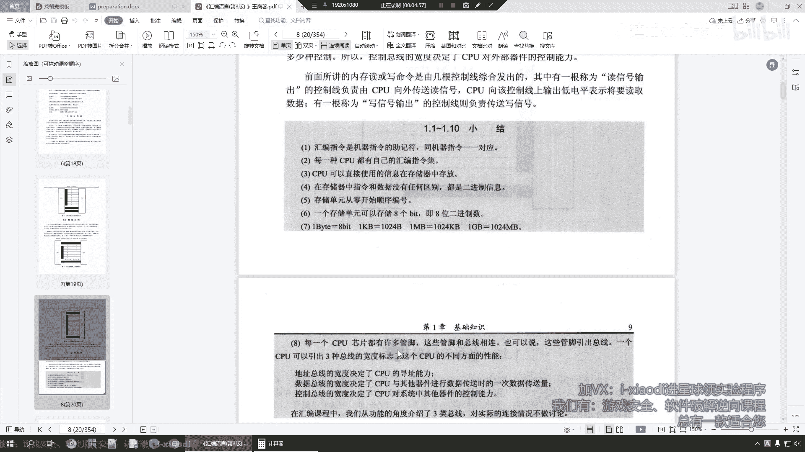

# 小白软件破解逆向工程师2023最新：4.5：🔌 总线


在本节课中我们一起来学习一个新概念，也就是**总线**。刚看到那张图的时候，很多同学可能会觉得一头雾水，看不明白图上画的到底是什么，这非常正常，不用担心，也不用先去死磕那张图，直接跟着下面的讲解把教材过一遍就行，听完之后回头看图，自然就能对应上了。

## 🧩 一、总线的逻辑分类


上一节课我们看到了教材里的一段内容，本节中我们来看看它到底说了什么。教材里讲的是：总线从逻辑上可以分为三类。这里要特别注意，是**三类**，不是**三根**，“根”和“类”完全不是一个概念，千万不要混在一起理解。

以下是这三类的具体名称：

- 地址总线
- 控制总线
- 数据总线

这三类总线各管一摊事，名字不一样，作用也不一样，接下来我们一个一个拆开讲，先从地址总线开始。

## 🏠 二、地址总线

现在我们已经知道，CPU 是通过地址总线来指定存储器单元的。那什么叫存储器单元呢？用大白话说，你就把它简单理解成**内存地址**，也就是内存里某个具体位置的编号。

CPU 不是靠一根线去确定内存地址，而是靠**一类**地址总线来确定内存地址。确定内存地址的可能性非常多，因为内存里的位置本来就很多，地址总线上能传送很多不同的信息，这样就可以对很多个存储单元进行**寻址**。

正因为可能性非常多，所以地址总线不可能只有一根。最底层的数据状态只有 0 和 1，导线的状态无非是通电或者不通电、高电平或者低电平，也就是开或者关，本质上就是 0 和 1 两种状态。只有一根线的话，0 和 1 的组合方式太少，能够表示的内存地址数量也就太有限了，因此必须用很多根线，让 0 和 1 的组合方式变多。

以下是地址总线的核心规律，可以写成公式：

```text
一根导线 = 传送 1 位二进制数据 = 只有 0 或 1 两种状态
十根导线 = 传送 10 位二进制数据 = 2^10 种组合

地址总线宽度为 N → 可寻址的存储器单元数量 = 2^N
```

一位二进制数据能表示多少种不同的数据呢？答案是 2 种。十根导线就能传送 10 位二进制数据，能表示 2 的 10 次方个不同的内存地址。所以一个 CPU 如果有 N 根地址线，我们就说这个 CPU 的**地址总线宽度为 N**，因为它确实有 N 根线，宽度自然就是 N。它具备的能力，就是能够寻找 2 的 N 次方个内存单元。


关于地址总线，听完上面的讲解，你只需要记住一句话：**地址总线不是一根，而是很多根**。记住这一点就足够了，再看那张图，一堆线并排的样子就能看明白了。

## 💾 三、数据总线与进制换算

上一节我们讲了地址总线，本节中我们来看看数据总线。教材里关于数据总线的文字可以直接跳过不看，你只要知道一件事：**数据是通过数据总线来传输的**。

我们需要重点关注的是教材里出现的 **D8** 和 **89** 这两个数据。它们是怎么出现的？以什么形式出现的？答案是以**二进制**的形式出现的。那具体怎么算出来的呢？这里直接教大家一个方法：打开计算器。

以下是调用计算器并完成进制换算的完整步骤：

- 按下 `Win + R` 打开运行窗口
- 在运行窗口里输入 `calc`，回车，计算器就被调出来了
- 在计算器界面里点击左上角的菜单，选择“程序员”模式
- 点击 `HEX`，`HEX` 代表十六进制
- 输入 `D8`，可以看到结果变成 `1101100011011000`
- 输入 `89`，可以看到结果变成 `1000100110001001`

`D8` 就是它第一次传的一个数据，`89` 是第二个数据，两者在计算器里都能直接转成二进制显示出来。你只需要记住这个计算器的使用方法就可以了，其他内容都不用管，教材上那一大段文字也不用看。


## 🎛️ 四、控制总线


上一节我们借助计算器把十六进制数据换成了二进制，本节中我们来看看最后一类总线，也就是控制总线。控制总线很简单，它同样不是一根，而是有好几根。

以下是控制总线的一个典型例子：

- 假设它有两根线，其中一根是读信号的控制线，负责发送“读”的指令
- 另外一根是写信号的控制线，负责发送“写”的指令

这些线表现出的低电平、高电平，实际上最终都可以理解成 0 和 1、1 和 0 这样的组合。所以说控制总线不是一根，而是两根，这样一来那张图就完全能看明白了。


控制线有两根，操作要么是读，要么是写。读的时候，读信号就是一，写信号就是零；写的时候，读信号就是零，写信号就是一。这就是实现层面“到底是在读还是在写”这个操作的判断方式。


## 📌 五、课程小结

本节课中我们一起学习了总线的相关知识。我们先明确了总线从逻辑上分为地址总线、控制总线和数据总线三类，注意是三类而不是三根；接着讲了 CPU 通过地址总线指定存储器单元，地址总线宽度为 N 就能寻找 2 的 N 次方个内存单元，并且地址总线一定不是一根；然后我们用 `Win + R` 加 `calc` 调出程序员计算器，把十六进制的 `D8` 和 `89` 换算成了二进制；最后讲了控制总线由多根线组成，通过读信号和写信号的 0 与 1 组合来控制到底是读还是写。



这个小节的内容大家可以自己再翻看一遍。另外补充一点，每个 CPU 都有很多管角，这个管角也叫**引脚**，有兴趣的同学可以自己去了解。本节课到这里就结束了，我们下节课再见。
