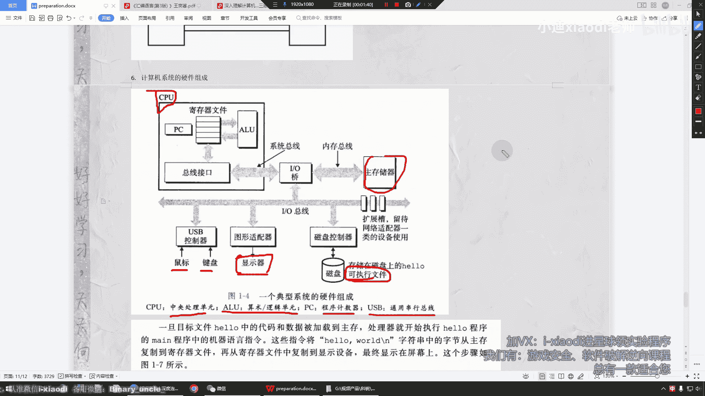
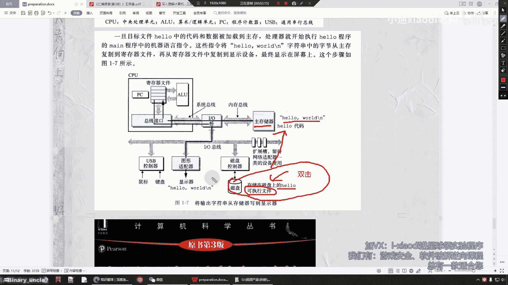
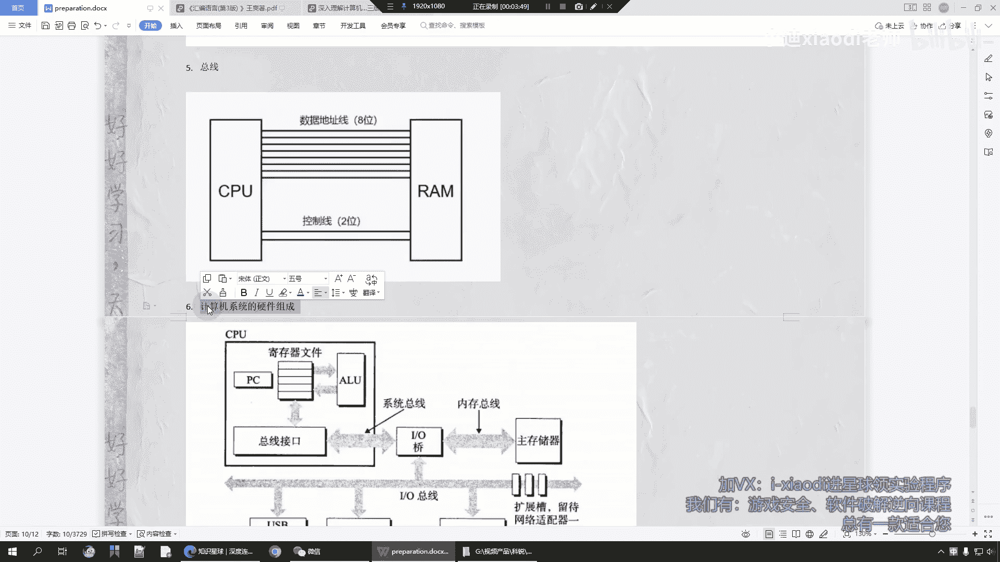
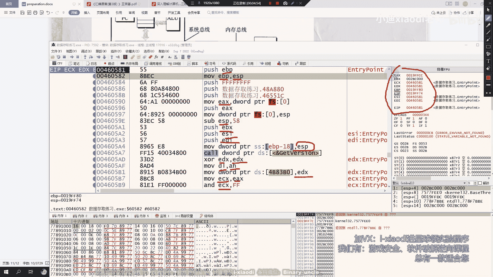
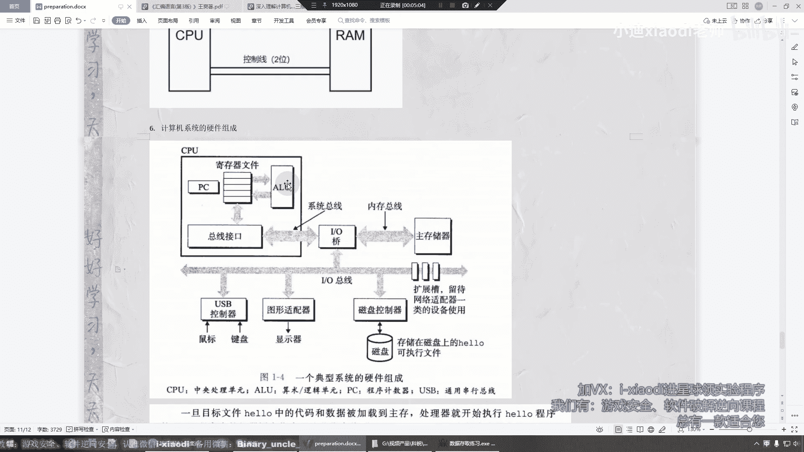
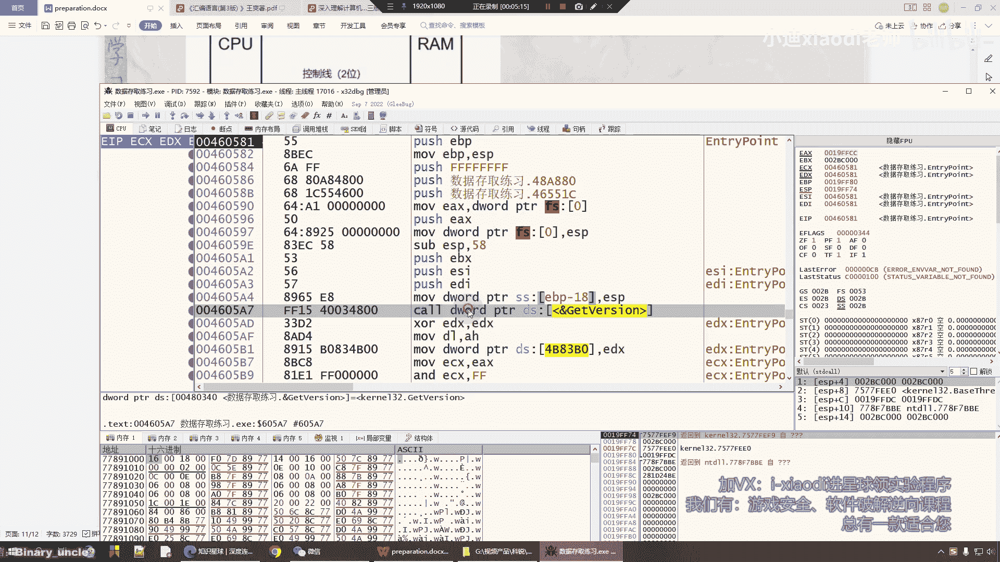
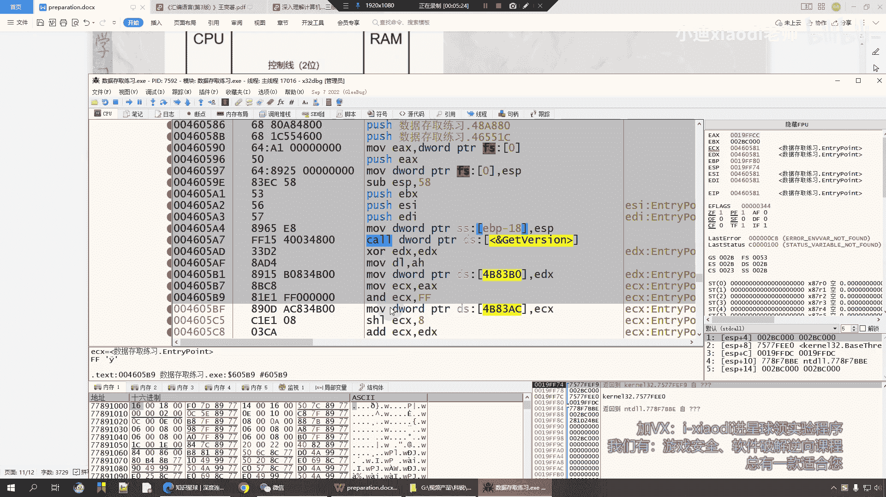
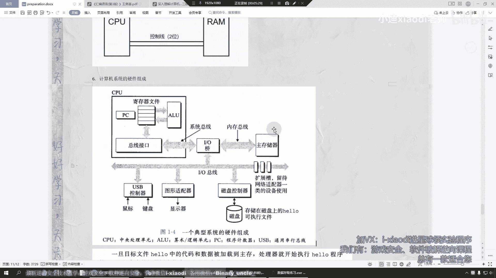

💻 小白软件破解逆向工程师2023最新：4.6：计算机系统的硬件组成

> 在本节课中，我们将会学习现代计算机系统的硬件组成，了解 CPU、内存、寄存器、I/O 桥这些部件是如何配合工作的，同时也会看到一个可执行文件从磁盘到屏幕的完整运行流程。

## 1️⃣ 现代计算机系统由哪些东西组成

先明确一件事：这里说的计算机系统，特指现代计算机系统，也就是你桌上那台最常见的机器。它有鼠标、有键盘、有显示器，平时你可以用来看小电影、打游戏。它看起来很复杂，但拆开来看，无非就是一堆硬件在一起协同工作。

在之前的课程中，我们已经接触过 CPU 和主存储器。现在这一节课，又多了一些新成员。为了让你不被一堆缩写吓到，我们先把这些名词快速过一遍。

以下是几个核心硬件名词：

- `CPU`：中央处理单元，负责执行程序指令。
- `ALU`：算术逻辑单元，用来做运算。它有点像门电路，可以实现逻辑运算和各种算术运算。
- `PC`：程序计数器，负责记录下一条要执行的指令位置。
- `USB`：通用串行总线，用来连接鼠标、键盘这类外部设备。
- `主存储器`：也就是内存，用来存放正在运行的程序和数据。

这些术语现在只需要有一个大概印象，暂时不用深究。你只要知道，计算机里有很多缩写，每个缩写背后都对应一个具体的硬件部件。



## 2️⃣ 你坐在电脑前是什么状态

你可以想象一下自己正坐在电脑前：手握着鼠标，手指放在键盘上，眼睛看着显示器。手老老实实放在鼠标和键盘上，不要放在奇怪的地方。这就是我们使用计算机时最标准的姿势。

那么，磁盘上放着什么呢？磁盘上放着一些可执行文件。什么是可执行文件？就是可以运行的文件。比如网易云音乐，半夜 emo 的时候打开听一听；再比如你打开游戏，玩上两把。那些游戏、那些程序，本质上都是可执行文件。

可执行文件是可以运行的文件，但运行它的时候，计算机会做很多事情。接下来我们看一个最简单的例子。



## 3️⃣ 可执行文件是怎么跑起来的

假设我们有一个可执行文件，也就是一个程序，它可以打印 `hello world`。现在你双击这个程序，会发生什么事情？

运行流程可以拆成下面几步：

1. 双击程序：这个动作告诉系统，要运行磁盘上的这个可执行文件。
2. 加载到内存：系统会把磁盘上的可执行文件加载到主存储器里，也就是内存里。
3. CPU 开始处理：程序加载到内存之后，顺着总线进入 CPU，CPU 开始处理这个程序的机器语言指令。
4. 数据输出：CPU 处理完数据后，把结果通过总线接口送出去。
5. 显示结果：数据经过图形适配器，最终到达显示器，然后屏幕上就显示出 `hello world` 这个字符串。

整个过程可以用下面这个流程表示：

```text
磁盘可执行文件 --双击--> 主存储器 --总线--> CPU --I/O桥--> 图形适配器 --> 显示器
```

这里要特别注意一点：微信、浏览器这类程序，运行时也是先把程序从磁盘加载到内存里。也就是说，运行任何程序，第一步都是加载到内存中，然后再由 CPU 去执行。

## 4️⃣ I/O 桥是干什么的

在整个流程中，有一个角色很关键，就是 RO 桥，也就是 I/O 桥。它是什么呢？你可以把它当成一个中间桥梁。

为什么要有一个中间桥梁？因为 RO 总线、内存总线、系统总线并不是直接连在一起的。它们之间如果直接连线，容易连错。为了保证协同运作、不出差错，就需要一个中间转接点。这个 I/O 桥就是专门用来处理内部运算和数据变换的。



换句话说，CPU、内存、外部设备之间要传递数据，不能各自乱接，必须统一经过 I/O 桥来转接。这就是为什么一个程序的运行流程里，数据在经过总线之后，还要过桥的原因。

## 5️⃣ 寄存器和下一节课的预告

注意看刚才的运行过程，里面有一个细节：字符串中的字节从主存储器复制到寄存器文件，再从寄存器文件复制到显示设备。也就是说，每一步都经过寄存器。

寄存器这个部件非常重要，它是下一节课的主要内容。为什么它这么重要？因为你在实际逆向分析时，看到的代码几乎全是在操作寄存器。

打开 x64dbg，随便加载一个程序，你可能会看到类似这样的汇编代码：

```asm
push EBP
mov EBP, ESP
```

这些 `EBP`、`ESP` 之类的名字，肉眼所见，全部都是寄存器。在 x64dbg 窗口里，左边是汇编指令，右边那一大堆，也都是寄存器。





寄存器能存放数据，也能处理数据。CPU 处理数据时，优先使用寄存器，不需要每次都跑到内存里找数据，所以速度非常快。很多汇编代码本质上都是在操作寄存器，这就意味着，看懂寄存器，是看懂汇编代码的关键。



这节课其实只是为了让你明白两件事：第一，寄存器非常重要；第二，现代计算机系统的硬件组成大概是什么样子。下一节课我们会专门讲寄存器，并且一步一步深入。等你慢慢熟悉这些寄存器的用法之后，再看这些汇编代码，就会知道它在干什么。知道代码在干什么，就可以进行代码翻译，甚至可以动手破解。这就是知己知彼，百战不殆。



## 6️⃣ 总结



本节课中，我们一起学习了现代计算机系统的硬件组成，包括 CPU、ALU、程序计数器、主存储器、USB，以及负责中转数据的 I/O 桥。我们还了解了一个可执行文件从磁盘加载到内存，再进入 CPU 执行，最终输出到显示器的完整流程。最后我们看到了寄存器在反汇编代码中无处不在，并且明白了寄存器是下一堂课的真正重点。下次我们讲寄存器的时候，会把这些细节进一步展开。
