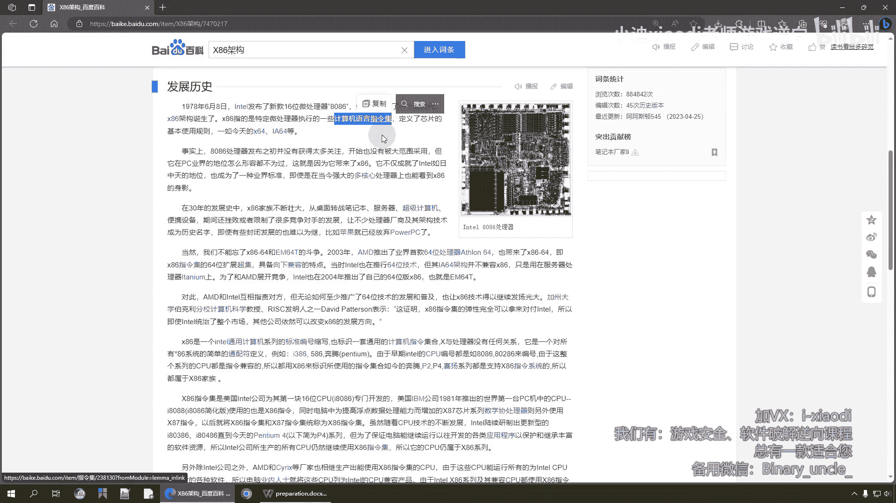
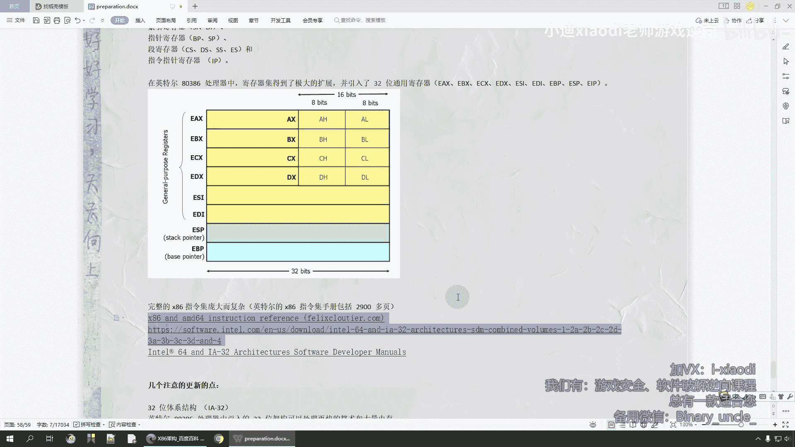
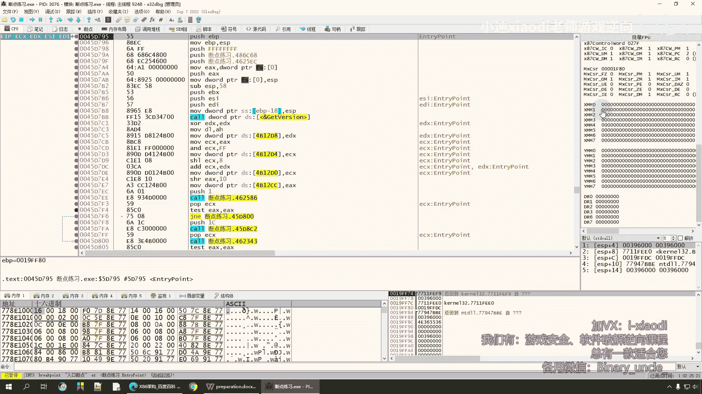
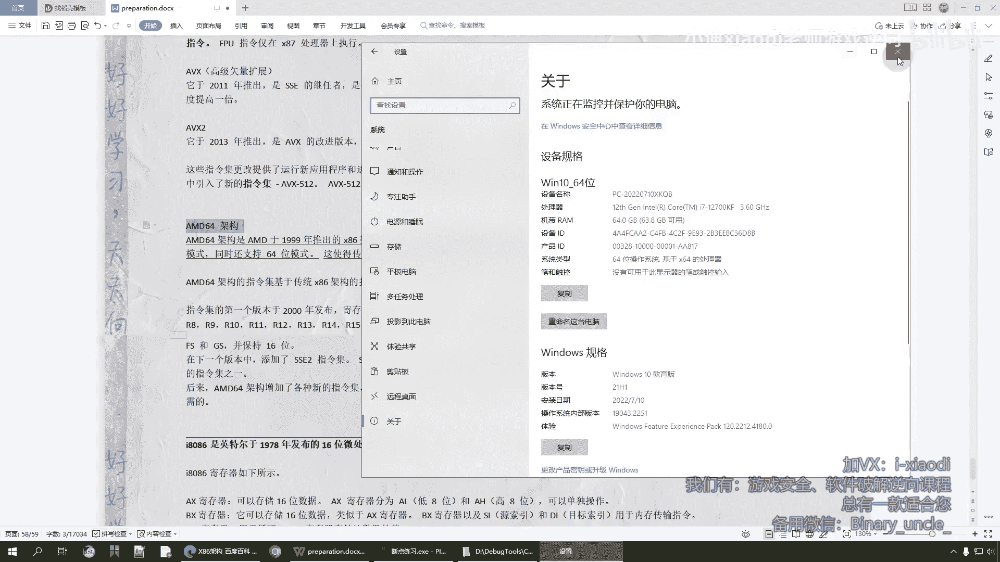
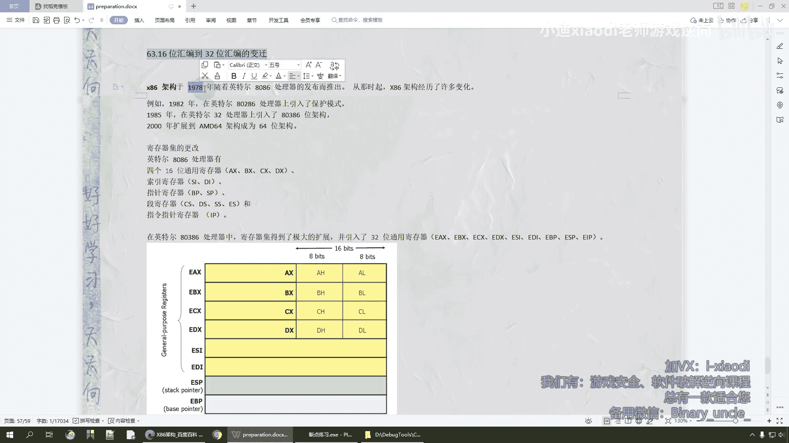

# 🧭 小白软件破解逆向工程师2023最新：4.63：16位汇编到32位汇编的变迁

在本节课中我们将要学习16位汇编到32位汇编的变迁。这是第63课，由小迪老师讲解，内容相当于从16位到32位的一次过渡。学习这节课的目的，是先建立整体印象，知道x86架构从哪里来、寄存器怎样从16位扩展到32位，以及后面常见的一些CPU相关名词分别是什么意思。

为了让初学者更容易理解，可以把核心概念先记成下面这个式子：

```text
x86 = 特定微处理器执行的计算机语言指令集
    = 描述指令 + 定义芯片基本使用规则 + 代码语法
```

## 🏛️ 小白软件破解逆向工程师2023最新：4.63.1：x86架构的来历

上一节概述了本课要完成从16位到32位的过渡，本节中我们来看看x86架构这个名词是怎么来的。在百度搜索x86架构，就能找到相关资料。原文口播中读作“叉86”，实际对应的就是x86。



1978年时，中国还在发展中，美国英特尔公司已经发布了一款新款的16位微处理器，型号是8086，课程配图中展示了8086的样子。与此同时，英特尔开创了一个新时代，x86架构就此诞生。

x86指的是特定微处理器执行的一些计算机语言指令集。它描述的是指令，定义了芯片的基本使用规则，实际上就是一些代码的语法。也就是说，x86可以理解成一套规则和语法，处理器按照这套规则去执行任务。

x86架构是伴随着1978年这款处理器的发布而推出的。理解这个来历后，后面再看16位到32位的变化，就不会觉得这些名词是凭空出现的。

## 🕰️ 小白软件破解逆向工程师2023最新：4.63.2：x86的发展历程与寄存器演化

上一节我们介绍了x86架构的诞生，本节中我们来看看它后来的发展历程和寄存器演化。从1978年起，x86架构经历了许多变化，因为时代一直在发展、不断向前，现在已经到了2023年、2024年、2025年这样的时间点。

以下是x86架构的大致发展节点，按时间顺序梳理如下：

- 1982年，80286处理器引入了保护模式。
- 1985年，80386架构被引入。
- 2000年，扩展到AMD64架构，成为64位架构。

这就是x86架构大概的发展历程。x86名称里的“86”来自哪里？看这些型号的后缀就能发现，它们都是一个86系列，8086、80286、80386都属于这个系列，后来在2000年又扩展成了64位架构。

接下来看寄存器的演化。之前课程中常见的内容包括AX、BX、CX、DX这些16位通用寄存器，还有SI、DI这类索引寄存器，BP、SP中BP代表栈底、SP代表栈顶，另外还有段寄存器和指令指针寄存器。这些都是之前课程中常见的东西。

在英特尔80386处理器上，寄存器得到了极大的扩展，引入了32位通用寄存器。以前是16位，只能处理16位数据，现在变成32位，位宽增加了一倍。原文口播中寄存器名称的读法有口误，学习时按通用名称理解即可。核心变化可以记成下面这样：

```text
16位通用寄存器 -> 32位通用寄存器
AX -> EAX
BX -> EBX
CX -> ECX
DX -> EDX
基本规律：很多32位名称加上 E 前缀
```

如果看到一个寄存器叫AX，就可能联想到一些较老的游戏。比如零几年的一些角色扮演游戏，或者零几年的一些老软件，软件可能不常见，游戏还比较常见。把这些老游戏下载下来，会发现很多操作都使用16位通用寄存器。现在的游戏和软件大部分是32位，看到的名字多是EAX、EBX、ECX、EDX这一类。

课程中还有一张寄存器变化的图片，建议截图保存。如果忘记寄存器的变化和演化，可以随时打开图片查看。完整的x86指令集，或者说完整的x86后备范码，内容比较庞大。老师提供了三个链接，大家可以自行查看，这三个链接会发到星球。

关于链接和星球加入方式，原文说明如下：

> 三个链接会发到星球。如果看到这里还没有加入星球，可以查看右下角提供的联系方式，联系微信后加入星球。



## 🧩 小白软件破解逆向工程师2023最新：4.63.3：CPU更新迭代后的注意点：IA-32与FPU

上一节我们梳理了x86发展和寄存器从16位到32位的变化，本节中我们来看看CPU更新迭代之后几个需要注意的点。这些名词在后面看软件、看调试器、看资料时会经常遇到，先混个眼熟，对初学者很有帮助。

以下是CPU更新迭代后需要留意的几个点，先介绍IA-32和浮点指令：

- 原文口播为“I1-32”或“R-32”，通常对应IA-32。它实际上是英特尔80386处理器中引入的一种32位架构。32位架构可以处理更快的算数和大量内存，以前是16位，现在是32位，这就是更新后的架构名称。
- 浮点指令中常看到FPU。1980年代，需要对浮点运算的应用程序需求增加，因此设计了浮点指令。浮点指令实际上就是操作小数的指令，x86指令集中也添加了浮点运算。

可以用下面两行帮助记忆：

```text
IA-32 = 80386引入的32位x86架构
FPU   = 浮点运算相关指令/单元，浮点就是小数
```

在常见调试软件中可以观察FPU相关内容。点击“隐藏FPU”后，会看到很多浮点相关内容消失；再点击显示FPU，会出现浮点相关的内容，包括XMM0、YMM0等。这些都属于浮点相关的东西。



FPU是1980年代的东西，现在x86指令集中多了这些内容，所以这也是接下来要新学习的内容。先知道这些名词的存在，后面遇到具体指令时再深入。

## 🚀 小白软件破解逆向工程师2023最新：4.63.4：AVX/AVX2与AMD64架构

上一节我们介绍了IA-32和FPU这两个注意点，本节中我们继续看AVX、AVX2以及AMD64架构。它们分别和性能优化、64位普及有关，理解它们有助于看懂软件编译选项和系统兼容情况。

AVX是高级矢量扩展，AVX2是AVX的改进版本。它的作用很直接，就是允许更快的整数算数。在写软件或者使用工具时，可能会看到它对开发出来的应用程序做了性能改进。例如Cheat Engine，原文口播为“che engine”，可以在官网下载，也可以使用星球发布的内容。

以下是AVX/AVX2在实际软件设置中可能出现的位置，用于帮助理解：

- 在Cheat Engine中往下拉，会看到AVX、SSE、AVX2等选项。AVX2实际上就是使用这类指令集版本。
- 这类软件不是完全用汇编开发的，而是可以设置开发平台的编译器，选择更快的版本。自己写软件时，估计会知道并了解这些选项。

接着看AMD64架构。这个架构是1999年推出的x86架构扩展，此后64位PC和服务器市场迅速普及。现在使用的机器基本上都是64位，查看系统“关于”页面，会发现是基于Win10的64位系统。现在去电脑城或者网上买电脑，基本上也都是64位。

64位同时兼容x86体系架构的32位模式，还支持64位模式。也就是说，在64位系统上运行32位或x86应用程序是可以的，没有问题。记住这个兼容关系即可，所以在Win10上仍然可以运行很多老游戏。可以记成：

```text
AMD64 = x86的64位扩展
64位系统 可运行 32位/x86程序
```

## 🧮 小白软件破解逆向工程师2023最新：4.63.5：8086常见寄存器回顾



上一节我们讲到了64位系统对32位程序的兼容，本节中我们回头复习8086时代的常见寄存器。这样能把前面的演化和之前课程学过的内容接起来，形成完整印象。

8086是英特尔1978年发布的16位微处理器，用于IBM PC和兼容机器。原文口播为“RBMPC”，通常指IBM PC兼容机。AX寄存器存储16位数据，可以分为低8位和高8位。可以用下面的式子帮助记忆：

```text
AX = AH(高8位) + AL(低8位)
```

以下是8086时代常见寄存器的用途回顾，按课程中提到的内容整理：

- AX用于存储16位数据，可以分成低8位和高8位。
- BX类似于BX寄存器，原文口播如此，学习时按通用寄存器用途理解。
- CX用于循环。
- DX用于输入输出。
- SI和DI是索引寄存器，也经常用于字符串操作。串操作在之前课程讲过，可以回顾。
- BP代表栈底，SP代表栈顶。原文口播中栈底和栈顶有口误，按通用理解记忆即可。
- IP寄存器指向正在运行的地址。
- 标志寄存器保存零标志位等各种标志位。也可以通过汇编代码去操作标志位，之前课程讲过，可以自行回顾。

这些寄存器是理解16位汇编的基础，后面看到32位寄存器时，只要知道它们是在16位基础上扩展而来，就不会觉得陌生。

## 🌱 小白软件破解逆向工程师2023最新：4.63.6：本课总结

前面几节从x86的来历讲到了发展、寄存器演化、CPU更新注意点、AVX/AVX2、AMD64兼容和8086寄存器回顾，本节中我们对本课做一个总结。本节课中我们一起学习了16位汇编到32位汇编的变迁，也了解了x86架构从1978年到2023年、2024年、2025年的大致演化过程。

以下是本课需要记住的关键点，方便复习：



- x86是一套指令集和代码语法规则，伴随1978年英特尔8086处理器发布而出现。
- x86经历了8086、80286保护模式、80386的32位架构，再到AMD64的64位扩展。
- 寄存器从16位扩展到32位，很多名称加上E前缀，例如AX到EAX、BX到EBX、CX到ECX、DX到EDX。
- IA-32是80386引入的32位架构，FPU是浮点运算相关指令，浮点就是小数。
- AVX和AVX2用于更快的整数算数，在一些软件和编译器选项中可以看到。
- AMD64是x86的64位扩展，64位系统可以运行32位或x86程序。
- 8086常见寄存器包括AX、BX、CX、DX、SI、DI、BP、SP、IP和标志寄存器，各自有常见用途。

其他内容不再展开，大概了解计算机是怎样发展的即可。今天的主要内容就是做一次简单科普，了解计算机的演化过程，从1978年到现在这样一个发展历程。本节课中我们一起学习了这些内容，本期结束，下期再见，拜拜😊。
