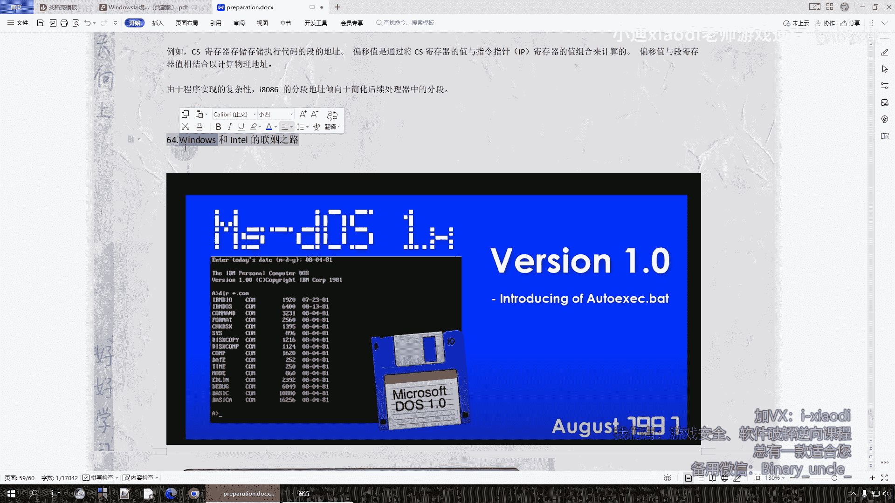

# 🐣 小白软件破解逆向工程师2023最新：64：Windows和Intel的联姻之路

在本节课中我们将要学习Windows和Intel的联姻之路。本课是小迪老师讲解的第64课，Windows是我们日常常用的操作系统，Intel是芯片、是CPU，本课会看它们之间有哪些千丝万缕的联系，以及这些联系最终怎样影响技术和生活。为了照顾初学者，这里先把结论说直白：Windows和Intel来自两家不同的公司，一家做软件和操作系统，另一家做处理器、CPU、芯片等硬件，它们不是同一家公司。

> 学习提示：本教程把原文口语整理成直白教程，核心概念用公式和代码标记，方便初学者先抓住主线。
> 

在正式进入历史之前，先把两位主角的身份分清。Windows是操作系统，属于软件层面；Intel是处理器和芯片，属于硬件层面。下面的列表先把这两个角色的基本定位列出来，后面再看它们怎样一步步走到一起。

1. Windows：日常使用的操作系统，主要负责管理程序、界面、文件和硬件调用。

2. Intel：芯片和CPU厂商，主要负责处理器这种硬件。

3. 本课主线：看Windows的发展历史中，怎样遇到Intel的8086系列处理器，并逐渐形成紧密联盟。

了解了两位主角的基本身份后，上一节我们明确了软件和硬件的分工，本节中我们来看看Windows的历史起点。讲Windows历史就不能不谈MS-DOS的历史，MS-DOS源自CP/M，CP/M是1973年的8位磁盘操作系统，当时还没有16位的东西，只有8位，它能操作的数据长度只有8个比特位，所以能力非常有限。之前学习16位汇编时见到的黑窗口界面，就是MS-DOS这一类系统的界面。

为了把这段关系看得更清楚，可以用下面的代码描述关键节点，这里表示从早期系统到MS-DOS的演进脉络。


```text
CP/M（1973，8位磁盘操作系统）
    ↓
Q-DOS / 86-DOS（1978，16位微型机实验性操作系统）
    ↓
MS-DOS（Microsoft Disk Operating System）
```


下面是这段历史中的关键事件，按时间顺序列出，方便初学者理解微软怎样进入操作系统市场。

1. 1978年，西雅图计算机公司开始开发操作系统Q-DOS，原文口语中也称为“西雅图降级公司”，这里按含义理解为西雅图计算机公司。

2. 西雅图计算机公司又研制出16位微型机的实验性操作系统86-DOS。

3. 同一时期，有一家公司开发处理器，需要配套操作系统，但与CP/M开发者谈判不顺利。

4. 微软乘虚而入，但微软没有足够时间开发新的操作系统。

5. 微软找到西雅图计算机公司，协商销售86-DOS，并达成协议。

6. 微软在销售过程中可能对86-DOS做了一些逆向工程，并以它为基础做出自己的MS-DOS，MS就是Microsoft。

7. 这种商业操作在当时很难评价，但MS-DOS 1的界面是黑窗口界面，以现在眼光看很简陋，在当时看还是比较强。

上一节我们看到了微软怎样以86-DOS为基础做出MS-DOS，本节中我们来看看MS-DOS继续发展后为什么必须改革。MS-DOS不断发展，内存支持、核心部分等也在更新，最终更新到6.22版本。到了这个阶段，系统不再简单更新，而是要改革，因为普通用户如果想玩转DOS操作系统，必须具备专业计算机知识，必须知道怎样用CD切换目录、用DIR列出文件等命令，必须掌握或熟悉这些计算机命令才可以操作，所以对一般用户确实不太好用。

正因为一般用户用起来困难，微软开始更新迭代，最终做出Windows 1.0。下面的列表概括了这段变化的关键点。

1. MS-DOS从早期版本不断发展，内存支持和核心部分持续更新，最终到6.22版本。


2. 继续更新遇到瓶颈，需要改革。


3. 改革原因：DOS需要专业计算机知识，用户要熟悉CD、DIR等命令。

4. 一般用户不好用，所以微软开始更新迭代。

5. 微软最终做出Windows 1.0。

Windows 1.0的样子和以前的黑窗口界面不同，它确实增添了一些色彩，也多了一些东西。它用DOS这种文字性的东西，加上颜色，做出了很多可视化界面，可视化界面比黑窗口界面好看很多。可以用下面的公式描述这种界面演进。

```text
DOS文字命令 + 颜色 + 可视化元素 → Windows 1.0图形化界面
```

上一节我们介绍了Windows 1.0带来的可视化变化，本节中我们来看看Windows NT和Wintel联盟的形成。Windows不断发展过程中，有一个非常好的版本叫Windows NT，这是一个更新迭代中非常典型的东西。NT代表新技术，也就是New Technology，它是Windows系列使用32位编程模式的第一个版本，充分利用80386以上处理器。

下面的列表把Windows NT和Windows 2.1这段联合过程的关键点列出来，帮助初学者看清微软和Intel怎样开始合作。

1. Windows NT代表New Technology，是Windows系列使用32位编程模式的第一个版本。

2. Windows NT充分利用80386以上处理器。

3. Windows 2.0版发布不久，Intel公司的80386处理器发布。

4. 微软推出使用80386处理器V86模式的Windows 2.1。

5. 这时微软和Intel开始联合，也就是“我用我的操作系统在你的处理器上跑，在你的CPU上跑”。

6. 随着发展，它们不断联合：处理器更新，操作系统跟着更新；操作系统更新，处理器也跟着更新。

7. 关系越来越紧密，最终形成Windows和Intel的联盟。

> 关键结论：Wintel不是一家公司，而是Windows操作系统与Intel处理器长期配合形成的联盟关系。
> 

可以用下面的公式概括这个联盟，后面学习操作系统和汇编时也会反复遇到这种软硬件配合关系。

```text
Wintel = Windows + Intel
```

Windows和Intel是相辅相成的，它们是两家公司。Windows是伴随着Intel 8086系列处理器从弱小逐渐成为霸主的，也就是说它们是慢慢发展起来的。上一节我们看到了Wintel联盟的形成，本节中我们来看看Windows发展到现在具备的主要特色。第一个特色是图形用户界面，也就是GUI，但凡是看到GUI，就要知道它是Graphical User Interface的缩写，意思是图形用户界面。

下面列出GUI和一致用户界面的关键点，先建立直观认识，后面写窗口界面时会用到。

1. GUI就是图形用户界面，英文是Graphical User Interface。

2. 现在看到的计算机屏幕上全部都是图形界面，还有按钮之类的元素。

3. 以前可能只有键盘，需要记一些命令；现在可以用鼠标。

4. 多了鼠标就多了很多元素，例如鼠标点击事件、消息、鼠标坐标等。

5. 一致的用户界面，就是大家打开软件都是一样的，都有播放等功能。

6. 例如打开WPS，都有播放、阅读模式、这几个按钮。

可以用下面的公式记住GUI的含义，这个缩写在后文学习窗口程序时会经常出现。

```text
GUI = Graphical User Interface
```

上一节我们介绍了GUI和一致界面，本节中我们来看看多任务和大量函数调用。多任务就是这台电脑上可以运行很多程序，以前写16位汇编时，写完那个程序只能运行那一个程序；现在Windows可以同时运行多个程序，一边工作、一边听歌、一边看电影都没有关系。

下面的列表把多任务和函数调用的重点列出来，方便理解Windows为什么比早期DOS更好用。

1. 多任务：Windows可以同时运行多个程序。

2. 以前16位汇编程序只能运行那一个程序。

3. 现在可以一边工作、一边听歌、一边看电影。

4. 大量函数调用：写16位汇编时，宏或函数如果实现复杂，使用起来就麻烦。

5. 微软为了防止用户用起来复杂，把上千种功能性的东西全部封装好。

6. 使用时直接写上名字调用，例如直接调用shiftft就可以了。

7. 微软找了很多程序员，可能有美国的，也可能有印度的，去编写这些函数。

8. 这样做的目的是方便今后的程序员在操作系统上开发程序。

9. 封装好的函数几乎涉及所有方面，例如删除文件、播放视频、播放动画、网络等。

10. 这些功能全部打包好，只要直接调用即可，所以Windows非常好用。

可以用下面的代码表示“直接调用封装函数”的思路，函数名沿用原文中的shiftft作为示例。

```c
// 直接调用封装好的函数，示例名称沿用原文 shiftft
shiftft();
```

上一节我们介绍了多任务和函数封装，本节中我们来看看设备无关性和内存管理。设备无关性是指程序运行起来并不是直接访问屏幕、打印机和键盘等硬件设备。如果程序直接访问键盘，某个程序出错了，就会影响键盘设备，这不行；如果影响打印机设备，或者突然屏幕坏了，也不行。所以Windows虚拟了所有硬件，这也是Windows非常非常牛的一个地方。

下面的列表把设备无关性的要点列出来，帮助初学者理解“程序不要直接碰硬件”这件事。

1. 程序不直接访问屏幕、打印机、键盘等硬件设备。

2. 如果直接访问键盘，某个程序出错就可能影响键盘设备。

3. 如果影响打印机设备，或者突然屏幕坏了，都不行。

4. Windows虚拟了所有硬件，程序通过Windows这一层间接使用硬件。

5. 内存管理暂时先简单了解，后面再深入。

可以用下面的公式描述设备无关性的基本结构，程序面对的是Windows提供的虚拟硬件接口，而不是直接面对硬件。

```text
应用程序 → Windows虚拟硬件接口 → 键盘/屏幕/打印机等硬件
```


另外，内存管理这一部分暂时先简单了解即可。到这里，Windows的主要特色已经过了一遍，上一节我们介绍了设备无关性和内存管理，本节中我们来总结本课内容并看下集预告。本节课中我们一起学习了Windows和Intel的联姻到底是怎么来的，主要还是看Windows的发展历程。在Windows的发展过程中，它碰到了Intel公司的8086处理器，这也是一种缘分，然后强强联合、不断发展，大家都随着时代发展向前迈步，最终来到今天的Win10或者Win11操作系统，现在这个操作系统还是非常牛、非常好用。

下面的列表把本课回顾要点整理出来，方便复习和衔接下一课。

1. Windows是日常常用的操作系统，Intel是芯片、CPU厂商。

2. MS-DOS源自CP/M，CP/M是1973年的8位磁盘操作系统，能力有限。

3. 1978年西雅图计算机公司开发Q-DOS，又研制16位实验性操作系统86-DOS。


4. 微软与西雅图计算机公司达成协议，以86-DOS为基础做出MS-DOS。


5. MS-DOS发展到6.22后需要改革，因为DOS命令对普通用户不好用。

6. Windows 1.0带来色彩和可视化界面，比黑窗口好看。


7. Windows NT代表新技术，是Windows系列使用32位编程模式的第一个版本。


8. Windows 2.1使用80386处理器的V86模式，微软和Intel开始联合，最终形成Wintel联盟。

9. Windows具备GUI、一致用户界面、多任务、大量函数调用、设备无关性、内存管理等特色。

10. Windows和Intel是两家公司，一家做软件和操作系统，另一家做处理器、CPU、芯片等硬件。



> 下集预告：下一集可以在Windows操作系统上写窗口界面，学习x86或者32位汇编。
> 

本节课中我们一起学习了Windows和Intel的联姻之路，也简单了解了它们是不一样的，是两家公司的东西。一家是做软件和操作系统的，另一家是专门做处理器、做CPU、做芯片、做硬件的。下一集再继续学习在Windows操作系统上写窗口界面，学习x86或者32位汇编，下期再见。
