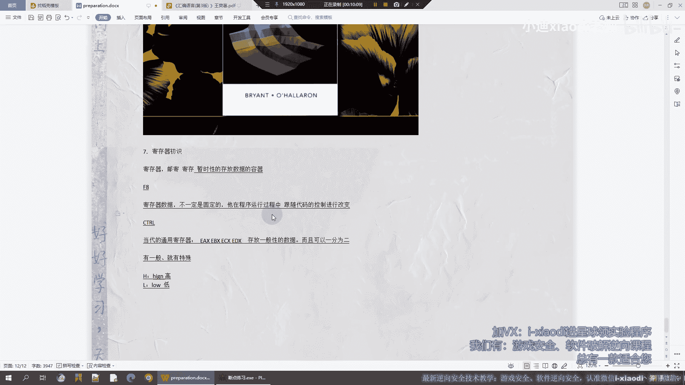

# 小白软件破解逆向工程师2023最新：4.7：寄存器初识 🧠


在本节课中我们将要学习寄存器初识。本节课会从“寄存器是什么”讲起，接着用调试器单步观察寄存器值的变化，再说明通用寄存器和特殊用途寄存器，最后看寄存器分割与汇编指令的初步样子。寄存器是后面调试程序、阅读汇编代码和做逆向分析的基础，所以这一节先把概念建立起来，暂时不要求死记硬背，先能看懂、能对应上调试器里的显示即可。


## 小白软件破解逆向工程师2023最新：4.7.1：寄存器是什么 📦


教材里有一句关键话，先把它放在这里：


> 对于一个汇编程序员来说，CPU中的主要部件是寄存器。


> 寄存器是CPU中程序员可以用指令读写的部件。


> 程序员可以通过改变各种寄存器的内容来实现对CPU的控制。


这几句话可以压缩成下面的关系：


```
寄存器 = CPU 中可由程序员用指令读写的部件
改变寄存器内容 ⇒ 改变 CPU 的行为 ⇒ 影响程序运行
```


换句话说，程序员不是直接“命令程序”去做什么，而是通过改变寄存器的内容来影响CPU，再通过CPU的行为影响程序运行。所以寄存器在程序运行中非常关键。下面看寄存器在硬件组成中的位置。


在现代计算机的典型系统硬件组成里，寄存器文件位于CPU内部。它是数据交互和存放的重要部件。调试器通常把寄存器区域放在CPU相关界面里，这种布局也说明寄存器是CPU内部非常核心的一部分。


寄存器这个名字也有意思。“寄”可以联想到寄存、存放，寄存本身就是暂时存放的意思。用最通俗的大白话讲：寄存器就是暂时存放数据的容器。这个“暂时性”很重要，后面会用单步调试演示它如何随代码变化。


## 小白软件破解逆向工程师2023最新：4.7.2：用单步调试观察寄存器的暂时性 🔍


上一节我们说明了寄存器是CPU中可读写的部件，也说明了它名字里有“暂时存放”的含义。本节中我们来看看调试器里寄存器值的变化，从而理解为什么说它是暂时性的容器。原文演示中反复出现 EAX、ESP 等寄存器，例如：


```
push EBP
mov EBP, ESP
...
```


这些代码里同一个寄存器会被多次使用，说明寄存器在程序运行中不断参与数据存放和传递。以下是单步观察寄存器变化的简要过程：


- 初始时 EAX 显示为 CC。
- 按 F8 单步执行，先执行几条暂时不涉及 EAX 的指令，EAX 没有变化。
- 执行到 `mov` 相关指令后，再看 EAX，它的值发生变化。
- 继续按 F8 单步，EDS 变为 2，ECX 变为红色，随后变为 6，又出现 6600、600、602 等值，EDS 再次变化。
- 这些现象说明寄存器不是固定不变的，它会跟随代码控制而改变。


所以这里体现出的核心结论是：寄存器是暂时存放数据的容器，它的内容会跟随代码控制进行改变。调试器把寄存器显示在CPU界面里，整体设计比较合理。原文还提到界面缩放：一般编辑器可以按住 Ctrl 键配合鼠标滚轮调整大小，有的区域能缩放，有的区域不能。这个细节只是界面操作，不影响寄存器概念本身。


## 小白软件破解逆向工程师2023最新：4.7.3：通用寄存器 🧮


上一节我们通过单步调试看到寄存器值会变化，本节中我们来看看寄存器的分类，重点是通用寄存器。教材以8086 CPU为例：所有寄存器都是16位，可以存放两个字节。这里先把字节和位的关系写清楚：


```
1 字节 = 8 位
2 字节 = 16 位
```


在调试器里一个字节一个字节地看，点一下看到一个字节，再点一下又看到一个字节，两个字节合起来就是16位。以下是教材提到的通用寄存器：


- AX、BX、CX、DX 通常用来存放一般性的数据，被称为通用寄存器。
- 现代CPU里这些寄存器进化成 EAX、EBX、ECX、EDX，也就是当代通用寄存器。
- 以后看到 EAX、EBX、ECX、EDX，要能认出它们是通用寄存器。
- 它们最常用的用途是存放一般性数据。


有“一般”就有“特殊”。以下是原文提到的特殊用途寄存器：


- EBP、ESP、ESI、EDI 有比较特殊的用途，存放比较特殊的数据。
- 上面的通用寄存器和下面的特殊寄存器要分开理解。
- 其他寄存器原文没有展开，先知道这个分类即可。


## 小白软件破解逆向工程师2023最新：4.7.4：寄存器的分割 ✂️


上一节我们区分了通用寄存器和特殊用途寄存器，本节中我们来看看通用寄存器的一个细节：它们可以一分为二。AX 可以分割成 AH 和 AL，BX 可以分割成 BH 和 BL，DX 可以分割成 DH 和 DL，原文还出现了 DL 的例子。可以用下面的形式理解：


```
AX -> AH + AL
BX -> BH + BL
CX -> CH + CL
DX -> DH + DL
```


这里的 H 和 L 可以先记成高和低：


```
H = High，高
L = Low，低
```


ABCD 这几个存放一般性数据的寄存器都可以分，而且可以一分为二，分成高的部分和低的部分。高低的具体含义以后再说，现在先记住“可以分”这个概念即可。课后把教材相关段落自己读一遍，先让脑袋里有印象，后面看到 AH、AL、BH、BL 这些名字时就不会完全陌生。


## 小白软件破解逆向工程师2023最新：4.7.5：汇编指令初见 🛠️


上一节我们看了寄存器分割，本节中我们先看汇编指令的样子，为下节课做准备。原文提到一些加法计算，如果懂英文，能看出大概意思。以下是下节课会逐步展开的指令示例：


- `add AX, BX` 表示 AX 和 BX 相加。
- `mov AX, BX` 表示把右边的 BX 放到左边的 AX。
- 还会看到 AL、BL、AH、BH 等名字，熟悉后就不困惑。
- 熟悉这些指令后，调试程序时就能知道当前在做什么。
- 这像做阅读理解，读文章时知道这一句在干什么，也就知道怎么破解程序。


## 小白软件破解逆向工程师2023最新：4.7.6：本节课总结 ✅




本节课中我们一起学习了寄存器初识：寄存器是CPU中程序员可以用指令读写的部件，改变寄存器内容可以控制CPU和程序；寄存器是暂时存放数据的容器，单步调试时能看到它的值随代码变化；AX、BX、CX、DX 是通用寄存器，现代对应 EAX、EBX、ECX、EDX；EBP、ESP、ESI、EDI 有特殊用途；AX 等寄存器可以分割成高和低两部分；还初步看了 `add`、`mov` 这类汇编指令。本节课内容比较零散，尽量把知识点交代清楚，下期再见。
