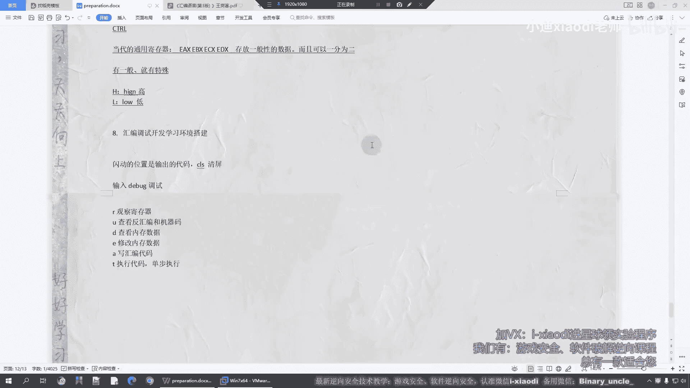
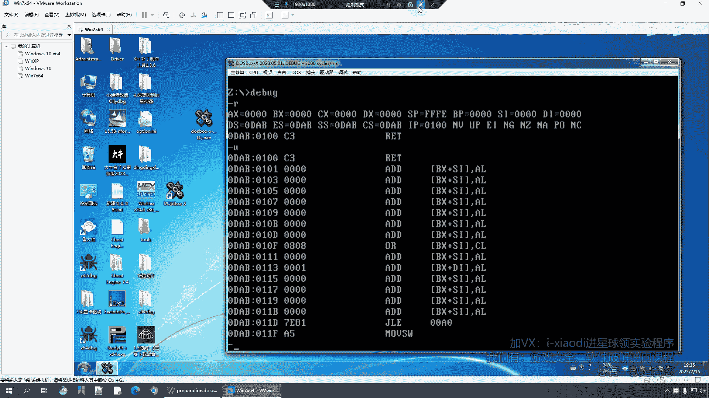
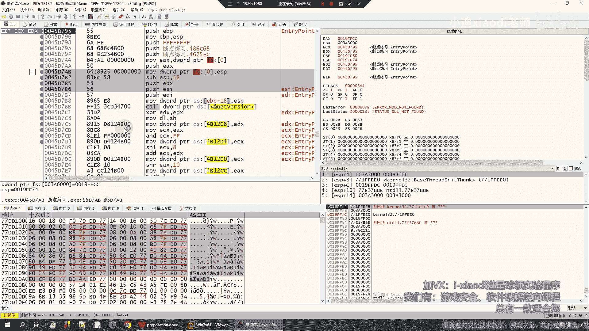
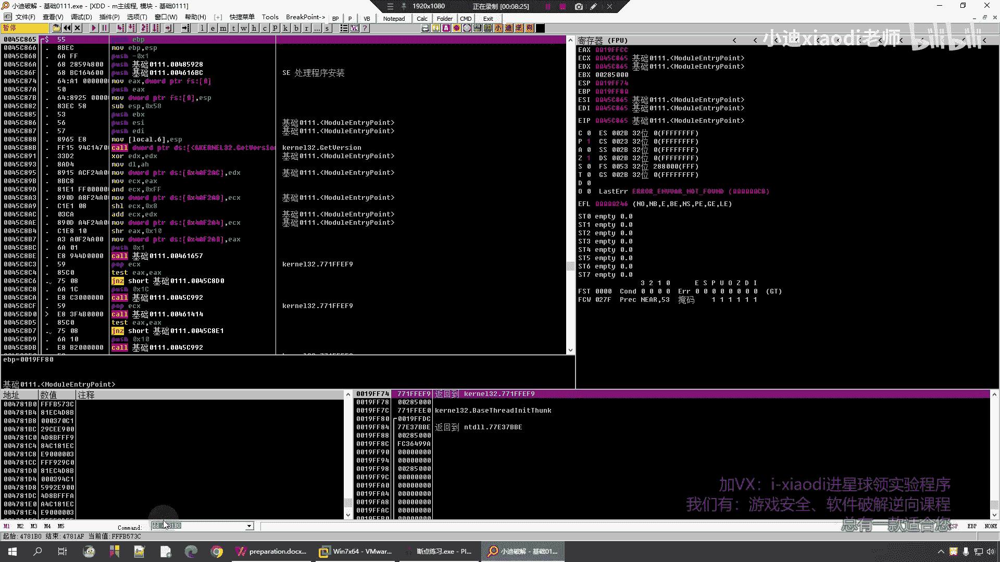
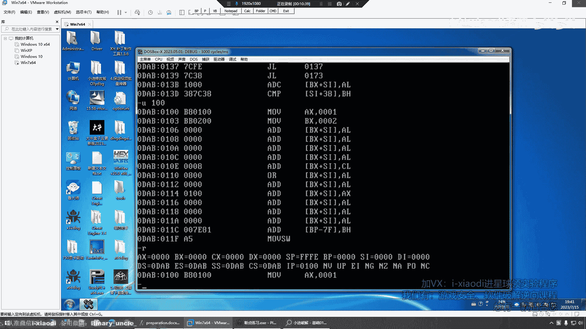
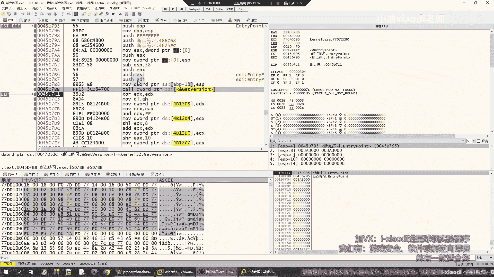
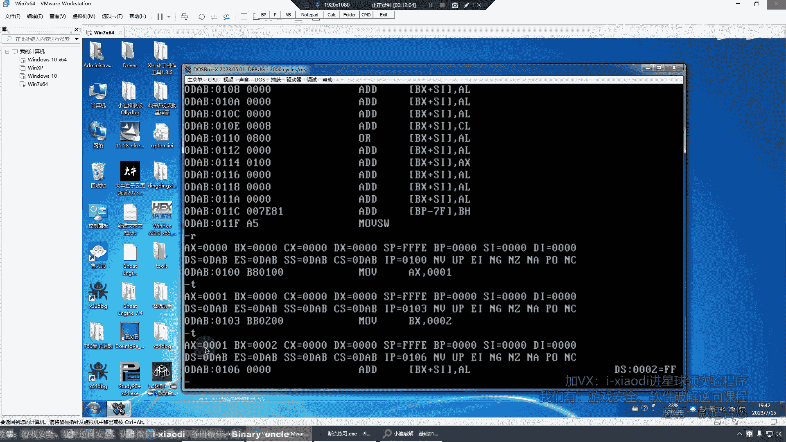
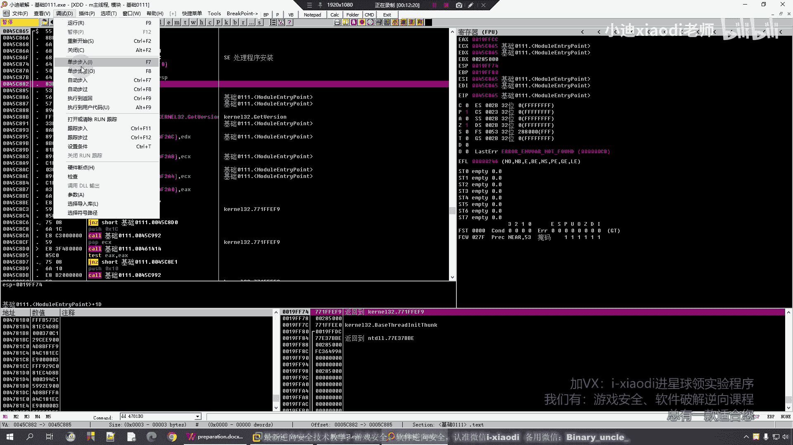
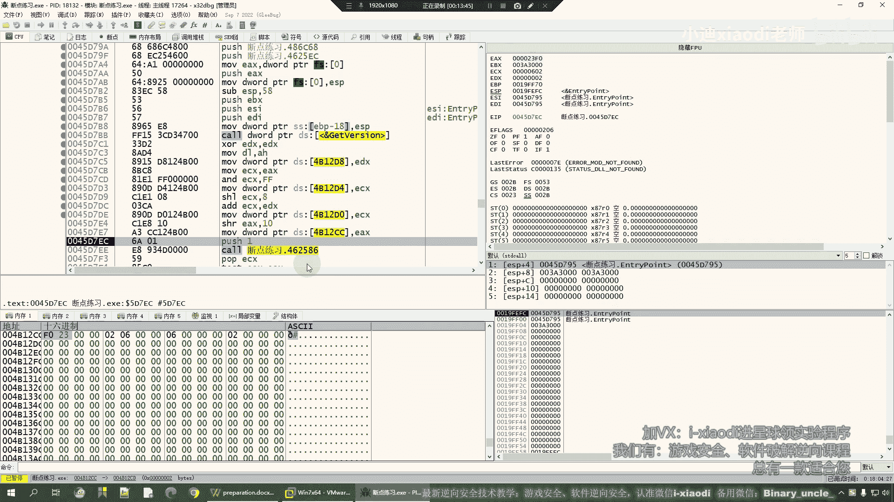

# 🧰 小白软件破解逆向工程师2023最新：4.8：汇编开发-指令学习01。

## 📌 课程概述

在本节课中我们将要学习汇编调试开发学习环境的搭建。今天是第八节课，主题是汇编调试开发学习环境搭建。初学基础阶段，有必要了解汇编如何编程，而不是只盯着 x32dbg、x64dbg、OllyDbg（OD）里的反汇编代码。只看那些反汇编代码，代码和人彼此陌生，熟悉度不会快速提升。

提升对汇编代码敏感度和熟悉度的方法，是用汇编编写程序，在编程过程中熟悉汇编。接下来讲如何编程、在哪里编程。教材第35页有实验一：查看 CPU 和内存，用机器指令和汇编指令编程。

> 教材第35页实验一：查看 CPU 和内存，用机器指令和汇编指令编程。这部分课下自己看，本节课听课堂重点。

以上是今天内容的范围。教材讲得详细，本节课只讲重点。了解学习目标后，本节看看程序获取与环境准备。

## 🧭 课程资料与环境准备

首先获取程序。程序已上传知识星球，名字是 DOSBox，配套 WinXP 2023.5.1 版本。知识星球每满50人价格上调30元，想一起学习可加群，抓紧加入。

以下是安装与启动的基本步骤：

- 安装时选择简体中文版，连续点击 Next。

- 因为已经安装过，出现提示时点否。

- 安装完成后，桌面会生成快捷方式，运行快捷方式即可。

- 安装完成后的界面比较古老，可以调整窗口大小。

- 窗口会闪烁，屏幕内容较多，输入清屏命令清理屏幕。原文口述为 CL，实际 DOSBox 常用 `CLS` 清屏。

- 清屏完成后，可以放大窗口继续操作。

安装和启动完成后，需要认识 DOSBox 与 DOS。本节看看 DOSBox 与 DOS 的关系。

## 🖥️ 认识 DOSBox 与 DOS

DOSBox 是一个程序。DOS 是一个操作系统，而且是非常古老的操作系统。DOS 经过不断进化，才进化到现在的 Windows 操作系统。

以前的这种操作系统用什么语言编程，答案是用汇编语言编程，不是零和一，而是汇编语言。因此找汇编的老祖宗、找汇编的亲兄弟，就会找到 DOS 系统，DOS 系统与汇编联系紧密。所以要了解 DOS，否则不会把它从历史里拿出来讲。认识 DOSBox 与 DOS 后，下面进入启动与清屏操作。

## 🧹 启动 DOSBox 并清屏

安装完成后，桌面会生成快捷方式，运行快捷方式。界面比较古老，可以调整大小。窗口会闪烁，屏幕内容较多，输入清屏命令清理屏幕。原文口述为 CL，实际 DOSBox 常用 `CLS` 清屏。

清屏命令可以写成下面的形式：

```dos
CLS
```

清屏完成后，屏幕内容被清理，可以放大窗口。清屏之后，下一步进入 DEBUG 调试环境。

## 🛠️ 进入 DEBUG 调试环境

清屏完成后，输入 `DEBUG`，原文口述为“得bug”，跟着读作 DEBUG。输入 `DEBUG` 后回车，就可以进行调试。回车之后，提示符由 Z 变成横杠，此时进入调试状态。

以下是 DEBUG 中需要初步认识的命令：



- `R` 命令观察寄存器，原文口述为“二”。

- `U` 命令查看反汇编和机器码，原文口述为“右”。

- `D` 命令查看内存数据。

- `E` 命令修改内存数据。

- `A` 命令编写汇编代码。

- `T` 命令单步执行代码。



进入 DEBUG 后，先看 `R` 命令。本节看看如何观察寄存器。

## 📊 R 命令观察寄存器

输入 `R` 观察寄存器，原文口述为“二”。可以看到此时此刻的寄存器，例如 AX、BX、CS、DS、SP、BP、SI、DI 等。原文点到了 AX、BX、CS、DS 四个寄存器，并问这四个是什么。严格说，AX、BX、CX、DX 是通用寄存器，CS、DS 等是段寄存器；这里保留原文观察寄存器的目的，同时要知道通用寄存器要能秒回答，不能秒回答说明还不熟。

寄存器观察可以用下面的形式理解：

```text
AX = 当前值
BX = 当前值
CS = 当前值
DS = 当前值
SP = 当前值
BP = 当前值
SI = 当前值
DI = 当前值
```

`R` 命令用于观察寄存器。观察寄存器之后，下一节用 `U` 命令查看反汇编和机器码。

## 🔍 U 命令查看反汇编和机器码

输入 `U` 回车，原文口述为“右”，可以查看反汇编和机器码。此时会给出一个默认地址。地址在冒号后，例如 100、101、103、105，这些是内存地址。前面相同的部分先不看，先不展开它是什么。

以下是 `U` 命令输出中需要认识的字段：

- 冒号后的 100、101、103、105 等是内存地址。

- 机器码列显示机器码。

- 右侧显示汇编代码，也就是反汇编结果。

了解内存地址、机器码、汇编代码这几部分后，继续往下看 `D` 命令。

## 🧱 D 命令查看内存数据

输入 `D` 回车，默认查看 100 地址，并往下显示内存数据。这样可以看到内存里的数据。内存数据和 x32dbg 里调试程序时看到的字节数据很像。汇编代码和字节数据实际上是一脉相承的，程序设计也是一脉相承的。

`D` 命令的基本形式如下：



```text
D
D 100
```

`D` 命令用于查看内存数据。查看内存之后，下一节用 `E` 命令修改内存数据。

## ✏️ E 命令修改内存数据

如果想修改内存数据，可以使用 `E` 命令。输入 `E`，例如 `E 100` 回车，原文口述为空格 100 回车，进入修改状态。例如要把 C3 修改成 11，输入 11 后连续回车两次。

修改后可以再用 `D` 查看。因为查看一遍后会接着看下面的内容，所以用 `D 100` 回到 100 地址查看。查看后显示内容会发生变化，原文提到变成以 180 开头，具体显示受命令续看影响。工具没有提供滚轮，往上翻不了，放大也有限，这是工具本身的问题。

接着可以把 100 后面的数据修改成 11 22 33 44 55。使用 `E 100`，依次输入 11、空格、22、空格、33、空格、44、空格、55，回车两次，再用 `D 100` 查看。修改和查看可以用下面的代码表示：

```text
E 100
11 22 33 44 55

D 100
```

这种指令非常有用。在 OD 里打开一个程序，这里有一个 Command，随便找一个程序，在 Command 输入 `DD 4781B0` 回车，`D` 指令生效，正确跳到 4781B0 地址。原文还提到 47C1 之类地址，意思是随便给一个数验证。因此这类指令有必要学，所有教的内容都有用，要认真听。这类指令一脉相承。

`E` 和 `D` 之后，下一节用 `A` 命令编写汇编代码。

## 🧑‍💻 A 命令编写汇编代码与 MOV 指令

输入 `A` 回车，原文口述为“杠A”，默认来到 100 地址。此时可以写代码。第一个指令是 MOV，写 `MOV AX,1`，空格；再写 `MOV BX,2`，空格；然后回车，再回车。写完后用 `U 100` 查看反汇编，原文口述为“杠右100”，可以看到 `MOV AX,1` 和 `MOV BX,2`。

编写和查看代码可以用下面的形式表示：

```asm
A
MOV AX,1
MOV BX,2

U 100
```

MOV 是移动的意思，作用是把右边的数据放到左边的容器。不管右边是什么、左边是什么，都是把右边移到左边。逗号把两个东西隔开。核心概念可以用下面的公式描述：

```text
MOV 左边容器, 右边数据
左边容器 ← 右边数据
```



右边总是数据，左边总是容器。不能说把容器放到数据里，这不可行。原文这里打字错误，粗心大意，需要注意。`A` 命令可以写后面的代码。



写完后要查看寄存器有没有被改掉。输入 `R` 观察寄存器，发现没有变，因为代码还没有执行。例如 EAX 为 FCC，按 F8 单步走，寄存器值不变，走到修改它的指令才变。寄存器数据在程序运行过程中才会跟随代码控制改变，必须让代码跑起来。下一节用 `T` 命令让代码跑起来。

## ▶️ T 命令单步执行代码

输入 `T` 回车，执行代码，会自动显示执行的是什么，执行的是刚才的 `MOV AX,1`。此时 AX 变成 1。再输入 `T`，BX 变成 2。继续 `T`，它会一条一条执行，这种执行方式叫单步执行，单步就是一步。

单步执行可以用下面的形式理解：

```text
T
AX ← 1

T
BX ← 2
```

点击调试里的单步也是同样道理，单步就是一步一步执行。这种调试方式一脉相承。学会 MOV 和单步后，下面布置课后作业。



## 📝 课后作业

本节课学习 MOV 指令后，课后作业是随便拖一个程序，点击 CPU，跑一下，观察 MOV 指令。以下是课后练习与验证方法：



- 随便拖一个程序，点击 CPU，跑一下，观察 MOV。

- 看是不是把 AX 给 ECX。

- 看 MOV 把 ES 给某个地址，例如 ES 为 23F0，地址为 4B12CC。

- 跳转地址用 Ctrl+G，也可以在命令里输入 4B12CC 回车。

- 没有数据时按 F8 单步，可以看到 23F0 倒着存储。

倒序存储知识再次出现，知识一脉相承。完成作业后，下面总结本节课内容。

## ✅ 课程总结



本节课中我们一起学习了汇编调试开发学习环境搭建、DOSBox 与 DOS 的关系、DEBUG 的 R/U/D/E/A/T 命令、MOV 指令、内存修改和单步执行，并布置了课后作业。今天暂时了解这些内容，学会 MOV 指令，回去做笔记：MOV 总是把右边数据放到左边容器。感谢收看，下期再见。

