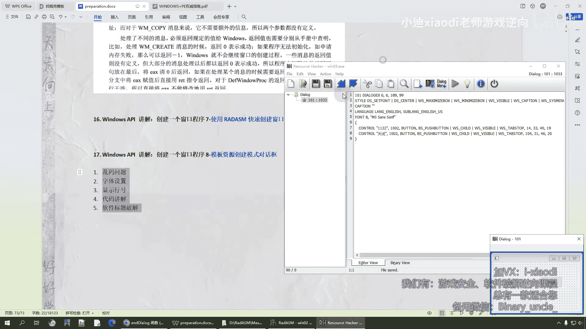

# 🛠️ 小白软件破解逆向工程师2023最新：5.17：Windows-API-讲解：创建一个窗口程序8-模板资源创建模式对话框

## 📖 课程概述

在本节课中，我们将要学习如何使用**模板资源创建模式对话框**。上一节课我们学习了用默认方式创建窗口，而今天的内容则是基于此延伸出的另一种更实用的创建方式。我们会详细讲解`DialogBoxParam`这个API函数的完整调用流程，从获取模块句柄、指定对话框模板，到设置窗口过程函数，每一步都会拆开揉碎了讲清楚。此外，我们还会顺便聊一聊代码编辑器中的乱码问题怎么解决，以及如何用资源编辑器对一个现成的程序进行简单的破解。学完这节课，你将彻底弄懂模式对话框的创建原理，并且能够自己动手操作一遍。


## 🧩 认识DialogBoxParam函数

### 🔍 从默认方式到模板资源方式

上一节课我们介绍了用默认方式创建窗口的过程，那个方式实际上调用了一个叫做`DialogBoxParam`的API函数。我们来看一下这个函数的庐山真面目，当我们搜索并查看微软官方文档时，官方给出的说明是这样的：**从对话框模板资源创建模式对话框**。

这句话是什么意思呢？我们来拆解一下。首先我们要明确一个概念，就是**资源**。我们手头是有资源文件的，大家可以看一下自己的工程目录，这个资源文件就放在那里，它就是用来描述窗口界面各种控件的一种数据文件。尤其要注意下边那个`.rc`文件，这就是我们的资源文件。我们要做的事情，就是从这么一个资源文件里面，去创建一个对话框出来。

这个对话框在学术上有一个专有名词，叫做**模式对话框**，它的完整说法是“从资源创建的模式对话框”。本质上，创建这个对话框的核心操作，就是调用`DialogBoxParam`这个API函数，然后把相应的参数一个一个给它传进去就可以了。

### 🧮 DialogBoxParam函数原理解析

任何一个API函数，我们都需要了解它的参数含义。`DialogBoxParam`函数的签名如下：

```c
INT_PTR DialogBoxParam(
  HINSTANCE hInstance,     // 模块句柄
  LPCTSTR lpTemplateName,  // 对话框模板名称
  HWND hWndParent,         // 父窗口句柄
  DLGPROC lpDialogFunc,    // 对话框过程函数指针
  LPARAM dwInitParam       // 初始化参数
);
```

第一个参数是**模块的句柄**，这个好不好获取？非常好获取。我们直接使用`GetModuleHandle`这个函数就可以了，把它的返回值拿过来用就行，代码如下：

```c
HINSTANCE hInst = GetModuleHandle(NULL);
```

这样一来，第一个参数就这么轻轻松松地搞定了。接下来看第二个参数，官方文档说的是“对话框模板”，此参数指向指定对话框名称的字符串指针。说人话就是，这个参数其实就是一个**字符串**。那这个模板名字我们应该怎么填呢？很简单，真的非常简单。我们点击工程里的头文件，就是那个`.h`文件，在里面我们会发现一个常量，这个常量有一个名字，叫做`IDD_DIALOG`。这个名字是怎么来的呢？它的来源我们得往回看，在资源文件里有一个`IDD_DIALOG`，这个东西就是当前这个对话框窗口的名字。我们要传入的就是这个字符串名字，它确实是一个字符串，这点毋庸置疑。

再往上看，可以看到它的ID是`101`，这个`101`和这个名字`IDD_DIALOG`是等价的，在代码里`EQU`就是起别名的意思，我们把`IDD_DIALOG`往参数里一传，第二个参数就完美搞定了。

### 🪟 框架搭建与回调函数

接下来看第三个参数，官方文档说的是“拥有对话框的窗口的句柄”。这个参数其实可以不用管它，一般默认情况下，我们直接填一个`NULL`就可以了，记住这里先不用管，留个印象即可。

然后看第四个参数，这个参数指向**对话框过程的指针**。那么问题来了，既然它创建的是一个窗口，那它需不需要回调函数呢？当然了，它肯定需要回调函数。回调函数的作用是什么呢？就是用来处理窗口收到的各种消息，我们可以根据需求自定义对消息的响应逻辑。这个回调函数，我们也可以叫它窗口过程，点进去就能看到它的完整实现。这个窗口过程的写法跟我们之前自己写过的那个窗口过程长得非常相似，第一个参数是窗口句柄，第二个参数是消息类型。我们需要对消息类型进行判断，然后做出相应的处理。至于其他那些暂时用不到的特有消息，直接让它走默认处理就可以了，或者说根本就不需要额外处理，了解吧？我们来看一下这个回调函数的代码结构：

```c
INT_PTR CALLBACK DialogProc(
    HWND hwndDlg,  // 对话框句柄
    UINT uMsg,     // 消息
    WPARAM wParam, // 附加参数
    LPARAM lParam  // 附加参数
)
{
    // 消息处理逻辑
}
```

这就是那个窗口过程函数。我们把窗口过程函数的指针传进去，也就是`DialogProc`这个函数名。最后一个参数，直接填一个`NULL`就完事了，不用管它。

经过我们这么一番调用，会发生一个怎样的现象呢？很简单，它就会创建一个跟资源文件中定义的那个窗口界面一模一样的窗口出来，直接就能显示在屏幕上了。那这个新创建出来的窗口，它所有的消息是通过谁来处理的呢？就是通过我们刚才传进去的那个窗口过程函数来处理的。这样一来，整个逻辑就非常清晰了：我们调用`DialogBoxParam`创建出来一个窗口，这个窗口所有的事情、所有的消息响应，都是通过我们自己写的那个窗口过程函数来办的。

接下来，我们来看看这个窗口过程函数内部是怎么处理消息的。首先，我们是不是要把这个消息取出来，放到一个变量里边，这个跟我们之前自己写窗口过程的时候是一模一样的。我们来对比一下，是不是我们也要把这个`uMsg`取出来，然后进行一个判断？对，完全一样的套路。来看代码：


```c
switch (uMsg)
{
case WM_INITDIALOG:
    // 初始化对话框时触发
    return (INT_PTR)TRUE;
case WM_CLOSE:
    EndDialog(hwndDlg, 0);
    return (INT_PTR)TRUE;
default:
    return (INT_PTR)FALSE;
}
```

`WM_INITDIALOG`这个消息，说实话看的多了你就自然记住了，不需要死记硬背。它的意思是当对话框初始化的时候，系统会发送这个消息。而`WM_CLOSE`表示关闭窗口的时候会收到这个消息，这两个消息你就先记住，其他用不到的暂时不用关注。比如说现在有`WM_INITDIALOG`消息，表示对话框界面正在初始化，假如说我们要对这个初始化界面的消息进行一些处理，那该怎么办呢？我们可以添加一个`case`分支，在对应的分支里直接调用我们自己的初始化代码就可以了。比如我们要在对话框初始化时设置一个文本内容：

```c
case WM_INITDIALOG:
    SetDlgItemText(hwndDlg, IDC_EDIT_NAME, L"默认名字");
    return (INT_PTR)TRUE;
```


想对哪条消息进行处理，就在下面加上相应的代码就可以了。至于其他那些不知道的消息，就先不管它们。接下来看看`WM_CLOSE`消息，当用户点击窗口上的关闭按钮时，系统会发送这个消息。既然收到了关闭消息，你还得做处理，对不对？不能让它关不掉。怎么处理呢？我们需要调用`EndDialog`函数来关闭对话框。这个`EndDialog`和`DialogBoxParam`是相互对应的关系，既然调用了`DialogBoxParam`来加载一个窗口，那关闭的时候就需要调用`EndDialog`来关闭它。我们看一下这个函数的参数，也是非常简单的：

```c
BOOL EndDialog(
  HWND    hDlg,  // 对话框句柄
  INT_PTR nResult // 返回值
);
```

填一个对话框的句柄`hDlg`就可以了，然后第二个参数是返回给应用程序的一个值，这个你不知道填什么的话，就直接填一个`0`就好了。这样处理之后，你的这个对话框界面就可以正常关闭了。再看其他消息的处理情况，代码里默认把返回值置为`FALSE`，然后直接返回了，没有去调用系统默认的窗口过程。如果没有命中任何我们关心的消息，也是把`FALSE`赋值给返回值，然后直接返回，同样不去做那个默认的窗口过程调用。好的，整体逻辑就是这样的。


## 🔨 构建运行与实操验证

### ⚙️ 编译构建工程

那这样的话，代码就写完了。我们去构建一下工程来试试实际效果。点击运行，点击构建，构建完成后，再点击构建并运行。看到没有？当这个窗口要载入的时候，屏幕上就会弹出这样一个我们刚刚用资源创建的对话框。点击确定按钮，窗口就正常显示出来了。整个过程非常顺畅，说明我们写的代码是正确有效的。

### 🔤 乱码问题解决方案

接下来，我们把剩下的一些零碎知识点讲一下。第一个要讲的就是**乱码问题**。你的程序在运行时，界面或者代码编辑器有可能会碰到乱码的情况，这通常是因为代码编辑器的编码设置不对导致的。乱码怎么解决呢？点击“工具”菜单，找到“选项”，再点击“字体”相关的选项，按照我这里展示的配置来设置。代码编辑区域的字体选择“微软雅黑”，然后下面每一个选项都要检查一下，确保语言都设置为“中文”。每一个选项都要检查一遍，确保每一个都是中文的选项，只要有一个不是中文，就有可能出现乱码。改完了之后点击“应用”，再点击“确定”就可以了。因为我已经提前改过了，所以现在界面上全都是中文，不会出现乱码的情况。

### 🔢 行号显示设置

第二个要讲的就是**字体和行号**的问题。刚才说了字体怎么设置，那行号怎么显示出来呢？点击代码编辑器左边的那个区域，看到那个`123`的图标按钮了吗？把这里点一下，代码行号就显示出来了。这是一个关于行号显示的小技巧，写代码的时候能看到行号会方便很多。


### 🛠️ 使用资源编辑器进行破解演示


代码讲解我们已经讲完了，窗口也创建出来了。那这个创建出来的窗口，具体应该如何去破解呢？其实很简单，我们之前讲到过一个叫做**资源编辑器**的工具。好，我们先找到我们自己写的那个程序的可执行文件，这个文件就在你的工程目录里边，运行起来看一下，这就是你自己的程序界面。然后找到`Resource Hacker`，也就是资源编辑器这个工具，把这个程序拖进资源编辑器里。

双击打开之后，有没有发现这个界面其实就是你的软件界面？这样你就可以直接在这里对界面上显示的内容进行修改了。比如说，我要对这个软件进行一个破解演示，界面上原本显示的是某个提示文本，我直接把它修改成我想要的内容。改完之后，我先点击“编译”按钮，编译完成后，再点击“保存”按钮。保存好之后，重新运行这个修改过的程序，你看，这个软件的内容就被你成功修改了，非常直观。这个操作确实很简单，这里临时介绍一下，大家了解一下即可。

## 📝 课程总结



本节课中，我们一起学习了如何使用`DialogBoxParam`函数从**模板资源创建模式对话框**。我们详细地介绍了这个函数的五个参数：`hInstance`模块句柄、`lpTemplateName`对话框模板名称、`hWndParent`父窗口句柄、`lpDialogFunc`对话框过程函数指针，以及`dwInitParam`初始化参数，并且用大白话解释了每个参数的含义和填写方法。我们还学习了窗口过程（也就是对话框过程）的编写方法，包括如何处理`WM_INITDIALOG`初始化消息和`WM_CLOSE`关闭消息，以及如何使用`EndDialog`函数来正确关闭对话框。最后我们还覆盖了两个日常生活中经常遇到的问题：一是代码编辑器的乱码如何通过修改字体和语言设置来解决；二是行号如何通过点击编辑器边上的按钮来显示；以及一个非常有趣的实战演示——如何用资源编辑器直接修改程序界面并保存修改后的文件。希望同学们课后能够亲自动手把这些操作都练习一遍，毕竟动手实践才是掌握逆向工程技术的最佳途径。

