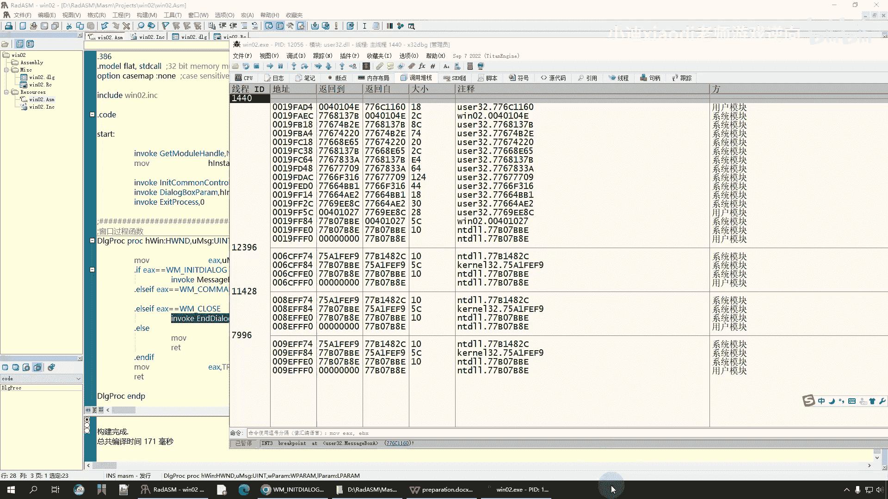
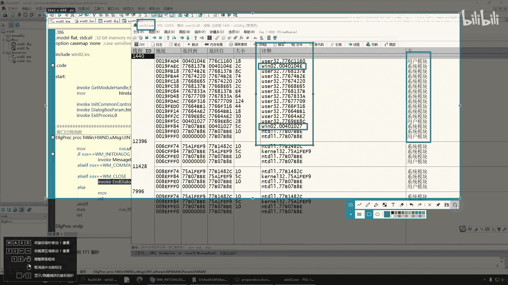
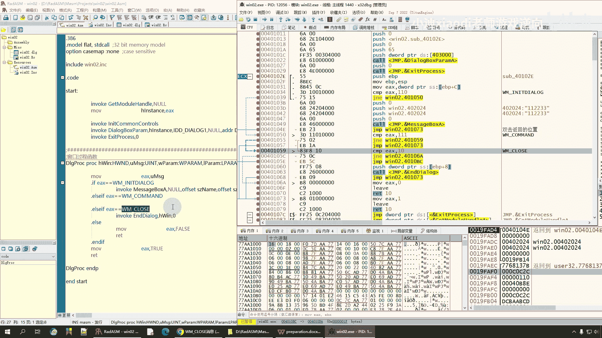

# 🧩 小白软件破解逆向工程师2023最新：5.18：Windows API讲解：创建一个窗口程序9-逆向分析给程序打补丁添加功能

## 📖 概述

在本节课中我们将要学习如何对一个简单窗口程序进行逆向分析，并通过打补丁的方式给程序添加新功能。本课由小迪老师讲解，对应第十八课“逆向分析窗口过程，外科手术式添加程序功能”。上节课使用 readd aSM 创建了一个简单窗口程序，本节课会先回顾构建和运行过程，再使用 x32dbg 进行调试，分析窗口过程函数中的消息过滤逻辑，最后在关闭窗口之前插入一个信息框，完成一次软件“外科手术”。

## 🪟 一、回顾简单窗口程序的创建与运行

上一节我们使用 readd aSM 创建了一个简单窗口程序，本节先回顾这个程序的构建和运行过程。原文中提到的 readd aSM 是工具名称，可以理解为 RadASM 一类的汇编开发环境。完成代码后执行构建并运行，就能看到程序窗口。这个窗口本身比较简单，程序直接调用 D 类函数就可以调出一个窗口。窗口资源位于资源脚本中的 `IDD_DIALOG1` 位置，`IDD_DIALOG1` 实际对应的就是当前显示的这个窗口。

这个窗口的所有功能和消息过滤，都是通过窗口过程函数实现的。原文口述为 dlogpro，可以理解为窗口过程函数 DlgProc。窗口消息就在这个函数中进行过滤和分发。理解这一点很关键，因为后续逆向分析时，需要找到窗口过程函数，并观察它比较了哪些消息、调用了哪些 API。

## 🔍 二、窗口过程中的消息过滤逻辑

上一节回顾了窗口程序的创建过程，本节查看窗口过程函数中的消息过滤逻辑。窗口过程函数首先处理 `WM_INITDIALOG`，这个值对应初始化界面的消息。如果界面进入初始化流程，程序就调用 `MessageBoxA` 弹出信息框。如果窗口关闭，程序就调用 `EndDialog`，`EndDialog` 是关闭窗口的消息处理功能。

以下列出本程序中需要重点关注的三类消息和对应行为：

- `WM_INITDIALOG`：初始化界面消息，程序在该分支中调用 `MessageBoxA`
- `WM_COMMAND`：命令消息，原文口述为 common，实际对应 `WM_COMMAND`
- `WM_CLOSE`：关闭窗口消息，程序通过 `EndDialog` 完成关闭窗口功能

对应消息值可以用下面代码表示：

```c
#define WM_INITDIALOG 0x0110
#define WM_COMMAND    0x0111
#define WM_CLOSE      0x0010
```

## 🛠️ 三、逆向分析准备：构建程序并用 x32dbg 调试

上一节分析了消息过滤逻辑，本节开始对程序进行逆向分析。首先需要查看程序大概是如何运行的，先执行构建。构建完成后到输出文件夹中找到生成的程序，然后使用 x32dbg 打开并调试。调试界面左侧是汇编代码，右侧是反汇编代码，阅读时需要把两边对应起来。

以下列出程序入口附近可以观察到的调用：

- 首先调用 Get 类函数，反汇编中可以看到对应调用
- 接着调用原文口述的另一个函数，反汇编中同样可以看到
- 然后调用 DialogBox 类函数，用于调出窗口
- 随后还能看到 ExistProcess 相关调用

这样一个小程序，入口附近的代码基本都能看到，程序的主要逻辑也集中在这里。除此之外还有窗口过程函数。因为程序比较小，所以在窗口过程中能直接看到它调用 `MessageBoxA`。如果程序比较大，窗口过程函数就不可能一眼看到。

## 🎯 四、根据程序行为下断点定位窗口过程

上一节完成了调试准备，本节根据程序行为下断点来定位窗口过程函数。程序较大时，不能只靠肉眼查找，可以根据程序表现出的行为下对应断点。只要断点能够断下来，就说明程序执行到了窗口过程函数附近。

> 关键思路：程序表现出某种行为，就寻找与该行为对应的 API，并在该 API 上设置断点。能够断下来，就说明断在了相关窗口过程逻辑中。

例如，这个程序一开始运行就会弹出一个信息框，说明程序经过某条消息时调用了 `MessageBoxA`。程序在过滤 `WM_INITDIALOG` 这条消息时调用了该函数。只要知道程序在某个时刻会表现出某种行为，而这个行为又对应某个 API，就可以在这个 API 上设置断点。这里的措辞必须严谨：一定要程序具备某种行为，才可以据此下断点。

以下列出原文提到的行为与 API 对应关系：



- 程序运行后弹出信息框，可能调用 `MessageBoxA`
- 程序关闭窗口，可能调用 `EndDialog`
- 程序打开文件时文件被删除，可能调用 `DeleteFile`

`EndDialog` 一定会执行关闭窗口动作，因此也可以在 `EndDialog` 上设置断点。因为本程序直接包含信息框，所以可以直接在 `MessageBoxA` 上按 F2 设置断点，然后运行程序。必须存在这种行为才可以下断点，需要根据程序表现进行判断。

程序断下来后，点击“调用堆栈”，跟着操作查看调用关系。调用堆栈中有很多内容，需要观察程序模块。这里观察的是当前程序自己的模块，重点查看左侧注释，不需要看右侧，右侧内容可以不用管。随后保存笔记。双击第一个程序模块相关条目，就会返回到程序模块位置；双击返回位置后，可以继续观察程序流程。



## 🧮 五、分析关键消息值：0x0110、0x0111、0x0010

上一节通过断点回到了程序模块，本节分析关键消息值。回到程序模块后可以看到程序对消息值进行比较。原文口述为 `CMP 110`，这里的 `110` 对应 `WM_INITDIALOG` 消息值，也就是 `0x0110`。程序通过这种方式对 `WM_INITDIALOG` 进行校验比较。

继续向下看，还能看到 `111`，它对应 `WM_COMMAND`。再往下还有 close 相关比较，`WM_CLOSE` 的值是 `0x0010`。需要把这些内容填写严谨，三条消息过滤都能对应上。

以下列出比较结果和含义：

- `0x0110`：`WM_INITDIALOG`，初始化界面消息
- `0x0111`：`WM_COMMAND`，命令消息
- `0x0010`：`WM_CLOSE`，关闭窗口消息

对应代码示例如下：

```asm
cmp eax, 0x0110   ; WM_INITDIALOG
cmp eax, 0x0111   ; WM_COMMAND
cmp eax, 0x0010   ; WM_CLOSE
```

到这里，三条消息的过滤逻辑都已经出现。后续分析中可以把每条消息校验与汇编代码一一对应，这样就能清楚知道程序在什么消息下执行什么功能。

## 💉 六、补丁需求：关闭窗口前弹出信息框

上一节分析完消息比较，本节提出补丁需求。现在有一个需求：在关闭窗口之前弹出一个信息框。关闭窗口的功能位于窗口过程函数中，某个分支会先准备参数，再调用函数，然后跳出去，程序随之退出。我们要在这个关闭窗口功能之前做一次“外科手术”。

补丁思路很简单：保留原来的关闭窗口功能，同时在关闭窗口功能之前写入调用信息框的代码。这样程序会先弹出信息框，再执行原来的关闭窗口逻辑。

以下列出补丁设计的基本步骤：

- 保留原关闭窗口功能，不能删除原逻辑
- 在原关闭窗口调用之前插入 `MessageBoxA` 调用
- 插入完成后继续执行原关闭窗口逻辑
- 最后跳回原程序流程，保证程序正常退出

关闭窗口分支本身空间不够，一共只有三行左右，要写入多行补丁代码就不够用。这时可以随便找一个可以写入且没有被使用的空位置，例如空代码区，拿来存放补丁代码。把参数和调用指令一行一行写进去，直接照抄原逻辑。调用信息框之后，还要调用原来的关闭窗口功能，不能把原功能替换掉或弄没。关闭窗口功能中的参数要统一复制，原来调用后跳转到的那行代码也要保留。

伪代码可以写成下面的形式：

```asm
; 补丁区：先弹出信息框
push 0
push offset 标题
push offset 内容
push 0
call MessageBoxA

; 再执行原来的关闭窗口逻辑：参数、参数、调用函数
...
jmp 原跳转位置
```

原文口述中还提到类似 `push 0` 等指令细节，实际编写时需要按照程序原来的汇编逐行填写，确保参数和调用顺序正确。

## 🧷 七、修改跳转并处理堆栈问题

上一节完成了补丁代码设计，本节修改跳转并处理堆栈问题。先记录补丁区首字节地址，鼠标右键复制地址。原文示例中首字节地址为 `0x4010BC`。回到源代码对应位置，用空格修改指令，直接写入 `JMP 0x4010BC`，让原来的关闭窗口分支跳到补丁区执行。这样程序经过原关闭窗口功能时，会先跳到补丁区弹出信息框，然后再执行关闭窗口逻辑。

对应修改可以表示为：

```asm
jmp 0x4010BC   ; 跳到补丁区，先弹框再执行原关闭逻辑
```

有同学会产生疑问：补丁区中存在 `[ebp+8]`，上面的操作会不会影响堆栈，这边是否也会受到影响。答案是不会影响。该函数使用内部平栈，内部平栈已经平衡了堆栈，不需要额外处理。因此可以放心使用 `[ebp+8]` 访问正确的参数值。

```asm
; 内部平栈已经平衡堆栈，补丁区仍可正常访问参数
mov eax, [ebp+8]
```

## ✅ 八、保存补丁文件并验证效果

上一节修改完跳转，本节保存补丁文件并验证效果。程序修补完成后，点击“补丁”，再点击“修补文件”。给新文件起一个名字，原文示例中提到问03、问02、带 ASM 和 EXE 的名称，按示例填写后回车确认，再点击 OK 保存。

以下列出验证时观察到的现象：

- 程序启动后弹出信息框
- 关闭窗口时再次弹出信息框
- 原关闭窗口功能仍然保留，程序能够正常退出

到保存位置运行新程序，程序启动会弹框；关闭窗口时也会新增一个弹框。这说明软件的外科手术已经完成，新功能成功添加。整个分析过程比较细致，每一条消息校验都可以与汇编代码一一对应。



## 🧾 总结

本节课中我们一起学习了如何逆向分析一个简单窗口程序，并通过打补丁添加功能。我们回顾了 readd aSM 创建窗口和构建运行的过程，理解了窗口过程函数如何通过 `WM_INITDIALOG`、`WM_COMMAND`、`WM_CLOSE` 等消息进行过滤，使用 x32dbg 根据程序行为在 `MessageBoxA`、`EndDialog` 等 API 上设置断点，定位窗口过程逻辑，分析 `0x0110`、`0x0111`、`0x0010` 等关键消息值。随后我们在关闭窗口功能之前插入信息框调用，保留原关闭窗口逻辑，修改 `JMP` 跳转到补丁区，并处理了内部平栈下的 `[ebp+8]` 访问问题，最后保存补丁文件并验证程序启动和关闭窗口时都能弹出信息框。如果学习本课过程中遇到疑问，可以通过社区联系学习。本课到这里结束，下期再见。

