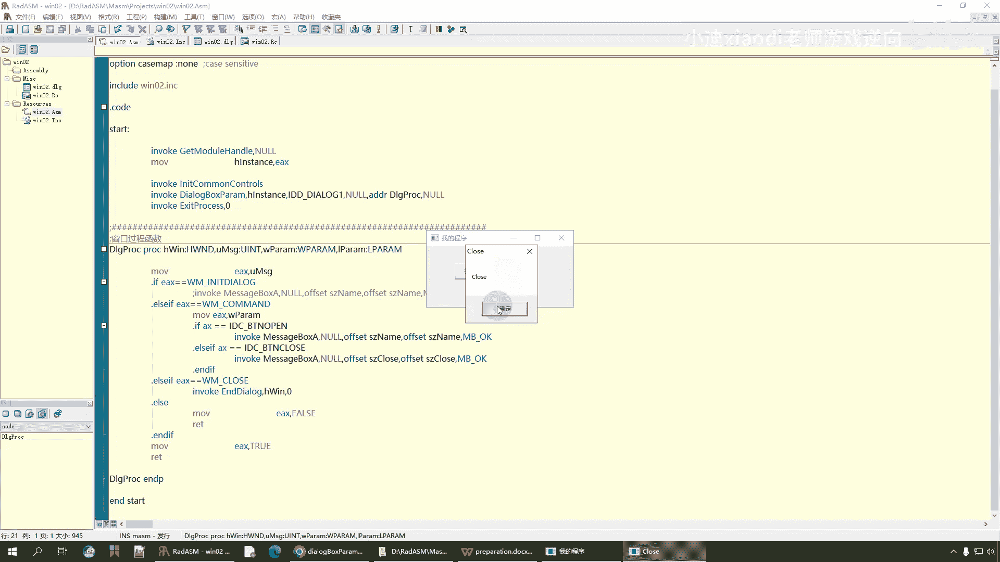

# 🧭 小白软件破解逆向工程师2023最新：5.19：精确逆向分析程序定位模态窗口过程函数


大家好，我是小迪老师。在本节课中，我们将要学习第十九课 Windows API 的内容：创建窗口程序时，如何精确定位模态窗口过程函数。本课对应视频编号 BV1JQ4y1t7Ba-。最近入冬，天气不好，气温骤降，大家注意保暖，不要像小迪老师一样感冒；即使感冒，也要完成知识讲解。对于初学者来说，先把名词和分析思路弄清楚，后面分析程序时会更容易跟上。

## 🧩 小白软件破解逆向工程师2023最新：5.19.1：什么是模态窗口


在进入逆向分析前，先把“模态窗口”这个名词弄清楚。创建窗口时会用到例子中的函数，该函数是 `DialogBox`。微软官方文档说明，`DialogBox` 从对话框模板资源创建模式对话框；用这个函数创建出来的模式对话框称为模态窗口，请记住“模态窗口”这个名词。用大白话理解，模态窗口像一种需要先处理完的对话框，处理完再回到主窗口，这样理解概念会更直观。

> 微软官方文档说明：`DialogBox` 从对话框模板资源创建模式对话框。用该函数创建出来的模式对话框称为模态窗口。


与模态窗口相对的是非模态窗口。非模态窗口以后有机会再讲，本节先了解模态窗口。今天创建的窗口就是模态窗口。核心概念可以用下面的公式表示：


$$
\text{模态窗口} = \text{用 DialogBox 系列函数从对话框模板资源创建的对话框}
$$

创建模态窗口时，代码形式可以理解为下面这样：


```c
DialogBoxParamA(hInstance,
                MAKEINTRESOURCE(IDD_DIALOG1),
                hWndParent,
                DialogProc,
                dwInitParam);
```


上述代码中第 4 个参数 `DialogProc` 就是窗口过程函数地址。理解模态窗口的概念后，下一小节看窗口过程函数在代码中的位置。

## 🪟 小白软件破解逆向工程师2023最新：5.19.2：窗口过程函数在哪里

上一小节说明了模态窗口是什么，本节看看模态窗口的窗口过程函数在代码中的位置。模态窗口的窗口过程就在我们自己编写的函数中，这个函数就是 `DialogProc`。模态窗口没有默认的窗口处理函数；在创建代码时可以看到没有默认处理函数。部分同学可能发现自己这边多了一些代码，先不要查看，这些内容与本课无关，下节课讲按钮时会说明。明确窗口过程函数由自己编写后，下一小节讨论如何定位它。


## 🔍 小白软件破解逆向工程师2023最新：5.19.3：定位思路：内部切入与外部切入


上一小节确认窗口过程函数在 `DialogProc` 中，本节讨论定位它的思路。上一节课的定位方法是：窗口刚开始执行时会走 `WM_INITDIALOG` 消息，用于初始化对话框。该消息处理中调用了 `MessageBoxA`，因此可以在 `MessageBoxA` 下断点，从而断在窗口过程内部。该方法从窗口过程内部切入，可行。


还可以从哪里下断点？大家要掌握全面的分析方法。`DialogBoxParam` 会使用窗口过程函数，因此可以从外部寻找蛛丝马迹。以下是两种常见的定位切入方式：

- 内部切入：窗口过程内部可能调用弹框函数，例如 `MessageBoxA`。在弹框函数下断点，就能断在窗口过程内部。
- 外部切入：创建模态窗口时一定会调用 `DialogBox` 系列函数，该函数参数中包含窗口过程函数地址。拿到这个地址，就拿到了窗口过程函数。


外部定位的关键关系可以写成公式：


$$
\text{窗口过程函数地址} = \text{DialogBoxParamA 的第 4 个参数}
$$


思路确定后，下一小节用 x32dbg 做实验，验证外部定位方法。


## 🛠️ 小白软件破解逆向工程师2023最新：5.19.4：用 x32dbg 从外部定位窗口过程函数


上一小节介绍了内部和外部两种思路，本节用 x32dbg 验证外部定位。把目标程序放入 x32dbg。以下是使用 x32dbg 从外部定位窗口过程函数的具体步骤：

1. 过去在 `MessageBoxA` 下断点，是从内部切入；现在从外部对 `DialogBox` 系列函数下断点。
2. 直接输入 `DialogBox` 可能出现无效表达式，应改用 A 版本 `DialogBoxParamA`。点击确定，按 F2 下断点，然后运行程序。
3. 程序运行后直接断下来，此时实际进入 `WM_INITDIALOG`，因为窗口需要加载。
4. 通过右下角的堆栈判断当前状态。堆栈中的 40000（示例值）是模块句柄，也就是实例句柄；`IDD_DIALOG1` 为 101，101 等于十六进制 `0x65`。
5. 观察参数：第 1 个参数、第 2 个参数、第 3 个参数、第 4 个参数。第 4 个参数是窗口过程函数指针，也就是窗口过程函数地址。
6. 在参数位置回车，跳转到 `DialogProc`，即窗口过程函数。可以添加注释“DialogProc 窗口过程函数”。
7. 还可以鼠标右键，为当前地址写标签，例如 `Dialog`。后续用到该地址时会显示标签；此处没有具体体现不要紧。注释和标签都可以添加。

通过以上步骤，可以从外部定位对话框函数，操作简单。核心是理解思想：不仅可以从内部切入，还可以从外部切入。细心观察来源于对 API 用法的了解，`DialogBox` 有参数，参数中包含窗口过程地址。今天内容比较简单。实验完成后，下一小节总结核心思想并回顾课程。

## 📌 小白软件破解逆向工程师2023最新：5.19.5：核心思想与课程总结


上一小节完成了外部定位实验，本节总结核心思想并回顾课程。以下是本节课的要点回顾：


- 模态窗口由 `DialogBox` 系列函数从对话框模板资源创建；非模态窗口以后有机会再讲。
- 模态窗口的窗口过程函数由自己编写，没有默认窗口处理函数；窗口过程在 `DialogProc` 中。
- 内部定位可以在 `MessageBoxA` 等蛛丝马迹处下断点；外部定位可以在 `DialogBoxParamA` 下断点，并取第 4 个参数地址。
- 使用 x32dbg 观察堆栈、模块句柄、`IDD_DIALOG1`、参数，回车跳转，添加注释与标签。
- 核心思想是全面分析并细心观察 API 用法。



本节课中我们一起学习了模态窗口的概念、窗口过程函数的位置，以及从内部和外部精确定位模态窗口过程函数的方法，还完成了 x32dbg 外部断点实验。下节课将讲解按钮，按钮内容也比较简单。下课前可以构建并运行程序；如果构建时发生错误，检查程序是否没有退出，关闭程序即可，然后重新构建并运行，观察窗口的打开和关闭。下节再见。

