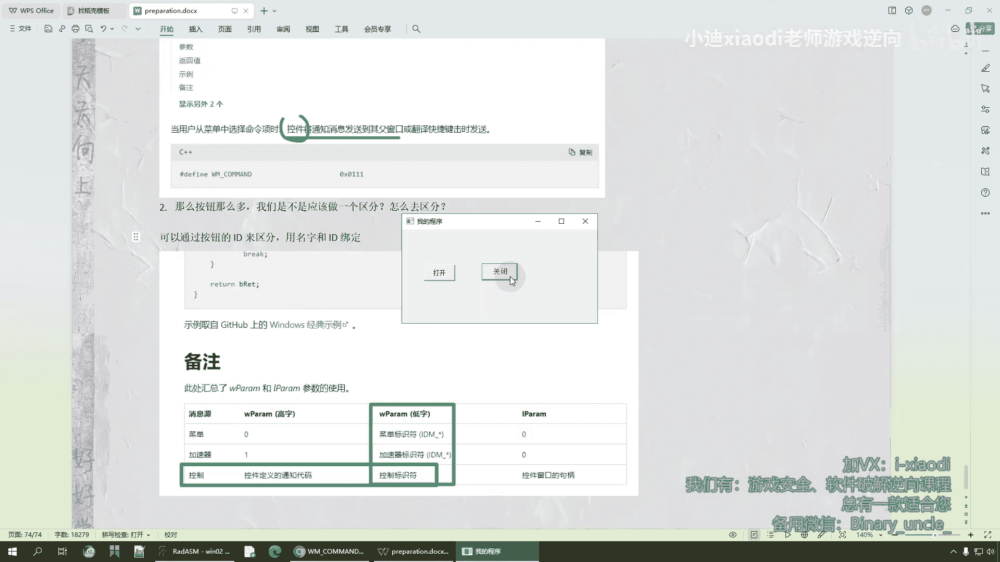

# 🪟 小白软件破解逆向工程师2023最新：5.20：Windows API讲解——创建一个窗口程序11：按钮

在本节课中我们将要学习 Windows API 中按钮控件的使用方法，课程由小李老师讲解，是 Windows API 讲解的第二十课，主题是创建一个窗口程序中的按钮。具体来说，我们会先搞清楚怎么把按钮添加到窗口里，再弄明白按钮被点击时消息到底归谁处理，然后学习怎么用按钮的 ID 区分不同的按钮，最后在窗口过程函数里写代码过滤按钮消息并弹出对应的提示框。整节课的内容并不复杂，核心就是两个步骤：先确定按钮属于哪个消息，再确定怎么用按钮 ID 做过滤。


## 🧩 小白软件破解逆向工程师2023最新：5.20.1：打开对话框资源并添加按钮

上一节我们明确了本节课的整体目标，本节中我们来看看第一步，也就是怎么在资源视图里找到对话框并往里面添加按钮。具体操作并不难，只要跟着资源视图的目录一层层点进去就可以。

以下是具体操作步骤：


1. 首先切换到 `MISC` 目录。
2. 双击 `dialog` 资源，这时就能看到一个窗口出现在编辑区域里。
3. 窗口中有一个 `OK` 按钮，这个 `OK` 就是一个按钮控件。你可以用鼠标随意拖动它，也可以调整它的大小。

之前我们已经设置过两个按钮，一个是“打开”，一个是“关闭”。这两个按钮都放在窗口里面，因此它们产生的消息处理也归属于整个窗口过程函数。窗口过程函数里会收到很多种消息，那么按钮到底属于哪一种消息呢？这就是下一节要重点解决的问题。

## 📨 小白软件破解逆向工程师2023最新：5.20.2：按钮消息归属于WM_COMMAND

上一节我们成功把按钮放进了窗口，本节中我们来看看按钮的消息到底归属于哪个消息类型。因为按钮是窗口里的控件，所以它的消息自然也会进入窗口过程函数，但窗口过程函数收到的消息有很多种，我们需要确认按钮点击对应的是哪一个。


我们可以去微软文档中搜索 `WM_COMMAND` 消息，文档中会提示：当用户从菜单中选择命令项时，控件将通知消息发送到其父窗口。这里说的控件就包括按钮、标签等器件，它们都是控件。也就是说，按钮这类控件发出的通知消息归属于 `WM_COMMAND` 消息。


用公式来表示就是：

```text
按钮通知消息 → WM_COMMAND → 父窗口过程函数
```

这样一来，第一个问题就解决了：按钮属于菜单消息中的 `WM_COMMAND` 消息处理范围。


## 🆔 小白软件破解逆向工程师2023最新：5.20.3：用按钮ID区分不同按钮

上一节我们确认了按钮消息归属于 `WM_COMMAND`，本节中我们来看看按钮有很多个时应该怎么区分。不同的按钮肯定要做不同的工作，所以必须给每个按钮一个明确的身份标识。

按钮本身带有 `name` 和 `ID`，而且不同按钮的 ID 是不一样的，ID 就像人的身份证号一样，每个按钮都不同。例如一个按钮的 ID 是 `1001`，另一个按钮的 ID 是 `1002`。这个 ID 可以和头文件里的名字绑定在一起。

以下是绑定按钮名称和 ID 的步骤：

1. 先给按钮起一个名字，例如“打开”按钮要改成 `IDC_BUTTON_OPEN`，注意一定要更改按钮的名称。
2. 把“关闭”按钮的名称改成 `IDC_BUTTON_CLOSE`。
3. 把这两个名字复制到头文件的定义区域中。
4. 用宏把名字和 ID 对应起来。


对应的核心代码可以写成这样：

```c
#define IDC_BUTTON_OPEN   1001
#define IDC_BUTTON_CLOSE  1002
```

完成这些步骤后，按钮的 ID 就搞定了，本质上就是用名字和 ID 做绑定。绑定完成之后，接下来的问题就是怎么在窗口过程函数里处理并过滤这些按钮消息。

## 🔍 小白软件破解逆向工程师2023最新：5.20.4：在窗口过程中过滤按钮消息


上一节我们把按钮名称和 ID 绑定好了，本节中我们来看看怎么在代码里根据按钮 ID 做过滤。微软文档中汇总了 `wParam` 和 `lParam` 参数的使用方法：对于控件通知代码来说，`wParam` 的高字是通知代码，低字是控件的标识符，而这个标识符就是按钮的 ID。


对于 32 位程序来说，低字就是低 16 位。假如用 `EAX` 寄存器来存放 `wParam`，那么 `EAX` 是一个 32 位寄存器，它的低 16 位就是 `AX`。因此我们可以把 `wParam` 给到 `EAX`，这样 `EAX` 中就拿到了整个控件的通知代码和控件标识符，然后再把 `EAX` 中的 `AX` 取出来，`AX` 就是按钮的 ID。


用代码描述这个取 ID 的过程就是：

```c
WORD id = LOWORD(wParam);  // 取出 wParam 的低 16 位，也就是按钮 ID
```

拿到 ID 之后就可以直接判断了。如果 `AX` 等于“打开”按钮的 ID，就弹出打开相关的消息框；如果 `AX` 等于“关闭”按钮的 ID，就弹出关闭相关的消息框。

对应的判断逻辑可以写成这样：

```c
if (LOWORD(wParam) == IDC_BUTTON_OPEN)
{
    MessageBox(hWnd, L"打开", L"提示", MB_OK);
}
else if (LOWORD(wParam) == IDC_BUTTON_CLOSE)
{
    MessageBox(hWnd, L"关闭", L"提示", MB_OK);
}
```


整个处理过程其实就这么点代码，逻辑非常直接。


## ▶️ 小白软件破解逆向工程师2023最新：5.20.5：构建运行并验证按钮效果

上一节我们写好了按钮消息的过滤代码，本节中我们来构建程序并运行看看实际效果。构建完成后点击“打开”按钮，会弹出打开相关的消息框；点击“关闭”按钮，会弹出 `close` 相关的消息框。实际运行下来可以发现，按钮的处理还是比较简单的。

整个流程可以归纳为两个步骤：

1. 第一步，先确定按钮属于菜单消息，也就是 `WM_COMMAND`。
2. 第二步，确定怎么用按钮的 ID 进行过滤，实际上就是用 `wParam` 的低字来取 ID 并做判断。


## 📝 总结



本节课中我们一起学习了 Windows API 中按钮控件的完整使用流程，包括在资源视图中添加按钮、理解按钮消息归属于 `WM_COMMAND`、用名称和 ID 绑定区分不同按钮，以及在窗口过程函数中通过 `wParam` 低字取出按钮 ID 并做条件判断。整节课的核心就是两步：先确认按钮属于菜单消息，再用按钮 ID 做过滤。课后可以把程序自己修修补补再写一遍，加深理解。本节内容到此结束，下期再见。

