# 🧭 小白软件破解逆向工程师2023最新：第八课：API函数下断点技术详解

本节课程由小杰老师讲解，是第八课，主题是API函数下断点。在本节课中我们将要学习为什么下断点、下什么断点、DeleteFile函数如何使用、如何用x32dbg给API函数下断点、断下后如何回溯调用位置，以及如何识别搜狗拼音等外部程序造成的干扰。课程会从Windows平台规则讲起，再进入删除文件案例，最后总结调试流程。对初学者来说，先理解“程序很多行为都要经过系统API”这一点，后面的断点分析才有落脚点。

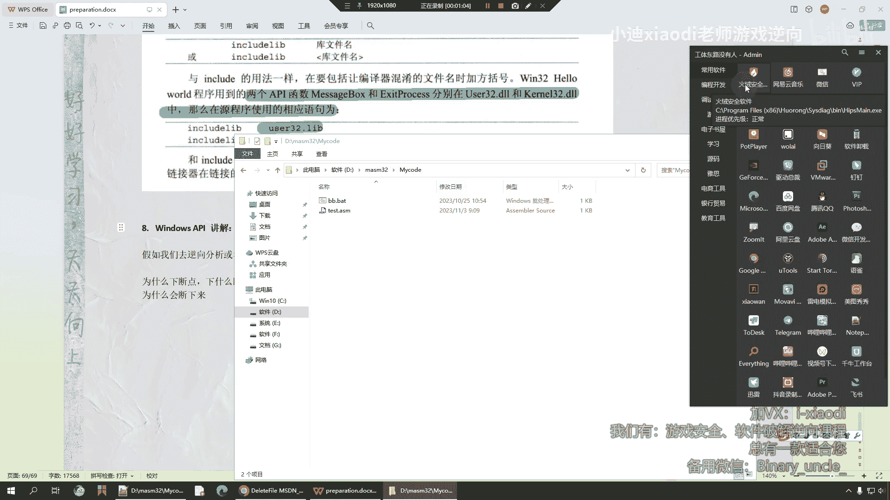

## 🎯 小白软件破解逆向工程师2023最新：第八课：为什么要下断点

上一节内容引出了课程主题，本节我们来看看第一个问题：为什么要下断点，下什么断点。现在运行环境是Windows操作系统，很多程序行为都依赖这个平台的规则。可以把这个平台理解成一个生态，程序不是想做什么就直接做什么，而是要按照系统给出的规则走。微软操作系统提供的一套重要规则就是API函数。如果程序要实现某些功能，要调用某些功能，就必须走系统提供的函数。比如一个程序要退出，它就要走对应的退出函数；一个程序要弹出消息框，它就要走对应的消息框函数。所有这类行为都建立在系统条件和规则之上。

下面用列表把“为什么下断点”的逻辑拆开，方便初学者一步步理解。

1. 程序运行在Windows平台上，很多行为依赖平台规则。
2. 平台规则中很关键的一层是API函数。
3. 程序要实现功能，通常要调用API函数。
4. API函数被调用时，就是一个可以观察程序行为的切入点。
5. 在API函数处下断点，程序调用该函数时就会暂停，便于分析。
6. 所以下断点的目的，是抓住程序行为发生的瞬间，查看调用关系和参数。

理解这个逻辑后，就能明白断点不是随便下的，而是围绕程序可能调用的API来下。上一段我们说明了API是程序行为的入口，接下来用一个删除文件的例子，把“为什么下断点”落到实际程序上。

课程还举了一个鲜活的例子：现在要去删除一个文件。电脑上通常装有杀毒软件，杀毒软件有可能删除木马程序，也有可能删除一些程序。这个例子说明，删除文件这种行为在系统里很常见，背后就会走删除文件的API。我们也可以自己写一个删除文件的程序，用它来观察API调用。

## 🧱 小白软件破解逆向工程师2023最新：第八课：用DeleteFile写删除文件程序

上一节我们理解了API是程序行为入口，本节我们来看看删除文件函数DeleteFile怎么用。删除文件的函数名字叫DeleteFile，今天又积累一个DeleteFile函数。使用方法可以先在百度搜索DeleteFile MSDN，搜索得到结果后看到Microsoft，这就是微软官网。进入官网后会看到说明：该别名根据Unicode预处理定义自动选择什么什么，这一句不用管。需要知道的是DeleteFile会出现A和W版本。为什么会出现A和W版本？因为删除文件要填入删除路径，而路径是字符串，所以搜索DeleteFile时，实际上会列出DeleteFileA和DeleteFileW。

点进去以后，页面会说明DeleteFile的功能是删除现有文件。页面上有语法，也有参数。这个函数只有一个参数，参数填要删除文件的名称。这个理解比较简单：只需要把要删除的文件名填进去。下面用代码块把函数原型和调用思路写出来，便于对照。

```c
BOOL DeleteFileA(LPCSTR lpFileName);
// lpFileName：要删除的文件名称，本质是字符串路径
```

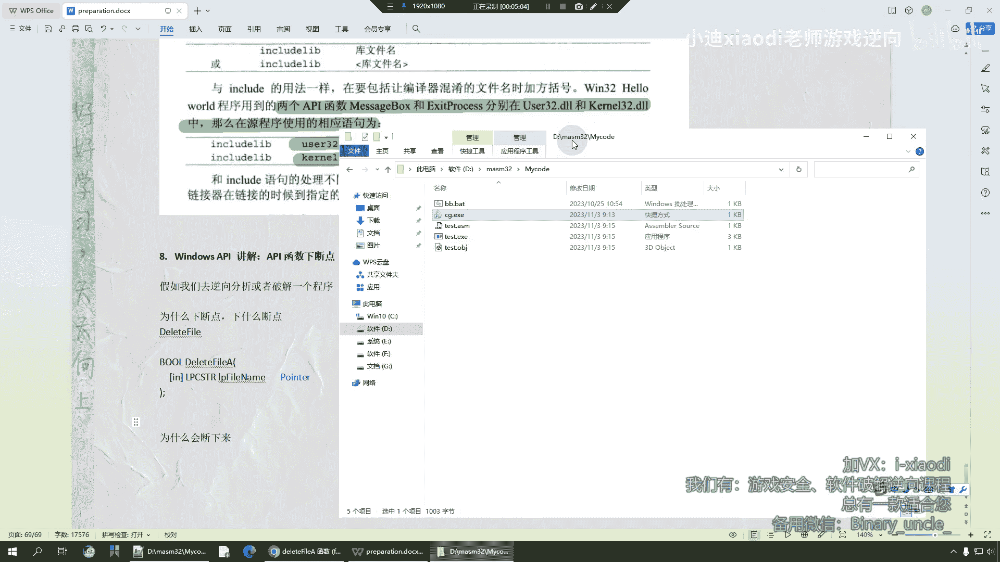

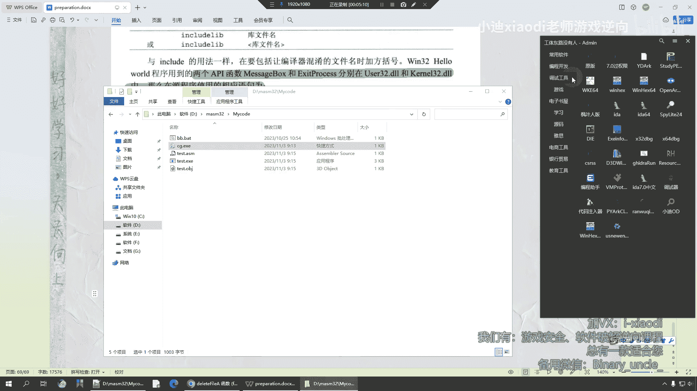

明白了函数参数后，接下来要准备一个实际程序。回到目录的上一层，随便复制一个程序过来，例如复制CD点SE到目标目录。然后可以创建快捷方式，鼠标右键属性，查看它的路径。现在定义一个要删除文件的路径，例如定义为SC file，并用DB把路径填过来。这样就有了删除文件的路径。接下来就是调用函数，直接写invoke即可。调用时写DeleteFileA，把函数复制过来，它有一个参数，就是要删除文件的名称。

这里有一个关键注意点：要删除文件名称这个字符串不要直接往参数位置填。直接填字符串，生成程序也能正常运行，但文件删不掉，因为它没有得到正确的地址。下面用代码块展示错误写法和正确写法。

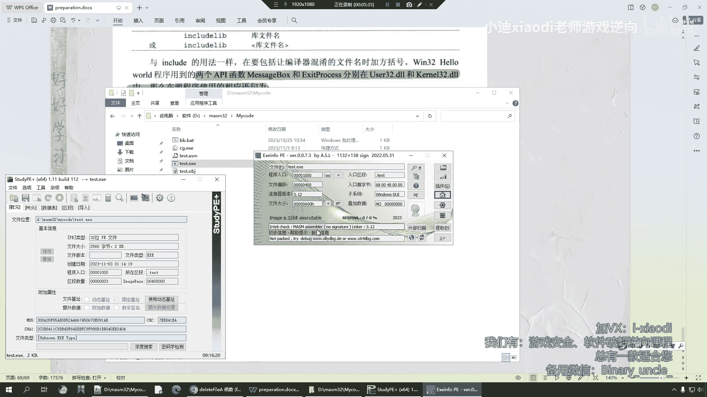

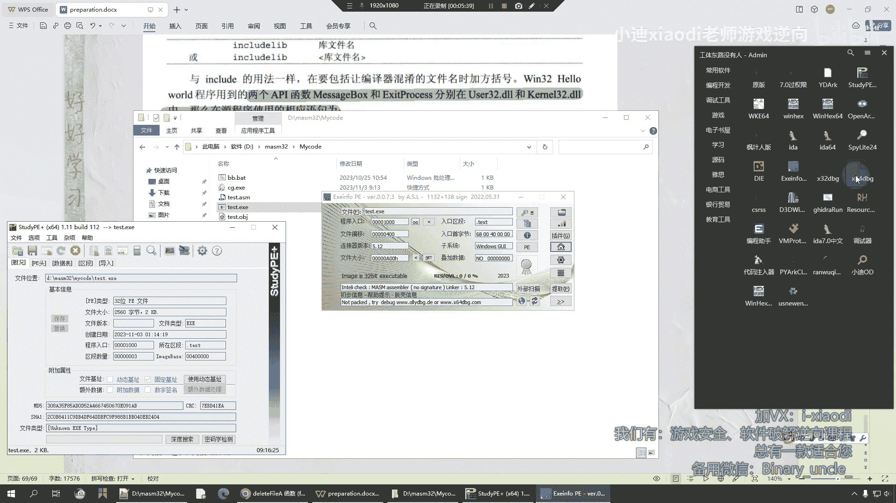

```asm
; 错误思路：直接填字符串，不能正确传入地址
invoke DeleteFileA, "C:\路径\CD点SE"

; 正确思路：先把路径放进变量，再用 offset 取地址
szFile db "C:\路径\CD点SE", 0
invoke DeleteFileA, offset szFile
```

为什么必须用offset？因为参数类型里有LP。LP是long pointer，long pointer里的P是pointer的意思，可以记录下来。看到LP，看到P，就要知道这里要传一个指针，或者说要传一个地址。怎么传地址？可以模仿人家怎么传地址：szTest前面有一个offset。所以一定要加offset，加上offset之后才是正确地把地址传过去。这样删除文件就可以正常删除。再生成一下，生成成功。这个时候再运行，程序就会消失。运行后点确定，程序会消失，当然它有延迟，会稍停一会儿，然后消失，程序已经被删掉。

上一节我们完成了DeleteFile删除文件程序，本节进入第二个问题：为什么会断下来。答案可以直观理解：因为API函数被调用了。下面去实践一下，把程序放到调试器里分析。

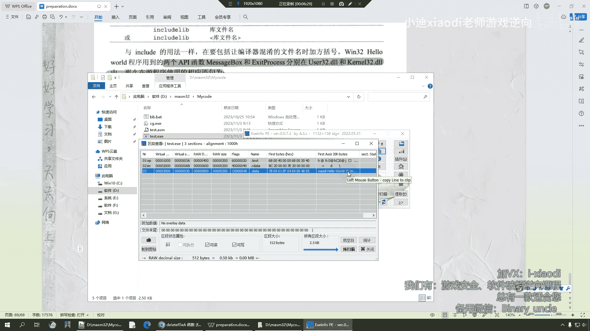

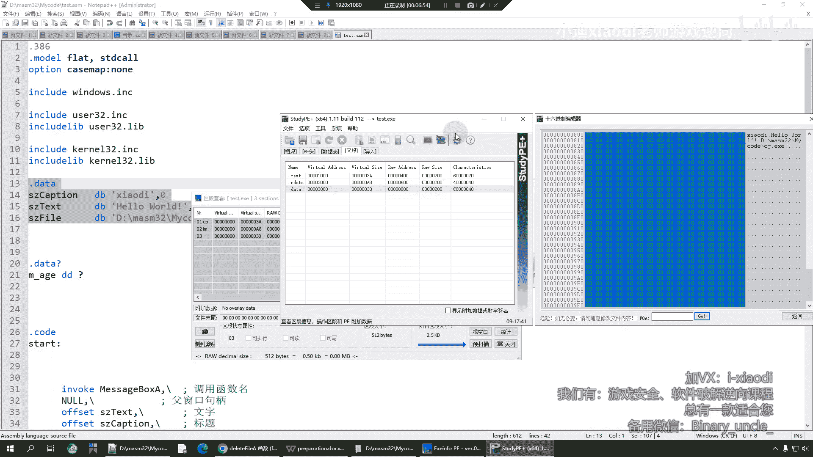

## 🛠️ 小白软件破解逆向工程师2023最新：第八课：调试准备与入口断点

上一节说明了断下来是因为函数被调用，本节我们来看看分析程序前要做什么准备。分析程序是不是要用x32dbg？可以走一下正规流程：先用Stud_PE或者Exeinfo PE拿到一个程序，拖过来，看一下它是多少位的程序。32位程序用x32dbg，64位程序用x64dbg。把程序拖过来后，先简单看一下文件类型，这里可能没有显示出来。然后看区段，区段有三个，简单熟悉一下。和普通程序比，它缺了一个资源段。为什么缺资源段？因为现在还没有窗口，没有图片这些资源，所以它只有三个段。简单了解资源段即可。

接着看数据段。一个程序如果写了一些关键数据在程序里，这些数据会出现在数据段。点到这里看的是区段，再看Stud_PE查看区段。查看data段时，可以看到小迪、hello world这些数字都摆在那里。点text段就没有那么显著，它不会把代码完整地显示在这里。简单了解data段即可。拿到一个程序可以直接观察data段，这一点比较重要。还可以看MASM编译器信息，它说明程序用什么工具开发、用什么编译器写。assembler是汇编，MASM就是用的MASM工具，路径和开发工具都能识别出来。

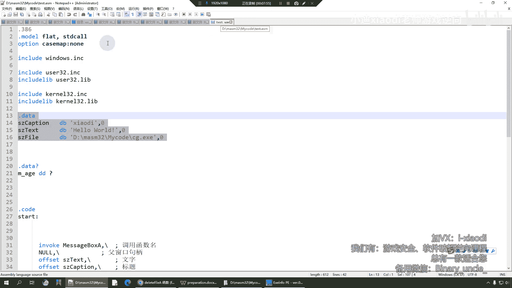

下面把调试前的设置步骤列出来，初学者可以照着做。

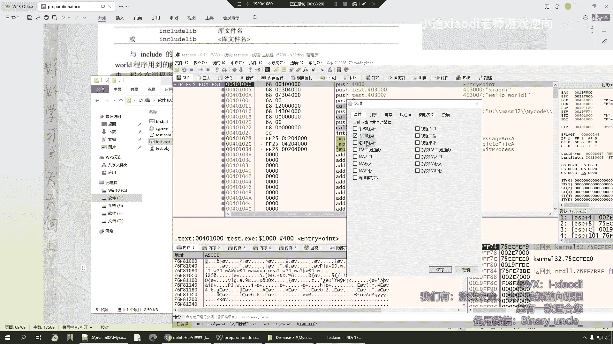

1. 把程序拖到x32dbg。
2. 点击选项。
3. 把所有的勾全部取消掉。
4. 只在入口断点处打上勾。
5. 点击保存。
6. 可以关掉调试器再重新打开。
7. 重新拖入程序后，入口断点会断下来。

设置时要注意，把所有断点全部取消掉，界面是空空的，然后再把入口断点勾上。为什么要这样设置？因为调试器有提示：当以下事件发生时暂停，入口断点会暂停。把程序拖过来时，这里就是程序入口，右边会显示entry point，也就是程序入口点。可以用公式表示：

```text
entry point = 程序入口点
```

程序入口点意味着开始走进这个程序，打开程序的大门，然后一步一步向着真理奔去。完成入口断点设置后，下面就可以围绕猜测的API下断点。

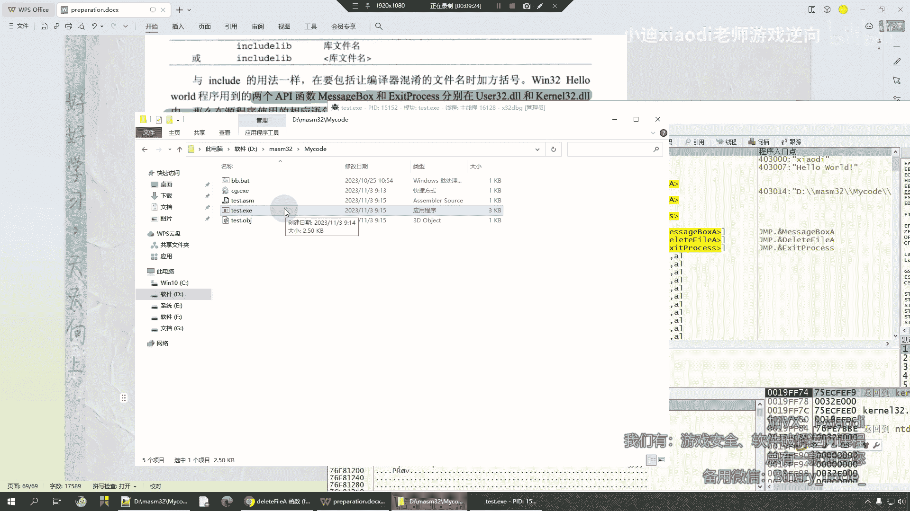

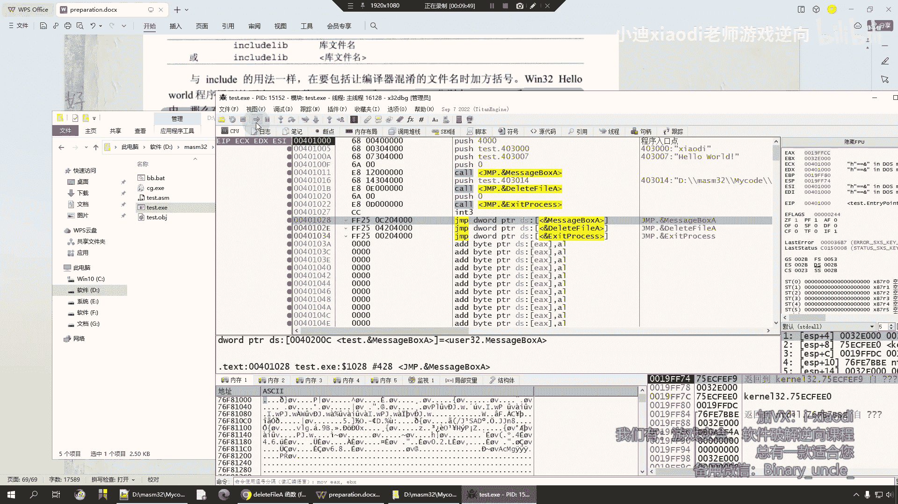

## 🔍 小白软件破解逆向工程师2023最新：第八课：用API断点定位DeleteFileA

上一节完成了入口断点设置，本节我们来看看如何给删除文件API下断点。假如猜测这个程序运行后被删除，会调用DeleteFile，或者调用删除文件相关断点。这个时候可以点击插件，点击API breakpoint，再点击set breakpoint。这里有文件处理，文件处理里面有一个删除文件。删除文件分A和W，如果不知道程序调用哪一个，就都勾选上。勾选后擦掉窗口，然后运行程序。

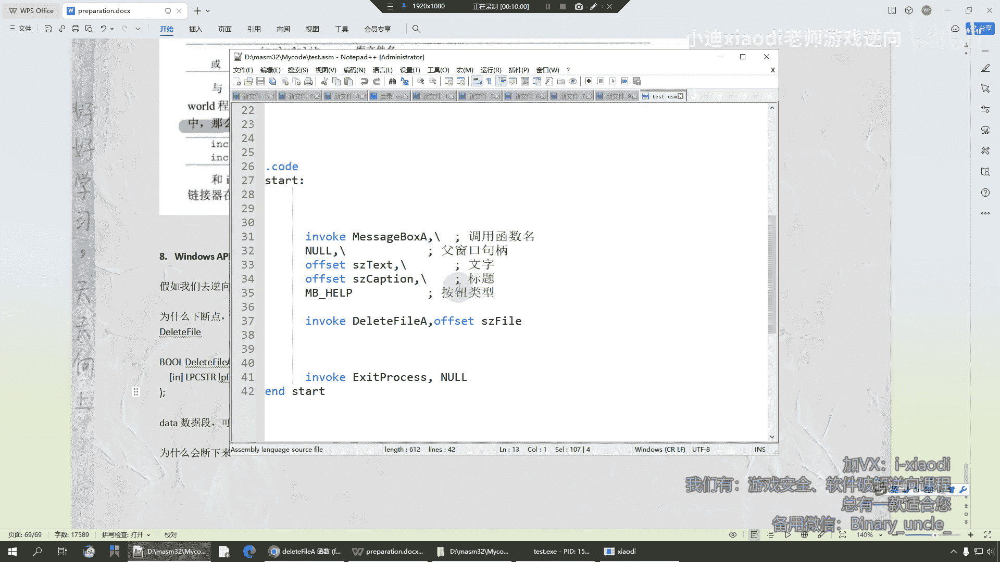

当前程序里的DeleteFile不会成功，因为这个文件已经被删过，文件已经消失。我们看能不能调过去，点击确定，程序断下来了。界面显示已暂停，已暂停意味着程序在这里停住了，说明函数或者程序真的调用了这个函数，所以它会停下来。它在A上停了，没有在W上停，意味着这个程序调用的是DeleteFileA，而不是DeleteFileW。继续运行程序，W也会跑一下。看一下DeleteFileW是哪里跑的，这个W不是我们自己调的，是搜狗拼音调的，不是我们自己的程序，这是输入法的问题。

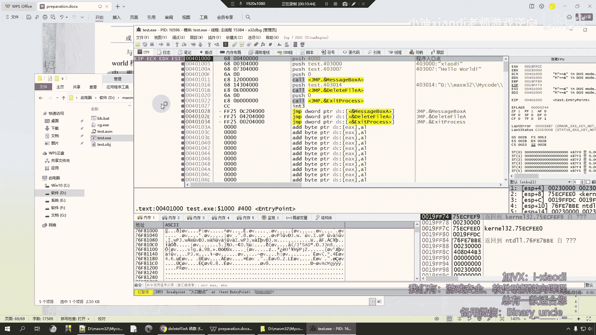

下面把定位和判断过程整理成列表，方便对照观察。

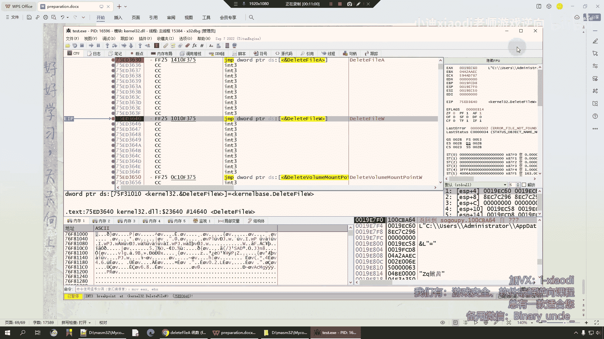

1. 在API breakpoint中给DeleteFileA和DeleteFileW都下断点。
2. 运行程序，观察断点停在A还是W。
3. 停在DeleteFileA，说明当前程序调用了DeleteFileA。
4. 查看堆栈和返回地址，确认调用者是不是自己的程序。
5. 如果看到搜狗拼音等外部模块，说明这个调用可能来自输入法或其他软件。
6. 不属于自己程序的调用，可以先不理，继续分析自己的程序。

重新跑一遍，看两个DeleteFile的差别。重新运行，点击确定，看DeleteFile是谁调的。可以发现DeleteFile返回到text点什么什么，这是我们自己的程序，是程序自己调的。再运行，这里出现DeleteFileW，这个不是我们自己的程序调的，是搜狗拼音调的。所以有的时候电脑装一些乱七八糟的东西，会影响分析，会打乱讲课内容的节奏。但它也增加了对知识点的扩充，对系统有多元化的理解。上一段我们看到了A和W的差别，本节继续看断下后如何回到调用位置。

## 🧩 小白软件破解逆向工程师2023最新：第八课：回溯调用位置与识别干扰

上一节定位到了DeleteFileA，本节我们来看看断下后怎么回到调用位置。DeleteFileA一般怎么分析？比如点击确定断下来了，瞅一眼发现是自己程序在堆栈里，可以观察到特征：它返回到我们自己的程序。一般来说用Ctrl+F9返回，再按F8。Ctrl+F9是返回到DeleteFileA函数的尾部。到了函数尾部，执行完之后该执行什么？该执行这一行代码，也就是跑回到外层，跑回到整个外部。现在还是在这个内部，从这个内部跑出来就到了外部。所以这个时候按F8单步，可以看到程序跑出来了。跑出来的地方就是调用的位置，我们就回溯到了调用的位置。

下面用流程公式把回溯过程写清楚，便于记忆。

```text
Ctrl+F9 -> 到达 DeleteFileA 函数尾部
F8      -> 单步到下一行代码，也就是外部调用位置
```

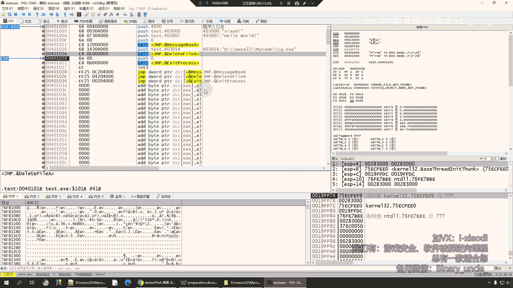

整个流程是：先Ctrl+F9到达DeleteFileA函数尾部，再F8单步到下一行代码。下一行代码实际上就是外部，外面的世界。刚开始我们是在函数里边断下来的，现在到达外边，就看到了整个调用。这就是程序的主体部分。当然这只是一个简单程序，还是要从简单程序开始写起，因为简单程序比较干净，没有那么多乱七八糟的东西。但简单程序也不是完全干净，比如下MessageBox断点，竟然还会在W上断下来。W我们发现是搜狗输入法。这个时候需要鉴别，怎么鉴别？就在右下角位置看它到底是谁调的，也就是看谁调用的。再来一遍，可以看到这是自己程序调的，看第一行就可以。或者在这个位置也会显示出一些蛛丝马迹，比如D盘，这就是要删除文件的路径，是一些关键字符串。再运行，看这个位置，程序有没有写过搜狗拼音？根本没有写过，一看就是搜狗拼音的东西，不属于自己的程序，就不要理它。

下面把识别干扰调用的方法列出来，初学者可以按这些位置观察。

1. 看断点停下的位置，判断停在A还是W。
2. 看堆栈返回地址，确认调用者是不是自己的程序。
3. 看右下角模块信息，判断调用来自哪个模块。
4. 看第一行调用来源，确认是不是自己的程序。
5. 看关键字符串和路径，例如D盘删除文件路径。
6. 看到搜狗拼音等无关模块，就判断为外部干扰，不要理它。

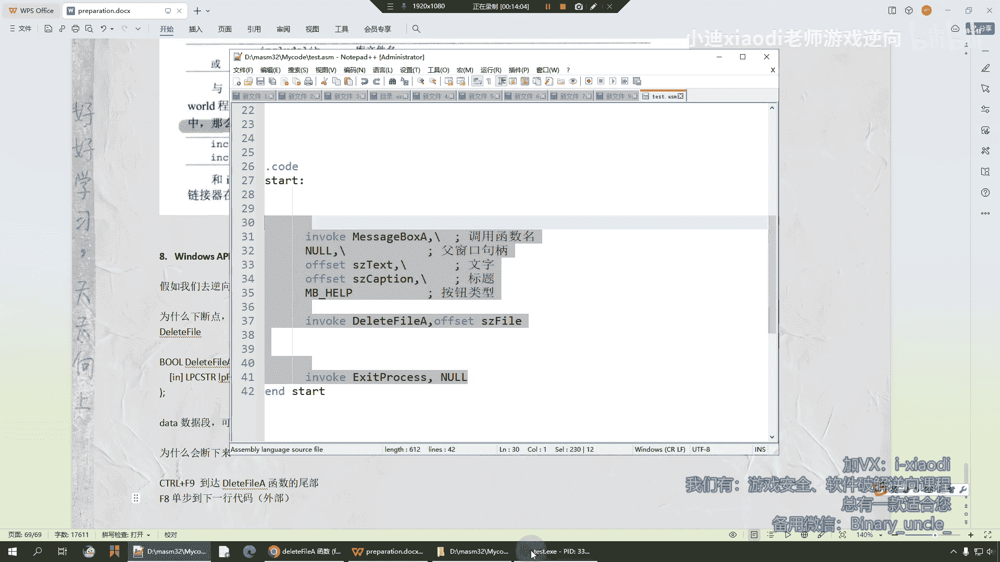

上一节我们完成了调用回溯和干扰识别，本节对整节课做总结。本节课中我们一起学习了API函数下断点的完整思路：先理解Windows平台和API规则，再学习DeleteFile函数用法，接着用x32dbg设置入口断点，给DeleteFileA和DeleteFileW下API断点，观察程序停在A还是W，最后用Ctrl+F9和F8回溯到调用位置，并学会通过堆栈、右下角模块信息和关键字符串识别搜狗拼音等外部干扰。课程内容到这里，下期再见。

## ✅ 小白软件破解逆向工程师2023最新：第八课：课程总结

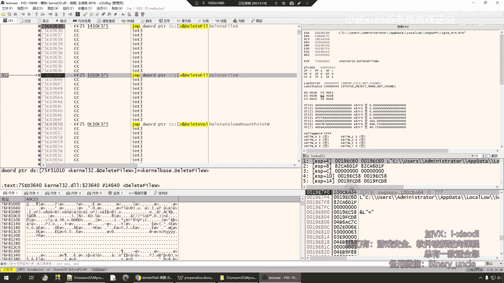

本节课中我们一起学习了为什么下断点、下什么断点，以及API函数下断点的基本逻辑。核心可以概括为：程序很多行为要调用Windows API，API被调用时下断点就能让程序暂停，从而观察调用关系和参数。删除文件案例中，DeleteFileA和DeleteFileW的差别来自字符串参数和Unicode版本；调用时要传地址，不能直接填字符串，常见写法是offset。调试时先设置入口断点，再用API breakpoint给删除文件函数下断点，断下后看堆栈和返回地址，用Ctrl+F9到函数尾部，用F8回到外部调用位置。遇到搜狗拼音等外部调用，要通过右下角模块信息和关键字符串鉴别并排除干扰。整个流程从简单程序开始练习，先抓住API断点、参数地址、调用回溯这几个关键点，再逐步分析更复杂的程序。

