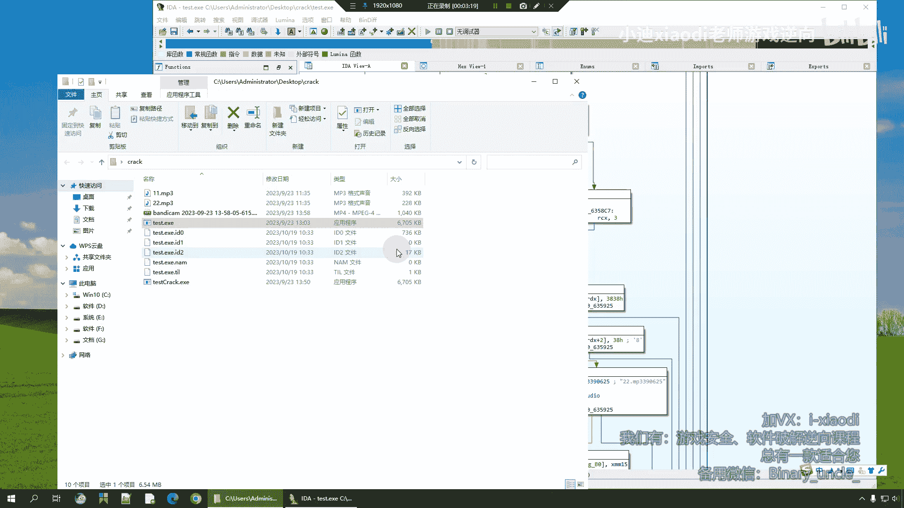

# 小白软件破解逆向工程师：第1章：某弹幕软件关键词破解逆向分析 🛠️

在本节课中，我们将学习如何对一个获取直播弹幕并根据弹幕内容播放本地音乐的软件进行破解逆向分析。这个程序是知识星球内某个成员提供的，它的功能是：当直播间弹幕中出现特定关键词（比如717）时，程序就会播放本地的指定MP3文件。该成员想要把关键词717改掉，比如改成666或88，问能不能改、怎么改。答案是肯定的，只要掌握了软件破解逆向的基础知识，即使零基础也可以学会。接下来，我们通过实际操作来演示整个分析过程。

## 确定程序位数与工具选择 🔍

首先，我们需要判断这个程序是多少位的。因为不同位数的程序需要使用对应位数的分析工具，如果选错工具，可能会导致分析失败。我们看到这个程序是一个**64位**的可执行文件（PE文件）。对于64位的程序，我们应该使用64位的IDA工具来进行分析。打开IDA 64，点击OK，然后运行。接着，我们直接把目标程序拖拽到IDA的界面中，点击确定，等待它加载完成。

## 寻找关键字符串与播放逻辑 🎵

在程序加载分析的过程中，我们可以做一个合理的假设：这个程序既然能播放音乐，那么它内部必然会调用与播放相关的函数。播放这个功能对应的关键英文字符串就是**play**。于是，我们在IDA中搜索“play”相关的字符串，看能不能找到一些有用的线索。很快，我们就在搜索结果中发现了一个叫做“man-play radio”的字符串，它的意思就是播放语音或播放音频。双击这个字符串，然后向上翻动代码，我们可以看到程序确实执行了一些与播放相关的操作。接着，为了弄清楚是谁调用了这个播放功能，我们查看它的交叉引用列表。列表中有三个调用来源，我们逐个查看。

## 定位关键词与MP3的关联 🔑

当我们跳转到其中一个调用位置之后，发现了一个非常重要的现象：代码中出现了“11点MP3”和“22点MP3”这两个文件名。也就是说，程序会根据不同的关键词播放不同的MP3文件。再往上看，代码中出现了“383838”，其实这就是数字“8”的另一种表示方式，结合上下文，这里检测的就是关键词**888**。为了确认，我们再往上看，还能看到检测**777**的逻辑。具体来说，当弹幕中出现717时，程序就会播放某个音频；当出现777时，播放11点MP3；当出现888时，播放22点MP3。因此，如果要修改关键词，逻辑就变得非常简单了——直接在这个位置修改对应的数值即可。例如，想把717改成666，只需要把原来比较“717”的指令改成比较“666”的指令，保存文件，程序就会按照新的关键词来播放音乐了。

## 具体操作与保存 💾

以上就是修改的关键思路。在实际操作中，我们需要在IDA中找到对应的指令，使用十六进制编辑器修改其中的关键字节，然后另存为新的可执行文件。整个过程并不复杂，但需要仔细，避免改错位置。由于课程篇幅有限，具体的每一步操作细节我们会发布在知识星球内部。如果你对这个方向感兴趣，想要深入学习软件安全与破解技术，可以加入我们的知识星球。关注视频右下角的备用微信和主微信，如果主微信出现问题，可以添加备用微信联系我们。这样就能获取更多详细教程和实战案例。

## 总结 📝

本节课中，我们一起学习了如何对一个64位的弹幕音乐播放软件进行初步的逆向分析。我们通过判断程序位数选择合适的工具，然后在IDA中搜索关键字符串“play”定位播放逻辑，再通过交叉引用找到了关键词与MP3文件的对应关系，最终确认了修改关键词的方法。整个过程展示了逆向分析的基本流程：**假设 → 搜索 → 定位 → 修改**。希望这个实例能帮助初学者建立起对软件破解的直观认识。下期再见。
