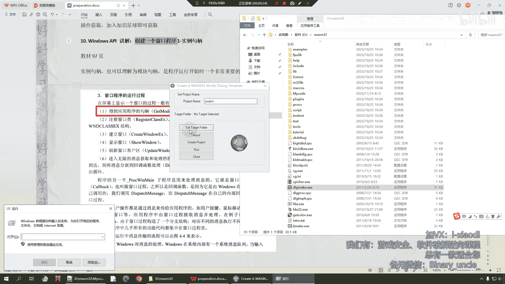
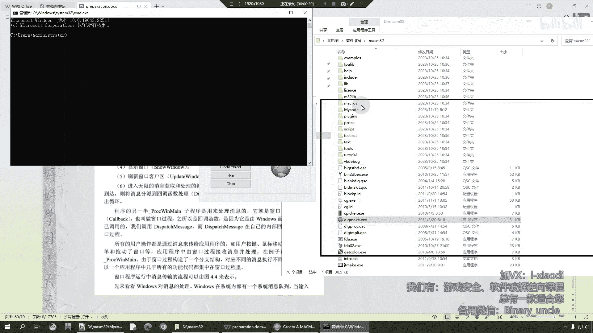
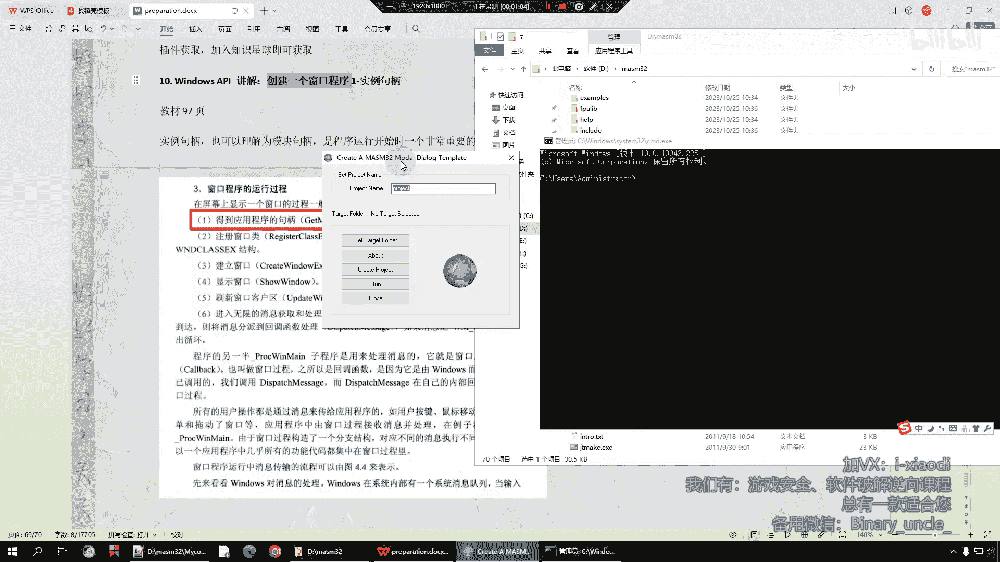
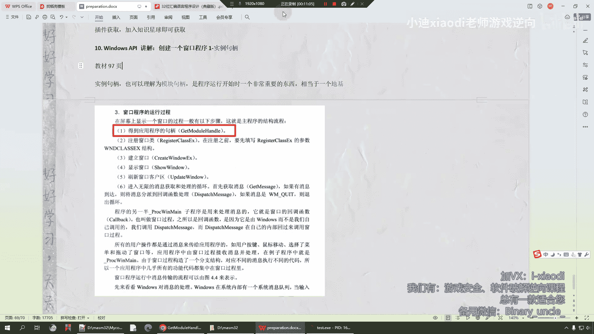

# 🧱 小白软件破解逆向工程师2023最新：10：Windows API 讲解——创建一个窗口程序 1：实例句柄

在本节课中我们将要学习 Windows API 创建第一个窗口程序的第一部分：实例句柄。本节课是第十课，由小林老师讲解，主题是创建一个窗口程序，并且先把“实例句柄”这个概念弄清楚。窗口程序和以前常见的黑窗口不一样，它是一个带有界面的程序，界面上通常有标题、控件等内容。为了让初学者更容易理解，本教程会先说明窗口程序是什么，再梳理窗口程序的运行流程，然后回到教材第 97 页的代码，重点讲解第一步“得到应用程序句柄”，最后在 x32dbg 里验证实例句柄的真实数值和它代表的意义。整节课会尽量把概念讲得直白一些，按照学习顺序一步一步展开。

## 🪟 小白软件破解逆向工程师2023最新：10.1：窗口程序和实例句柄是什么



上一节概述了本节课的目标，本节先认识窗口程序和实例句柄的基本概念。窗口程序可以理解为带有窗口界面的程序。随便找一个常见程序观察，它通常有一个界面，界面上有窗口标题，还会有一些控件。它并不是 CMD 那种黑窗口。为了感受差别，可以对比黑窗口和 Windows 窗口程序：黑窗口主要通过命令和指令进行操作，而 Windows 平台的一个特色是可以用控件组成界面。汇编语言同样可以编写界面，到了 Windows 时代也可以这样做。实例句柄是窗口程序运行开始时非常重要的东西，后面创建窗口、注册窗口类等步骤都会围绕它展开。

以下是窗口程序与 DOS 时代黑窗口的主要差别，先建立直观印象：

- 窗口程序带有可见的窗口界面，界面上通常有窗口标题和控件。

- DOS 时代的程序更多是通过纯命令、纯指令进行操作。





- Windows 平台的特色是可以用控件组织界面，程序外观更像日常软件。

- 汇编语言也可以编写界面，并不是只能写黑窗口程序。

- 实例句柄是程序运行开始时的重要基础，可以把它理解成后续操作的地基。

## 🧭 小白软件破解逆向工程师2023最新：10.2：窗口程序的六步运行流程

上一节认识了窗口程序的外观和实例句柄的地位，本节来看窗口程序从启动到运行的主程序结构流程。窗口程序不是简单地显示一下就结束，它有一个比较固定的运行过程。一般来说，主程序结构流程大致分为六步，本节课只重点关注第一步，也就是得到应用程序的句柄。后面几步会涉及注册窗口类、建立窗口、显示窗口、刷新窗口，以及进入无限的消息获取和处理循环。先把这个整体流程记住，后面写代码时就不容易迷路。

以下是窗口程序运行流程的六个步骤，可以先把它当作一张路线图：

1. 得到应用程序的句柄。

2. 注册窗口类。

3. 建立窗口。

4. 显示窗口。

5. 刷新窗口。

6. 进入无限的消息获取与处理循环。

注册窗口类可以类比成注册一个账号，就像注册 QQ 号一样。注册账号时要填写一些信息，把手机号等信息填好之后就可以建立账号；窗口程序也要把窗口大小、坐标、颜色、背景、风格等信息放在一个结构体里。信息填写完整之后，才可以建立窗口。窗口建立完成之后要显示出来，显示之后还需要刷新，因为窗口是实时显示的，刷新过程让窗口保持实时显示，这种设计很人性化。刷新完成后，程序会进入无限的消息获取和处理循环，它不是一个静止的东西，而是动态运行的程序。这个循环可以类比成人在生活中不断接收外界消息，程序也在不断接收和处理消息。很多程序之所以越来越像人，本质上是在模拟人的行为方式。

> 窗口程序运行流程 = 获取实例句柄 → 注册窗口类 → 创建窗口 → 显示窗口 → 刷新窗口 → 消息循环

## 🧩 小白软件破解逆向工程师2023最新：10.3：教材代码结构与实例句柄存放位置

上一节梳理了六步流程，本节回到教材和代码，看看实例句柄在代码里放在哪里。可以翻到教材第 97 页，查看 32 位汇编语言程序设计相关内容，这一页有第一个窗口的完整源代码。直接看完整代码会有一定难度，所以要按照逻辑和学习顺序逐步掌握。先找到代码目录，再观察代码结构。代码本身并不复杂，代码里有初始化数据，例如给一个字符串“123456”。代码段外面还有未初始化的数据，这个未初始化数据就是用来存放应用程序句柄的地方。教材里的命名方式也可以参考，应用程序句柄就是我们要获取到的实例句柄。

未初始化数据通常放在 `data?` 段，所以汇编代码里会看到 `D` 后面带问号的写法。代码段和之前学习的内容基本一样，之前只写了一个 `invoke ExitProcess` 用来退出进程。现在代码段里增加了 `invoke GetModuleHandleA`，这个函数就是用来得到应用程序句柄的。学习时不必着急，先掌握这个函数怎么调用、怎么得到句柄，再理解它相关的信息，这样就能逐步理解，不会觉得突然。

以下代码结构用于说明实例句柄大致放在什么位置，以及函数返回值如何保存：

```asm
; 初始化数据示例
.data
    szText db "123456", 0

; 未初始化数据：存放应用程序实例句柄
.data?
    hInstance dd ?

.code
start:
    invoke GetModuleHandleA, NULL
    mov hInstance, eax

    invoke ExitProcess, 0
end start
```

上面的代码结构表达的核心关系是：调用 `GetModuleHandleA` 取得句柄，函数返回值放在 `EAX` 中，再把 `EAX` 保存到未初始化数据段里的句柄变量中。这个句柄变量后面会用到，所以现在先把取得和保存的流程走通。

## 🔍 小白软件破解逆向工程师2023最新：10.4：GetModuleHandleA 取得自身程序实例句柄

上一节看到了代码里的 `GetModuleHandleA`，本节详细说明这个函数的作用。可以通过百度搜索 MSDN，查找 `GetModuleHandleA` 的官方解释。MSDN 的说明是：检索指定模块的模块句柄，模块必须由已调用进程加载，返回值是指定模块的句柄。这里的模块句柄就是应用程序的句柄。`instance` 的中文意思是实例，所以实例句柄也可以叫模块句柄，这两个说法是一回事，这是本节课的重要知识点。它是程序运行开始时非常重要的东西，相当于一个地基。初学时会疑惑为什么它像地基，后面的调试会把这个关系看清楚。

以下是 MSDN 解释中需要掌握的要点，初学者可以逐条对照理解：

- `GetModuleHandleA` 用于检索指定模块的模块句柄。

- 模块必须由已调用进程加载。

- 函数返回值是指定模块的句柄。

- 在这个场景里，模块句柄就是应用程序句柄。

- `instance` 表示实例，因此实例句柄也可以称为模块句柄。

- 实例句柄在程序运行开始时非常重要，相当于地基。

为什么参数要填 `NULL`？如果参数填 `NULL`，函数会返回用于创建调用进程的文件的句柄，也就是返回我们自己的程序句柄。也可以理解为填 `0` 时就是获取自身程序的句柄。第一步要获取的是自身程序的句柄，不是别人的程序，所以这里填 `NULL`。函数有返回值，返回值要赋给一个变量，这个变量今后会用到。函数的返回值存放在 `EAX` 中，所以要把 `EAX` 赋值给句柄变量。这个规律不只说过一次，不只用于窗口程序，游戏逆向分析、病毒木马分析等场景中，函数返回值放在 `EAX` 这一点同样成立。到这里，这个程序的基本框架已经写完，核心动作就是取得句柄并保存。

> 实例句柄（Instance Handle） = 模块句柄（Module Handle）

```asm
hInstance = GetModuleHandleA(NULL)
; 返回值 -> EAX -> hInstance
```

## 🛠️ 小白软件破解逆向工程师2023最新：10.5：在 x32dbg 中验证 00400000 与模块基址

上一节从 MSDN 角度理解了函数，本节通过调试器实际验证。先把程序生成出来，生成前可以删除不需要的部分，然后拿到 x32dbg 里调试。如果调试器界面和教程不一样，可以点击选项，在事件相关设置中只勾选需要的选项，点击保存，然后重新把程序拖入调试器。进入调试后，使用 F8 单步执行，也就是步过。执行到 `GetModuleHandleA` 时，观察函数返回后 `EAX` 的值。此时可以看到 `EAX = 00400000`。这个现象值得注意，这个数值和代码地址很接近，说明它指向我们自己的程序模块。

以下是调试观察时可以按照顺序执行的步骤，便于把概念和实际数值对应起来：

1. 生成程序，并把程序拖入 x32dbg。

2. 如果界面不同，点击选项调整事件设置，保存后重新拖入。

3. 使用 F8 单步执行，步过当前指令。

4. 执行 `GetModuleHandleA`，观察 `EAX` 的返回值。

5. 点击内存布局，查看模块基址对应的页面信息。

6. 观察基址加不同偏移后对应的代码段和数据段。

在调试器里可以看到，`00400000` 这个地址标识的是我们自己的程序。实例句柄或者说模块句柄指向的就是自己的程序。模块基址加上不同偏移，可以对应到程序的不同区域。基址加 `0x1000` 对应程序入口点，基址加 `0x2000` 对应只读数据，基址加 `0x3000` 对应未初始化数据。双击过去查看，还能看到初始化数据里的“123456”。所以实例句柄确实像地基，从它开始，代码和数据的故事才展开。第一步创建窗口程序，首先要明确自己的程序从哪里开始，有了这个起点，后面的代码和数据才有依托，后面的内容才能继续生长。

```text
模块基址 + 0x1000 = 程序入口点
模块基址 + 0x2000 = 只读数据
模块基址 + 0x3000 = 未初始化数据
```

> 实例句柄指向自己的程序模块，它把代码和数据连接在同一个起点上。

## 📌 小白软件破解逆向工程师2023最新：10.6：本节总结

本节课中我们一起学习了 Windows API 创建第一个窗口程序的第一部分：实例句柄。先认识了窗口程序和黑窗口的差别，窗口程序带有界面、标题和控件，Windows 平台可以用控件组织界面，汇编语言也可以编写界面。然后梳理了窗口程序的六步运行流程：得到应用程序句柄、注册窗口类、建立窗口、显示窗口、刷新窗口、进入无限消息获取与处理循环。本节课重点掌握第一步，也就是通过 `GetModuleHandleA(NULL)` 取得自身程序的实例句柄，函数返回值放在 `EAX` 中，再保存到句柄变量里。

以下是本节课需要带走的核心结论，方便复习时快速回忆：

- 窗口程序是带界面和控件的程序，不是 CMD 黑窗口。

- 窗口程序运行流程大致分为六步，本节课只聚焦第一步。

- 实例句柄也叫模块句柄，`instance` 就是实例的意思。

- `GetModuleHandleA(NULL)` 返回自身程序模块句柄，返回值在 `EAX`。

- 调试时可以看到 `EAX = 00400000`，它指向自己的程序模块。

- 模块基址加偏移可以对应入口点、只读数据和未初始化数据。

- 实例句柄是程序运行开始时的地基，后面的窗口创建都从这里展开。



下节课会继续学习注册窗口类、建立窗口、显示窗口、刷新窗口和无限消息循环，最终把真正的小窗口造出来，让程序看起来像一个完整的小软件。本节课的内容到这里结束，后续继续按照这个顺序往下学习即可。

