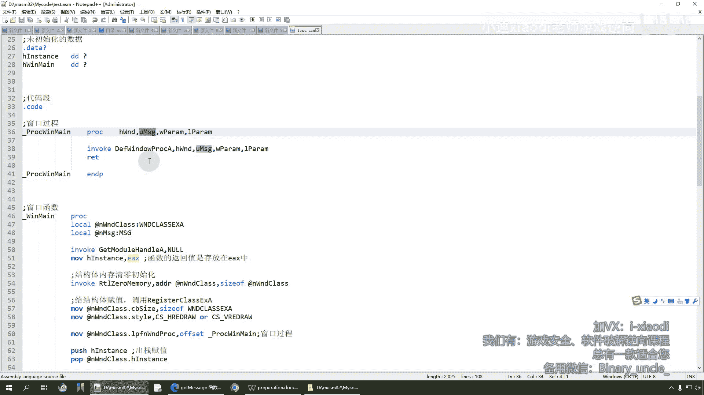
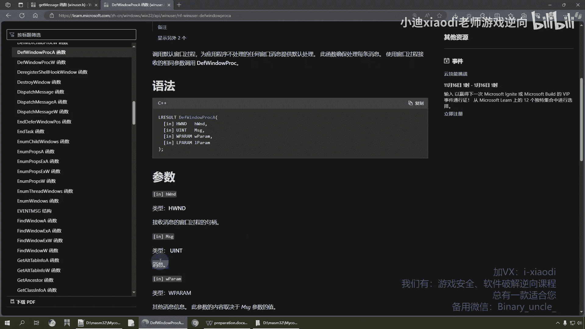
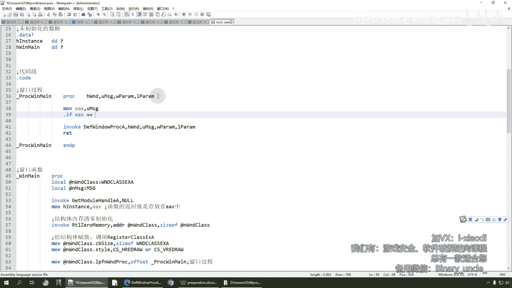
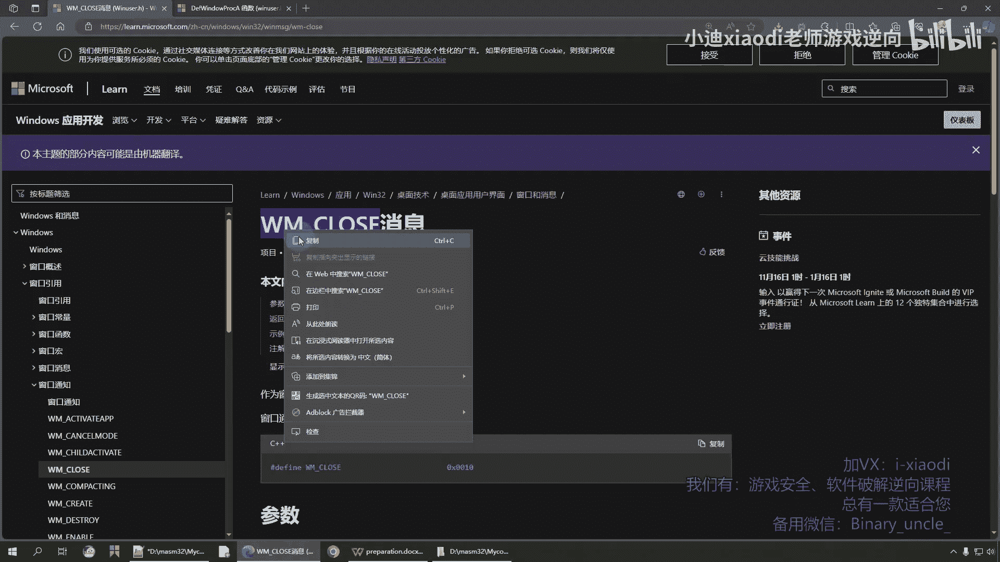
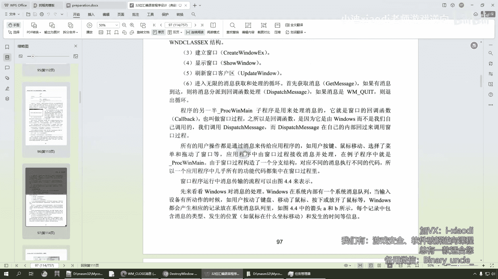

# 🪟 小白软件破解逆向工程师2023最新：第五章14：Windows API讲解——创建一个窗口程序5：完善窗口过程

## 🧭 小白软件破解逆向工程师2023最新：第五章14：本节概述

在本节课中我们将要学习如何完善窗口过程，让上一节创建出来的窗口能够正常关闭并退出程序。本节对应小迪老师的第十四课，视频编号为 BV11u4y1j7Bp。上一节我们已经创建出了一个窗口，但是这个窗口存在一个问题：点击关闭按钮时关不掉。出现这个问题的原因在于，窗口关闭、窗口销毁以及程序退出这些消息没有被处理。默认的窗口过程虽然会处理消息，但处理得可能不够完善，因此需要我们手动把这些处理补上。下面我们先回顾问题产生的原因，再一步步补全窗口过程。

## 🧩 小白软件破解逆向工程师2023最新：第五章14：回顾窗口为什么关不掉

上一节我们介绍了如何创建一个窗口，本节中我们来看看为什么创建出来的窗口关不掉。点击关闭按钮时窗口没有关闭，原因在于关闭窗口的消息、销毁窗口的消息、程序退出的消息都没有被处理。所有消息原本都会交给默认窗口过程处理，但默认窗口过程不一定能完全满足我们的需求，所以需要手动完善这些处理。今天要做的，就是把程序退出、窗口销毁这些逻辑加进去。这个问题本身不复杂，关键是要先判断消息的种类，然后针对不同消息做不同处理。理解这一点后，我们再去看窗口过程函数的参数，找出哪个参数代表消息。

## 🔍 小白软件破解逆向工程师2023最新：第五章14：观察窗口过程参数

要判断消息种类，先观察窗口过程函数的参数。默认窗口过程和开发者自己写的窗口过程函数，参数是一样的。第一个参数是窗口句柄，第二个参数就是消息。在 `DefWindowProcA` 函数的说明中，第二个参数就是消息。因此可以在自己的窗口过程函数里对第二个参数进行判断。这里可以用一个简单的公式表示窗口过程的基本模型：

`窗口过程(HWND, UINT, WPARAM, LPARAM) -> LRESULT`

其中 `UINT` 类型的消息参数就是我们要判断的对象。下面列出窗口过程参数的基本含义，方便初学者建立直观认识。

- 第一个参数是窗口句柄，可以理解成窗口的编号或标识。

- 第二个参数是消息类型，表示当前窗口收到了什么消息。

- 后续参数是消息附带的附加信息，当前课程先重点关注消息类型。

理解参数后，就可以进入消息判断。原文从汇编视角说明，可以先把消息放入 EX 寄存器，再进行比较；在常见 32 位汇编中，这个寄存器通常理解为 EAX。高级语言中可以直接用 `if` 或 `switch` 判断消息类型。接下来我们具体看窗口关闭消息 `WM_CLOSE`。

## 🚪 小白软件破解逆向工程师2023最新：第五章14：判断 WM_CLOSE 窗口关闭消息

上一节我们确认了第二个参数就是消息，本节中我们来看看如何判断窗口关闭消息。首先把消息放入 EX 寄存器，然后判断它的值。窗口退出对应什么消息，可以回到 `GetMessage` 相关代码往下查看，找到 `WM_` 开头的消息并点开说明。左侧会显示窗口通知，这里的窗口通知就是窗口消息。其中 `WM_CLOSE` 的说明是：作为窗口或应用程序应终止的信号发送。也就是说，`WM_CLOSE` 就是窗口关闭消息。把这个消息复制到代码中做判断，这行代码的意思就是：如果窗口收到的消息是 `WM_CLOSE`，就关闭窗口。可以用下面的判断逻辑表示：



```c
if (uMsg == WM_CLOSE) {
    // 收到窗口关闭消息，执行关闭和退出处理
}
```



下面列出与本节相关的消息判断要点，帮助理解这段逻辑。



- `WM_CLOSE`：表示窗口或应用程序应终止的信号。



- 判断对象：窗口过程函数的第二个参数 `uMsg`。

- 判断目的：收到关闭消息时，主动销毁窗口并发送退出请求。

理解 `WM_CLOSE` 后，下一步就是调用函数真正关闭窗口并退出程序。下面我们看看需要调用哪两个函数。

## 🧹 小白软件破解逆向工程师2023最新：第五章14：调用 DestroyWindow 与 PostQuitMessage

上一节我们判断了 `WM_CLOSE`，本节中我们来看看收到关闭消息后应该调用什么函数。要关闭窗口，需要查看自己写的代码中调用了什么函数。这里需要调用销毁窗口的函数 `DestroyWindow`，它只有一个参数，就是窗口句柄。这个参数不用多说，可以自己查看 MSDN 文档确认。窗口句柄在之前已经拿到，而且它是一个全局变量，所以可以直接使用。除了 `DestroyWindow`，还需要调用 `PostQuitMessage` 发送程序退出消息。查看 `PostQuitMessage` 的说明可以看到：系统指示线程已发出终止请求，通常应用于响应 `WM_DESTROY` 消息。也就是说，程序要退出、窗口要销毁时，发出一个终止请求，这是应用程序退出的代码。`PostQuitMessage` 只有一个参数，可以填空或填 `0`，没有返回值，作用就是发送“我要退出了”的请求。教材里也是这么写的，跟着教材写即可。下面列出这两个函数的作用和参数，方便对照理解。

- `DestroyWindow(hwnd)`：销毁指定的窗口，参数是要销毁的窗口句柄。

- `PostQuitMessage(0)`：发送程序退出请求，参数可以填空或 `0`，没有返回值。

- `hwnd`：之前已经获取到的窗口句柄，并且是全局变量，可以直接使用。

理解这两个函数后，关闭分支的主体就清楚了。下面看完整的窗口过程判断结构，以及其他消息应该如何处理。

## 🔁 小白软件破解逆向工程师2023最新：第五章14：其他消息交给默认窗口过程并正确返回

上一节我们准备了销毁窗口和退出程序的函数，本节中我们来看看其他消息如何处理，以及函数如何正确返回。其他情况下的其他消息，理论上应该做其他处理；当前课程只处理关闭消息，所以其他情况暂时没有额外处理逻辑。因此，其他情况需要调用默认窗口函数 `DefWindowProc`。判断执行完之后要返回；其他情况也要直接返回。退出分支执行后同样需要返回，所以要在 `if` 语句结束后进行返回。返回之前还要做一件事：把 EX 寄存器清空，这样程序才足够健壮和完善。下面给出一个完整的窗口过程示例，把关闭处理、默认处理和返回逻辑放在一起。

```c
LRESULT CALLBACK WindowProc(HWND hwnd, UINT uMsg, WPARAM wParam, LPARAM lParam) {
    // 汇编视角：先把 uMsg 放入 EAX（原文写作 EX 寄存器），再判断
    if (uMsg == WM_CLOSE) {
        DestroyWindow(hwnd);   // 销毁指定窗口，参数是窗口句柄
        PostQuitMessage(0);    // 发送程序退出请求，参数可填空或 0
        return 0;              // 执行完退出分支后返回，汇编层面返回前清空 EAX
    }

    // 其他消息交给默认窗口过程处理
    return DefWindowProc(hwnd, uMsg, wParam, lParam);
}
```

下面列出完整处理流程中的关键点，方便复习。

- 收到 `WM_CLOSE`：调用 `DestroyWindow(hwnd)` 销毁窗口。

- 销毁窗口后：调用 `PostQuitMessage(0)` 发送退出请求。

- 退出分支执行完：使用 `return` 返回，返回前清空 EX/EAX。

- 其他消息：调用 `DefWindowProc(hwnd, uMsg, wParam, lParam)` 交给默认窗口过程。

- 所有分支都要有返回，避免窗口过程执行不完整。

代码补全后，就可以保存并运行测试。下面我们通过任务管理器验证程序是否能正常退出。

## 🧪 小白软件破解逆向工程师2023最新：第五章14：生成运行并验证退出

上一节我们补全了窗口过程，本节中我们来看看实际运行效果。先保存代码，然后生成程序并重新生成运行。打开任务管理器，程序名字是 `text`，观察关闭程序时它会不会正常消失。运行后可以看到 `text` 进程出现，关闭程序后进程正常退出。这说明窗口过程里的关闭消息处理已经完成。下面列出验证步骤，方便按顺序操作。

- 保存修改后的代码。

- 生成并重新生成程序。

- 运行程序，打开任务管理器查看 `text` 进程。

- 关闭程序，确认进程正常退出。

测试通过说明关闭消息的处理已经补齐。除了关闭消息，程序中还会有按钮消息、绘制消息等，大家可以先参考教材第 94 页的代码，往下自行预习。下一集继续讲解后续内容。下面我们对本节课做一个小结。

## 📝 小白软件破解逆向工程师2023最新：第五章14：本节总结



本节课中我们一起学习了如何完善窗口过程，解决窗口创建后点击关闭关不掉的问题。我们回顾了原因：窗口关闭、窗口销毁、程序退出消息没有被处理，默认窗口过程处理得可能不够完善。随后我们观察了窗口过程参数，确认第二个参数就是消息。接着判断 `WM_CLOSE` 窗口关闭消息，在收到该消息时调用 `DestroyWindow(hwnd)` 销毁窗口，并调用 `PostQuitMessage(0)` 发送退出请求。其他消息则交给 `DefWindowProc` 默认窗口过程处理。返回前还需要清空 EX/EAX，使程序更加健壮和完善。最后我们生成运行程序，通过任务管理器确认 `text` 进程能够正常退出，并提到按钮、绘制等消息可以参考教材第 94 页继续预习。下一集继续学习后续内容。

