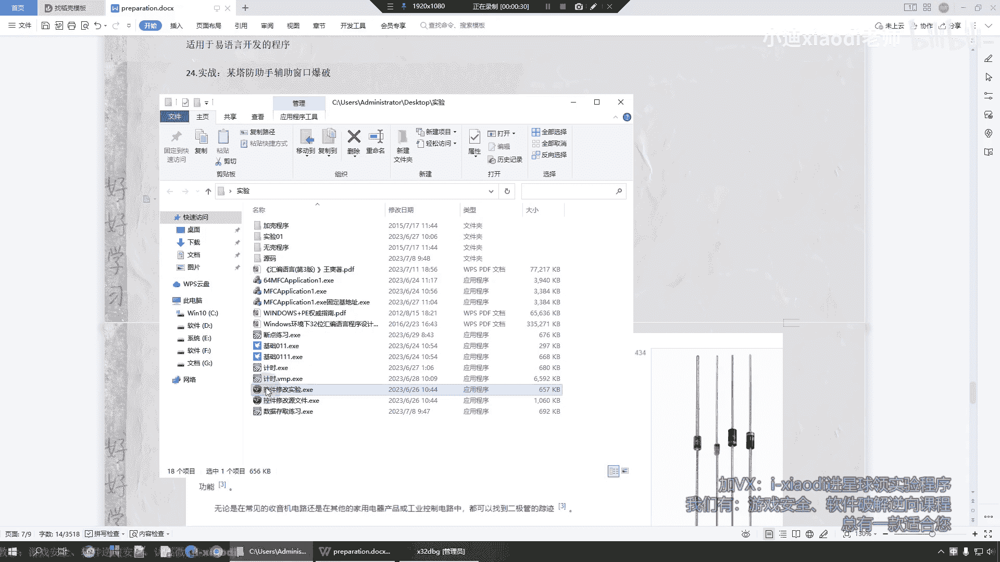
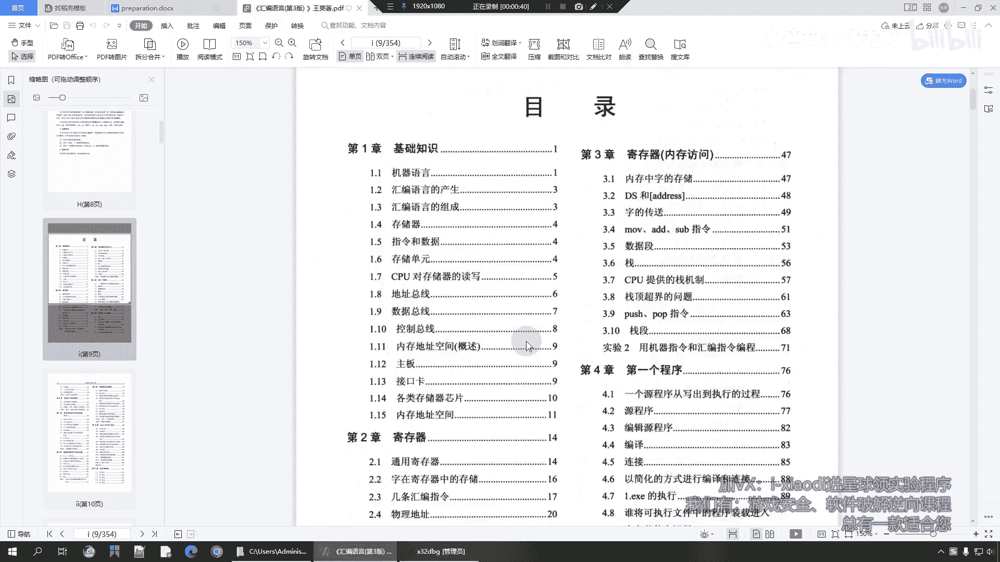
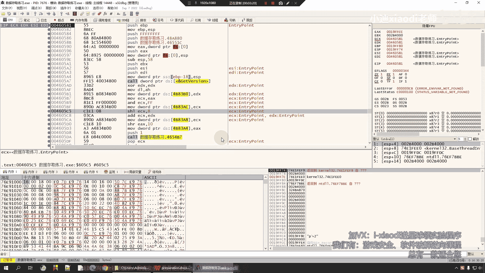
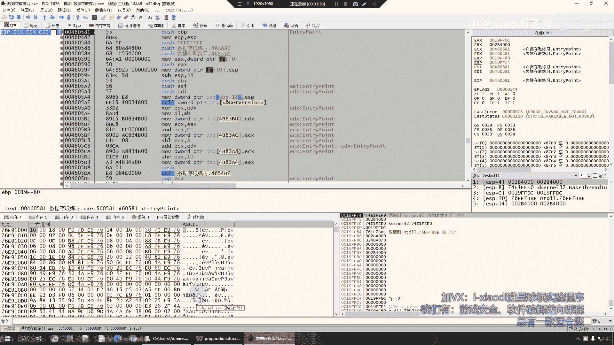
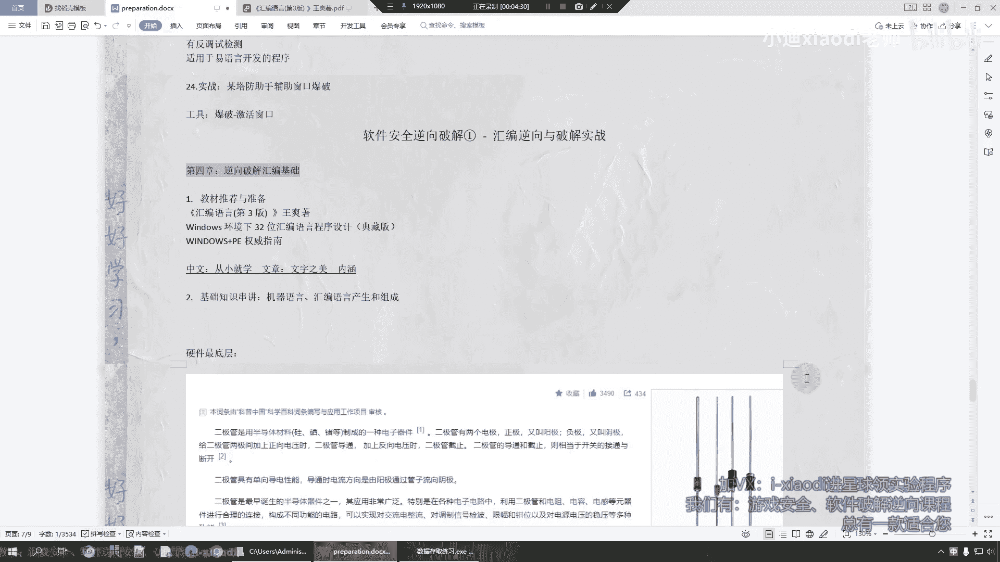

# 小白软件破解逆向工程师2023最新：第四章：汇编代码基础：01-教材推荐与准备 📚



在本节课中，我们将正式进入第四章“逆向破解汇编基础”的学习。首先需要明确一点：只有学习了汇编语言，才能更好地掌握破解技术，所以这是所有逆向分析工作的基石。本节课作为第四章的第一课，主要任务是为大家推荐教材，并做一些学习前的准备。



## 一、为什么要学习汇编语言？🤔

我们将会按照基本几本教材的内容来讲，但不会全部讲，而是挑选重点来看。那么，为什么要学习汇编语言呢？简单来说，因为破解过程中遇到的代码、数据、指令，追根溯源都来自汇编语言。如果我们不掌握汇编，读起代码来就像看天书一样，无从下手。换句话说，汇编语言是逆向破解的“母语”，看不懂母语，怎么可能理解代码背后的逻辑呢？

## 二、教材推荐：王爽《汇编语言》📖

首先推荐的第一本教材，是王爽注的《汇编语言》。我们来看一下这本书的目录结构。书中会讲解最基本的知识，比如数据存储、寄存器等。继续往下翻，我们能看到 `call` 和 `ret` 这样的东西，大家是不是感觉很眼熟？比如我们随意打开一个文件，随便找一个例子，比如说“数据存取练习”，就会发现里面出现了 `call`。再按一下空格，还能看到 `cl`、`dword`，以及 `DS`。那么这些 `CS`、`DS` 眼熟吗？很熟悉吧。再看，`push` 和 `pop` 是不是也特别眼熟？在代码里 `push`、`call`、`pop` 经常连在一起出现。还有 `mov`，这个 `mov` 更是常见。此外还有 `AL`、`SI` 这样的寄存器，以及 `ZF`、`PF`、`SF`、`OF` 这些标志位，还有 `INT` 指令。可以说，我们在逆向分析时见到的所有指令，它们的根源都在汇编语言里。

下面用一段简单的汇编代码来概括这些常见元素：

```asm
mov ax, 0
push ax
call some_function
pop ax
ret
```

其中还涉及到 `CS`、`DS`、`AL`、`SI`，以及状态标志位 `ZF`、`PF`、`SF`、`OF` 等。这些概念最初都来自汇编语言的基础知识。

## 三、掌握汇编语言的意义 💡

当我们真正了解了一门语言之后，再去读它的代码，和什么都不会、只认识几个零散指令时再去读，完全是两种不同的概念。举个简单的例子：我们的母语是中文，从小就开始学，所以我们对中文特别熟悉。当我们看一些文章的时候，能够真切感受到文字之美，感受到那种押韵的感觉。比如“床前明月光，疑是地上霜”，“光”和“霜”押韵。当你真正了解一门语言时，你就能体会到这种文字的美感，也能理解其中的内涵。再比如“举头望明月，低头思故乡”，表达的是思念家乡之情。但外国人可能就搞不明白，体会不到这种美感，原因就是他们对这门语言不熟悉。同理，如果我们想把逆向破解中的代码看得特别透彻、特别明白，就必须先熟悉汇编语言这门“外语”。所以我们的第一步，就是把汇编的基础概念全部搞明白。



因此，从本章开始，我们会带着大家快速掌握汇编语言，并学会运用它来分析数据。这样，以后面对任何程序的代码，我们都能从容地拆解、读懂其中的逻辑。



## 四、获取教材与其他说明 📲

今天的内容就是这些。教材会上传到学习星球。如果大家还不知道怎么加入星球，可以加一下我的微信。星球每个月都会涨价，所以每个星期来都是最低价，大家一定要抓紧时间。如果你想要加入学习，可以联系微信加入。感谢大家收看，我们下期再见。

## 总结 ✨



本节课中，我们一起学习了为什么逆向破解必须先学汇编，推荐了王爽的《汇编语言》作为教材，并浏览了其中涉及的寄存器、指令和标志位。我们还通过中文母语的类比，理解了“真正掌握一门语言”对代码分析的重要性。下一节课，我们将正式开始汇编基础知识的详细讲解。
