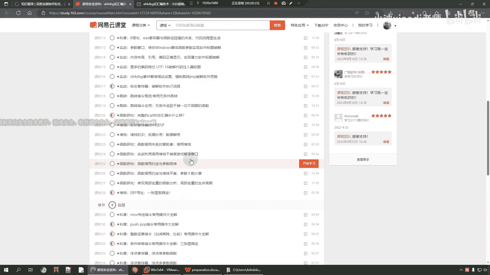
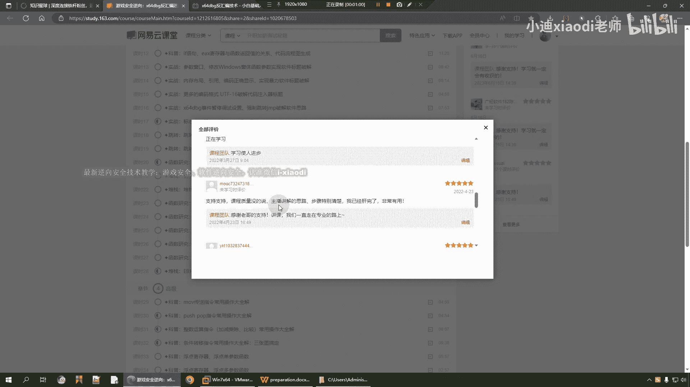
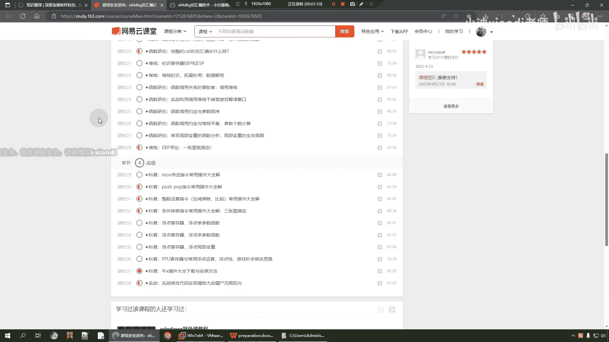
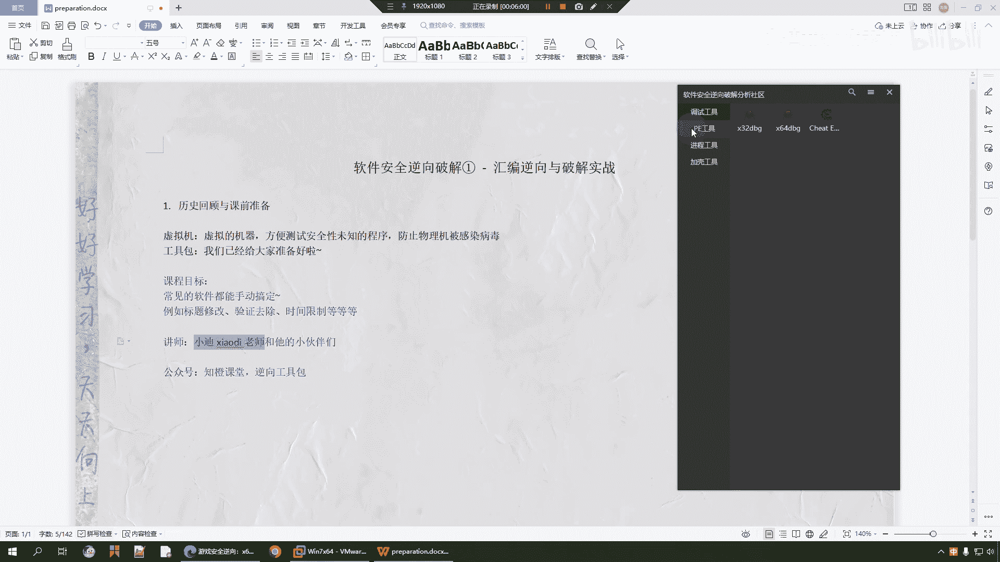

# 🧰 小白软件破解逆向工程师2023最新：01：历史回顾与课前准备

在本节课中我们将要学习新课程“软件安全逆向破解汇编逆向与破解实战”的开篇内容。课程会先回顾之前开设的类似课程以及学员反馈，再说明新课程的目标，最后完成课前准备，包括虚拟机和工具包两部分。整个过程会尽量用直白的大白话解释，让初学者能够看懂每个概念的作用和意义。

## 📚 小白软件破解逆向工程师2023最新：01.1：历史回顾

上一段概述了本节课的整体安排，本节先做历史回顾。大家好，我是小迪小迪老师。今天开始我们将开设一个新课程，叫做“软件安全逆向破解汇编逆向与破解实战”。在此之前，我们实际上开设过一个类似的课程。

这个课程的名字大家应该比较熟悉，叫“x64dbg反汇编速成”（原文称“叉64的bug反汇编速成”）。这个课程上传到了网易云课堂，也上传到了哔哩哔哩，点赞、投币、收藏的效果都挺不错。大家看完后也说课程非常好，期待继续更新。当时课程更新了38集，并且已经更新完毕，大家的评价都非常不错，很多学员都学完了。

以下是评论区中整理出的典型反馈：

- 有学员说教程非常不错，已经学了，可以配合CE写植物大战僵尸外挂。



- 有学员提到之前研究了一段时间逆向，感觉一直停留在门外，没有真正入门。

- 有学员说看到课程后感觉思路一下子清晰了。

- 有学员说主播讲解的思路步骤特别清楚，已经完成学习。

- 有学员评价课程非常有用，非常好。

这些反馈说明旧课程效果不错，但旧课程只更新了38集，而且之前讲课时大部分围绕汇编语言和编程语言展开，实战破解内容相对较少。因此，本节回顾完旧课程后，下一节我们来看看新课程的目标。

## 🎯 小白软件破解逆向工程师2023最新：01.2：课程目标

上一节回顾了旧课程和学员反馈，本节看看新课程的目标。新课程的核心目标就是实战，也就是让常见软件都能手动搞定。比如软件标题修改、验证去除、时间限制去除等，这些都是课程要覆盖的目标。

课程讲师是我和小伙伴们。后续我们会接受大家投稿，如果大家有一些例子，也可以发过来，我们上传后一起分享自己的逆向分析流程和学习成果，这些都是可以的。因此，我们是接受大家投稿的。

以下是课程目标与安排要点：



- 课程目标：常见软件能够手动搞定。



- 实战方向包括标题修改、验证去除、时间限制去除等。

- 讲师由小迪小迪老师和小伙伴们组成。

- 接受学员投稿，可以分享逆向分析流程和学习成果。

目标明确之后，下一节我们开始做课前准备，先介绍第一个准备项：虚拟机。

## 🖥️ 小白软件破解逆向工程师2023最新：01.3：课前准备之虚拟机

上一节明确了新课程目标，本节准备第一个东西：虚拟机。虚拟机是下一节课会详细讲解的内容，这里先提前透露一下。虚拟机就是虚拟的机器，方便测试安全性未知的程序。注意这里的措辞是“安全性未知”，因为不知道程序到底有没有病毒木马，所以可以在虚拟机器上测试，防止物理机被感染病毒。这就是虚拟机存在的意义和价值。

虚拟机长什么模样，大概就是电脑里又运行了一个电脑。实际上是在当前电脑里再用其他软件运行或执行一个操作系统，就好像是一台虚拟的机器。它也可以打字，比如新建一个文档，然后在里面随便打字，想干什么都行。虚拟机器和平时见到的Windows操作系统机器是一样的，因此大家不要担心这一点。下一集我们会专门讲虚拟机。

虚拟机概念可以用下面这组公式和代码描述：

```text
虚拟机 = 用软件模拟出的隔离计算机
物理机 + 虚拟机软件 → 虚拟计算机
```

以下是虚拟机的要点：

- 虚拟机是虚拟的机器。

- 虚拟机用于测试安全性未知的程序。

- 使用虚拟机可以防止物理机感染病毒木马。

- 虚拟机中可以新建文档、打字，操作方式与普通Windows机器类似。

- 下一节课会进一步讲解虚拟机的具体使用。

本节介绍完虚拟机，下一节我们来看看第二个准备项：工具包。

## 🧰 小白软件破解逆向工程师2023最新：01.4：课前准备之工具包

上一节介绍了虚拟机，本节看工具包。古人说“工欲善其事，必先利其器”，因此我们要准备一个工具包。这个工具包已经给大家准备好了，是特地准备的、非常特殊的自己的工具包。而且所有程序都经过验证，安全性是一致的，也就是安全的。

拿到工具包之后运行，可以看到“软件安全逆向破解分析社区”这样的界面。里面有调试工具、P工具、进程工具、加速工具。目前准备了这些工具，随着课程更新，工具包也会更新。因此大家一定要关注课程的进展，工具包不是一成不变的，而是一直在更新。现在工具包是1.0版本，后续更新可能变成2.0版本。

这些工具我们都测试过，都是可以用的。随便打开一个工具可以看到它可以用，所有东西都是可以用的。工具包里的功能特别多，比如实用工具、编程助手、文字编码、加密算法、汇编工具扫描器、逆向工具等。我们专门挑选了一些特别有用的东西，不是随便找一些工具滥竽充数。工具包非常靠谱，工具包组成可以用下面的代码表示：

```text
工具包 = 调试工具 + P工具 + 进程工具 + 加速工具 + 编程助手 + 逆向工具
工具包版本：1.0 → 后续可能更新到2.0
```

以下是工具包的特点：

- 工具包已经提前准备好，所有程序经过验证，安全性一致。

- 工具包中包含调试工具、P工具、进程工具、加速工具。

- 工具包还包含实用工具、编程助手、文字编码、加密算法、汇编工具扫描器、逆向工具等。

- 工具包会随课程更新，当前为1.0版本，后续可能更新到2.0版本。

- 所有工具都测试过，可以正常使用。

工具包内容介绍完，下一节我们看看如何获取这个工具包。

## 📥 小白软件破解逆向工程师2023最新：01.5：工具包获取方式

上一节介绍了工具包的内容和版本更新方式，本节看工具包的获取方式。获取方式比较直接，可以在哔哩哔哩搜索“小迪小迪老师”，或者关注公众号“支成课堂”。关注公众号后回复“逆向工具包”，就可以获取到这个工具包。

我们也会在课程相关评论区或参考资料上传位置进行上传。因此，如果实在找不到，可以来找我私信。你在B站搜索这个名字，然后给我发私信，说明需要工具包，我就会发给你。

以下是工具包获取方式：

- 在哔哩哔哩搜索“小迪小迪老师”。

- 关注公众号“支成课堂”，回复“逆向工具包”。

- 在课程相关评论区或参考资料上传位置查找工具包。

- 如果找不到，可以在B站搜索名字后发私信索要工具包。

获取方式明确后，本节内容结束，下面进入本节课总结。



## ✅ 小白软件破解逆向工程师2023最新：01.6：总结

本节课中我们一起学习了新课程“软件安全逆向破解汇编逆向与破解实战”的开篇内容。我们回顾了之前“x64dbg反汇编速成”课程的更新情况和学员反馈，明确了新课程以实战为核心的目标，介绍了课前准备中的虚拟机概念，说明了虚拟机用于测试安全性未知程序、防止物理机感染病毒，并介绍了工具包的内容、版本更新和获取方式。课程后续也会接受学员投稿，大家可以分享自己的逆向分析流程和学习成果。接下来我们就扬帆起航，开始学习，下集再见。

