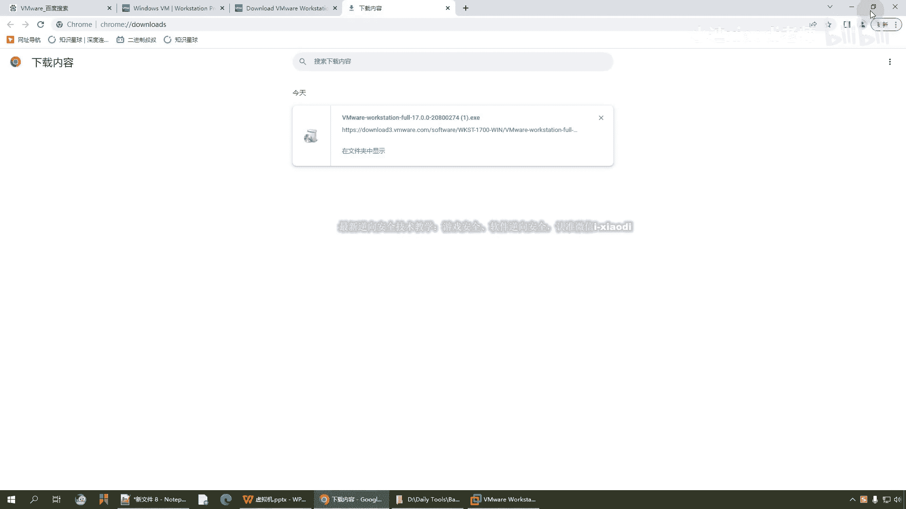
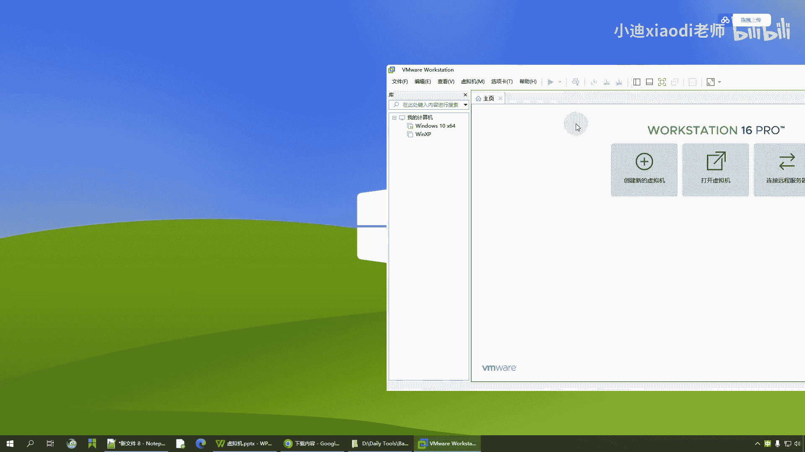
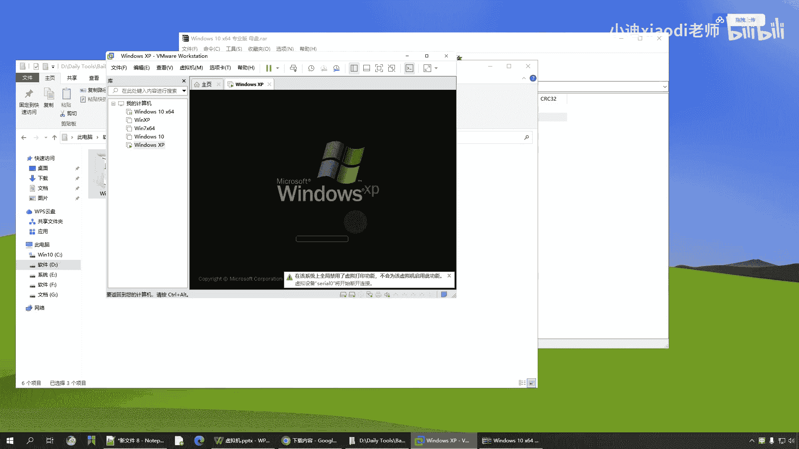
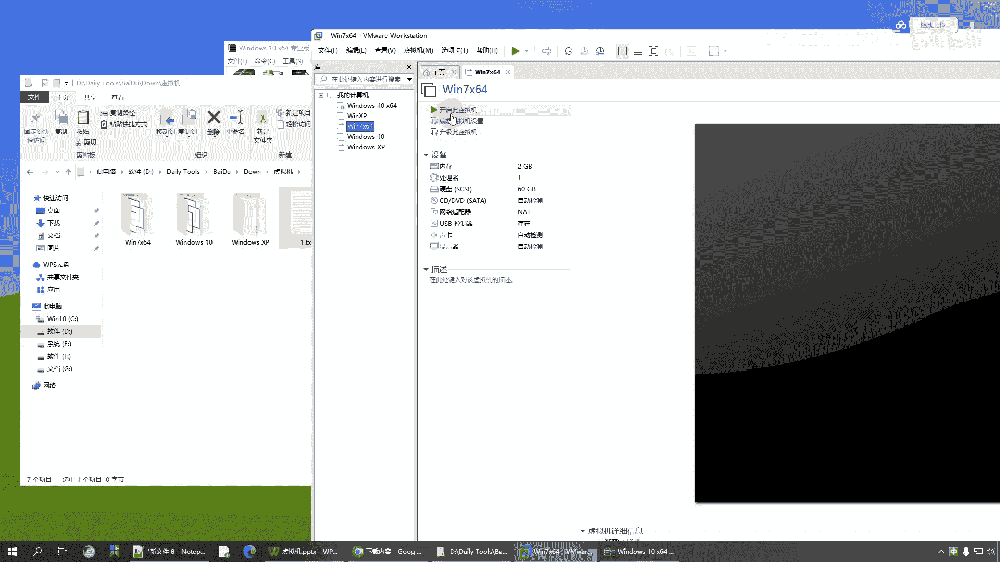
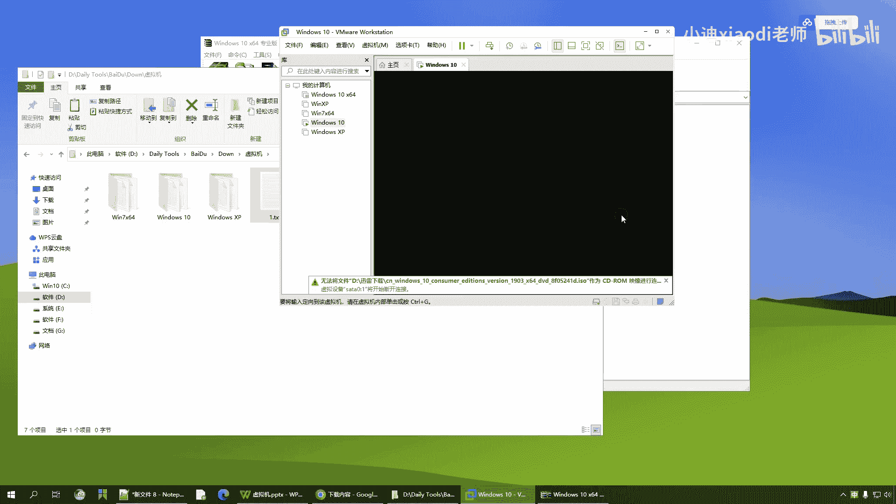
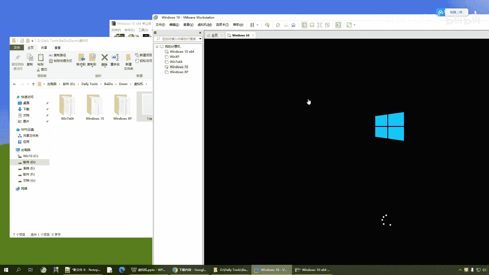
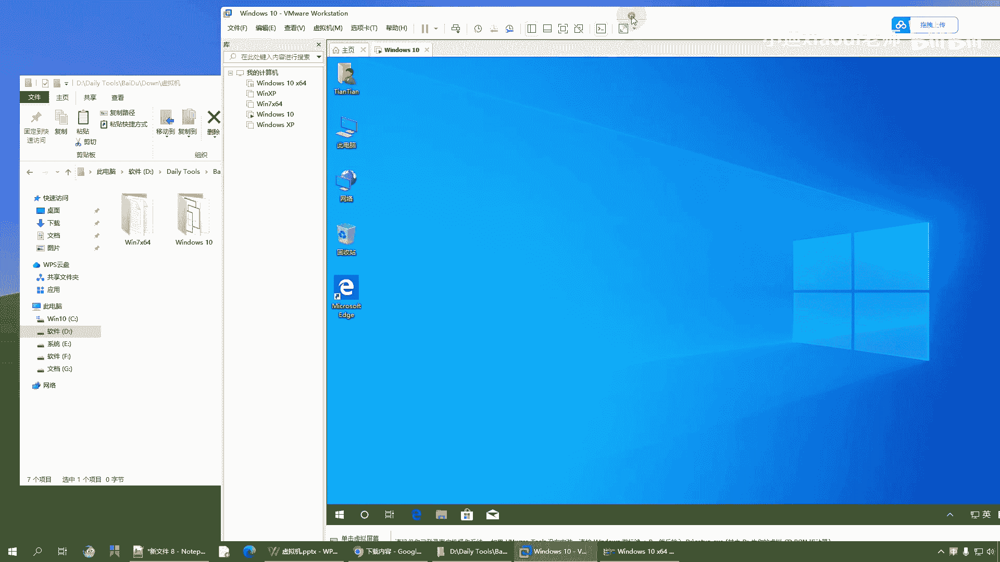
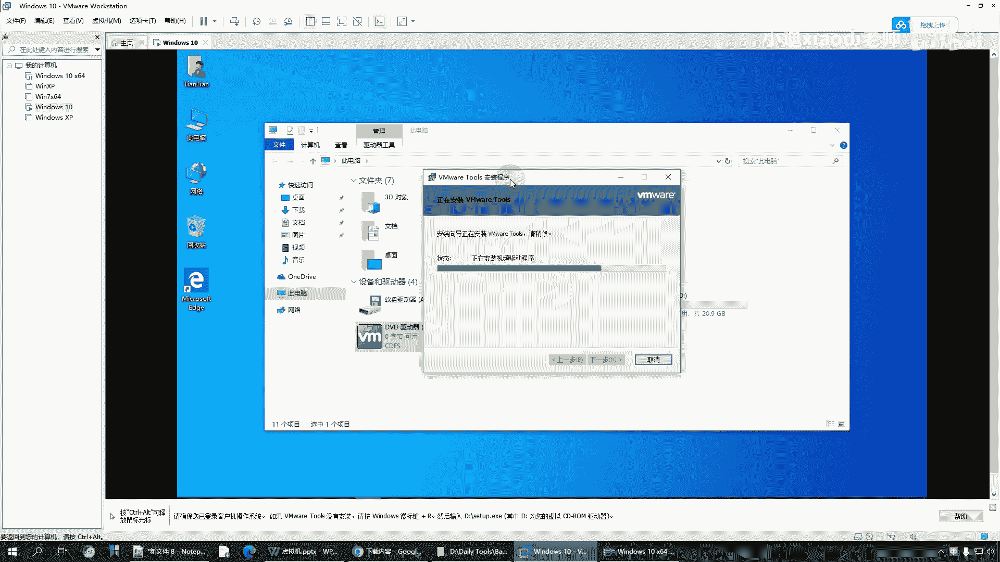
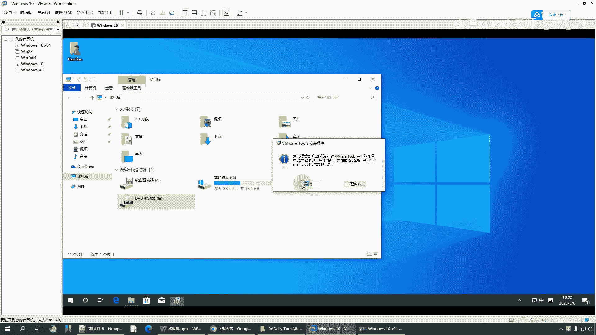
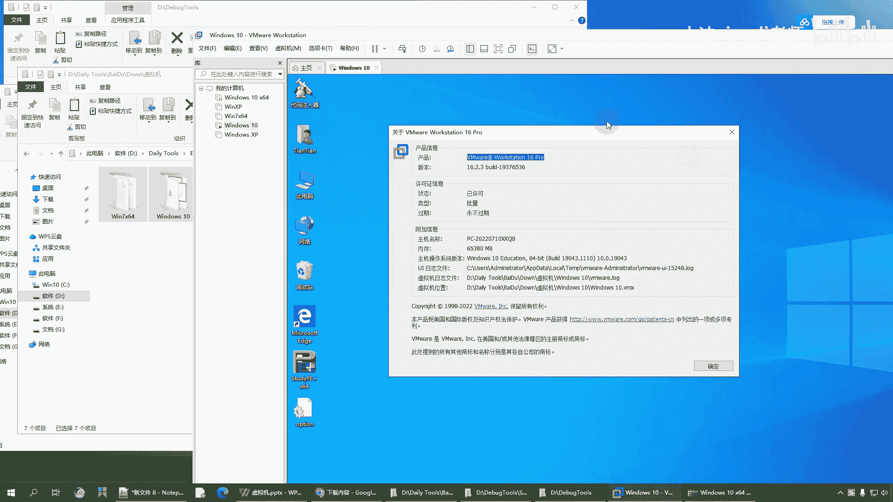

# 🎼 小白软件破解逆向工程师2023最新：02：虚拟机安装与使用入门

最近一直有朋友私信，问能不能录制一期虚拟机使用教学视频，这期内容就是为此准备的。在本节课中我们将要学习虚拟机是什么、虚拟机有什么用、VMware 怎么下载安装，以及如何导入并启动 Windows XP、Windows 7、Windows 10 三个操作系统，还会演示在虚拟机里复制文件、安装工具和运行软件。即使你之前没听说过虚拟机，也可以跟着这节课一步一步看下去，因为后面做技术性操作、测试软件或测试系统时，虚拟机都会很有用。

## 🧠 小白软件破解逆向工程师2023最新：02-1：虚拟机是什么

上一节我们说了本课的整体内容，本节来看看虚拟机的概念。简单点说，虚拟机就是“虚拟的机器”。我们听过虚拟现实，它是对现实生活中的一些场景进行虚拟；虚拟机就是把日常生活中的机器进行虚拟，这里说的机器实际上就是我们的电脑。无论你是否听说过虚拟机，都建议看一看，因为今后做技术性工作、测试软件或测试系统时，它都非常有用。

核心概念可以用公式表示：

```text
虚拟机 = 用软件模拟出来的一台电脑
```

## 🎯 小白软件破解逆向工程师2023最新：02-2：虚拟机的应用场景

上一节我们认识了虚拟机的概念，本节来看看它常见的使用场景。第一种场景是：当我们需要在一台不属于自己的电脑上运行软件或测试程序时，比如测试木马、测试病毒，肯定不能拿自己的机器冒险，所以就需要虚拟机。第二种场景是：当我们需要在一台不属于自己的电脑上测试不同操作系统时，比如新出了一个操作系统，或者你对 Linux、苹果系统感兴趣，就可以用虚拟机装一个系统来测试。以上两种情景，都需要借助“虚拟机”这个程序的力量。

以下是两类典型应用场景：

- 测试软件、木马、病毒等，不希望影响自己的电脑。
- 测试新操作系统、Linux 或苹果系统等不同系统环境。

## 🧰 小白软件破解逆向工程师2023最新：02-3：VMware 与多系统解决思路

上一节我们了解了使用场景，本节介绍一款最常用的虚拟机软件 VMware。它是一款电脑虚拟机软件，可以让我们在电脑之中模拟电脑，有点像俄罗斯套娃。举个例子：你有一台安装 Windows 10 系统的电脑，现在需要一台 Linux 系统的电脑来学习 Linux 相关知识；你不能直接把 Windows 10 换掉，因为换成 Linux 后，穿越火线、地下城勇士等游戏就玩不了，这些游戏不支持 Linux。

上一节提到换系统会影响游戏，本节看看解决办法。第一个办法是再买一台电脑，但花费比较高；另一个办法是下载 VMware，做一台虚拟电脑，这样可以节约学习成本，也更方便学习。你不需要在多台电脑之间跑来跑去，只需要简单进行窗口切换即可。

以下是两种解决思路的对比：

- 再买一台电脑：花费较高。
- 使用 VMware 创建虚拟电脑：节约成本，切换方便。

## ⬇️ 小白软件破解逆向工程师2023最新：02-4：下载与安装 VMware

上一节我们确定了使用 VMware 的方案，本节看看这个软件长什么样、怎么下载安装。我的电脑上已经安装好了，版本是 16.2.3；大家也可以安装最新版，最新版可以去百度搜索。演示中打开百度，直接搜索 VMware，会看到官网，点进去，找到 Products 产品，再点 Workstation Pro，这就是他们的虚拟机。页面会让你在线购买，我们这里不买，先试用，点击 Try 试用，然后点击下载，点击 Download Now 就可以下载了。

可以暂停视频，等下载完成后再继续录制；下载完成后点击程序运行安装，所有安装都按默认选项点击“下一步、下一步、下一步”即可。安装过程中可能提示重新启动电脑，那就重启一下；重启完成后开机运行程序，界面就出来了。如果你觉得 17 版本太新、可能不稳定，也可以选 16 版本，下载链接都已经准备好，这一点不用担心。

安装和下载的关键路径可以记成：



```text
VMware 官网 -> Products -> Workstation Pro -> Try -> Download Now
安装方式 -> 默认选项 -> 下一步 -> 必要时重启电脑
```



## 💿 小白软件破解逆向工程师2023最新：02-5：准备系统与扫描导入

上一节我们完成了虚拟机软件的准备工作，本节准备操作系统。我不仅准备了虚拟机的下载链接，还准备了操作系统，这里提供三款：Windows XP、Windows 7、Windows 10。现在把 Windows 10 也解压一下，解压过程稍等，进度到 60% 时继续操作；解压完成后测试怎么把操作系统在 VMware 里打开，操作非常简单，不用担心。

以下是准备好的三款操作系统：

- Windows XP
- Windows 7
- Windows 10

上一节系统压缩包已经准备好，本节把它们导入 VMware。点击界面，点击“文件”，点击“扫描虚拟机”，把这个目录复制一下；下载目录里的三个文件夹会提供下载链接，你下载下来并解压出来就是三个文件夹。然后点击下一步，刚开始会显示 Windows 7、Windows 10、Windows XP，我们全部点击完成，再点击关闭，就能看到 Windows 7、Windows 10、Windows XP。

导入路径可以记成：



```text
文件 -> 扫描虚拟机 -> 选择解压目录 -> 下一步 -> 完成 -> 关闭
```

## 🖥️ 小白软件破解逆向工程师2023最新：02-6：启动 Windows XP 并测试复制

上一节导入完成，本节先启动 Windows XP。点一下 Windows XP，再点开启此虚拟机；如果提示“该虚拟机似乎正在使用”，就点击“获取所有权”，然后点击“开启此虚拟机”，再点击“我已复制该虚拟机”，进入操作系统。可以看到，非常经典的操作系统界面就出来了，这就是 Windows XP，你可以直接使用它。

接下来测试能不能复制文件：在虚拟机里新建一个文件，或者从本机粘贴文件进去。刚开机时可能需要缓一缓，等一会儿再粘贴；我们把文件复制过去，改名为 1，点击复制，再粘贴，桌面上就会出现名为 1 的文件。测试完成后切回去，点击“否”，再点击关机，不要它了。

以下是 Windows XP 测试要点：



- 提示正在使用：点击“获取所有权”。
- 启动时选择“我已复制该虚拟机”。
- 刚开机粘贴可能延迟，等一会儿即可。
- 复制文件后可在桌面查看是否出现。

## 🪟 小白软件破解逆向工程师2023最新：02-7：启动 Windows 7 并测试粘贴

上一节测试了 Windows XP，本节再看 Windows 7。直接点击开启此虚拟机，点击“我已复制该虚拟机”，点击“是”，Windows 7 就启动了，操作非常简单，所有东西都准备好了，不用担心。等它启动完成，开机稍等一会儿，竟然可以直接粘贴；点击家庭网络即可，网络配置随便选，然后点击粘贴，名为 1 的文档就从本机粘贴过来了。

以下是 Windows 7 测试步骤：



- 开启虚拟机。
- 点击“我已复制该虚拟机”，再点击“是”。
- 等待启动，选择家庭网络。
- 直接粘贴文件，确认文件出现。



## 🪟 小白软件破解逆向工程师2023最新：02-8：启动 Windows 10 并安装工具

上一节 Windows 7 也测试完了，本节把 Windows 7 关掉，再看 Windows 10。点击开启此虚拟机，点击“我已复制该虚拟机”，点击“是”，Windows 10 正在开机，稍等一下；Windows 10 越来越漂亮了，这个虚拟机名字叫“小甜甜”。同样可以复制文件，鼠标右键点击复制，可能要稍等一下，等它加载。

不过 Windows 10 没有安装某个工具时，文件是粘贴不过来的，这一点要注意。解决办法是点击“虚拟机”，点击“安装 VMware Tools”，下方会有提示，按提示按键并输入内容；实际上工具已经存在于这里，直接运行，点击“是”，然后让它安装一下即可，很简单，这是纯净版本。点击“下一步”，点击“安装”，按操作来即可；它待会儿可能要重启电脑，点击“是”即可，然后会自动重启。重启完成后，Windows 10 就可以把文件或软件复制过去了，比较好用。



安装工具的关键路径是：

```text
虚拟机 -> 安装 VMware Tools -> 运行安装程序 -> 下一步 -> 安装 -> 如提示重启则点击“是”
```



## 🧪 小白软件破解逆向工程师2023最新：02-9：运行软件验证虚拟机效果

上一节安装了工具，本节验证虚拟机效果。等 Windows 10 开机后，把软件复制过来：鼠标右键复制，然后粘贴并运行，点击“是”，程序跑起来了，说明软件可以正常运行。再来一个“代码输入器”，粘贴并运行，点击“是”，这个软件也可以正常运行，说明这个操作系统没有任何问题。



以下是验证思路：

- 从本机复制软件到 Windows 10 虚拟机。
- 在虚拟机内粘贴并运行软件。
- 再测试一个代码输入器，确认程序可正常启动。

## 📦 小白软件破解逆向工程师2023最新：02-10：资料打包与课程总结

上一节我们完成了软件运行验证，本节做最后说明。关于操作系统，我全部会给大家打包；关于虚拟机，现在用的是 16 版本，也会给大家打包；17 版本已经教了如何下载。这就是今天全部内容，非常简单。如果你在安装过程中或使用过程中有任何疑问，都可以私信我，我们下次再见。

本节课中我们一起学习了虚拟机的基本概念、常见用途、VMware 的下载安装、三款操作系统的导入启动，以及在虚拟机中复制文件、安装 VMware Tools 和运行软件的完整流程。核心可以记成一句话：**虚拟机就是用软件在你的电脑里再模拟一台电脑**，用它测试系统和软件更方便、更安全。



> 小提示：安装过程中如果提示重启电脑，按提示重启即可；虚拟机使用中遇到问题，可以私信交流。

