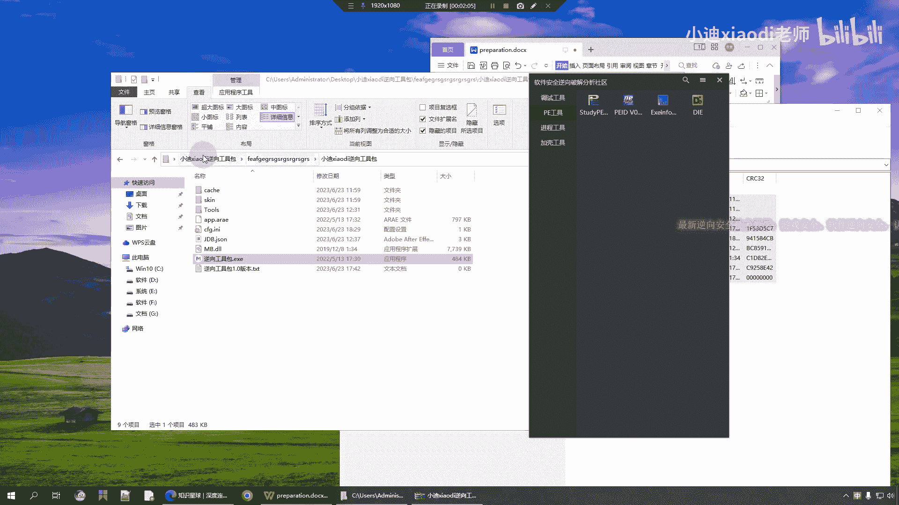
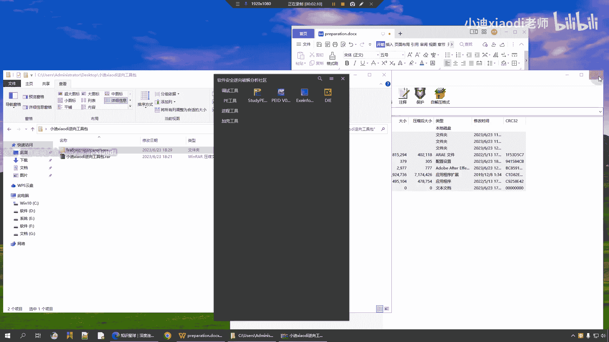
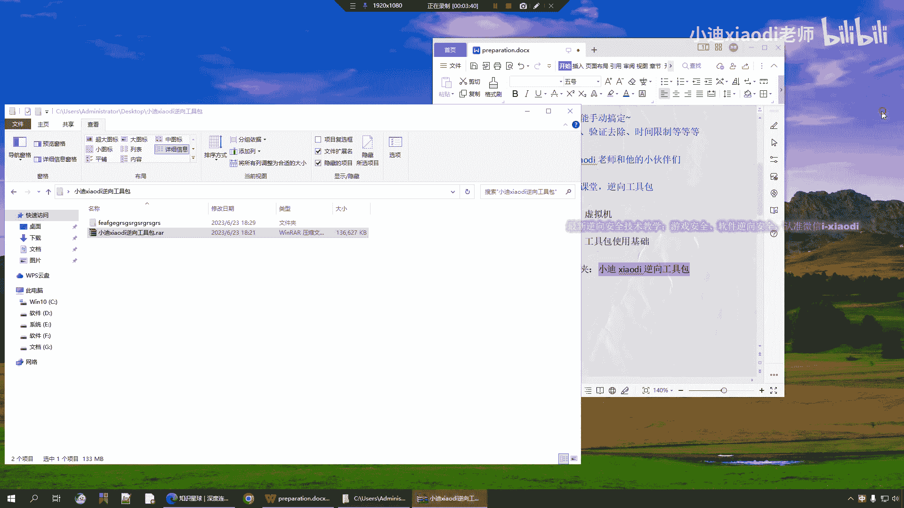

# 🛠️ 小白软件破解逆向工程师2023最新：课前准备3：工具包使用方法（BV1614y127oV）

在本节课中我们将要学习工具包使用的基础内容。观看课程的人群可能覆盖小学、初中、高中、大学阶段，也可能包含在各行各业工作多年的从业者，但大家对这一块知识可能还存在一些欠缺。很多人拿到工具包之后，一时间不知道怎么下手。为避免这种情况，本节课会说明工具包的基本使用方法，并尽量防止后续出现不必要的问题。

## 📦 小白软件破解逆向工程师2023最新：课前准备3-1：工具包使用基础与准备思路

拿到工具包之后，首先看到的是一个压缩包文件。这个压缩包可以双击打开，双击之后就能看到里面的内容。打开后会发现里面有很多文件，此时先不要着急处理这些文件，第一步是新建一个文件夹。这个准备思路很直接：先把运行环境整理好，再考虑启动工具包。

这个文件夹的名字一定要固定，原文要求名称为 `小迪小迪逆向工具包`。如果名称发生变化，软件可能运行不起来，这一点需要理解。原文演示中还出现过相近的名称写法，核心含义仍然是同一个：固定名称不要随意改动。

下面是新建固定文件夹的具体操作要点。

- 在目标位置使用鼠标右键，选择“新建”，再选择“文件夹”。

- 在文件夹名称处填入固定名称 `小迪小迪逆向工具包`。

- 打开这个新建的文件夹，把已经打开的压缩包拖到这个文件夹里面。

完成以上步骤后，压缩包就被拖进了固定文件夹。此时可以尝试运行工具包，运行其中的软件，确认软件能够启动。以上内容就是工具包使用前的基础准备，下一步需要确认位置变化时名称是否仍然保持固定。

## 🚚 小白软件破解逆向工程师2023最新：课前准备3-2：移动位置与名称固定

上一节完成了固定文件夹和拖入压缩包的操作，本节来看看工具包移动到其他位置时需要注意什么。工具包可以放到其他位置，例如再新建一个文件夹，把工具包放到任意位置，也可以给外层文件夹随便起名字。关键点不在于外层位置，而在于工具包文件夹本身的固定名称不要变化。

工具包可用性的核心条件可以用下面的公式表示。

```text
工具包可用 = 固定文件夹名称保持不变 && 压缩包已拖入固定文件夹 && 软件可以正常启动
```

下面是移动工具包时的操作顺序。

- 先关闭正在运行的工具包程序，避免文件被占用。

- 把固定名称的工具包文件夹剪切或粘贴到新的位置。

- 在新位置打开这个文件夹，再次运行工具包中的软件。

原文演示中，把文件夹放到别的位置后，名称仍然保持为固定名称，打开后再次运行，软件也能运行。由此可以确认：名称不要改变，一旦改变，软件就容易出问题。这个简单配置的核心就是位置可以变，名称不要变。

## ⚙️ 小白软件破解逆向工程师2023最新：课前准备3-3：运行后的基础设置

前面已经确认工具包可以运行，本节来看看运行之后可以做哪些简单设置。工具包能够运行之后，可以进行一些基础设置，例如开机启动等。在界面中点击相应入口，再点击设置，就可以看到常规选项中的“开机时自动启动”。此外还可以看到置顶、全屏、勿扰、动作、多线程运行等选项，也可以根据常见操作习惯做简单更改。

以下是运行后常见的基础设置项目。

- 开机时自动启动：用于控制软件是否随系统启动。

- 置顶、全屏、勿扰：用于调整窗口显示和干扰控制方式。

- 动作与多线程运行：用于调整软件运行时的行为习惯。



- 常见操作习惯：可以根据自己的使用方式进行简单更改。



如果拿到工具包后觉得默认设置已经比较习惯，也可以不改动这些设置。基础设置的原则是按需调整，不必为了设置而设置。下一节会继续看看外观、透明度和窗口显示方面的自定义内容。

## 🎨 小白软件破解逆向工程师2023最新：课前准备3-4：主题透明度与窗口显示自定义

上一节介绍了运行后的基础设置，本节来看看外观和窗口相关的自定义。工具包提供主题调整功能，可以调整颜色等内容，原文演示中习惯使用黑色主题。透明度也可以调整，例如调到 20 就显示为 20 的透明度，调到 50 就显示为 50 的透明度，调到 80 就显示为 80 的透明度。如果想要透明效果就调整透明度，不想要透明效果就保持默认。

窗口名称也可以修改，如果希望改成自己的窗口名，可以直接修改。相应的显示与隐藏选项也可以调整，例如权限等项目可以取消勾选。原文强调这些内容都可以由使用者自定义。

以下是外观与窗口自定义的常见项目。

- 主题颜色：可以按照使用习惯调整颜色。

- 透明度：可以设置为 20、50、80 等不同透明度。

- 窗口名：可以改成自己的窗口名称。

- 显示与隐藏：可以对权限等显示项目进行取消勾选。

这些自定义项目的核心是让工具包更符合自己的使用习惯。完成这些设置后，工具包的基本使用流程已经完整，下一节对整节课内容做总结。



## ✅ 小白软件破解逆向工程师2023最新：课前准备3-5：本节总结

本节课中我们一起学习了工具包使用的基础流程。拿到工具包后，首先新建一个固定名称的文件夹，原文要求名称为 `小迪小迪逆向工具包`，然后把软件从压缩包中拖到这个文件夹里，就可以使用。工具包可以移动到其他位置，但文件夹名称不要改变，名称变化可能导致软件出问题。工具包运行后还可以设置开机启动、置顶、全屏、勿扰、多线程运行等基础选项，也可以调整主题颜色、透明度、窗口名以及显示与隐藏项目。本节内容到此结束，下节课再见。

