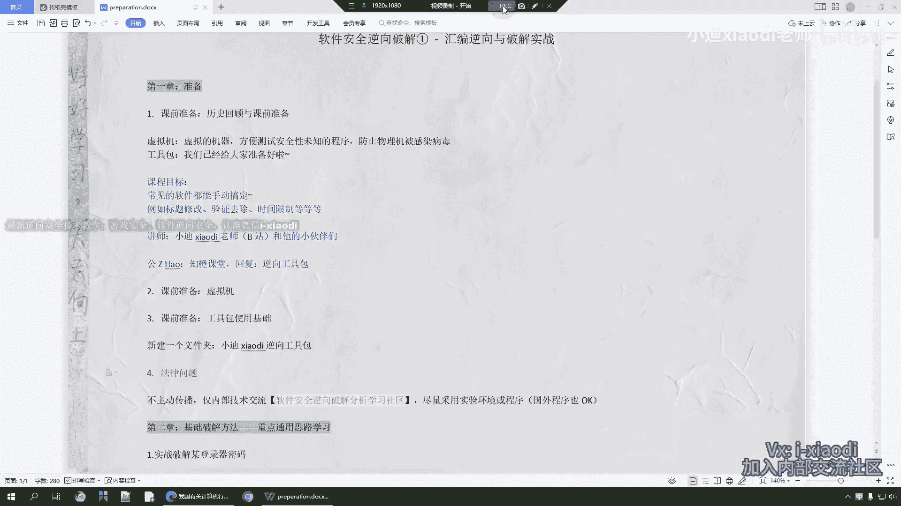
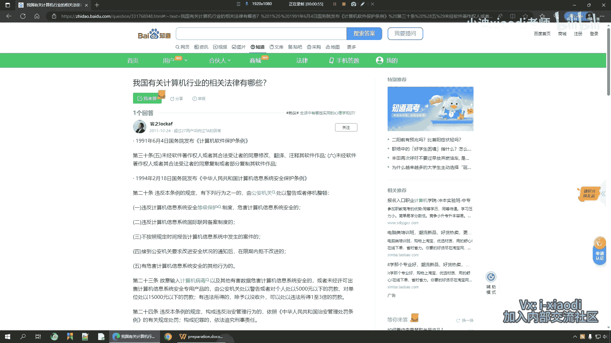

# 🧑‍💻 小白软件破解逆向工程师2023最新：课前准备4：法律问题

> 课程编号：BV1FX4y1q74n-

本节课是准备阶段第四课，主题是法律问题。上一节我们进入课前准备阶段，本节中我们来看看软件逆向与破解学习中最容易被忽略、但非常重要的一块内容，也就是法律边界。原因很直接：互联网并非法外之地，学习技术、分析软件、修改程序，都需要先知道哪些事情不能做，哪些做法相对更稳妥。下面我们会用大白话把原文提到的法律名称、风险点和合规做法讲清楚，让初学者也能看懂。

## ⚖️ 小白软件破解逆向工程师2023最新：课前准备4.1：为什么要讲法律问题

先说明为什么要专门讲法律问题。原因不复杂：互联网并非法外之地，计算机行业也有相关法律约束。如果我们要去逆向分析破解一个软件，就有可能面对法律制裁风险，所以必须提前了解边界。这里不是吓唬人，而是让学习过程更安全、更可控。

以下是原文提到的相关法律和风险点，我们用直白的话展开说明。

- **计算机软件保护条例**：未经软件著作权人或者其合法受让者的同意，就修改、翻译、注释其软件作品，或者复制、部分复制其软件作品，都可能涉及法律风险。

- **计算机信息安全系统安全保护条例等等**：除了软件著作权相关条例，还有其他计算机行业相关法律和安全管理规定，原文也提到“等等”，说明相关规则不止一条。

- **未经同意拿别人东西或改别人东西**：没有经过别人同意，就拿别人的东西，或者改别人的东西，在现实生活中不符合一定规则，也违反道德和人性。

- **逆向分析破解软件可能受到法律制裁**：如果直接去逆向分析破解一个软件，原文提醒我们，有可能受到相关法律制裁，所以需要先了解风险。

了解了为什么要讲法律问题后，本节中我们来看看面对这些风险时，具体应该采取哪些合规做法。

## 🛡️ 小白软件破解逆向工程师2023最新：课前准备4.2：合规做法

面对法律风险，原文给出的思路不是继续扩大传播，而是尽量把行为限制在更安全的范围内。简单说，就是不要主动传播，尽量只在内部做技术交流，并且优先使用实验环境和自己可控的程序。这样做的目的，是尽量避免因为传播或公开使用而带来不必要的法律问题。

以下是几条可以落地的合规做法，原文都提到了，我们逐条说明。

- **第一，不主动传播**：不要主动去传播一些东西。因为如果没有传播，只是自己使用，别人并不知道你进行了一些技术上的修改，这样风险会相对小一些。

- **第二，仅内部技术交流**：技术讨论尽量限制在内部交流范围内，不对外扩散，不主动公开传播。

- **第三，尽量采用实验环境**：实验环境和程序可以由我们提供，也可以由我们自己写，或者由大家自己写一个小程序，这些都是更可控的做法。

- **第四，优先使用自己提供或自己编写的程序**：程序来源越清楚、越可控，越适合学习和实验。



可以用一个简单的公式来描述原文的合规边界：

```text
合规边界 = 不主动传播 + 仅内部技术交流 + 使用实验环境 + 自己提供或编写程序 + 优先选择国外程序
```

掌握这些合规做法后，本节中我们来看看社群和实验环境方面的具体安排。

## 👥 小白软件破解逆向工程师2023最新：课前准备4.3：社群与实验环境

原文提到我们有社群，可以通过知识星球进行内部技术交流。具体做法是关注知识星球，用知识星球APP搜索“软件安全逆向破解分析学习社区”。如果搜不到，可以联系本人，加入专门的学习群。这样做的目的，是让技术交流尽量在内部进行，符合前面说的“仅内部技术交流”。

以下是社群和实验环境方面的具体安排，方便初学者按步骤操作。

- **关注知识星球**：使用知识星球APP，搜索“软件安全逆向破解分析学习社区”。

- **搜不到就联系本人**：如果搜索不到社区，可以联系本人，加入专门的学习群，我会拉你进群。

- **使用实验环境**：尽量采用实验环境，实验环境和程序由我们提供，也可以我们自己写，或者大家自己写一个小程序。

- **保持内部交流**：社群和实验环境的目的，是让学习和技术交流尽量限制在内部，不主动对外传播。

准备好社群和实验环境后，本节中我们来看看国外程序相关说明，并对整节课做一个总结。

## 🌍 小白软件破解逆向工程师2023最新：课前准备4.4：国外程序与总结

原文还提到一个思路：国外的程序可以直接国际化。老外写了一些软件，如果软件本来就比较小众，你在中国修改一个美国的软件，他肯定不知道，所以国外程序也可以。这里保留原文含义：优先选择国外程序，是原文给出的一种降低风险的做法。结合前面的不主动传播、仅内部技术交流、使用实验环境等做法，做到这几点，就能够规避一定的法律问题。

以下是国外程序相关说明，原文表达得比较直接，我们整理成更清楚的条目。

- **国外程序可以直接国际化**：原文认为国外程序也可以作为学习对象。

- **小众软件更难被发现**：老外写软件，如果本来就比较小众，你在中国修改一个美国的软件，他肯定不知道。

- **国外程序也可以**：原文明确说“国外的程序也是OK的”，也就是国外程序可以作为选择之一。

- **做到这几点能规避一定法律问题**：不主动传播、仅内部技术交流、使用实验环境、自己提供或编写程序、优先国外程序，这些做法合在一起，能够规避一定的法律问题。

本节课中我们一起学习了准备阶段第四课的法律问题：互联网并非法外之地，逆向分析破解软件可能涉及计算机软件保护条例、计算机信息安全系统安全保护条例等法律风险；未经同意修改、翻译、注释、复制或部分复制软件作品，以及未经同意拿别人东西或改别人东西，都不符合规则，也违反道德和人性；应对方法是第一不主动传播，第二仅内部技术交流，尽量采用实验环境，程序由我们提供或自己编写小程序，国外程序也可以作为选择。原文最后简单说明了法律问题，接下来带着这样的准备工作，我们就可以进入第二章，下集再见。

