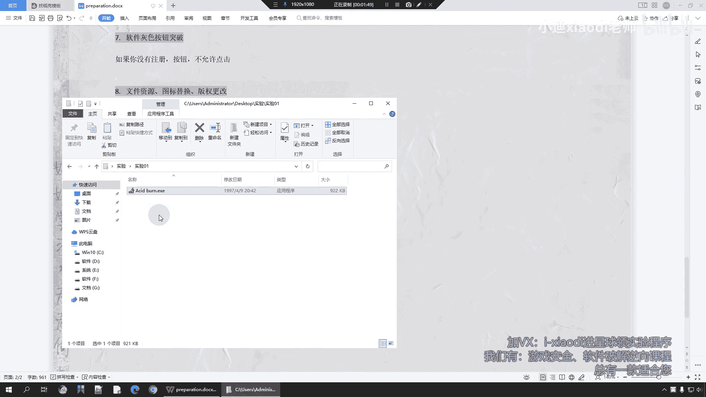
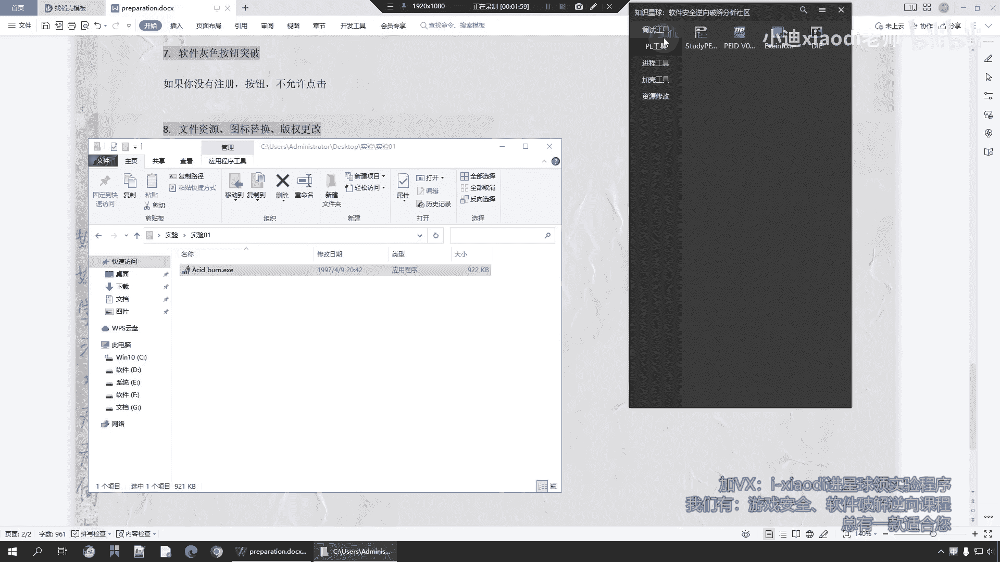
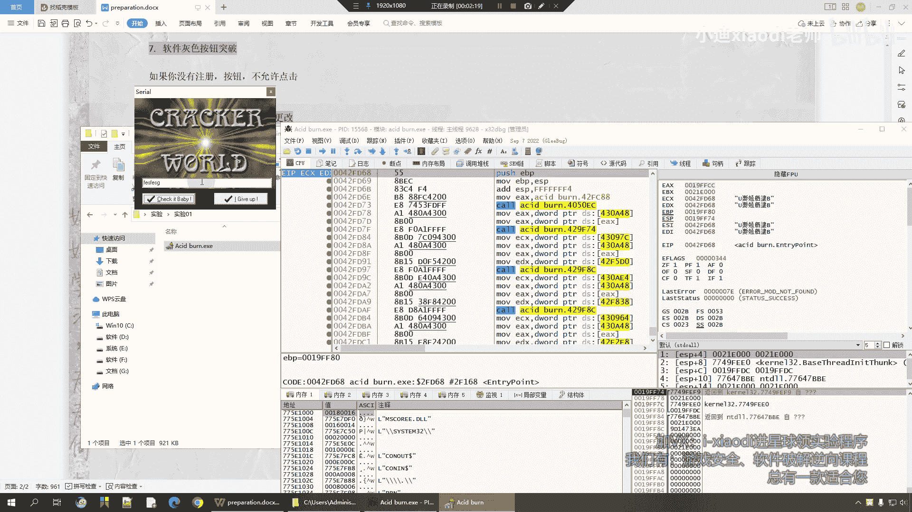
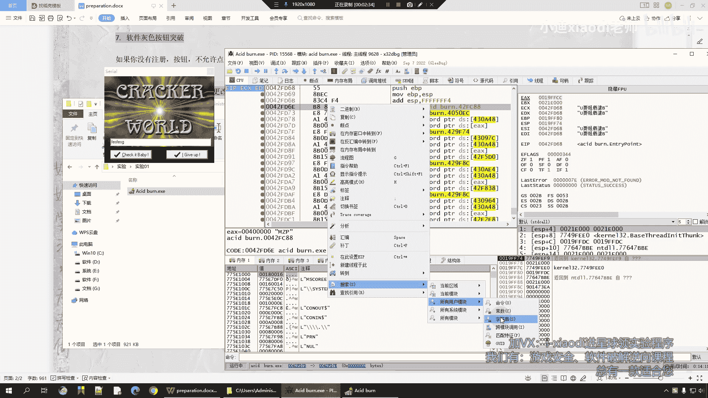
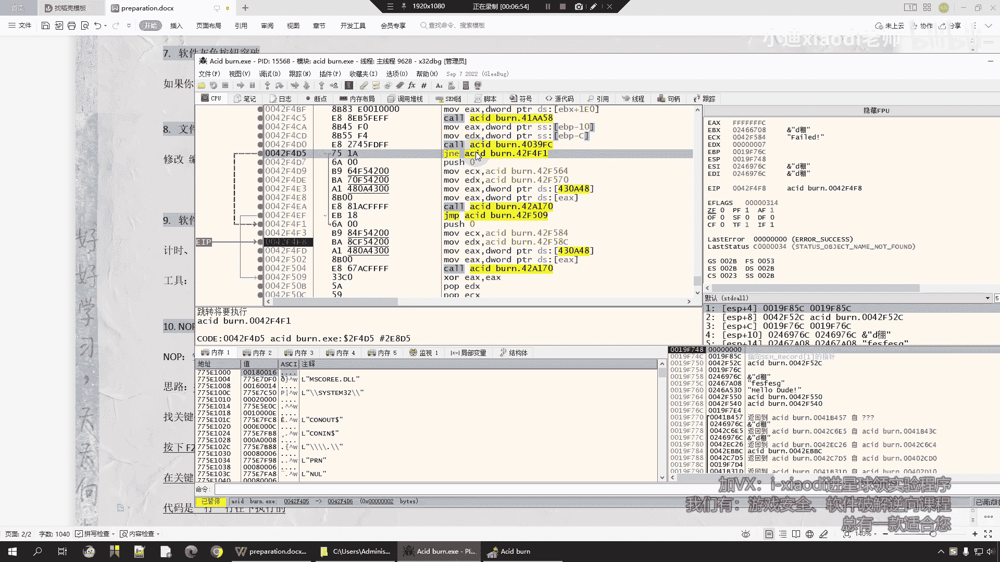
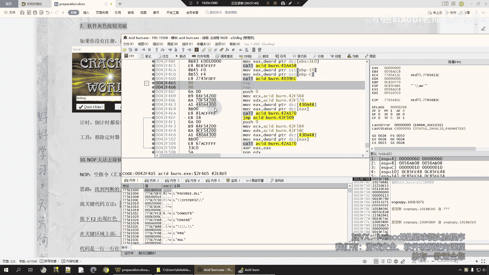

# 🧰 软件安全逆向破解实战：第10节：NPE大法去除软件验证

在本节课中我们将要学习软件安全逆向破解实战第二章基础破解方法中的第十节课，主题是NPE大法去除软件验证。课程已经进行到第十节课，本节会从空指令的基本概念讲起，再介绍字符串查找法、F2断点、CPU查看断点位置、观察跳转逻辑，以及用NOP填充修改关键指令的完整思路。内容会尽量用大白话说明，让初学者也能看懂每一步在做什么、为什么要这样做。

## 🧠 软件安全逆向破解实战：第10节：认识NPE空指令

上一节我们介绍了课程进度和本节主题，本节中我们来看看NPE到底是什么。原文把空指令读作NPE，在汇编语言里常见的写法是NOP；本教程按原文称为NPE大法，代码中用NOP表示空指令。汇编是一种编程语言，指令就是代码，空指令就是空代码，也就是什么都不做的代码。可以用一个简单的公式理解：`NOP = 空操作`，程序执行到它时不做实际计算，只继续往下走。

```asm
NOP        ; 空指令：不改变寄存器，不改变内存，只让程序继续执行
```

原文用“吃饱了躺平、什么事都不干”来比喻这种代码，意思就是它在程序里不产生实际动作。理解这一点很重要，因为后面去除软件验证时，就是想办法把某些关键指令改成这种空指令，让它不再执行原来的判断或跳转。介绍完空指令的概念后，接下来我们看看它在去除软件验证时的核心思路。

## 🎯 软件安全逆向破解实战：第10节：NPE去除验证的核心思路

上一节我们认识了NPE空指令，本节中我们来看看NPE去除软件验证的基本思路。核心做法是找到判断的关键代码处，直接修改一个控制指令，也就是把原来的指令改成空指令。软件有时会判断账号密码是否匹配，有时会直接判断注册码是否正确，总之会有一个判断的地方；如果把这个判断相关的位置改成NPE空指令，它就什么都不做，也就不再执行原来的判断。

```c
if (验证通过) {
    登录成功();
} else {
    登录失败();
}
// 把关键判断或关键跳转改成 NOP 后，程序不再走原来的失败逻辑
```

不去判断之后，我们就有可能登录成功，这就是NPE大法的基本思路。这里最关键的问题是怎么找到判断的关键代码处，这一步比较重要，也是初学者容易卡住的地方。接下来我们先讲一种常用的定位方法，也就是字符串查找法。

## 🔍 软件安全逆向破解实战：第10节：字符串查找法定位关键位置





上一节我们介绍了NPE去除验证的核心思路，本节中我们来看看如何用字符串查找法找到关键位置。字符串查找法就是查找软件中存放的相应字符串，看看能不能从这些字符串里找到有效信息。以下是使用字符串查找法定位关键位置的操作步骤。

1. 先找到要分析的程序，确认它是多少位的；原文中的程序是32位程序。

2. 找到调试工具，也就是32位的调试器，把程序拖进去。



3. 程序拖进去后可以运行，点击确定，进入调试环境。



4. 点击只判断一个密码的功能，随便输入一个密码，点击check测试。

5. 测试结果提示失败，说明密码不对，这时就可以去查找字符串。

6. 在反汇编窗口的位置点击鼠标右键，搜索所有用户模块字符串。

7. 搜索`try again`，可以看到出现了三个结果。

8. 三个`try again`需要挨个尝试，逐个下断点观察。

完成字符串搜索后，我们还需要验证哪一个`try again`对应真正的失败逻辑。原文中提示失败时会显示类似`for`失败的信息，这就是我们定位的线索。找到候选字符串后，下一步就是下断点并观察程序断在哪里。

## 🛠️ 软件安全逆向破解实战：第10节：F2断点与CPU查看断点位置

上一节我们通过字符串查找法找到了`try again`候选位置，本节中我们来看看怎么用F2断点和CPU窗口确认关键代码处。以下是下断点并查看断点位置的操作步骤。

1. 在候选位置按F2下断点，先不用管断点的完整概念，只需要知道按F2后左边会出现红色标记。

2. 回到软件界面点击触发功能，软件会停住；这个现象不叫卡住，而叫断下来了。

3. 点击CPU窗口，可以看到程序停在断点位置，断下来的位置就显示出来了。

4. 观察断点附近的信息，原文中能看到`for`失败之类的提示，说明这里和失败逻辑有关。

5. 继续观察代码执行方向，代码在程序中是一行一行往下执行的，需要顺着执行流程看它在哪里出错。

> 原文提示：软件“卡住”不叫卡住，叫断下来了；断下来的这个点叫断点。

断点位置显示出来后，我们还要往上看，寻找关键区域附近的跳转。跳转的常见特征是蓝线红箭头，也可能是红线红箭头、虚线或向下的小三角。断的位置就是关键代码处，也就是关键区域；在关键区域上面观察跳转，才能判断程序是怎么跳过错误位置的。接下来我们结合跳转逻辑分析应该修改哪一行。

## 🧭 软件安全逆向破解实战：第10节：观察跳转逻辑并确定修改点

上一节我们确认了断点位置和跳转特征，本节中我们来看看如何根据跳转逻辑判断修改点。代码在程序中是一行一行往下执行的，跳转会让执行方向发生改变；原文中的逻辑是程序往下跑，好像从某个位置跳过来，然后执行到错误段的位置。如果不跳过来，旁边还有一个小箭头会跳过去，也就是说程序在某些条件下会跳过错误位置。

```text
关键判断 -> 跳转 -> 成功分支 / 失败分支
目标：让程序跳过错误位置，不执行失败分支
```

我们的目标是让程序不执行错误位置，也就是想方设法跳过错误的位置。原文分析到：上边会跳过错误位置，所以不应该让它往下跳到错误分支；如果从某个位置直接跳，会跳过某一行，但可能仍然跳不过错误代码所在位置。因此应该把这一行代码NOP掉，让它变成空指令。这样程序执行到这里时不再按原来的跳转逻辑走，也就不会进入错误位置。理解了这个逻辑后，下面进行实际修改和验证。

## 💻 软件安全逆向破解实战：第10节：用NOP填充修改并验证结果



上一节我们确定了需要修改的关键指令，本节中我们来看看如何用NOP填充完成修改并验证。以下是修改和验证的操作步骤。

1. 在目标指令位置点击鼠标右键，选择二进制，再选择用NOP填充。

2. 点击确定，原来的指令就被空指令替换了。

3. 继续运行程序，观察执行到这一段时它又发生跳转，直接跳到下面去了，这样错误位置就不会执行。

4. 先运行程序，再重新测试一遍功能。

5. 点击测试后，程序提示`congratulation`和`good job`，说明验证已经被成功去除。

> 成功提示：`congratulation`、`good job`



完成修改后可以看到，NOP填充让关键指令不再执行原来的动作，程序因此跳过了错误分支。这个结果说明NPE大法去除软件验证的思路是可行的：先找关键字符串，再下断点确认位置，最后修改关键指令。接下来我们对整节课的思路和术语做一个总结。

## 📌 软件安全逆向破解实战：第10节：方法总结与术语回顾

上一节我们完成了NOP填充修改和验证，本节中我们对整节课的思路进行总结。整个NPE大法去除软件验证的流程可以概括为：先找关键字符串，因为提示错误时通常会出现`for`或`try again`之类的内容；然后在引用里搜索`try again`；找到后按F2下断点；再点击CPU来到断点位置；程序暂停或卡住的现象叫断下来，断下来的点叫断点。以下是完整流程的简要回顾。

1. 确认程序位数，使用对应位数的调试工具加载程序。

2. 触发验证功能，根据失败提示确定要搜索的字符串。

3. 搜索所有用户模块字符串，找到`try again`等关键提示。

4. 在候选位置按F2下断点，回到软件触发功能，让程序断下来。

5. 点击CPU查看断点位置，往上看关键区域附近的跳转。

6. 根据代码一行一行执行的逻辑，观察带箭头的跳转方向。

7. 想方设法跳过错误位置，必要时用NOP填充把关键指令改成空指令。

8. 运行程序并重新测试，看到成功提示即说明修改生效。

还需要注意，跳转有很多种情况，原文中还有往上跳的跳转，就像玩游戏一样；本节先了解NPE大法，也就是把指令NOP掉，让它变成空指令、什么都不做。NPE大法需要配合带线的跳转来生效，跳转的详细内容会在后期课程中讲解，今天先掌握这种基本方法，它适用于很多场景。本节课中我们一起学习了NPE空指令的概念、字符串查找法、F2断点、CPU查看断点位置、观察跳转逻辑以及用NOP填充去除软件验证的完整流程。

