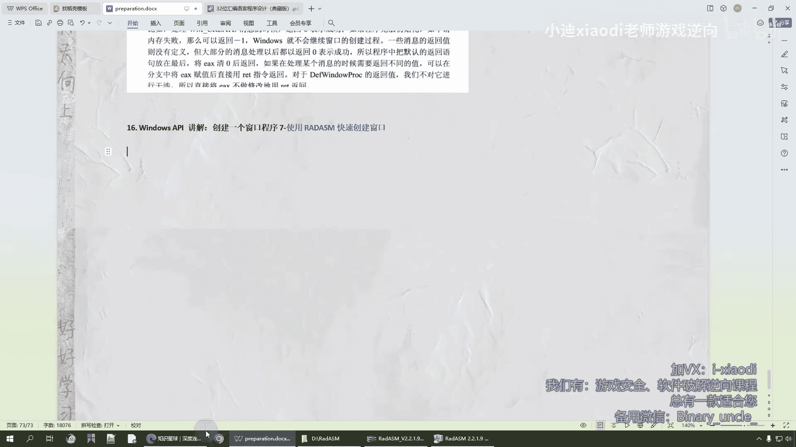
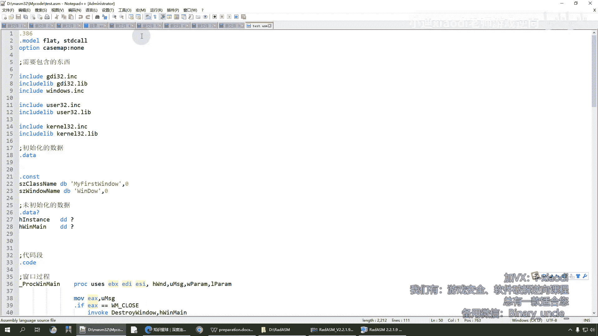
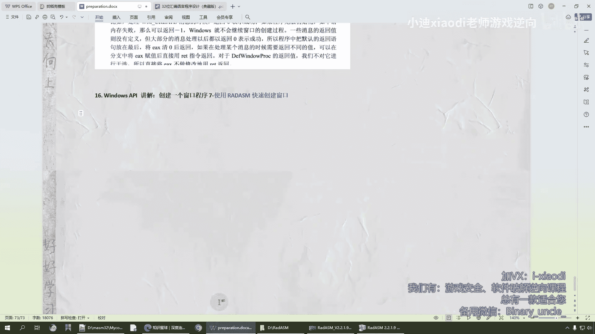
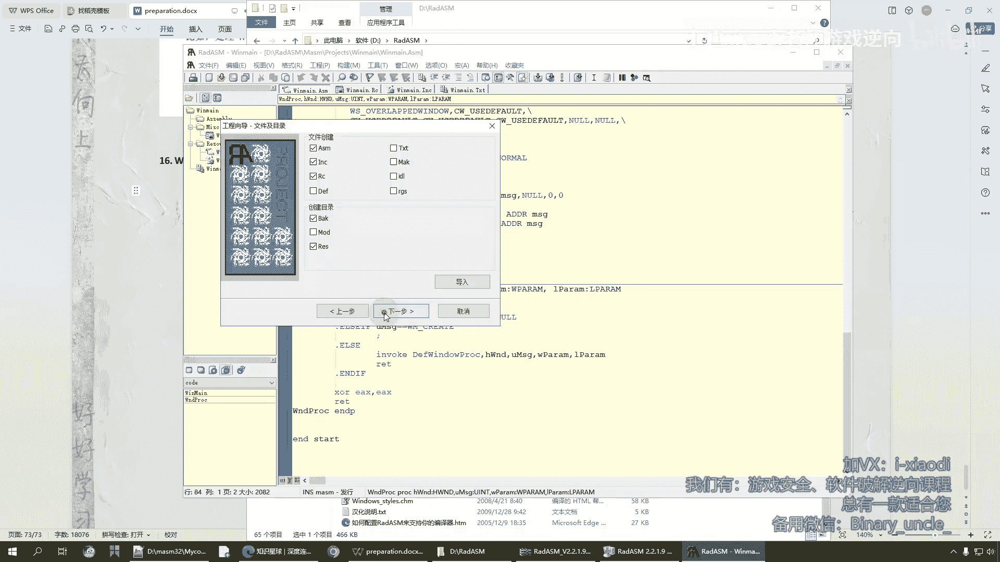
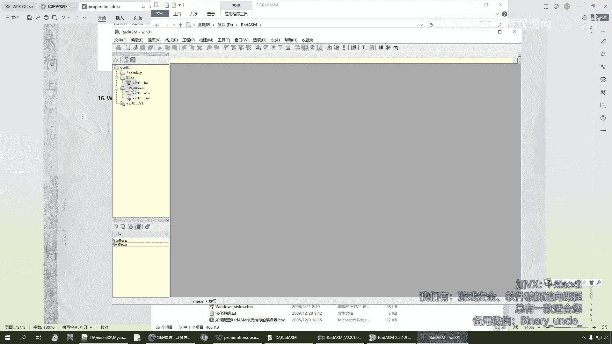
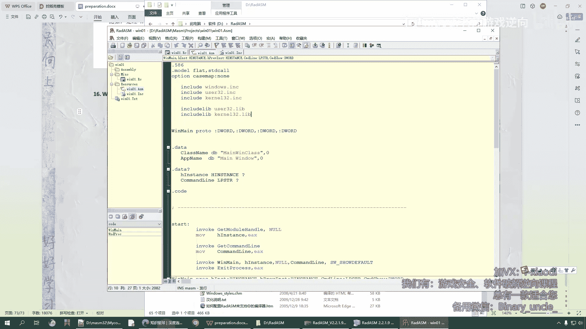
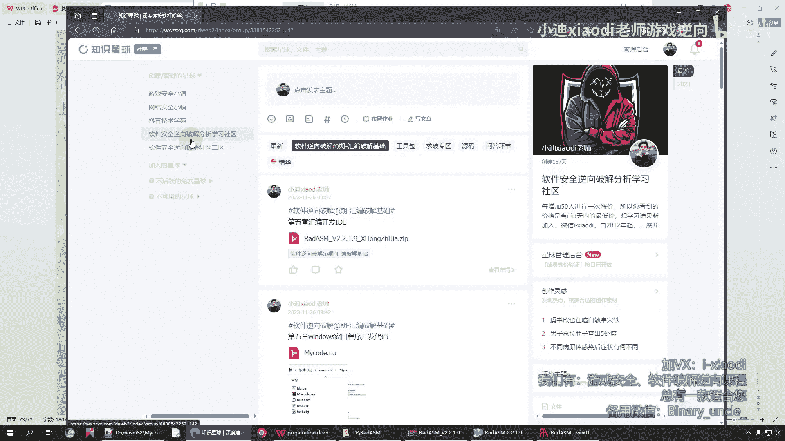
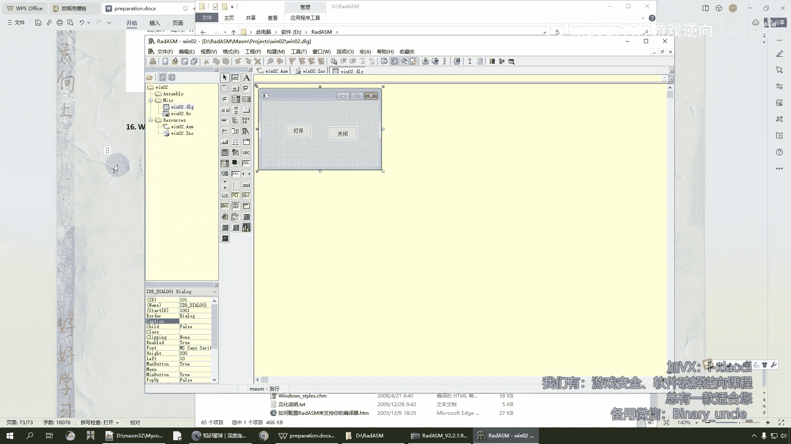
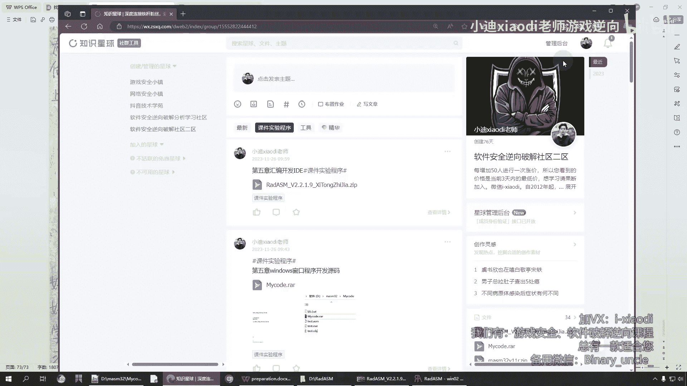

# 小白软件破解逆向工程师反汇编2023最新：5.16：Windows API 讲解——创建窗口程序7：使用 RADASM 快速创建窗口 🪟

## 📚 课程概述

本节是 Windows API 讲解系列的第 16 课，主要学习如何使用 RADASM 快速创建一个窗口程序。

此前编写程序时，通常使用 Notepad++。Notepad++ 可以正常编写代码，也支持语法高亮，还可以选择不同的编程语言。但是，当项目变大，涉及菜单、资源和按钮等窗口控件时，仅使用文本编辑器就不够方便了。

本节将介绍 RADASM。RADASM 是一个比较系统化的开发工具，可以把资源编辑、代码编写、菜单编辑以及程序生成等功能整合在一起。通过这个工具，可以更方便地创建 Windows 窗口程序，也能减少手动配置项目的步骤。

下面先了解为什么需要使用 RADASM，再学习如何创建普通窗口程序和对话框程序。

## 🛠️ 一、为什么不只使用 Notepad++

上一节中使用文本编辑器编写代码时，主要工作集中在代码本身。本节中我们进一步考虑项目规模变大之后的问题。

Notepad++ 适合编写代码，但它没有提供完整的资源编辑器，也没有提供专门用于编辑窗口控件的工具。也就是说，如果项目中包含菜单、按钮、图标以及其他资源，就需要手动处理这些内容。

当项目规模较大时，项目分组、资源管理和程序生成也需要更加系统化的流程。RADASM 的作用，就是把这些操作集中到同一个开发环境中。

以下是 RADASM 主要提供的功能：

- 代码编写。

- 资源编辑。

- 菜单编辑。

- 窗口控件编辑。

- 项目文件管理。

- 程序构建与运行。

可以把 RADASM 理解为一个面向汇编语言 Windows 程序的集成开发工具。它不仅能够编辑 ASM 代码，也能通过可视化方式编辑窗口资源，从而让创建窗口程序变得更加直接。

## 📦 二、安装 RADASM

在开始创建程序之前，需要先安装 RADASM。相关工具已经上传到知识星球，知识星球的一区和二区都提供了下载内容。

安装过程比较简单，主要按照安装向导完成即可。下面是具体步骤：

1. 直接运行 RADASM 安装包。



2. 点击“下一步”。

3. 点击“我同意”。



4. 在安装选项中，取消不需要的两个勾选项。

5. 将剩余选项全部勾选。

6. 点击“下一步”，完成安装。

由于示例环境中已经安装过 RADASM，因此不再重复安装。实际操作时，按照上述顺序完成安装即可。

安装完成后，可以在安装目录中找到 RADASM 的主程序。后续创建窗口程序时，直接双击安装目录中的 RADASM 程序即可打开开发环境。



## 🏗️ 三、创建 Win32 窗口程序

安装完成后，先创建一个最基本的 Win32 窗口程序。这个过程可以帮助初学者了解 RADASM 自动生成项目文件的方式。

打开 RADASM 后，按照以下步骤操作：

1. 点击“文件”。

2. 点击“新建工程”。

3. 为工程设置名称，例如输入“问01”。

4. 点击“下一步”。

5. 选择 `Win32 EXE`。

6. 连续点击“下一步”。

7. 点击“完成”。

这里的 `Win32 EXE` 表示创建一个 32 位 Windows 可执行程序。它属于 x86 平台下最基本的一类 Windows 程序，适合用来学习 Windows API 和窗口程序的基本结构。



工程创建完成后，RADASM 会自动生成一些项目文件。此时不需要手动创建所有文件，开发环境已经为我们准备好了基本结构。

## 🗂️ 四、查看 RADASM 自动生成的文件

工程创建完成后，可以在工程窗口中看到自动生成的文件。当前示例中主要包含资源文件和 ASM 代码文件。

资源文件最开始是空的。由于还没有添加按钮、菜单或其他控件，因此它对应的是一个空窗口。

ASM 文件则包含程序的基本代码结构。通常可以看到以下内容：

- 数据段。

- 未初始化数据段。

- `WinMain` 入口函数。



- `ShowWindow` 调用。

- `UpdateWindow` 调用。

- Windows 消息循环。

- `include` 或库文件、头文件引用。

Windows 窗口程序的基本执行流程可以概括为：

```text
WinMain
  ↓
ShowWindow
  ↓
UpdateWindow
  ↓
消息循环
```

其中，`WinMain` 是 Windows GUI 程序的入口函数。`ShowWindow` 用于显示窗口，`UpdateWindow` 用于更新窗口，消息循环则负责不断接收和处理系统发送给窗口的消息。

从程序结构上看，可以把它简化表示为：

```asm
WinMain:
    invoke ShowWindow
    invoke UpdateWindow

MessageLoop:
    ; 获取消息
    ; 判断消息是否结束
    ; 分发消息
    jmp MessageLoop
```

实际生成的代码可能会根据模板有所不同，但整体结构基本一致。对于初学者来说，先记住“入口函数、显示窗口、更新窗口、消息循环”这几个关键部分即可。

## ▶️ 五、构建并运行窗口程序

过去编写程序时，通常需要返回项目目录，再通过其他方式生成程序。使用 RADASM 后，可以直接在开发环境中完成构建。

按照以下步骤运行程序：

1. 点击“构建”。

2. 点击“构建并运行”。

RADASM 会自动编译并链接工程。如果代码和配置没有问题，就会生成并运行窗口程序。

通过这种方式，创建一个基本窗口的过程被大幅简化了。以前需要手动准备文件、配置生成流程，现在只需要创建工程并点击“构建并运行”即可。

## 🪟 六、创建对话框程序

除了普通的 Win32 EXE 窗口程序，RADASM 还可以创建基于对话框的程序。对话框程序更适合快速添加按钮、文本框等控件。

首先打开 RADASM，然后按照以下步骤创建新工程：

1. 点击“文件”。

2. 点击“新建工程”。



3. 设置工程名称，例如输入“问02”。

4. 点击“下一步”。



5. 选择对话框程序模板，例如 `DlogApp` 或类似的对话框应用模板。

6. 连续点击“下一步”。

7. 点击“完成”。

完成创建后，双击工程中的 ASM 文件，可以看到自动生成的汇编代码。工程中还会包含相关的库文件或头文件，用于提供程序所需要的定义和函数声明。

对话框程序的重点，是通过资源编辑器直接设计窗口界面，而不是完全依靠代码创建控件。这样可以更加直观地布局窗口内容。

## 🎛️ 七、向对话框中添加按钮

创建对话框程序后，可以直接使用资源编辑功能添加控件。

在资源编辑区域中双击对应的对话框资源，就会打开窗口设计界面。此时可以看到窗口中出现控件编辑区域，也可以在其中添加按钮。

添加按钮的基本过程如下：

1. 双击对话框资源。

2. 在资源编辑器中选择按钮控件。

3. 将按钮添加到窗口中。

4. 点击“构建并运行”。

构建运行后，按钮就会被直接显示在窗口中。RADASM 会把资源编辑器中的控件配置保存到资源文件中，并在程序构建时自动整合到最终的可执行文件中。

资源控件的处理流程可以表示为：

```text
资源编辑器添加控件
        ↓
保存资源文件
        ↓
构建工程
        ↓
控件显示在窗口中
```

这种方式比手动编写大量创建控件的代码更加直观。对于刚开始学习 Windows API 的用户来说，可以先使用资源编辑器设计界面，再逐步学习控件背后的 API 调用。

## ✏️ 八、修改按钮名称

添加按钮后，可以看到按钮通常包含 `Name` 和 `Caption` 等属性。

其中，`Name` 通常用于标识控件，`Caption` 用于设置控件在窗口中显示的文字。因此，可以通过修改 `Caption` 来改变按钮的显示名称。

例如，将按钮的 `Caption` 修改为“打开”，再添加另一个按钮并将其 `Caption` 修改为“关闭”。

示例属性可以表示为：

```text
Button1:
    Name    = Button1
    Caption = 打开

Button2:
    Name    = Button2
    Caption = 关闭
```

修改完成后，再次点击“构建并运行”。运行程序时，就可以看到窗口中显示“打开”和“关闭”两个按钮。

需要注意的是，修改按钮显示文字只改变了控件的外观。按钮是否真正执行打开或关闭操作，还需要在代码中编写对应的消息处理逻辑。

## 💡 九、RADASM 的使用价值

通过前面的操作可以看到，使用 RADASM 创建窗口程序的过程比较简单。

传统方式通常需要手动完成以下工作：

- 创建工程目录。

- 编写 ASM 源代码。

- 准备资源文件。

- 定义窗口控件。

- 配置编译和链接过程。

- 生成最终程序。

而使用 RADASM 后，可以在一个工具中完成代码编写、资源编辑、控件设计和程序构建。整个流程更加集中，项目文件也更容易管理。

因此，RADASM 特别适合用于学习汇编语言 Windows API，也适合创建包含窗口、菜单和按钮的简单 Windows 程序。对于初学者来说，先通过模板创建程序，再逐步修改自动生成的代码，是一种比较容易理解的学习方式。

## 📚 十、课件与工具获取

如果需要获取 RADASM 工具或相关课件，可以进入知识星球进行下载。

知识星球中提供了对应的资料板块。一区和二区都包含相关课件，二区中也提供了同样的学习资料。使用时可以根据实际情况进入相应板块进行查看和下载。

## ✅ 本节总结

本节课中，我们一起学习了如何使用 RADASM 快速创建 Windows 窗口程序。

主要内容包括：

- 了解 Notepad++ 在大型窗口项目中的局限。

- 认识 RADASM 的代码编辑、资源编辑、菜单编辑和程序构建功能。



- 学习 RADASM 的安装步骤。

- 创建 `Win32 EXE` 类型的基本窗口程序。

- 了解数据段、未初始化数据段、`WinMain`、`ShowWindow`、`UpdateWindow` 和消息循环。

- 使用“构建并运行”快速生成并启动程序。

- 创建对话框应用程序。



- 通过资源编辑器添加按钮。

- 修改按钮的 `Caption` 属性。

- 了解资源编辑器与 ASM 代码之间的配合方式。

总体来说，RADASM 将代码编写、资源设计和程序生成整合到了一起，使 Windows API 窗口程序的创建过程更加简单。后续编写窗口程序时，可以继续使用这个工具进行开发。

