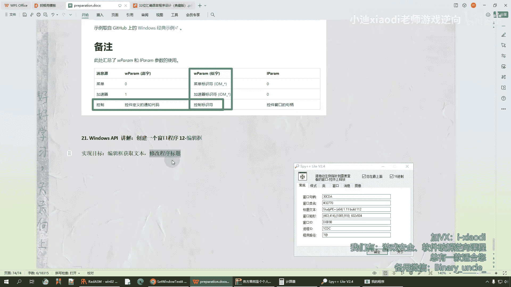

# 小白软件破解逆向工程师反汇编2023最新：5.12：编辑框实现标题破解修改工具 🧰

在本节课中我们将要学习 Windows API 中“通过编辑框获取文本并修改程序标题”的完整流程。大家好，我是小李老师，今天是第21课 Windows API 讲解，主题是创建一个窗口程序12：编辑框实现目标编辑框获取文本、修改程序标题。这个被修改标题的程序可以是任意程序，本次课程先拿自己的程序做测试，围绕编辑框来完成实验。课程会从认识编辑框和标签开始，再讲控件创建、ID 对应、消息拦截、文本获取和标题设置，最后给出一个可以修改其他程序标题的小工具作业。


## 小白软件破解逆向工程师反汇编2023最新：5.12.1：认识编辑框与标签 🧩


首先要知道什么是编辑框。在 readASM 中双击找到对话框所在的位置，然后在这里可以看到一个 ABC 标识，提示文字为 `idit text`，这个位置对应的就是编辑框。要理解编辑框的外观和作用，可以点击这个位置进行预览，当前界面中的控件已经拖好了。编辑框就是可以编辑文字的地方，可以在里面输入文字，这个控件就像平时使用的社交软件输入框，输入消息后点击发送就可以把内容发出去。

编辑框左边放置的是一个标签，标签的作用是给一些控件做提示，或者在某些特定情形下做说明。当前标签提示的内容是“请输入新的程序标题”，然后在编辑框里输入新的程序标题，程序标题就会做相应更新。以下是认识编辑框和标签时需要掌握的几个要点：

- 编辑框用于输入和编辑文字，类似聊天软件的消息输入框。

- 标签用于提示控件用途，本次标签提示“请输入新的程序标题”。

- 在编辑框输入新标题后，程序标题会随之更新，这是本次程序的目标效果。

- 标签和编辑框分别是两个控件，需要分别创建并设置属性。


这两个控件分别对应界面中的哪个位置，也需要看清楚。当前界面中的标签可以在 `caption` 属性里任意修改，`caption` 就是标签显示的内容。这个标签在当前实验中已经用不到，因此可以删除；当前已经把它修改成“请输入新的标题”，`caption` 保存的就是这段内容。编辑框可以点击后任意拖动，大小也可以拖动和更改；编辑框的内容还可以做初始化设置，如果不想初始化，就不用给它初始内容，它会显示为空。

认识控件之后，下一步就是创建控件并让代码识别它们。以下是创建控件和完成宏对应时需要执行的操作：

- 按照前面讲解的逻辑，分别创建一个标签和一个编辑框。

- 把编辑框的名字改成 `EDTCAP`，其中 `cap` 表示 `caption`，也就是标题。

- 改完名字后，把控件 ID 和控件名字做宏的对应。


- 在 `include` 文件中完成 ID 与名字的宏对应，方便后续代码使用。


## 小白软件破解逆向工程师反汇编2023最新：5.12.2：创建控件并完成宏对应 🛠️

创建控件并修改名称之后，需要把控件 ID 和名称做好宏对应。完成宏对应之后，就可以写代码接收并处理控件消息。这个编辑框位于对话框或整个菜单体系中，因此需要先理解文档对控件通知消息的说明。以下是原文引用的文档说明：

> 当用户从菜单中选择命令项时，控件将通知消息发送到其副窗口，或翻译快捷键时及时发送。


这个控件是编辑框控件，编辑框控件也适用这套通知消息机制。因此编辑框的处理方法应当和按钮一样，按钮的 ID 判断方式是从 `W` 参数中取出 `D` 字，再用 `AX` 判断 ID，也就是用第 16 位来判断 ID。刚才编辑框的 ID 和名称已经做了宏对应，所以后续可以直接用编辑框 ID 来识别消息来源。

控件创建好并且 ID 完成对应后，下一步就是拦截编辑框消息。以下是拦截编辑框消息时的核心判断代码：


```c
if (AX == IDC_EDT_CAP) {
    // 处理编辑框消息
}
```

直接判断 `AX` 是否等于编辑框 ID，就可以过滤编辑框的消息。这个判断方式和按钮消息处理思路一致，核心目的就是先确认消息来自目标编辑框，然后再执行获取文本或修改标题的操作。


## 小白软件破解逆向工程师反汇编2023最新：5.12.3：拦截编辑框消息并获取文本 🔍


确认消息来自编辑框之后，就可以获取编辑框文本。获取编辑框文本要使用 `GetDlgItemText`，原文口述为 `get dial text`，实际 API 是 `GetDlgItemText`。要查看这个 API 的用法，可以直接搜索它的文档；看 A 版本或 W 版本都可以，参数基本一样，只是编码方式不同。以下是 `GetDlgItemText` 的参数结构和本次调用方式：


```c
int GetDlgItemText(
    HWND hDlg,       // 包含控件的对话框句柄
    int nIDDlgItem,  // 控件标识符，也就是控件 ID
    LPTSTR lpString, // 接收标题或文本的缓冲区
    int nMaxCount    // 缓冲区最大长度
);

char szBuffer[128];
GetDlgItemText(hWnd, IDC_EDT_CAP, szBuffer, sizeof(szBuffer));
```

第一个参数是对话框句柄，也就是包含控件的对话框句柄。谁包含控件，就把谁的窗口句柄拿过来；窗口过程里的 `hWnd` 就是当前窗口的句柄，可以直接使用。第二个参数是控件标识符，控件标识符就是编辑框 ID，把编辑框 ID 放进去即可。第三个参数是用于接收标题或文本的缓冲区，既然要从编辑框里取出内容，就需要找一个容器存放文本。缓冲区可以做成全局变量，本次为了考虑内存利用，使用局部变量接收编辑框文本。

在汇编中可以用 `local` 声明局部变量，`local` 表示局部变量。以下是本次局部缓冲区的声明方式：

```asm
local szBuffer[128]:byte
```

这里声明一个 128 字节的数组 `szBuffer`，冒号后面的类型是字节，128 个字节用于存放编辑框文本。最后一个参数是最大长度，可以直接用 `sizeof` 计算出来，这种方式非常简便，汇编语言在这一点上相当简洁。该函数就是获取编辑框文本的函数，前面已经使用了很多 API，阅读这个 API 文档应该已经比较简单。

获取到编辑框文本后，下一步就是学习设置窗口标题。以下是设置窗口标题的核心 API 调用：


```c
BOOL SetWindowText(
    HWND hWnd,        // 要更改文本的窗口或控件句柄
    LPCTSTR lpString  // 新的标题或控件文本
);

SetWindowText(hWnd, szBuffer);
```


## 小白软件破解逆向工程师反汇编2023最新：5.12.4：设置窗口标题并测试修改其他程序 ✏️

设置窗口标题要使用 `SetWindowText`，原文口述为 `setment text`，实际 API 是 `SetWindowText`。这个函数也分 A 版本和 W 版本，本次默认使用 A 版本即可。第一个参数是要更改文本的窗口和控件句柄，先修改自己程序的标题时，自己程序的句柄就是 `hWnd`，原文口述为 H 问，指的就是窗口句柄。第二个参数是新的标题或控件文本，新的标题已经存放在局部变量中，直接把局部变量放进去即可。


需要注意，字符串参数要使用 `ADDR` 进行寻址；`LP` 表示 long pointer，也就是指针。以下是本次标题设置与字符串寻址的核心代码：


```asm
; 字符串使用 ADDR 寻址
SetWindowText(hWnd, ADDR szBuffer)
```


完成代码后构建并运行程序。在编辑框里输入内容时，程序标题会随之改变，说明编辑框文本已经成功传给标题设置函数。`SetWindowText` 还可以用于更改其他程序的标题文本，例如常用的 StarPE 工具。StarPE 当前标题是某个文本，再打开 SPY++，把放大镜拖到目标程序上，就可以探测到这个程序的窗口句柄。


探测到的句柄是 `30CDA`，这是十六进制表示。十六进制转换成十进制是 `199898`。以下是句柄转换关系：

```text
0x30CDA = 199898
```

讲解中曾提到把 199898 填到第二个参数，但实际操作应填到第一个参数，因为第一个参数才是句柄参数。将十进制数 199898 填入第一个参数后，构建并运行自己的程序。程序构建出来后，把目标程序拿过来，当鼠标点到目标程序上时，目标程序的标题会消失；再通过编辑框更改标题时，目标程序标题和编辑框文字会同步起来。

这个例子不仅可以修改自己程序的标题，还可以修改其他程序的标题，是一个多功能的小程序。目标程序的标题可以任意修改，想怎么改就怎么改，只是可修改的文本长度存在上限，最长数量是有限的。这个长度上限来自缓冲区大小和 API 参数限制，因此实验时不要把标题设置得过长。


## 小白软件破解逆向工程师反汇编2023最新：5.12.5：作业与总结 📌

今天的内容到这里完成，最后布置一个作业：自己回去写一个可以修改其他程序标题的工具。作业可以围绕本次的 `GetDlgItemText` 和 `SetWindowText` 展开，把编辑框文本取出来，再把文本设置到目标窗口标题上。以下是本次作业需要把握的几个关键点：

- 创建一个编辑框和一个标签，完成控件 ID 与名称的宏对应。

- 拦截编辑框消息，并用 `GetDlgItemText` 获取编辑框文本。

- 用 `SetWindowText` 修改自己程序或其他程序的窗口标题。


- 使用 SPY++ 探测目标窗口句柄，并注意十六进制与十进制之间的转换。




本节课中我们一起学习了编辑框和标签的概念、控件创建与宏对应、编辑框消息拦截、`GetDlgItemText` 获取文本、`SetWindowText` 设置窗口标题，以及通过 SPY++ 获取窗口句柄并修改其他程序标题的完整流程。课程最后还布置了一个作业，要求自己实现一个可以修改其他程序标题的小工具，从而把本节课的 API 用法真正串起来。
