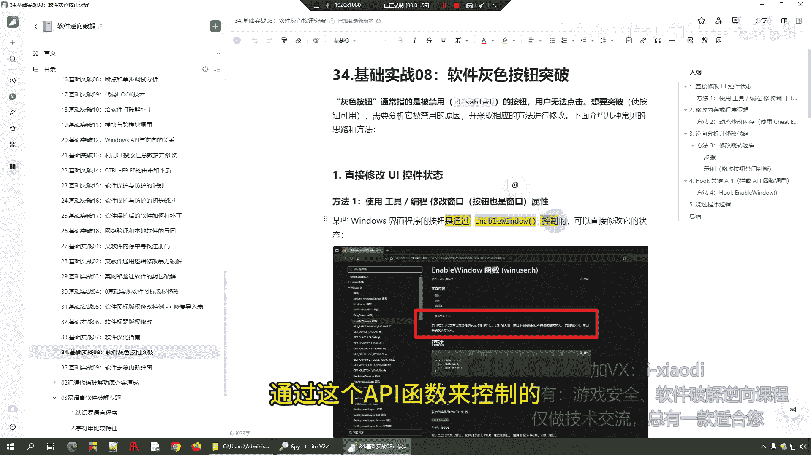
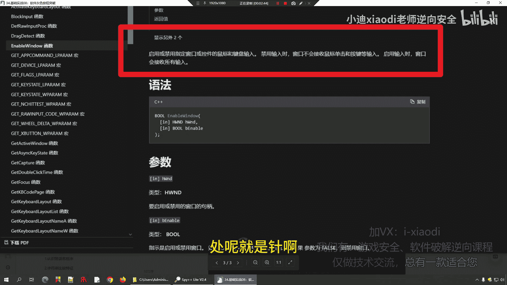

# 🛠️ 小白软件逆向安全逆向工程师2025最新：01：软件灰色按钮一键突破技术大全解

在本节课中我们将要学习软件灰色按钮一键突破。这个内容对应视频编号 BV1DBoaYxEqi。大家好，我是小迪老师。今天讲解软件灰色按钮突破。灰色按钮通常指被禁用的按钮，用户无法点击。举例来说，一款软件没有充值，软件就把按钮做成灰色并限制使用。遇到这种情况需要理解一个比喻：世界上能量守恒，要么付费，要么学习技术并仅做技术交流，从基础触发，然后进行突破测试。这个比喻是为了说明，问题通常有原因，找到原因才能设计修改方法。

上一段概述了课程主题和基本思路，本节中我们来看看灰色按钮的定义和总体突破思路。如果不想付费，就需要学习相关技术，分析按钮被禁用的原因，并采取相应方法进行修改。下面介绍几种常见思路和方法，后文会依次展开。对初学者来说，先理解总体地图，再进入工具操作，学习过程会更清晰。

以下是几种常见思路和方法的总体名称，具体细节会在后文展开：

- 直接修改 UI 控件状态，使用工具或编程修改窗口属性。
- 修改内存或程序逻辑，例如用 CE 搜索按钮状态。
- 逆向分析并修改代码。
- 拦截关键 API 函数调用。
- 绕过程序逻辑，直接调用对应 API 函数。

这些方法从易到难，适合不同基础的学习者。小白可以先从工具修改控件状态入手，有编程基础后再研究代码和 API 层面的方法。

## 🧱 小白软件逆向安全逆向工程师2025最新：03：直接修改UI控件状态前要懂的窗口概念

上一节我们列出了几种突破思路，本节中我们来看看第一种方法背后的基础：直接修改 UI 控件状态。第一种方法是直接修改 UI 控件状态，使用工具或者编程修改窗口属性。这里有一个小知识点：在 Windows 操作系统中，所有控件都可以被看作一个小窗口。理解这一点很重要，因为后面工具和 API 都是围绕窗口句柄工作的。

以下是理解这个知识点时可以对照的几个控件例子：

- 标签也是小窗口，例如界面上的“请输入新的程序标题”就是标签。
- 编辑框也是小窗口，编辑框的功能是让用户输入文本。
- 按钮也是小窗口，正常按钮和灰色按钮都属于窗口。
- 图片框也是小窗口，图片框可以显示图片。

在 Windows 操作系统中，大大小小的控件都是窗口。正常按钮和灰色按钮的区别在于，灰色按钮让用户无法点击、无法输入。灰色状态由 Windows API 控制。接下来我们看看这个 API 的具体信息。

## ⚙️ 小白软件逆向安全逆向工程师2025最新：04：EnableWindow函数与按钮状态

上一节我们确认了控件属于小窗口，本节中我们来看看控制窗口启用和禁用状态的 API 函数 EnableWindow。这个函数用于启用或禁用指定窗口。指定窗口或控件中的控件也属于小窗口。禁用鼠标和键盘输入时，窗口不会接收鼠标单击和按键等输入。灰色状态的含义就是用户输入功能被限制。



以下是 EnableWindow 函数的关键信息：

- 作用：启用或禁用指定窗口。
- 参数一：窗口句柄，也就是窗口的句柄。
- 参数二：启用状态，TRUE 表示真，也就是启用；FALSE 表示假，也就是禁用。
- 效果：禁用后，窗口不接收鼠标单击和按键等输入。

核心概念可以用下面的公式和代码描述：

```c
BOOL EnableWindow(HWND hWnd, BOOL bEnable);

// bEnable = TRUE  启用
// bEnable = FALSE 禁用
```

相关编程代码在本视频不展开。高级版社区 C 语言 Windows 程序开发课程中已经讲解过，高级版社区学员可以自行查看和学习。理解函数参数后，下面用工具做一次实际测试。

## 🧰 小白软件逆向安全逆向工程师2025最新：05：使用ssplight工具突破灰色按钮

上一节我们理解了 EnableWindow 控制按钮状态，本节中我们来看看如何用工具直接测试灰色按钮突破。这个工具在工具包进程工具中，名称是 ssplight。测试时先打开目标程序，界面中会有一个小靶子图标。工具提示为：请拖动左侧的指针到需要查看的窗口或控件上释放。

以下是使用 ssplight 工具进行测试的主要步骤：



- 按住左侧指针，拖到目标按钮位置，目标会闪烁，说明已经定位到按钮。
- 松开鼠标左键，工具会探测窗口相关信息。
- 点击窗口，可以查看进一步信息，也可以查看子窗口列表，此处子窗口列表为空。
- 点开“消息”，重点在这里查看。
- 点击“窗口可用”，灰色按钮就可以点击，相关功能可以使用。
- 再执行“窗口禁用”，按钮恢复灰色。
- 其他操作可以自行测试。

接着再运行另一个程序，用同样方法把指针拖过去。目标闪烁说明定位成功。点击窗口可以看到它的一些信息，点击“消息”，勾选“窗口可用”，按钮就可以点击。点击关闭，close 功能可以使用。以上是该工具操作并实现灰色按钮突破的过程。这个工具的原理是找到窗口句柄，根据窗口句柄改变窗口的禁用和启用状态。工具方法直观，适合初学者先建立手感。下一节我们换一种思路，从内存和程序逻辑入手。

## 🔎 小白软件逆向安全逆向工程师2025最新：06：用CE修改内存或程序逻辑

上一节我们用工具直接修改窗口状态，本节中我们来看看第二种拓展方法：修改内存或程序逻辑。具体做法是用 CE 搜索按钮状态。这种方法只适用于按钮有切换状态的情况，也就是按钮有时可用、有时不可用。对于这种按钮，可以在可用时用 CE 搜索 1，在不可用时用 CE 搜索 0，最后筛选过滤出一定数值。

以下是使用 CE 搜索按钮状态时的核心做法：

- 按钮可用时搜索 `1`。
- 按钮不可用时搜索 `0`。
- 对筛选出的数值进行锁定，或一直修改成 `1`。
- 修改成 `1` 后可以一直启用，也可以在想使用时改回 `1`。

核心搜索逻辑可以用下面的代码形式表示：

```text
可用状态：搜索 1
禁用状态：搜索 0
目标：锁定为 1 或持续写入 1
```

关于 CE 怎么搜索数据，前面的课程已经讲过。内存方法依赖按钮状态变化，因此不是所有灰色按钮都适合。下一节进入逆向分析层面，看看代码修改的思路。

## 🧩 小白软件逆向安全逆向工程师2025最新：07：逆向分析并修改代码

上一节我们通过 CE 观察按钮状态，本节中我们来看看第三种方法：逆向分析并修改代码。这个方法仍然围绕 Windows API 函数。在 Windows 操作系统上，所有软件都基于 Windows API 函数。微软不可能把整个操作系统代码都提供出来，这是微软的原创。微软会开放一些接口，这个接口叫 application programming interface，也就是应用程序编程接口。程序把这个接口接好，就可以使用系统能力。所有软件都要走系统接口，没有接口就无法操作软件。这个接口是微软提供给程序员的，可以改变窗口状态的函数。

以下是逆向分析并修改代码时的关键步骤和背景：

- 在窗口函数上下断点。
- 断下来之后进行回溯。
- 修改跳转，或者把相关指令 NOP 掉。
- 通过修改跳转或 NOP 更改代码执行逻辑。

这个思路在前面课程中也讲过，这里不做赘述。核心概念可以写成：

```text
在 EnableWindow 相关调用处下断 -> 回溯调用链 -> 修改跳转/NOP -> 改变执行逻辑
```

代码修改需要对程序执行流程有基本认识，初学者可以先理解断点和回溯的作用。下一节继续看 API 层面的另一种方法。

## 🛡️ 小白软件逆向安全逆向工程师2025最新：08：拦截关键API函数调用

上一节我们通过修改代码改变执行逻辑，本节中我们来看看第四种方法：拦截关键 API。关键 API 也逃脱不了 API 函数。这个方法的原理是拦截 API 函数的调用，把返回值始终改成真，始终把状态改成真，这样就可以一直启用。这个方法需要掌握 C 语言编程。可以了解高级版社区 C 语言 Windows 程序开发课程，这里不做赘述。

以下是拦截关键 API 方法的核心要点：

- 目标是 API 函数调用。
- 拦截调用后修改返回值。
- 返回值始终改为真，也就是 `TRUE`。
- 状态持续为真，按钮持续启用。

核心概念可以用下面的伪代码描述：

```c
// 拦截 API，修改返回值
return TRUE; // 让状态始终为启用
```

拦截 API 比直接改控件状态更接近程序内部逻辑，因此需要更多编程基础。下一节看一种更直接的思路：绕过程序逻辑。

## 🚪 小白软件逆向安全逆向工程师2025最新：09：绕过程序逻辑直接调用API

上一节我们讨论了拦截 API 调用，本节中我们来看看第五种方法：绕过程序逻辑。绕过程序逻辑实际上并不复杂，直接调用对应的 API 函数即可。既然能够实现让一个外部程序改变灰色状态，就可以用外部程序直接突破灰色状态，直接点击。这里准备了一篇文章，文章已经写好，感兴趣可以自行查看，内容不复杂。阅读文章需要编程基础。如果现在没有编程基础，可以学完编程基础之后再回头复习这部分知识。

以下是绕过程序逻辑直接调用 API 的要点：

- 使用外部程序改变目标窗口的灰色状态。
- 直接调用对应 API 函数。
- 原理是调用 `PostMessage` 发送 `BM_CLICK` 消息。
- 通过消息模拟按钮或窗口点击。

核心代码可以表示为：

```c
PostMessage(hWnd, BM_CLICK, 0, 0);
```

这个方法的关键在于理解消息机制。按钮点击在系统层面可以表现为消息，外部程序发送消息就可能触发点击。到这里，本节课的主要方法已经介绍完毕，下面做总结和实践建议。

## 📌 小白软件逆向安全逆向工程师2025最新：10：总结与实践建议

上一节我们介绍了绕过程序逻辑直接调用 API，本节中我们对整节课做总结。本节课中我们一起学习了软件灰色按钮一键突破。内容包括灰色按钮的定义、直接修改 UI 控件状态、EnableWindow 函数、ssplight 工具测试、CE 搜索按钮状态、逆向分析修改代码、拦截关键 API，以及绕过程序逻辑直接调用 API。今天全部内容就是这些。大家可以根据自己的基础水平做相应实践。如果还是小白，可以先实践方法一。

以下是本节课的实践建议：

- 先理解窗口、句柄、启用状态三个基础概念。
- 用 ssplight 对测试程序做一次“窗口可用”和“窗口禁用”切换。
- 有 CE 基础后，再尝试搜索按钮的 `1` 和 `0` 状态。
- 有编程基础后，再研究代码修改、API 拦截和 `PostMessage` 消息点击。


学习逆向和软件安全相关内容时，需要把技术交流放在合适范围内，理解原理比盲目操作更重要。我们下期再见。

