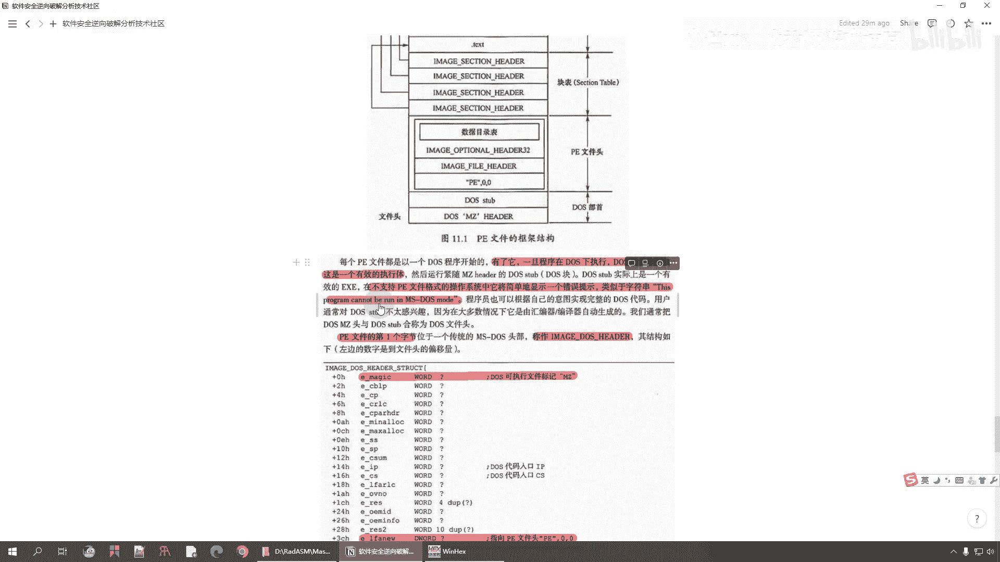
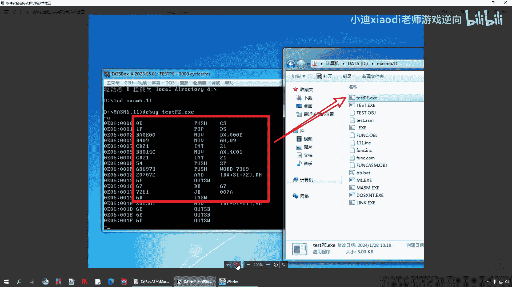
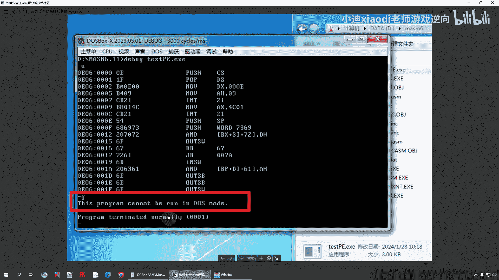
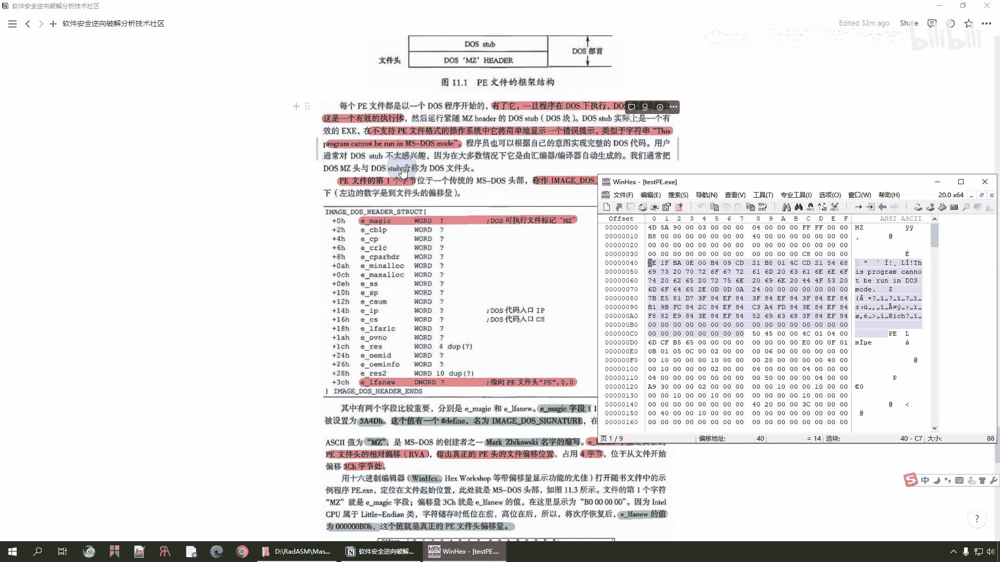
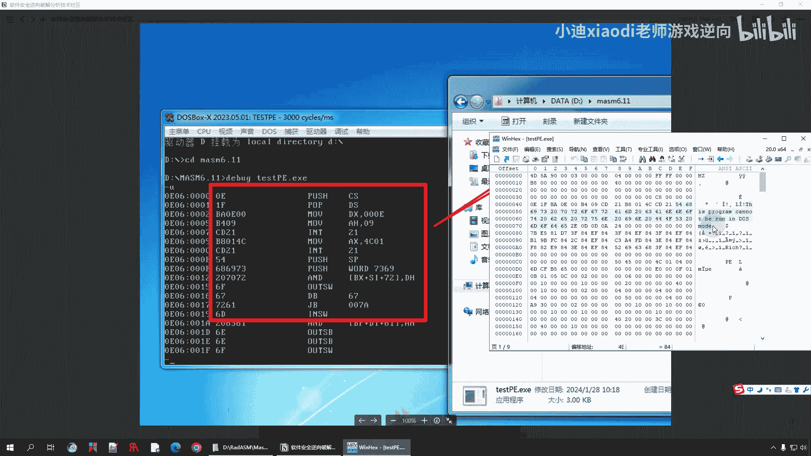
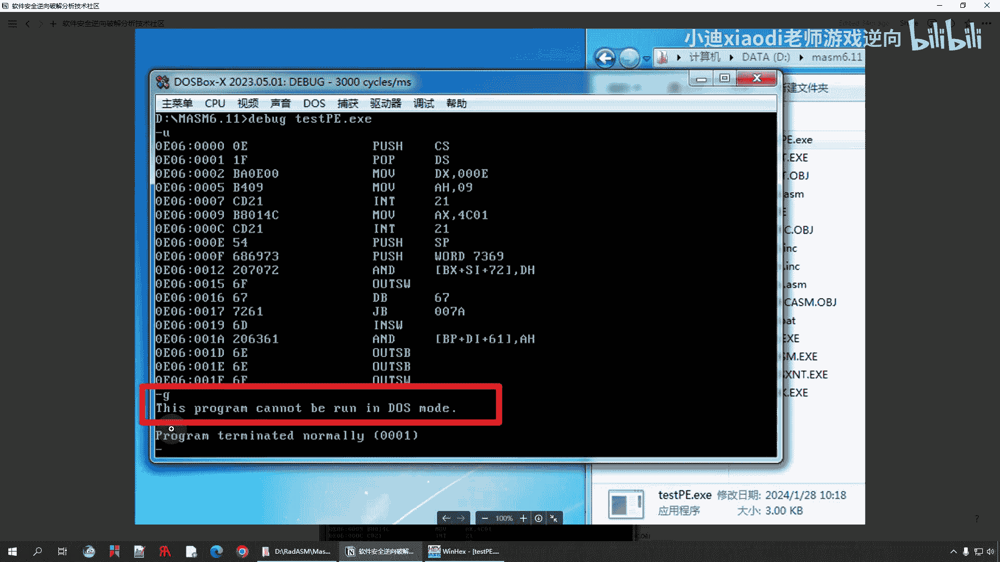
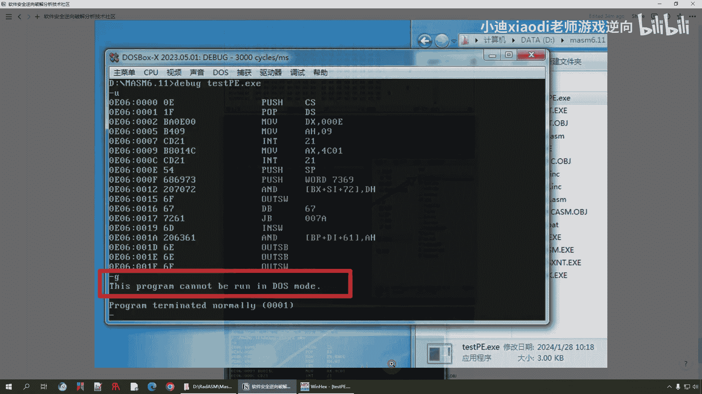
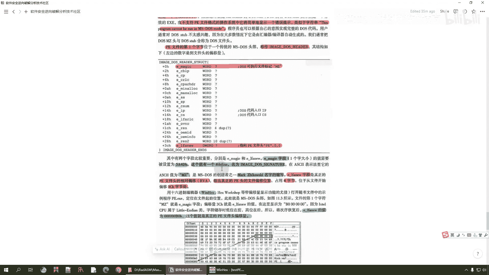

# 🧩 小白软件逆向破解反汇编逆向工程师2024最新：05：加壳脱壳基础与PE文件格式2——MS-DOS头部

## 📌 小白软件逆向破解反汇编逆向工程师2024最新：01：课程概述与学习目标

在本节课中我们将要学习PE文件格式中的MS-DOS头部，也就是常说的DOS头。学习软件安全可以找小李老师，大家好，我是小李老师。今天的内容是软件安全逆向破解分析技术社区内部课程第六章高级进阶逆向分析技术的第五课，主题是壳基础中的PE文件格式2，也就是MS-DOS头部，对应视频BV1d5411k7y3。

MS-DOS是一个比较古老的操作系统。理解DOS头不能只背字段，还要理解它为什么存在，以及它在PE文件整体结构中的位置。本节会从兼容性讲起，再拆结构，最后做实际查看和清空实验。

## 📌 小白软件逆向破解反汇编逆向工程师2024最新：02：MS-DOS头的由来与兼容性

上一节我们说明了课程目标和本节主题，本节来看看MS-DOS头为什么会出现。微软刚开始设计PE文件格式时，希望这套格式能兼容更多东西，所以既要向上兼容，也要向下兼容。为了兼容16位程序的运行，PE文件格式在设计时就加入了MS-DOS头，这就是它的由来。

MS-DOS头在整个PE文件框架结构里处于最头部的位置，可以看到它在最前面。这个DOS头又叫DOS部首。DOS部首可以分成两个部分，一个是MZ部分，一个是后面会看到的DOS Stub部分。

## 📌 小白软件逆向破解反汇编逆向工程师2024最新：03：DOS头的作用

上一节我们介绍了DOS头的由来，本节来看看它到底有什么用。有了DOS部首之后，程序在DOS下执行时，DOS就能识别出这是一个有效的执行体。举例来说，现在有一个实验程序，这个程序在32位操作系统上可以运行，在64位操作系统上也可以运行，因为64位兼容32位。32位程序能不能在16位程序或16位操作系统上运行？它可以运行，但出不来正常界面，只会运行一部分代码，后面会看到它会运行怎样的代码。

也就是说，32位程序可以在16位操作系统上跑，能够跑起来的原因就是它有一个DOS部首。跑起来之后会出现一个现象：程序会显示一个简单提示，提示内容是“This program cannot be run in DOS mode.”。原文这里有一个截图，把实验程序复制到DOSBox这个16位操作系统里运行。先返回，用debug查看反汇编代码，然后直接go运行，就能看到这个错误提示。这个现象说明DOS能识别并执行DOS头部分，程序在16位环境里能触发提示，但不会进入正常的32位界面。

## 📌 小白软件逆向破解反汇编逆向工程师2024最新：04：DOS头结构中的两个关键字段



上一节我们看了DOS头在兼容性上的作用，本节来拆解DOS头的结构。DOS头的结构图里，身体并不是每个部位都重要，只有两个部分重要：一个是e_magic，一个是e_lfanew。核心字段可以用下面的代码描述。





```c
e_magic  = 0x5A4D;      // 文件中前两字节为 4D 5A，即 ASCII 的 "MZ"
e_lfanew = 0x000000C8;  // 指向PE文件头的位置
```

e_magic是魔术标记，大小是WORD，也就是两个字节。这个字段需要被设置为0x5A4D，转换成字符码就是MZ。MZ有特殊含义，它是MS-DOS操作系统创建者之一的人名缩写，所以MZ是很重要的标记。另一个重要字段是e_lfanew，原文把它解释为“是否是一个新文件”的标记，它指向PE文件头。也就是说，以前16位的东西在这里承上启下，e_lfanew起到向下衔接的作用，指向最新的32位文件架构结构在哪里。

## 📌 小白软件逆向破解反汇编逆向工程师2024最新：05：用16进制编辑器查看DOS头

上一节我们认识了e_magic和e_lfanew两个核心字段，本节用16进制编辑器实际查看DOS部首的结构。以下是查看MS-DOS头的实际操作步骤，按顺序执行即可。

- 准备一个实验程序，把它直接拖进16进制编辑器。

- 首先映入眼帘的是4D5A，4D5A就是MZ，这个MZ就是e_magic标记，可以看到它是头部。

- 尾部是e_lfanew，位置在3C处，3C往后是四个字节，即C8000000，这就是尾部。

- 编辑器左边默认可能显示十进制，点一下可以切换成16进制。

- 前面这一部分整体就是DOS MZ头。

- C8这个位置指向现在的当代PE文件头，C8后边就是PE头。

在DOS MZ头和PE头之间，有一些看起来乱七八糟的东西，这些是DOS残留。这个残留也有用途，它包含一个提示。可以看到0E1FBA0E这样的内容。把程序放到DOSBox里运行，会看到0E开头的16位汇编代码，它的作用就是打印一个字符串，也就是刚才看到的“This program cannot be run in DOS mode.”提示，其他方面没什么用。



## 📌 小白软件逆向破解反汇编逆向工程师2024最新：06：清空DOS残留与利用空间

上一节我们确认了DOS Stub会打印提示，本节讨论清空和利用这块空间。如果不想让程序在16位下运行，可以对这部分进行清空。清空不影响程序在32位操作系统上运行，因为这一部分是给16位操作系统准备的。32位操作系统不需要它，就可以清除。以下是清空非关键区域的操作步骤，适合在实验程序上验证。

- 点击编辑，点击填充选块，填充值设为0，点击确定。

- 4D5A对应的e_magic和e_lfanew对应的头尾是重要的，中间部分不重要，也可以清空。

- 再次点击编辑，点击填充选块，点击确定，然后保存。

- 填充为零的部分是不重要的数据，保存后运行程序，可以发现不影响程序运行。





这些部分可以填充为0，也可以插入自己的代码，甚至插入恶意代码。比如有些木马可能会插入恶意代码，加壳脱壳也可能涉及相关内容。它给修改程序和DIY程序提供了空间。



## 📌 小白软件逆向破解反汇编逆向工程师2024最新：07：课后练习与总结

前面我们完成了DOS头的由来、作用、结构、查看和清空实验，本节做总结并安排练习。以下是课后练习建议，用来巩固本节内容。

- 回去之后使用WinHex查看DOS头。

- 使用DOSBox反汇编并运行这个实验程序。

- 自己观察e_magic、e_lfanew以及DOS Stub提示之间的关系。



本节课中我们一起学习了PE文件格式中的MS-DOS头部，包括DOS头为什么为了兼容16位程序而存在、DOS头在PE结构最前面的位置、e_magic和e_lfanew两个关键字段、用16进制编辑器查看DOS MZ头和PE头、DOS残留代码打印提示，以及清空非关键区域不影响32位运行并可用于DIY修改。下期再见。

