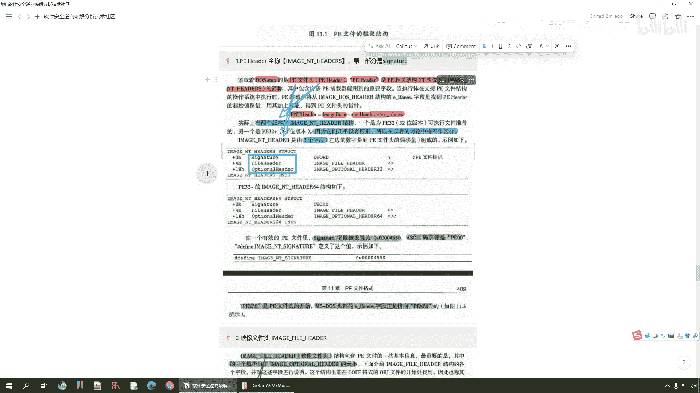
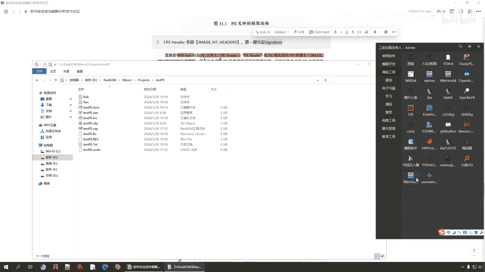
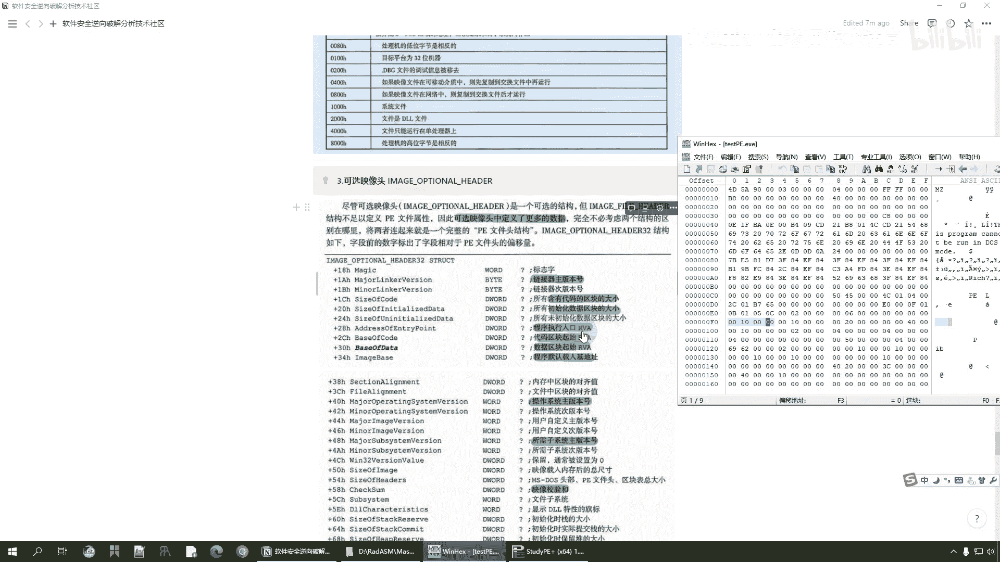
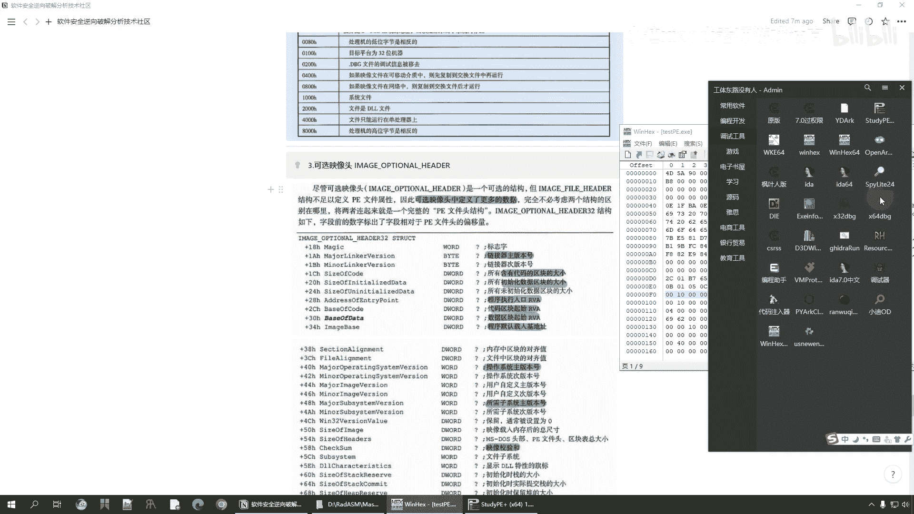
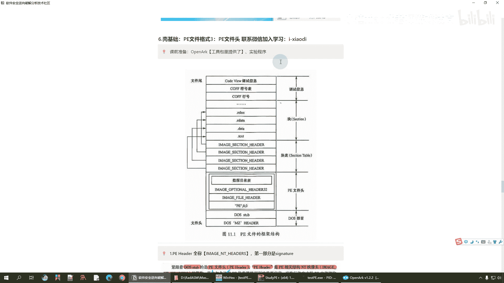

# 🧩 小白软件逆向破解反汇编逆向工程师2024最新：第六章第六课：PE文件头

## 📌 小白软件逆向破解反汇编逆向工程师2024最新：6.1：课程概述与课前准备

大家好，我是小迪老师，学习软件安全可以找小迪老师。今天是软件安全逆向破解分析技术社区第六章高级进阶逆向分析技术的第六课，主题是壳基础中的PE文件格式3：PE文件头。本次课程终于讲到PE文件头这一部分。在本节课中，我们将要学习PE文件头的整体结构、三个组成部分，以及如何用工具查看关键字段。对初学者来说，可以把PE文件头理解成程序在磁盘上的“身份证”和“基因记录”，很多运行前就确定的信息都写在这里。

上一节我们介绍了PE文件的整体框架，本节中我们来看看PE文件头的位置和别名。为了后面查看字段不迷路，先做课前准备。以下是课前需要准备的工具和程序。


- 准备OpenRK工具包，工具包中已经提供该工具。

- 准备实验程序，后面会用实验程序做查看和对照。

课前准备完成后，先回顾PE文件整体框架结构。PE文件整体框架就是这样一层一层排列的。DOS步骤是为了兼容16位程序而做出来的，所以PE文件头与DOS步骤紧挨着，PE文件头就在DOS步骤后面。PE文件头又叫PE header，PE是PE相关结构NT映像头（NT image header）的简称。之前讲过NT操作系统是Windows操作系统发展过程中非常重要的一个环节，所以NT这个名字应运而生。PE header全称是PE相关结构NT映像头，它的结构图在32位和64位下差不多，基本一模一样。

## 🏷️ 小白软件逆向破解反汇编逆向工程师2024最新：6.2：PE文件头的位置与三部分结构

上一节我们回顾了PE文件整体框架，本节中我们来看看PE文件头本身的结构。PE文件头的位置在DOS步骤之后，它和DOS步骤紧挨着。理解这一点后，后面用工具定位字段会更容易。PE文件头可以先用一个简单公式表示，核心概念如下。

```text
PE Header = Signature + File Header + Optional Header
```



PE文件头分为三个部分。以下是三个部分的划分和各自作用。



- 第一部分是Signature，也就是标记，用来表明这里是PE文件头。

- 第二部分是File Header，也就是映像文件头，里面记录运行平台、区块数量、时间戳等信息。

- 第三部分是Optional Header，也就是可选头，里面记录程序入口、代码区块地址、数据区块地址、默认载入基地址等信息。

第三部分比较特殊，它里面还有一些数据目录表，这部分后面有机会再说。为了好讲，先按三个环节讲就可以。第一部分Signature和DOS magic差不多，它就是一个标记，这个标记被设置为`0x00004550`，也就是字符串`"PE\0\0"`。换一种写法如下。

```text
Signature = "PE\0\0"
十六进制字节 = 50 45 00 00
按双字小端读作 = 0x00004550
```

到这里我们知道了PE文件头的三个部分，下一节中我们来看看如何用WinHex在实验程序里找到Signature。

## 🔍 小白软件逆向破解反汇编逆向工程师2024最新：6.3：用WinHex查看Signature

上一节我们介绍了PE文件头的三个部分，本节中我们来看看Signature在文件里长什么样。使用WinHex可以直观看到文件字节。现在WinHex已经打开，也可以重新打开：点击相应位置，把程序关掉，再把实验程序拖过来。拖过来之后，这就是我们那个文件。在WinHex中能看到DOS相关区域，最后这个位置指向PE文件头的一个位置，也就是偏移C8。我们可以点击左边，转换成16进制视图。现在这里是C0，走到C8，C8处几个字节就是PE标记。标记之后加4的位置就是下一部分。

为了更清楚，以下是查看Signature时可以采用的步骤。

- 用WinHex打开实验程序。

- 将左侧视图切换为16进制显示。

- 定位到PE文件头偏移位置C8。

- 查看C8处的几个字节，确认PE标记。

完成Signature查看后，本节中我们知道了PE文件头开头有一个明确标记。下一节中我们来看看标记后面的映像文件头。

## 🧾 小白软件逆向破解反汇编逆向工程师2024最新：6.4：映像文件头中的运行平台与区块数

上一节我们找到了PE文件头开头的Signature，本节中我们来看看第二部分映像文件头。第二部分映像文件头的结构就在这里，加4就是运行平台字段，工具会把一些详细信息列出来。这个文件里运行平台字段可以查看它的大小和值，原文查看时提到两个字节，工具中显示为`014C`。`014C`是机器类型标志，`014C`就是Intel 386 CPU，说明这个程序可以运行在这个CPU平台上。再往下是WORD类型的文件区块数，值为`0004`，说明这个程序有4个区块。可以用StarPE拖过来查看，点击区块能看到1、2、3、4，正好四个区块，和字段对上了。

为了把这一部分的字段关系看清楚，以下是本小节涉及的几个核心概念。

```text
Machine = 0x014C          // Intel 386 CPU
NumberOfSections = 0x0004 // 文件中有4个区块
```

再往下是文件创建日期和时间，字段是DWORD，4个字节，值为`65B702C`。这个值直接看不出来是文件创建日期，因为它表示自1970年1月1日以来按格林威治时间计算的秒数。这个秒数要变成可读字符串，需要用到`ctime`函数，另一个对字段有用的函数是`GMtime`。我们不需要自己写程序调用函数，可以用StarPE拖过来，点击PE文件头，里面有一个时间戳，名字就叫时间戳。`65B702C`对上了，点击时间计算器可以看到2024年1月29日9点36分44秒，非常精确。

时间戳之后还有一些字段，不是很重要，简单了解即可。比如文件属性字段，可以说明这是系统文件、DDE文件，还是其他什么文件。相关笔记会发到社区，简单看一下就可以。到这里我们看完了映像文件头里的几个关键字段，下一节中我们来看看可选头。

## 🧩 小白软件逆向破解反汇编逆向工程师2024最新：6.5：可选头中的链接器版本与程序入口

上一节我们介绍了映像文件头，本节中我们来看看第三部分可选头。可选头的大小可以从PE加04的WORD位置开始看，原文中讲到按16字节步进，一直加到16的位置，从那个位置开始就是第三部分可选头。到了加18的位置，因为紧挨着上面的就是下面的，承上启下，这里开始有标志字和链接器版本信息。第一个WORD是标志字，标志字不知道具体用途时可以暂时了解。接着链接器主版本号是BYTE，值为`05`，链接器次版本号是`0C`，所以链接器版本号是`05.0C`。用StarPE拖过来，点击PE文件头，可以看到链接器版本，开发平台是`05.0C`，实践和猜想再次对上。





可选头中加28的位置是程序执行入口RVA，字段是DWORD，4个字节，值为`00001000`。这里表示程序执行入口的相对虚拟偏移，也就是相对虚拟地址。打开实验程序，点击符号，能看到模块名，双击过去可以看到`00401000`，程序从`1000`开始，所以程序执行入口是`1000`。代码区块起始地址也是`1000`，和这个四个字节对得上。数据区块起始的相对虚拟地址可以点击内存布局查看，数据区块IDAT是`2000`，字段也是`2000`，同样对上了。程序默认载入基地址是4个字节，值为`00400000`，点击符号可以看到`00400000`，基值也对上了。这说明程序运行起来之前，在它趴在磁盘上的时候，这些信息就已经刻在它的基因里了。

为了把本小节的关键字段放在一起看，以下是可选头中常见的核心概念。

```text
AddressOfEntryPoint = 0x00001000 // 程序执行入口RVA
BaseOfCode = 0x00001000          // 代码区块起始RVA
BaseOfData = 0x00002000          // 数据区块起始RVA
ImageBase = 0x00400000           // 程序默认载入基地址
LinkerVersion = 05.0C            // 链接器版本
```

加28之后一直加到78的位置，78附近就是结尾，也就是数据目录表。最后一个部分里面包含一个小的数据目录表，相关细节后面有时间再说。到这里我们看完了可选头里的重要字段，下一节中我们用OpenRK从宏观上再看一遍。

## 🧭 小白软件逆向破解反汇编逆向工程师2024最新：6.6：用OpenRK宏观查看PE文件头

上一节我们逐个查看了可选头字段，本节中我们来看看如何从宏观上整体查看PE文件头。OpenRK在工具包里也有提供，点击OpenRK运行起来。运行起来之后，点击扫描器，把实验程序拖到扫描器里，然后点击PE文件头。可以先看基本信息，程序的基本信息都在这里。再点击PE文件头，把FileHeader展开，就是现在的PE文件头。第一个部分是Signature，也就是PE标记。可以对一下答案，比如时间戳，工具里都是英文标记，英文标记可以和教材里的字段名对应上，也可以和原来的名字对应上。再展开还能看到数据目录表，后边有机会再说。我们先讲一些比较重要的标记。

为了便于复习，以下是使用OpenRK观察时建议关注的对象的说明。

- 先看基本信息，建立程序整体印象。

- 再展开FileHeader，对照Signature、时间戳等字段。

- 最后展开数据目录表，知道它存在即可，细节后续再讲。

通过OpenRK可以把前面用WinHex和StarPE看到的零散字段串起来。到这里我们完成了PE文件头的宏观查看，下一节中我们来做作业并总结本课。

## 📝 小白软件逆向破解反汇编逆向工程师2024最新：6.7：作业与课程总结

上一节我们用OpenRK从宏观上查看了PE文件头，本节中我们来做作业并总结。今天给大家留一个作业：自己拿StarPE去查看连接器版本、时间戳、代码段入口、数据段入口、程序默认基址。前面这几个数我们都看了，时间戳也看了，大家自己再瞅一瞅，加深印象。以下是作业中建议对照检查的项目。

- 用StarPE查看连接器版本。

- 用StarPE查看时间戳。

- 用StarPE查看代码段入口。

- 用StarPE查看数据段入口。

- 用StarPE查看程序默认基址。



本节课中我们一起学习了PE文件头的位置、三部分结构、Signature标记、映像文件头中的运行平台与区块数、时间戳、可选头中的链接器版本、程序入口、代码区块地址、数据区块地址、默认载入基地址，以及如何用WinHex、StarPE和OpenRK查看这些字段。PE文件头就像程序在磁盘上的基因记录，很多信息在程序运行前就已经写好。想加入社区学习的可以抓紧加入学习，年前是最优惠的机会，联系微信加入学习，把最好的最新的优惠留给你。下期再见。

