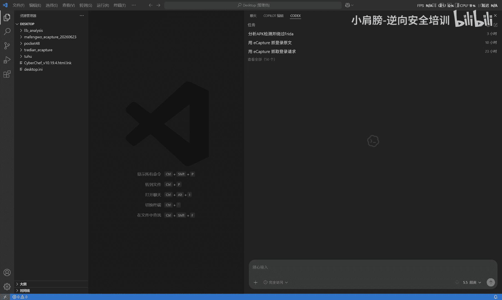
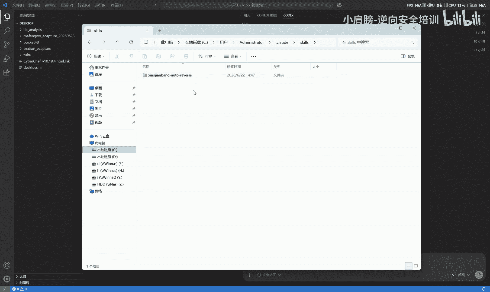
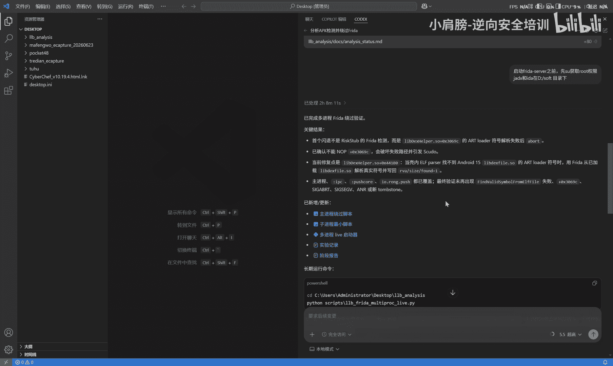
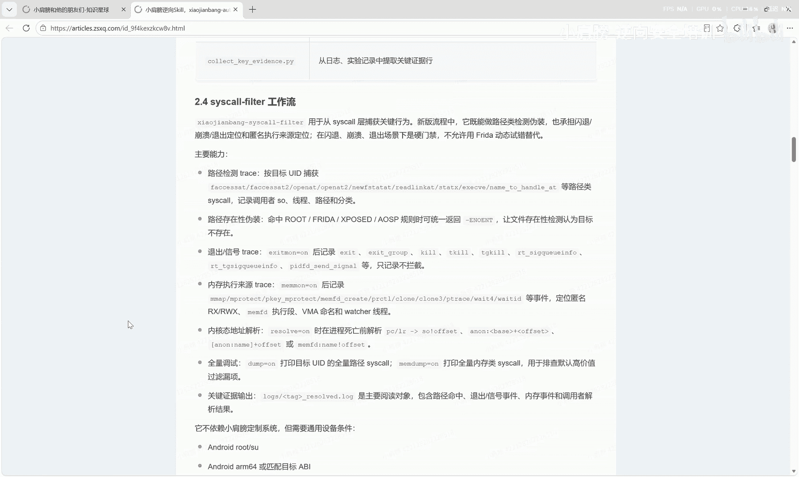
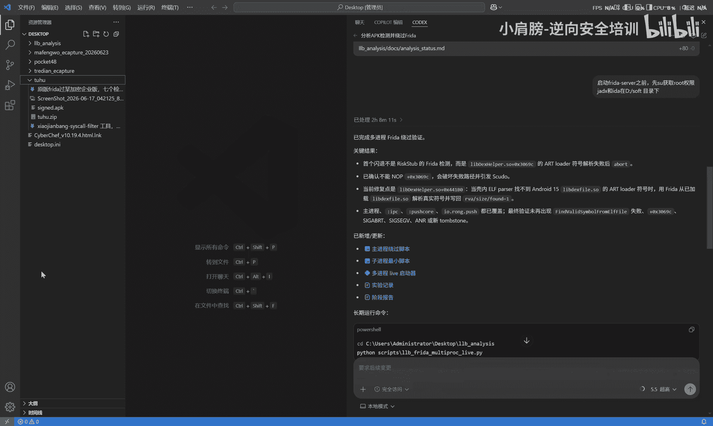
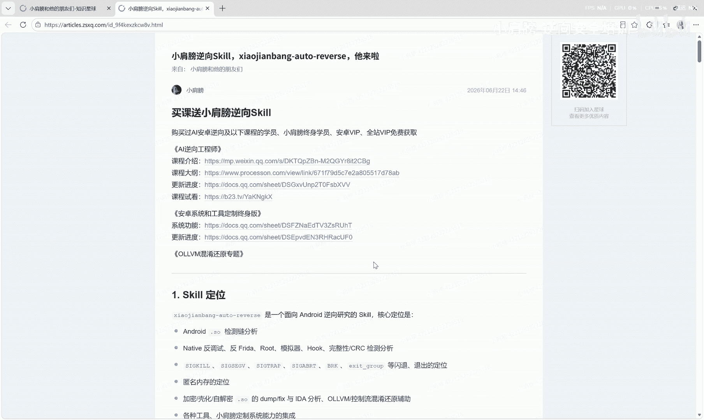

## 🧭 小肩膀自动逆向Skill：01：课程概述与安装位置



在本节课中我们将要学习小肩膀自动安卓逆向 Skill 的使用方法。原文强调这个 Skill 的用法不复杂，核心就是把 Skill 放到对应客户端的 skills 目录中，然后让 AI 按工作流执行抓包、参数分析、算法还原和请求复现等任务。

安装时先看核心概念：Skill 的安装位置可以理解为“用户目录下的 skills 目录”。如果使用 Codex，就放到 Codex 的 skills 目录；如果使用 Claude，就放到 Claude 的 skills 目录。目录里面放的就是 Skill 所需内容。

```text
Codex:  ~/.codex/skills/
Claude: ~/.claude/skills/
```

这个 Skill 支持 Claude Code 和 Codex，其他客户端原文没有测试。该系统支持 Windows、Linux、macOS，但原文只说明在 Windows 系统和“6系统”上测试过，这里按原文理解为 Linux 系统。把 Skill 放好之后，就可以开始看实际效果。

## 🧪 小肩膀自动逆向Skill：02：简单案例效果演示

上一节我们介绍了 Skill 的安装位置，本节中我们来看看几个实际案例的效果。第一个案例是原文前一天做的案例，提示词非常简单，只让 AI 使用 Skill 进行操作，实操抓包，登录过程是手动点击的。抓包完成后得到数据包，该案例的请求使用“HT标点名协议”，所以需要额外解析，然后让 AI 分析数据包里面的参数、数据包里的其他参数以及 native 里面的参数，最后复现登录请求。这个案例存在魔改算法，原文提到的“3一”是魔改过的，有了 Skill 后这些内容都能自动处理，提示词很少也能完成案例。

以下是原文提到的几个案例及操作过程，便于理解 Skill 能覆盖哪些环节。

- 第二个案例使用 Skill 里面的 ecapture 去进行抓包（原文“招高”），登录同样手动点击，然后让 AI 给出抓包原文，得到抓到的数据后，再让 AI 分析数据包里面的参数，分析 native 里面的参数，最后用 Python 程序复现登录请求，提示词也非常少。
- 第三个案例同样使用 Skill，让 AI 抓登录请求并给出原文，然后查看里面的加密参数，再让 AI 还原参数，并用 Python 复现登录请求，AI 完成分析。这个案例比较简单，原文说它没有涉及 SO，准确说是涉及了 SO，但不通过逆向 SO 也能够搞定；它把几个值传到 MD5 函数里面，而这个 MD5 在 native 函数里面实现，AI 通过猜算法把几个值拼接后直接得到结果。
- 第四个案例的提示词仍然非常少，只告诉 AI 使用 Skill 过掉里面的检测。AI 首先做分析，更新完毕后由于没有找到设备上的 JIDS 和 IDA，所以停下来，随后把 JIDS 和 IDA 的路径给 AI，接着 AI 自动分析，最终绕过检测。该案例是某仿加固，AI 总共分析大约 3 个小时。

从这些案例可以看到，原文中的几个案例只用到 Skill 里面的一部分功能。下面是简单提示词的示意，原文的题词风格就是尽量少描述，把操作交给 Skill 工作流。

> 示例提示词：使用 Skill 抓包，分析参数，并复现登录请求。



看完案例后，我们继续看 Skill 里面更完整的功能范围。

## 🧩 小肩膀自动逆向Skill：03：SO 定位与主要功能

上一节我们看了几个简单案例，本节中我们来看看 Skill 里面更完整的功能。首先是 SO 定位，这个 Skill 主要用来逆向 SO，例如分析 SO 里面的检测链。一个 APP 里面不一定只有一个 SO 去检测，Skill 会自动逐个分析，并分析里面的反调试、反 Frida、root、模拟器、hook 检测、完整性 CRC 检测等内容。如果检测的表现是让 APP 崩溃或退出，Skill 里面也有相应工具去定位，会捕获系统调用和信号来定位闪退和退出的位置。

很多 SO 的检测代码不是直接写在 SO 里面，而是通过申请匿名内存，把检测代码写到匿名内存里面再进行检测。Skill 里面的工具可以进行匿名内存定位。Skill 还集成了 SO 脱壳修复、IDA 数据导出以及 OLLVM 还原脚本，也集成了小肩膀定制系统的能力。所以这不是一个简单脚本，而是一整套工作流，用来指导 AI 进行分析。这部分内容可以自行简单查看。

以下是 SO 定位和主要功能的核心概念概括，帮助初学者理解工作流在做什么。

```text
SO 检测链分析 = 多 SO 定位 + 反调试/反 Frida/root/模拟器/hook/完整性检测分析
```



介绍完主要功能后，我们继续看里面比较重要的工具和配套能力。

## 🛠️ 小肩膀自动逆向Skill：04：重要工具 syscall filter 与配套能力

上一节我们介绍了 SO 定位和主要功能，本节中我们来看看几个重要工具。比较重要的工具之一是 syscall filter（原文“sysnical filter”），这个工具本来没有，是在搞案例的时候开发的。该案例是爱加密企业版的检测，爱加密企业版的 SO 挺多，但最先要搞定的是两个，一个是 libbESEC.so，一个是 libbESEC梦.so。当时先把 libbEXEC.so 的检测过掉，但加载 ESEC梦.so 的时候被 EXEC.so 追杀，也就是说它里面还有其他线程，并不是立即杀死进程，而是等其他 SO 加载之后再杀。这个时候如果没有工具去定位，分析会比较难，因为根本不知道是哪个地方导致闪退，可能误以为是其他 SO 导致的崩溃，然后去分析其他 SO。有了这个工具，就可以准确定位到它在哪个地方闪退。



以下是该工具可以捕获和定位的主要内容，原文对这些能力做了较详细的说明。

- 路径检测：例如调用相关 SN 扣做检测，主要用于检测一些路径。
- 捕获退出和 exact kill 相关事件：原文这里没有写信号，之后还补充了捕获信号。
- 捕获信号：退出是指 APP 里面调用相关系统调用进行退出；信号是指 APP 里面没有调用相关系统调用进行退出，也能够捕获，例如通过访问非法地址让 APP 崩溃，或者构造栈不平衡让 APP 崩溃。总之有很多种方法让 APP 崩溃，并不一定要调用退出函数，这时可以通过信号捕获。
- 捕获后定位崩溃位置：会得到 SO 地址或者匿名内存地址以及所处偏移。
- 定位匿名内存：现在的 SO 检测并不简单地在当前 SO 里面，更倾向于申请匿名内存，在匿名内存里加载检测代码进行检测；直接反编译 SO 看不到检测代码，需要定位到匿名内存，把这段匿名内存 dump 修复后，才可以看到检测代码。

这个工具虽然由原文作者开发，但没有限定必须使用小肩膀定制系统，只要设备有 root 就可以用。该 Skill 还包含在 IDA 里面把 SO 相关数据导出来提供给 AI 分析的工具，以及还原 SO 混淆的工具。无痕 hook 是在分析某加固案例时开发的，当时存在 Frida 检测，要使用 Frida 就必须先过掉 Frida 检测，于是开发了无痕 hook。无痕 hook 依赖硬件断点，是内核层的无痕 hook，一般 APP 检测不到；它唯一能检测的是硬件断点有没有被占用，因为一般每个线程最多有 6 个硬件断点。Skill 还集成了抓包功能，对转化层也有相应处理，但主要还是用来做出联搜（原文如此）。同时集成了小肩膀定制系统的能力，定制系统的意思是修改安卓系统来辅助逆向。

以下是定位闪退位置的核心公式，便于理解工具输出与崩溃位置之间的关系。

```text
闪退位置 = 捕获系统调用/信号 -> SO 地址或匿名内存地址 + 偏移
```

看完工具能力后，我们继续看使用 Skill 需要准备的环境、设备和定制系统条件。

## ⚙️ 小肩膀自动逆向Skill：05：依赖、设备与定制系统

上一节我们介绍了重要工具和配套能力，本节中我们来看看使用条件。Skill 在三个系统上都支持，但需要自己额外安装一些东西，例如 Python、AP、frida（原文“fidda”）。这几个可以不用手动安装，AI 会自动安装；JDK、IDA、JIDS 需要自己安装。设备要求是内核 5.4 以上，一般是 P5、P6 以及更高设备。这个内核版本要求主要用于两个工具，一个是无痕 hooker，一个是系统调用定位，这两个工具需要安装内核模块，而内核模块对内核版本有要求。

以下是使用前需要准备和注意的事项，原文把环境依赖和设备条件集中讲了一遍。

```text
设备内核 >= 5.4
```

如果要用小肩膀定制系统的功能，就需要刷小肩膀定制系统；如果只用其他功能，那么任何设备都可以，只要满足内核要求，并且使用的是 apparache root 就可以。定制系统里面的功能使用起来可能比较麻烦，但 Skill 集成了相应的使用方法。只要使用小肩膀定制系统，AI 就能直接操作整体加固脱壳、初级加固脱壳、native 函数监听、论 EO 的注入，主要是这几项功能。定制系统还做了一些防检测适配。

环境条件讲完后，我们来看一个常见问题：Skill 这么强大，是否还需要学习逆向。

## 🧠 小肩膀自动逆向Skill：06：是否需要继续学习逆向

上一节我们介绍了依赖和设备条件，本节中我们来看看是否还需要安装逆向环境、是否还需要学习逆向。原文的结论是仍然需要。因为 AI 在进行逆向时很容易跑偏，为了防止它跑偏，Skill 里面加了相应约束，规定了工作流程，也提供了相应工具。但是案例是无穷变化的，将来碰到的案例可能没有在 Skill 的规定范围里面。如果完全不懂，让 AI 去分析，它有可能跑不出来，可能跑几天也没有解决案例，浪费的 token 费用足够购买课程。

如果自己会一点，再加上这个 Skill，上限会更高。应该把 Skill 当成减轻工作量的工具，而不是完全依赖它。简单来说还是要学一点，只是可能不用像以前那样学那么多基础，要把重心放在学习逆向思路、逆向流程上面。下面这个引用可以概括原文的提示词风格：提示词不复杂，重点是把任务和工具交给 Skill。

> 使用 Skill 抓包，给出原文，分析加密参数，并复现登录请求。

理解了这个学习建议后，我们对整节课内容做一次收束。

## ✅ 小肩膀自动逆向Skill：07：课程总结



本节课中我们一起学习了小肩膀自动安卓逆向 Skill 的安装位置、支持环境、案例效果、SO 定位功能、syscall filter 工具、配套能力、设备依赖、定制系统条件以及是否需要继续学习逆向。核心安装方式是放入 Codex 或 Claude 的 skills 目录；核心工作流是让 AI 按抓包、参数分析、算法还原和 Python 复现的流程执行；核心使用原则是把 Skill 当作减轻工作量的工具，同时保留一定的逆向思路和流程学习，避免完全依赖 AI 导致分析跑偏。

