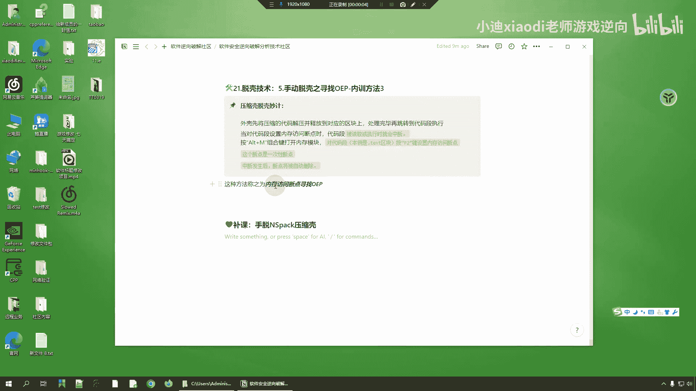
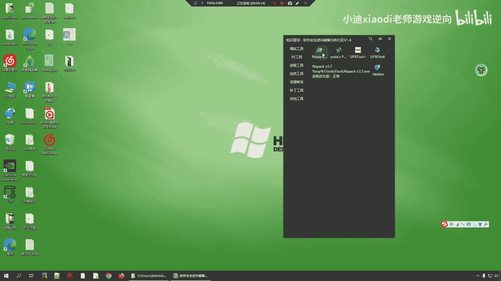
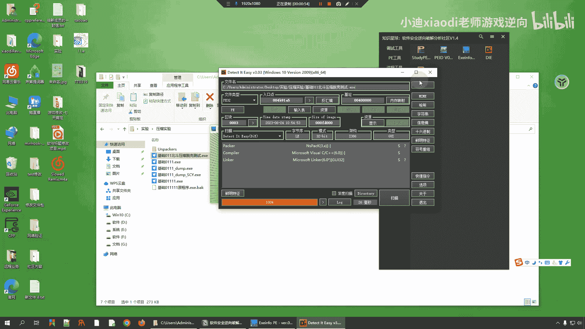
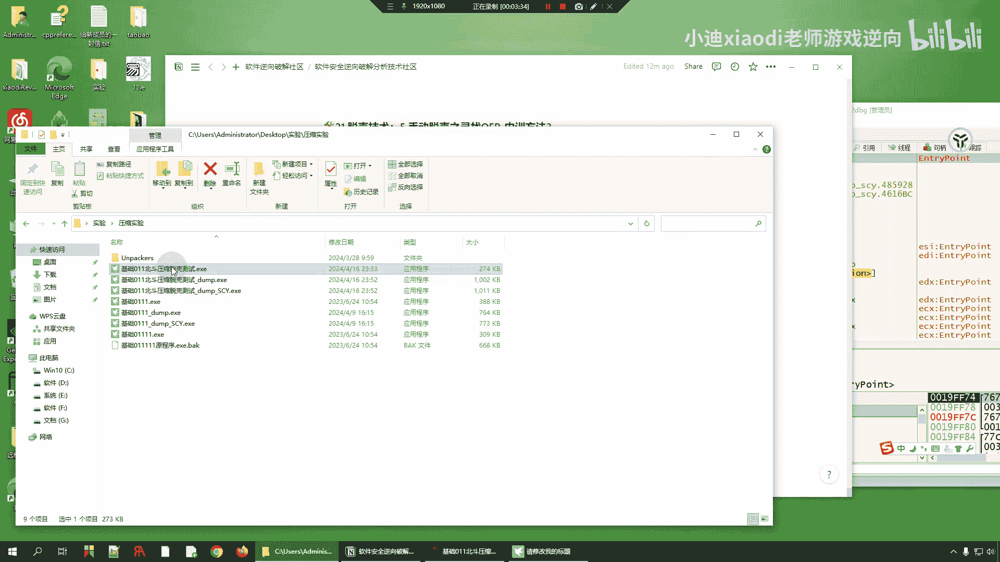

# 🧰 逆向脱壳技术：01：手脱NSpack压缩壳

本节课程由小李老师讲解，主题是手脱 NSpack 压缩壳。本课会先认识 NSpack 的压缩工具和查壳结果，再讲用 ESP 定律法（堆栈平衡法）找到 OEP，最后完成 dump、修复并验证脱壳程序。整个流程适合游戏安全、软件安全、网络安全和 CTF 比赛入门学习，也是软件破解、反汇编、逆向安全工程师需要掌握的基础。为了便于理解，本节把“加壳”和“脱壳”拆成可操作步骤，先查清壳类型，再按步骤调试。下面从压缩壳工具和查壳开始。

## 📦 逆向脱壳技术：01.1：认识NSpack压缩壳与查壳

上一段我们明确了本课目标，本节来看看 NSpack 是什么，以及怎样确认程序是否被它加壳。NSpack 是一款国产压缩壳，原文口播中的 NSp、NSpeg 等名称，实际指向 NSpack，也就是常说的北斗压缩。这个 NSpack 加壳程序放在知识星球“软件安全逆向破解分析社区”的工具包中，位于加壳程序目录里的第一个。打开后会看到对应界面，把想加壳的程序直接拖进去，再点击压缩即可；它的压缩效率比较高，原文示例压缩后的程序大小为 **274KB**，比 UPX（原文口播为 UPS/UPSX）要小很多。



本次演示所用程序已经提前压缩好，接下来需要先查壳确认类型。以下是查壳时可以使用的操作和工具信息：



- 使用查壳程序检查加壳后的程序。
- 点击 PE 工具，并分别用 ExeInfo PE（原文口播为 Ees info）和 DIE 打开查看。
- 查壳结果显示为 **NSpack**，也就是 NSp、北斗压缩。
- 再把程序拖到 ExeInfo PE 中检查，结果同样是 **NSpack / 北斗压缩**。

从入口区段看，NSpack 的特征与 UPX 大同小异：它会把代码段、数据段、只读数据段和资源段整体压缩，并把所有区段名字统一修改；程序运行起来后，才进行正确解压，再把内容分配到各个区块中。可以用下面的公式概括这种压缩壳的工作方式：



```text
加壳程序 = 压缩(代码段 + 数据段 + 只读数据段 + 资源段) + 修改区段名
运行时 = 解压并回填到各区块
```

理解了壳的特征后，下一步就是上手脱壳。脱壳方法有多种，原文提到内存访问断点法、ESP 定律法和单步跟踪法；在这个阶段，ESP 定律法比较合适，它也叫堆栈平衡法。下面进入实际调试。

## 🛠️ 逆向脱壳技术：01.2：用ESP定律法找到OEP

上一节我们完成了查壳并认识了 NSpack 的区段特征，本节来看看怎样用 ESP 定律法找到 OEP。操作上先打开 x32dbg，把加壳程序直接拖进去。拖入后会看到保存寄存器环境的代码，此时按 F8 单步执行，ESP 会变成红色，说明寄存器环境已经被保存。接着在内存窗口中转到“下一个硬件访问断点”；如果之前设置过，就重新设置一次硬件访问断点。设置好后运行程序，它会自动执行到访问 ESP、更改 ESP 的位置，此时 ESP 变成 **F74**。到这一步再按 F8，就能来到一个 OEP 位置。

可以把关键判断浓缩成下面的代码式流程：

```text
F8 单步 -> ESP 变红 -> 设置硬件访问断点 -> 运行
运行到 ESP 被改写 -> 再按 F8 -> 到达 OEP
```

到达 OEP 后，点击插件，使用 IAT 搜索并点击 Get，然后点击保存。此时保存下来的文件有点问题，需要修复 dump，再点击打开。查看程序大小时，可以看到它从 **274KB** 解压成了 **1011KB**。运行一下，程序解压成功，这说明用 ESP 定律法手脱 NSpack 压缩壳的流程已经走通。这个流程看起来步骤不多，但每一步都在确认程序从壳代码回到原程序入口，因此对初学者来说，重点是把“ESP 变红、硬件断点、运行到改写、F8 到 OEP”这一串动作练熟。

## ✅ 逆向脱壳技术：01.3：验证脱壳结果与课程总结

上一节我们完成了 dump 和修复，本节来验证脱壳结果，并回顾整个方法。脱壳完成后，程序会自动在 OEP 处执行。可以关掉加壳的程序，把脱壳后的程序直接拖过来；此时它会直接在 OEP 位置执行程序原来的代码。这样就说明脱壳后的文件能够正常运行，也验证了前面的操作有效。

以下是本课需要记住的收尾要点：

- 脱壳后的程序会在 OEP 处执行原程序代码。
- 关闭加壳程序后，把脱壳后的程序拖入即可验证。
- 本次演示的 NSpack 压缩程序会放到知识星球社区，便于自行练习。
- 课后应自己动手试一遍完整流程，下集再见。



本节课中我们一起学习了手脱 NSpack 压缩壳：先认识国产 NSpack（北斗压缩）的压缩方式和查壳特征，再用 ESP 定律法（堆栈平衡法）定位 OEP，随后进行 dump、修复，并通过程序大小变化和实际运行验证脱壳结果。整个教程围绕“先查壳、再调试、后 dump 修复、最后验证”的顺序展开，适合作为逆向脱壳入门的基础练习。
