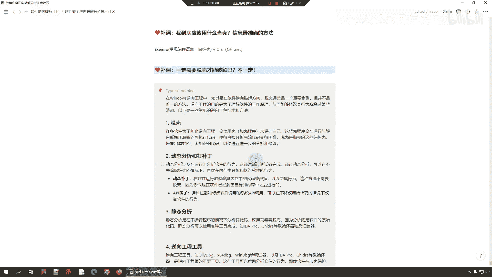
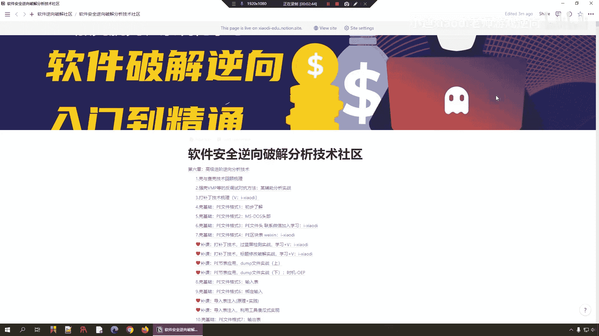
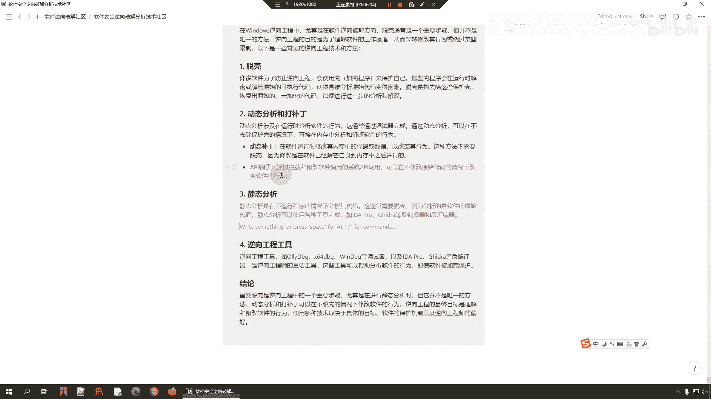
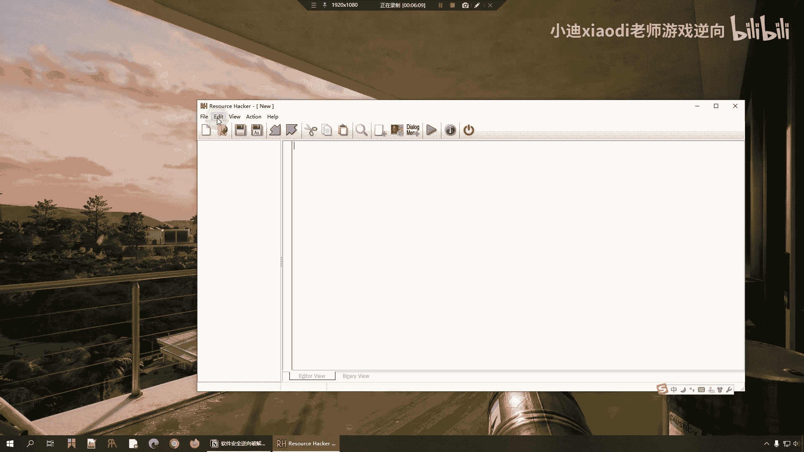
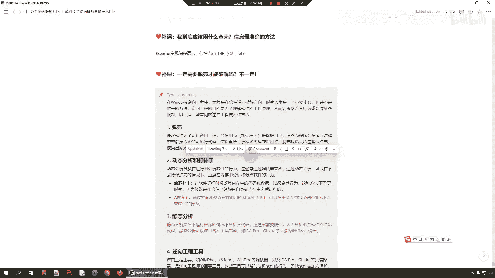

# 🧭 软件安全逆向破解：第六章-第4次补课-01：课程说明与本节目标

大家好，我是小迪老师；学习软件安全逆向破解可以找小李老师。本节属于第六章“高级进阶逆向分析技术”，是第16课之后的第四次补课。想学习的朋友可以联系，现在有最新优惠。通过以往的公开内容，大家可以了解到我们这边是国内最实惠且最全面的内容，讲解循循善诱，听起来如沐春风。

本节要讨论的问题是：一定要脱壳才能破解吗？答案是：不一定。因为接下来要讲脱壳，所以先把脱壳和破解之间的联系理清，并说明这种联系会影响分析方向和分析行为。本节就是一次答疑解惑，用大白话说明脱壳与破解的关系。

# 🔐 软件安全逆向破解：第六章-第4次补课-02：壳与脱壳的基本关系

在Windows逆向工程中，尤其在软件逆向破解方向，脱壳通常是一个重要步骤，但没有说一定，脱壳并不是唯一方法。换句话说，脱壳很重要，但破解不一定只有脱壳这一条路。

许多软件为了防止逆向工程，会使用壳来保护自己，也就是通过一些加壳程序来保护程序。下面列出常见壳类型及其作用，方便初学者建立整体认识。

- 压缩壳：主要用于压缩，同时也起到一定防护作用。
- 加密壳：对程序内容进行加密保护。
- 虚拟保护壳：通过虚拟化保护方式提高分析难度。

这些壳程序会在运行时解密或解压原始的可执行代码，使直接分析原始代码变得困难。加壳之后，代码会变形或加密；脱壳之后，代码会还原，出现原始的未加密代码。这样再去修改程序或破解版权就更方便，这就是脱壳的作用，也是为什么会出现脱壳这件事。

可以用下面的公式理解加壳与脱壳的关系：

```text
加壳(原始代码) = 加密或压缩后的代码
脱壳(加密或压缩后的代码) = 原始代码
```

加壳会影响分析，因此需要脱壳，这是脱壳的第一个原因。接下来看动态分析，因为动态分析可以在不脱壳的情况下继续分析程序。

# 🛠️ 软件安全逆向破解：第六章-第4次补课-03：动态分析是否必须脱壳

动态分析和W0（原文中的工具表述）之前已经讲过，现在一直使用动态分析。动态分析就是程序运行起来之后，通过调试器分析软件行为，原文提到的工具包括32Ddebug和64点bug（原文表述，通常对应x32dbg与x64dbg）。分析时可以回忆打补丁的过程。

之前讲过墙壳VMP（原文也写作枪壳VMP），例如有一个辅助程序加了墙壳，分析方式是先运行程序，然后直接附加。加壳会影响分析，但不是完全不能分析，实际上仍然可以继续分析，方式就是用工具做动态分析。动态分析可以在不去除保护壳的情况下进行分析。





可以用下面的代码概括这种思路：

```text
先运行程序
再用调试器附加进程
在运行状态下观察并分析行为
```

讲完动态分析，会发现它可以在不脱壳的情况下分析程序。接下来顺带讲动态补丁技术，它也是不脱壳破解的重要思路。

# 🩹 软件安全逆向破解：第六章-第4次补课-04：动态补丁与不脱壳破解

动态补丁不是把修改后的代码直接保存到原文件，而是通过一个外部工具动态修改运行中的程序数据。动态补丁属于一种破解方式，通过外部工具动态修改运行中的程序完全可以。

可以用下面的公式描述动态补丁：

```text
动态补丁 = 外部工具 + 运行中的程序 + 动态修改数据
```

动态补丁说明，破解不一定需要先把壳脱掉。接下来看API钩子，它也是在不脱壳情况下影响程序行为的一种方式。

# 🪝 软件安全逆向破解：第六章-第4次补课-05：API钩子与机器码修改

API钩子用于检测网卡信息或检测本地机器码这类场景。程序检测这些信息时，实际上要调用系统API，因此可以进行API Hook，把API钩住，然后修改它返回的本地机器码信息，再返回给软件一个能正常运行或破解成功的机器码。这个思路在游戏外挂上也适用。

例如腾讯会封机器：如果一台电脑开关开得多了，就会封机器。封机器的方式是通过系统API检测网卡信息、检测硬盘信息，因此可以对这些API进行Hook。钩住之后返回正常或合法的信息，这样游戏虽然封了机器，游戏仍然可以正常运行。腾讯以及Steam上很多大型网游都会这样做。

可以用下面的公式理解API钩子：

```text
API Hook = 拦截系统API + 修改返回值 + 返回合法信息
```

动态分析和API钩子说明，不脱壳也能影响程序行为。接下来看静态分析，因为静态分析通常和脱壳关系更密切。

# 🔍 软件安全逆向破解：第六章-第4次补课-06：静态分析与脱壳的关系

静态分析是在不运行程序的时候分析代码，这个时候通常需要脱壳。静态分析目前还没有讲到，后面会说，这里先简单听，并做高亮提示。静态分析有一个很典型的例子，就是打开Resource Hacker（原文写作result hacker与ressource hacker）分析程序。

使用Resource Hacker分析程序时，并没有把程序运行起来再处理，而是在程序不运行时直接修改版权或修改菜单，这就是静态处理过程。静态就是不运行程序。



可以用下面的公式描述静态分析：

```text
静态分析 = 不运行程序 + 直接分析或修改代码与资源
```



静态分析通常需要脱壳，但动态分析、动态补丁和API钩子提供了不脱壳的替代路径。接下来把结论收束起来，并总结本节思路。

# 🧾 软件安全逆向破解：第六章-第4次补课-07：结论与本节总结

原文提到一些名词解释，这里不展开。结论是：脱壳是逆向工程中的重要步骤，尤其在静态分析中，但脱壳并不是唯一方法。动态分析、动态补丁可以在不脱壳的情况下修改软件行为，最终也可以实现软件逆向破解。

> 结论：不是一定需要脱壳才能破解。动态分析找到关键点后打补丁，也可以完成破解。

虽然接下来要讲脱壳，但要记住：不是一定需要脱壳才能破解。动态分析找到关键点，然后打补丁就可以。把思路捋一捋之后，后面再讲脱壳。



本节课中我们一起学习了壳与脱壳的基本关系、动态分析、动态补丁、API钩子、静态分析，以及“脱壳不是破解唯一方法”这一结论。下期再见。
