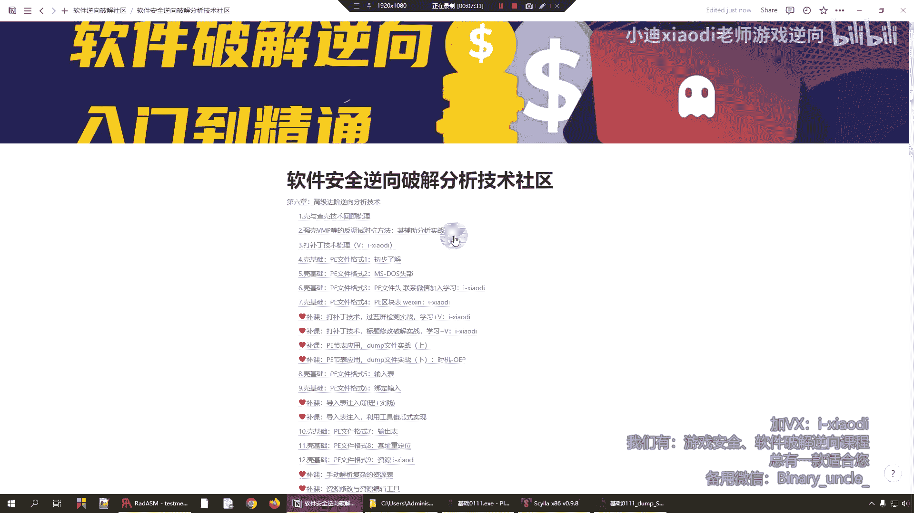

# 🧰 高级进阶逆向分析技术：第6章：手脱UPX壳

## 📌 高级进阶逆向分析技术：6.0：课程概述与学习目标


大家好，我是小李老师，学习软件安全逆向破解，就找小李老师。本次内容是第六章高级进阶逆向分析技术补课的一部分，主题是手工脱UPX壳。上节课我们讲了如何用ESP定律法，也就是堆栈平衡法，去脱一个相对简单的壳；本节中我们来看看更常见、更典型的UPX壳，并把手工脱壳流程完整走一遍。


本节的学习目标是：理解为什么学习手脱UPX壳，掌握查壳与区段观察方法，掌握从壳入口开始保存寄存器环境、利用ESP定律设置硬件访问断点、单步跟踪并跳过循环、判断OEP、修复导入表、转储并验证脱壳结果的完整流程。以下是本节将要覆盖的核心概念，先给出一个整体公式，方便初学者建立框架。

```text
壳入口 pushad -> 保存寄存器环境 -> 壳代码执行 -> ESP 还原 -> 跳到 OEP -> 修复导入表 -> 转储 -> 验证运行
```

## 🧭 高级进阶逆向分析技术：6.1：为什么学习手脱UPX壳

上一节我们回顾了ESP定律法和堆栈平衡法脱简单壳的案例，本节中我们来看看为什么还要专门学习手脱UPX壳。UPX是非常常见的压缩壳，使用范围很广；在讲壳的基础知识时，UPX就是经常被拿来举例的压缩壳。很多带破解需求的程序可能带UPX壳，CTF比赛中的RE赛题也可能带魔改的UPX壳，所谓魔改就是修改后的UPX壳。

不管面对的是普通UPX壳，还是CTF中魔改后的UPX壳，掌握常见壳的手工脱壳技术都非常必要。原因是网络上通用的脱壳机面对魔改壳可能脱不了，这时就需要手工脱壳；手工脱壳可以沿用上节课讲到的操作手法，也就是ESP定律法，或者称为堆栈平衡法。下面列出学习手脱UPX壳的典型原因，帮助初学者理解这项技术的使用场景。


- 带破解的程序可能带有UPX壳，需要脱壳后才能继续分析。
- CTF的RE赛题可能带有魔改UPX壳，通用脱壳机可能无法处理。
- 不脱壳时，修改资源可能产生问题，甚至无法修改资源。
- 不脱壳时，有些数据可能根本看不到，影响后续分析。


> ESP定律法又称堆栈平衡法。


## 🔍 高级进阶逆向分析技术：6.2：查壳并确认UPX版本

上一节说明了手脱UPX壳的必要性，本节中我们来看看拿到实验程序后如何查壳。首先拿到实验程序“基础0111”，先用查壳工具DIE拖入程序查看，可以看到它显示UPX 3.91；随后可以用ESin打开查看，ESin打开速度比较慢；同时也可以打开StudyPE查看区段信息，点击区段后可以看到区段不正常，这些信息都说明它实际上是一个加了壳的程序。以下是查壳与观察区段时可以使用的工具和结果说明。

- DIE：拖入实验程序“基础0111”后，显示UPX 3.91。
- ESin：打开比较慢，拖入程序后也能看到UPX 3.91版本信息。
- StudyPE：打开后查看区段信息，点击区段可以看到区段不正常，说明程序被加壳。

确认是UPX 3.91壳后，就可以开始脱壳。脱壳后程序大小会发生改变，这是正常现象；脱壳的目的在于后续修改资源、查看数据和分析程序时不受壳的阻碍。下面的公式可以概括这一阶段的判断依据。

```text
查壳结果 = UPX 3.91
区段异常 + 压缩壳特征 -> 需要脱壳
```

## 🧱 高级进阶逆向分析技术：6.3：从pushad入口开始保存寄存器环境

上一节我们确认了程序带有UPX 3.91壳，本节中我们来看看如何用调试器进入壳入口。打开x32dbg，把程序拖进去，映入眼帘的是`pushad`指令；`pushad`的作用是保存寄存器环境。此时按F8执行一下，让程序先完成保存寄存器环境这一步。为什么要关注这一步？因为ESP在整个加载壳信息的过程中会发生变化，最终又会还原；后续就要利用ESP的这个变化规律来定位壳代码何时把环境恢复完成。下面用代码形式表示入口处的关键动作。


```asm
pushad    ; 保存寄存器环境
```


```text
ESP 在壳代码执行过程中变化 -> 壳代码结束时 ESP 还原 -> 利用还原时机继续跟踪
```

## 🧷 高级进阶逆向分析技术：6.4：用ESP定律设置硬件访问断点

上一节执行了`pushad`并理解了ESP会变化又会还原，本节中我们来看看如何利用ESP定律下断点。在x32dbg中鼠标右键打开内存窗口，选择转到内存，找到对应的内存区域，然后鼠标右键设置断点，选择硬件访问断点。设置后调试器会提示已在该处设置硬件断点；关于为什么设置硬件断点，后续会用补课形式发到知识星球，这里先掌握操作和现象。下面列出这一阶段的关键操作，便于初学者照着实践。

- 在x32dbg中打开内存窗口。
- 鼠标右键选择转到内存，定位对应内存区域。
- 鼠标右键设置断点，选择硬件访问断点。
- 调试器提示已设置硬件断点后，运行程序。

运行程序后，ESP会还原，可以看到它变成`FF74`。此时先删除断点，再按F8单步跟踪。跟踪过程中如果遇到向上跳转，就在下一行按F2下断点，然后运行程序，让这个循环自动跑完；这个循环的次数可能比较多。运行结束后取消断点，继续按F8单步。这里用公式概括ESP定律的核心观察点。

```text
硬件访问断点 = 监视 ESP 指向的栈内存被访问
ESP 还原 -> 壳即将把控制权交给程序入口
```

## 🏃 高级进阶逆向分析技术：6.5：单步跟踪与跳过循环

上一节利用硬件访问断点等到了ESP还原，本节中我们来看看如何从恢复寄存器环境的位置继续往下跟踪。此时可以在调试器里查看这段代码的情况，这里是恢复寄存器环境的位置；如果看到向上的跳转，就在下一行设置断点，让向上跳转的逻辑自动跑完，然后来到下方继续分析。看到大型的`GMP`调用时，可以直接单步跟踪；原文中的`GMP`可理解为`GetModuleHandle`一类调用，重点是识别这是程序常见API调用区域。

这里使用的方法本质上就是最开始讲的第一种方法，也就是笨方法、单步跟踪法，所以可以大胆按F8单步。单步下来后，这一片代码非常像OEP，也就是程序原始入口点；可以在调试器里把这里标记为OEP。以下列出跟踪过程中的操作要点，帮助读者理解什么时候下断点、什么时候单步。

- 从恢复寄存器环境的位置往下看代码。
- 遇到向上跳转时，在下一行设置断点，让循环自动跑完。
- 看到大型`GMP`调用时，可以大胆按F8单步跟踪。
- 单步到一片类似程序入口的代码区域时，重点判断是否为OEP。

```text
OEP ≈ 壳还原寄存器环境后跳转到的程序原始入口
单步跟踪法 = 遇到循环先绕过，遇到关键区域再仔细判断
```

## 🎯 高级进阶逆向分析技术：6.6：判断OEP并修复导入表

上一节单步跟踪到类似OEP的区域，本节中我们来看看如何确认OEP并处理导入表。可以判断这里是OEP，原因是这里出现了`GetVersion`、`GetCommandLine`、`GetInfo`、`GetModuleHandle`等调用，这些调用与平时编写Windows窗口程序时使用的API一致，因此有90%的概率可以判定这里是OEP。确认后点击插件，选择对应插件项，点击“是”，再点击`get import`获取导入表信息。以下是判断OEP和修复导入表的操作清单。


- 观察`GetVersion`、`GetCommandLine`、`GetInfo`、`GetModuleHandle`等常见API调用。
- 这些API与平时编写Windows程序时一致，可高概率判断为OEP。
- 点击插件，选择对应插件项并点击“是”。
- 点击`get import`获取导入表信息。
- 点击`valid`查看可疑或可能有错误的导入表信息。

初次转储出来的程序基本上可能无法运行，因为它里面可能存在可疑或错误的导入表信息；此时可以再次点击`dump`，选择刚才的文件并点击打开，目录中会生成新的程序。这个初次生成的程序可能仍然无法运行，甚至可以看到报错；随后再次运行，可以看到程序正常运行成功。这个正常运行的程序就是脱壳后的程序。下面用公式概括这一阶段的判断与处理。

```text
OEP 判断依据 = 常见Windows API调用集中出现 + 程序入口特征
导入表修复 = get import 获取导入表 + valid 检查 + dump 转储
```

## 📦 高级进阶逆向分析技术：6.7：验证脱壳结果与课程总结


上一节完成了OEP判断和导入表修复，本节中我们来看看如何验证脱壳结果并做总结。脱壳后的程序肯定与原程序会稍有不同，但不影响分析；它的程序入口会直接从这里开始执行，不再执行壳的代码。可以再打开一份脱壳后的程序拖入x32dbg，可以看到它直接在原程序入口点执行；以前加壳的程序是从壳代码开始执行，这就是两者之间的差异。如果能够理解这个差异，说明本节课的内容已经掌握得八九不离十；课后拿到实验程序自己实践一遍即可。


手脱UPX壳的技术适用于破解程序带UPX壳的情况，也适用于CTF程序带UPX壳的情况。本次视频使用的是ESP定律法，又称堆栈平衡法。以下是本节课的实践建议和后续信息。

- 课后使用实验程序“基础0111”完整复现手脱UPX壳流程。
- 遇到带UPX壳的破解程序，可以尝试使用ESP定律法手工脱壳。
- 遇到CTF中带UPX壳或魔改UPX壳的题目，也可以使用本节课的方法分析。
- 想加入社区学习，可以观看视频右下角的联系方式，或通过视频中的方式联系讲师。
- 当前有最新优惠：基础版199，高级版249；下集再见，下集更精彩。


```text
加壳程序执行路径：壳代码入口 -> 壳代码 -> OEP
脱壳程序执行路径：程序原始入口（OEP）直接执行
```



本节课中我们一起学习了手脱UPX壳的完整流程，包括确认UPX 3.91壳、理解UPX壳与魔改UPX壳的应用场景、从`pushad`入口保存寄存器环境、利用ESP定律设置硬件访问断点、单步跟踪并跳过循环、判断OEP、修复导入表、转储程序并验证运行结果。掌握这套流程后，面对常见的UPX壳以及部分魔改UPX壳，就可以尝试用ESP定律法和堆栈平衡法手工完成脱壳，并为后续软件安全、逆向分析和CTF比赛打下基础。

