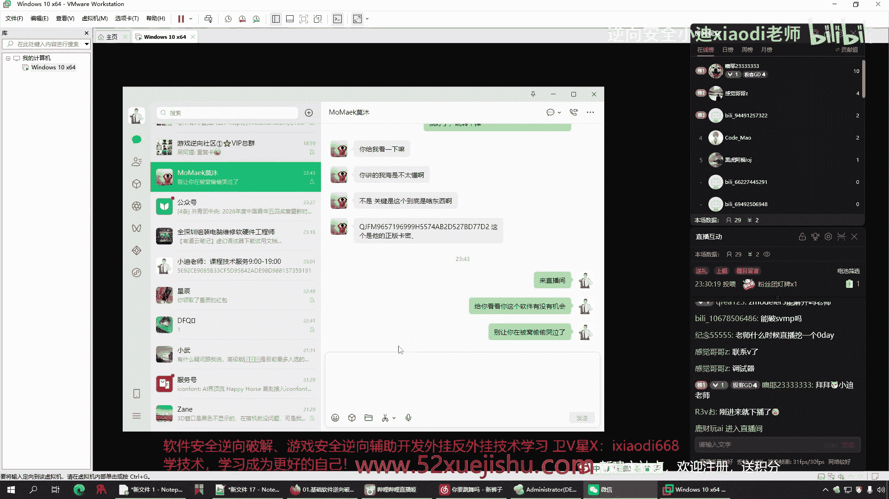

## 软件破解与反外挂实战：01：课程概述与演示背景 🛡️


在本节课中我们将要学习打击外挂相关的软件破解技术，主题是VMP强壳游戏外挂软件破解，重点演示对抗自删除和卡密网络验证破解。它属于二进制安全逆向、游戏安全、软件安全、网络安全、CTF比赛必备基础、封包技术方向，对应内容编号为BV1yQ9YBNEGG-。这个概述先帮助初学者建立整体印象，后面再进入具体操作，避免一上来就被各种工具和术语绕晕。


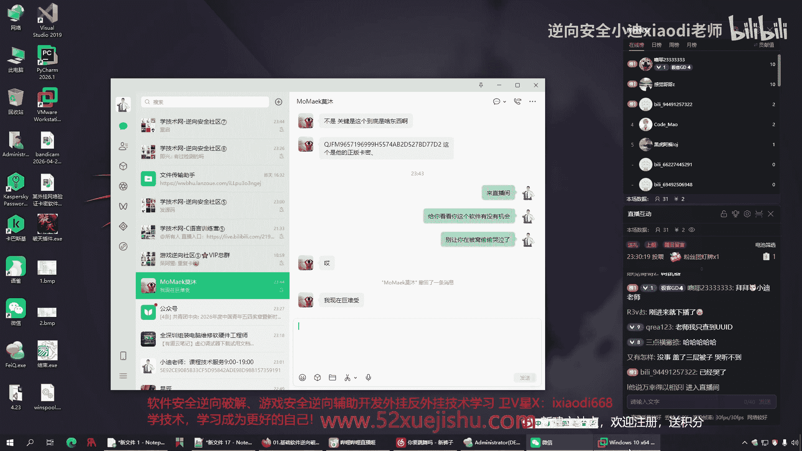

演示中提醒不要在直播间偷偷哭泣；演示者调侃真哭去了、偷偷哭泣，笑称玻璃心，并说吓人、盖三层被子听不着。随后查看加菲更新器，确认它来了，当前状态巨难受。接着继续观察，下面进入第一轮防护观察。


## 软件破解与反外挂实战：02：第一轮防护观察与文件大小变化 🔍


上一节我们明确了演示目标和背景，本节中我们来看看第一轮自定义防护观察。这个阶段的目的很直接，就是先用火绒的自定义防护盯住加菲更新器的文件操作，看看它在运行过程中会读取、修改、删除哪些内容。初学者可以把这一步理解成先给程序套一个观察罩，先不急着破解，而是先看清它的动作。


下面是第一轮观察的操作步骤，按顺序执行即可。


- 创建自定义防护，勾选“立即开启”。
- 添加发起程序，找到加菲更新器。
- 添加保护对象，它在桌面上，因此对修改、删除进行拦截。
- 选择“询问我”，点击保存。
- 观察读取状态，盯住文件大小，看到大小显示出来。
- 将文件复制出来到指定位置，选择允许，查看大小是否变化。
- 大小变为17.1并再次变化，说明程序还在往里面写数据。
- 再次允许，看到当前都是读取；继续允许。
- 检查删除是否没有被拦上；演示中发出疑问并继续操作。
- 直接选择阻止，查看能否拦住；继续尝试。
- 火绒有时也会失测；全部取消。
- 读取U盘并删除，火绒有时也不行，说明作者软件的保护达到新的高度。
- 不能直接阻止；点错为“询问我”，点击保存并删掉。
- 先允许，再允许，第三次允许，再允许。
- 查看程序是否释放完成；此时应该已经释放完成，这次应该删除，大小为17.1。


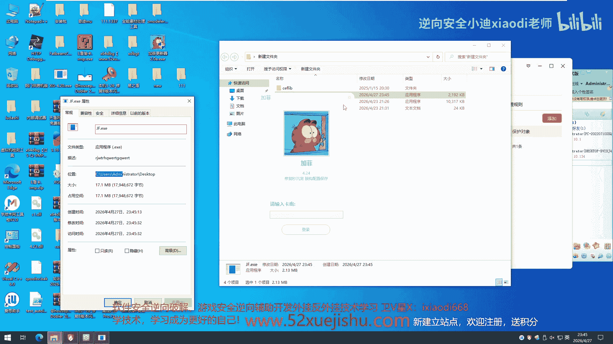

这一轮操作看起来步骤多，实际是在观察程序运行时的文件写入节奏。第一轮说明简单拦截不稳定，下一节识别自删除逻辑。


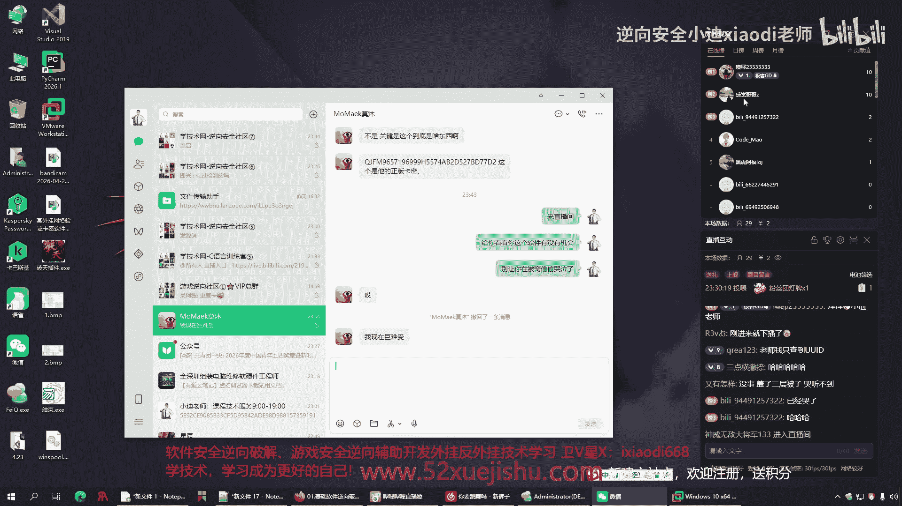

## 软件破解与反外挂实战：03：识别自删除逻辑与补充规则 🧩


上一节看到删除拦截不稳定，本节中我们来看看程序的自删除逻辑。演示中复制出一个副本后，看到自删除现象。它的逻辑不是A文件直接删除B文件，而是A.exe写出B.exe，然后B.exe自己删除自己。原文用A点ESE、B点EFE来描述这个关系，核心含义就是B自己把自己删掉。理解这一点后，就不能只盯着A文件，还要控制B文件的释放和自删除过程。


核心逻辑可以用下面的代码描述。


```text
A.exe 释放 B.exe
B.exe 删除自身
不是 A.exe 直接删除 B.exe
```


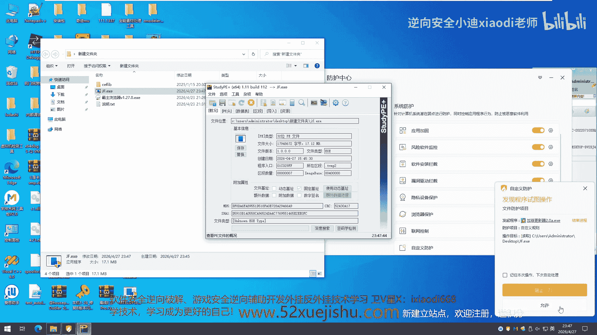

因为存在两次动作，所以演示中强调需要控制两次。根据自删除逻辑，演示中需要控制两次并补充规则，下面是具体操作。


- 第一次控制、第二次控制，确认代码释放。
- 稍等，在火绒中添加自定义防护，再添加一条规则。
- 添加发起程序GF，打开并添加保护对象。
- 保护对象仍为桌面上的这个文件夹。
- 将删除、修改、读取勾上，点击保存。
- 运行这个程序；演示中发出疑问，确认发起程序是这个发起程序。
- 程序很强，检查哪里搞错；保护文件夹设置为“保护新建文件夹”，点错并搞错。
- 找到新建文件夹，之前没有进去，这个才是正确对象。
- 演示中确认“我就说这样”，然后继续操作。


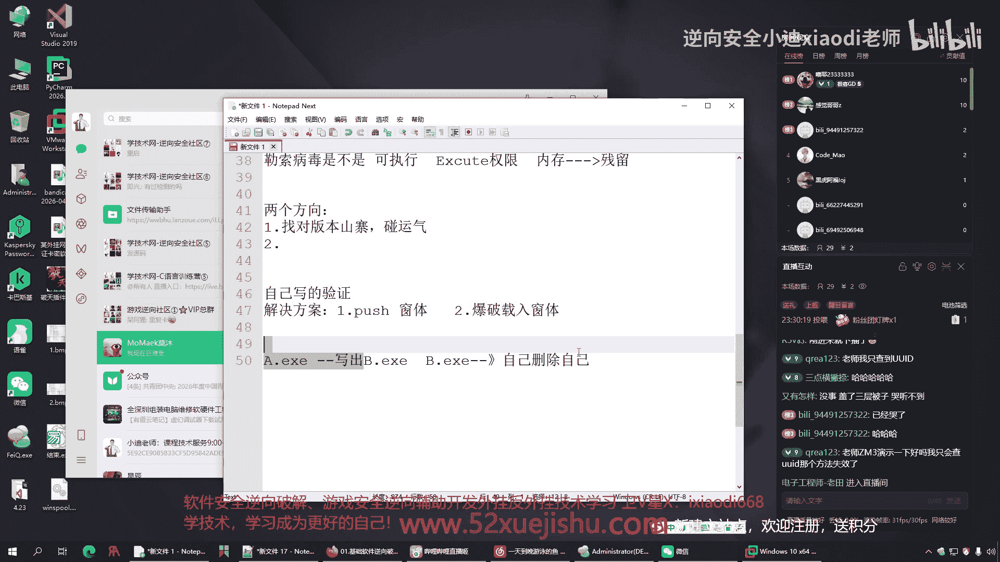

补充规则后还需要选对保护文件夹，下一节看正确规则与模块提取。


## 软件破解与反外挂实战：04：正确保护规则与模块提取 📦


上一节已经补充第二条规则并找到新建文件夹，本节中我们来看看正确运行、拦截删除和提取模块。这个阶段的关键是保护对象不能选错，文件夹选错会导致看起来像没有拦住，实际是规则没有落到目标文件上。对于初学者来说，先确认路径，再运行程序，会比盲目点允许更稳。


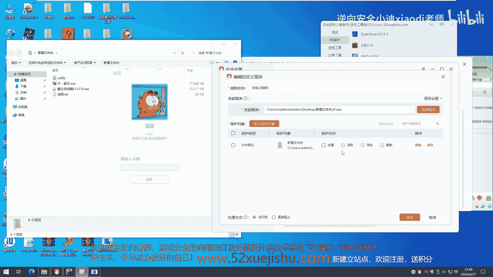

下面是正确运行、拦截删除和提取模块的操作。


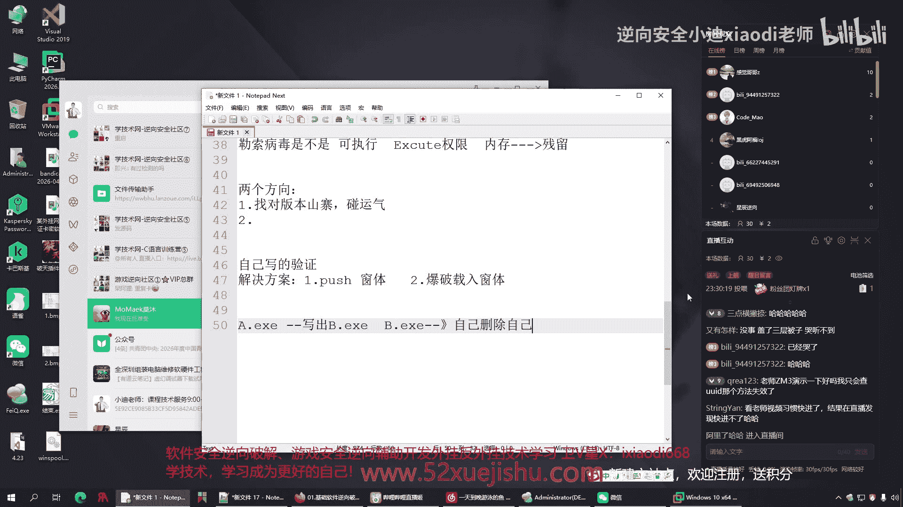

- 运行程序，选择允许、允许。
- 把目标内容提取出来之后运行。
- 程序进行读取，演示中称为圆形读取。
- 看到程序要删除时，选择阻止。
- 检查后发现没有搞错，是文件夹没有选上；这样操作就可以了。
- 这样程序的模块都在目标位置。
- 模块都在这里之后，就可以附加调试。


模块提取完成后就可以附加，下一节看管理员附加与Hook思路。


## 软件破解与反外挂实战：05：管理员附加与Hook思路 🔧


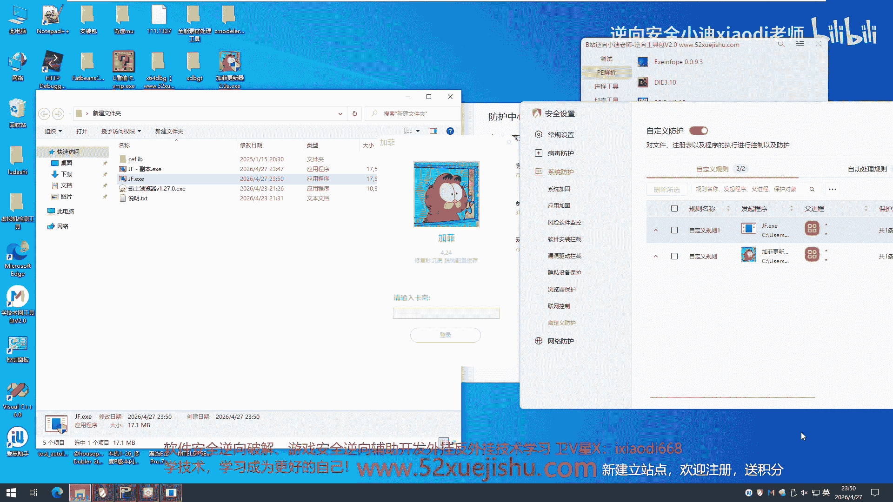

上一节模块都在目标位置，本节中我们来看看附加调试和Hook。演示中提出为什么无法附加，原因是没有管理员身份权限，原文说成“管理员身份印象”。需要以管理员身份运行，才能看到目标进程。看到进程的那一刻，意味着已经渗透到程序内部，后续才可以做调试分析。这个点对初学者很重要，很多附加失败不是工具问题，而是权限不够。


附加之后，所谓看起来比较强的反调试就不攻自破了。演示中认为还是有点机会，可以使用插件自己爆破。核心Hook思路可以用下面的公式描述。


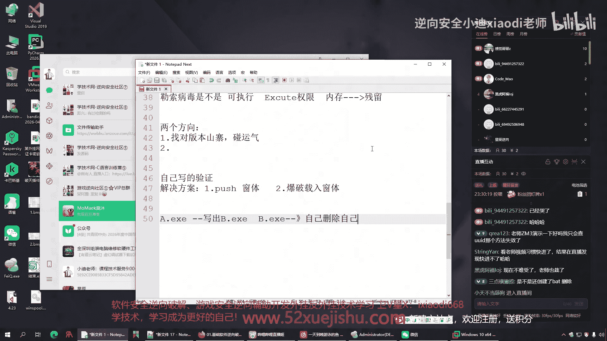

```text
Hook(目标窗口/目标函数) -> 修改执行流 -> 打补丁或载入窗体
```


下面是附加后可以采用的调试和Hook动作。


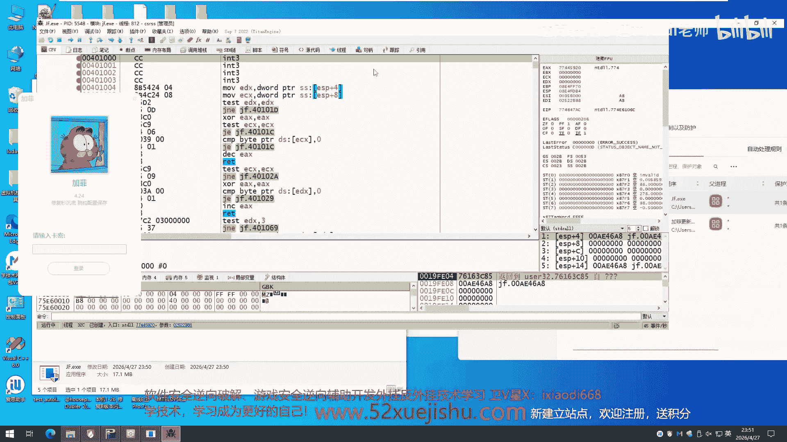

- 以管理员身份运行，才能看到目标进程。
- 看到进程说明已经渗透到程序内部。
- 进行调试分析，所谓看起来很强的反调试不攻自破。
- 仍然有机会；使用插件自己爆破。
- 载入行动窗口，在这里做Hook。
- 打破解补丁，在这里做Hook。
- 把窗体拿出来。


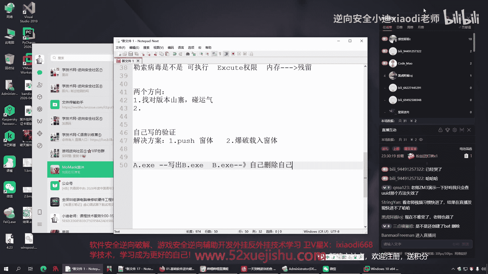

附加和Hook思路完成后，下一节整理互动提醒和后续学习。


## 软件破解与反外挂实战：06：互动提醒与后续学习 💬


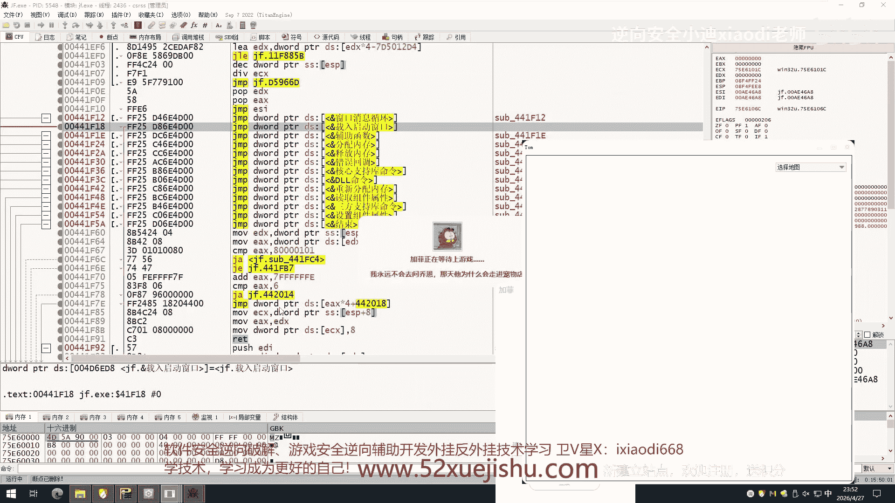

上一节完成附加与Hook思路，本节中我们来看看演示中的互动提醒和学习建议。演示里除了技术操作，还有不少课堂互动和后续学习提示，这些内容对初学者同样有用，因为它们说明了应该先学什么、哪些特征先不用管、Hook视频在哪里看。


以下是演示中提到的互动提醒和学习建议。


- 现在值了，觉得值就扣一；不要在被窝哭；演示者询问人，直接值得扣1，里面够了。
- 询问大家是否学到东西；学到东西扣一，演示者就下播。
- 1元是一个特征；上面混淆不用管。
- 在这里做一个VEH的Hook。
- Hook有视频讲解；VIP1第三部分有SE壳的Hook。
- 演示中提示又破好了。
- 今天到这里结束。
- Q什么123，先把基础学，学了之后就能自己试。


互动提醒整理完成，下一节做总结。


## 软件破解与反外挂实战：07：课程总结 ✅


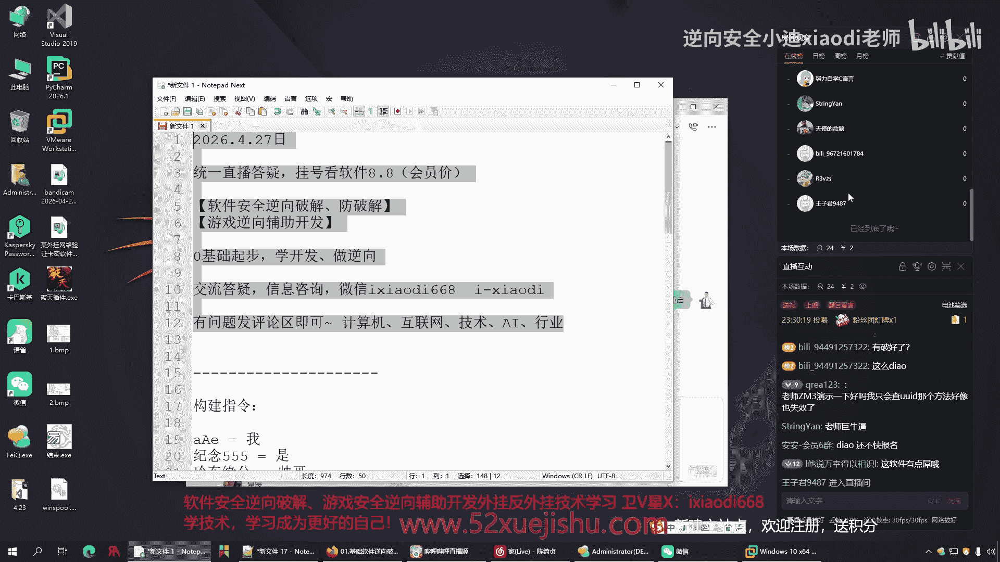

前面各节完成演示和互动整理，本节中我们来看看总结。本节课中我们一起学习了打击外挂背景下的软件破解演示，内容包括VMP强壳游戏外挂软件破解、对抗自删除和卡密网络验证破解相关方向，也涉及二进制安全逆向、游戏安全、软件安全、网络安全、CTF比赛必备基础和封包技术。演示中以加菲更新器为例，先用火绒自定义防护观察读取、修改、删除和文件大小变化，再识别A.exe释放B.exe、B.exe自删除的逻辑，随后补充规则、选对保护文件夹、提取模块，最后以管理员身份附加进程并讨论Hook、补丁和窗体提取思路。整个过程的核心是先用规则观察行为，再识别自删除，再控制释放过程，最后进入调试与Hook阶段。以上就是本教程内容。

