# 🖼️ 软件图片资源提取实战：01：使用图片提取工具提取程序内图片

在本节课中我们将要学习一款图片资源提取工具的使用方法。这款工具名为“无视强壳保护暴力提取程序图片工具 V1.0”，原文说明它支持 GPG 和 PG，并且有一个显著特点：可以无视强壳保护来提取软件中的图片资源。强壳保护是软件防护的一种手段，原文举例提到 VMP、TMD 这类保护方式。下面我们按照实际操作流程，把这套使用方法整理成初学者也能看懂的教程。

## 🧭 软件图片资源提取实战：01：课程概述与工具认识

上一段我们认识了工具名称和它的主要特点，本节先说明整体思路。整个流程并不复杂，核心就是先确认目标程序是 32 位还是 64 位，再让目标程序运行起来，然后运行提取工具，最后输入带后缀的程序名，让工具把图片输出到目标程序所在目录。原文也说明，本次内容是以录制分享的方式讲解这款工具怎么使用。

为了更直观地理解工具特点，可以用下面的代码概括核心概念：

```text
强壳保护示例：VMP、TMD
提取工具特点：可无视强壳保护提取图片
工具名称：无视强壳保护暴力提取程序图片工具 V1.0
原文支持说明：GPG、PG
```

认识工具之后，下一步就是判断目标程序的位宽。因为只有先知道程序是 32 位还是 64 位，后续测试和输入程序名时才有明确对象。完成这一节的概念说明后，我们进入位宽判断环节。

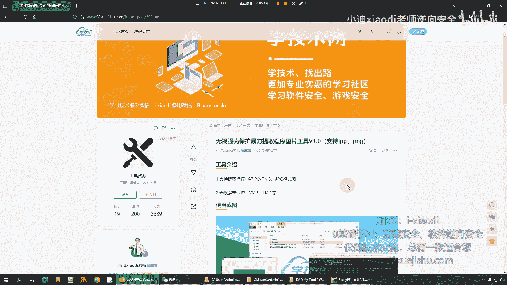

## 🔍 软件图片资源提取实战：02：判断目标程序位宽

上一节介绍了工具的基本情况，本节我们来看看如何判断程序位宽。原文的操作是：拿到一个程序后，先要知道它是多少位，然后使用 sstardy P 工具，把程序拖过来，查看工具显示的位数。演示中，拖入一个程序后，可以看到它是 32 位 PE 文件。

下面是判断 32 位程序位宽的操作步骤：

1. 打开 sstardy P 工具。

2. 把目标程序拖入工具窗口。

3. 观察工具显示结果，确认它是 32 位 PE 文件。

判断位宽的核心概念可以用下面的代码表示：

```text
目标程序位宽 = PE 查看工具显示结果（32 位 / 64 位）
```

确认 32 位程序后，原文又做了一个测试，也就是测试微信。具体做法是找到微信所在位置，把微信拖过来，查看后确认微信是 64 位 PE 文件。这样我们就分别有了一个 32 位程序和一个 64 位程序作为测试对象。完成位宽确认后，下一节就可以开始实际提取。

## ⚙️ 软件图片资源提取实战：03：运行程序与工具的基本流程

上一节确认了 32 位程序和微信的位宽，本节开始讲解提取工具的基本使用流程。原文强调，如果要使用这款工具，需要先把目标程序运行起来，运行起来之后，再运行这个提取工具。这个顺序很关键，先让目标程序处于运行状态，再让工具去处理它。

提取工具运行之后，会在同目录下创建两个文件夹，分别用于输出对应的图片文件。这里的“同目录”可以理解为目标程序所在的位置。核心输出结构可以用下面的代码表示：

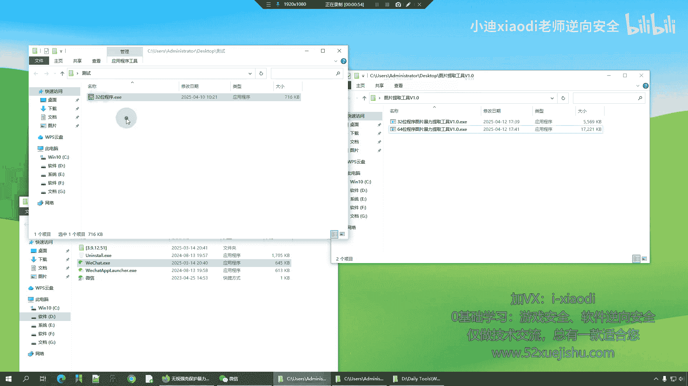

```text
目标程序同目录/
├─ 图片输出文件夹 1
└─ 图片输出文件夹 2
```

工具运行起来后，需要输入程序名字。原文说明，程序名字要输入 32 位程序名，并且要加上它的后缀，也就是 `.exe`。输入格式可以概括为下面的代码：

```text
提取输入 = 程序文件名.exe
```

了解基本流程后，下一节就按照 32 位程序进行第一次实际提取。整个操作的重点是程序名必须带后缀，输入后按回车等待输出即可。

## 🗂️ 软件图片资源提取实战：04：提取 32 位程序图片

上一节说明了运行顺序和输入格式，本节我们来看看 32 位程序的实际提取过程。原文的操作是先运行目标程序，再运行提取工具，然后输入程序名。输入时可以先复制程序名，再粘贴到工具中，然后按回车。

下面是 32 位程序图片提取的具体操作步骤：

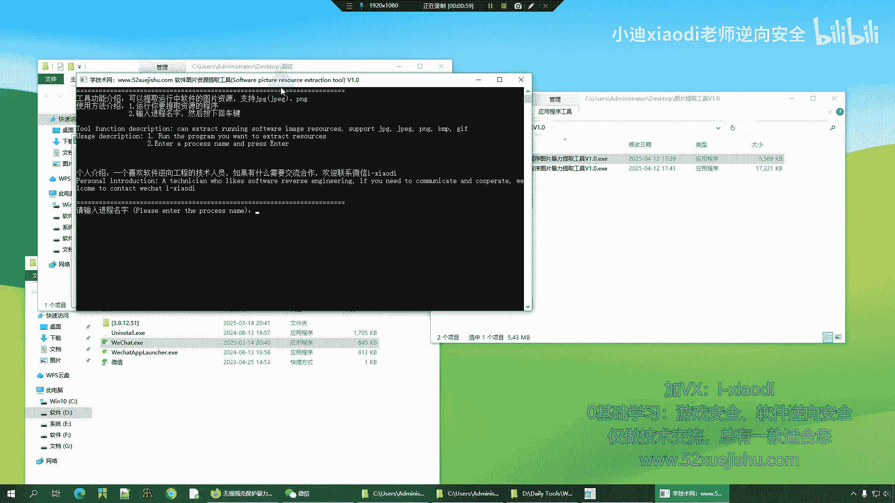

1. 先运行 32 位目标程序。

2. 再运行提取工具。

3. 在工具中输入 32 位程序名，并保留 `.exe` 后缀。

4. 复制程序名后粘贴到输入位置。

5. 按回车，等待工具输出图片。

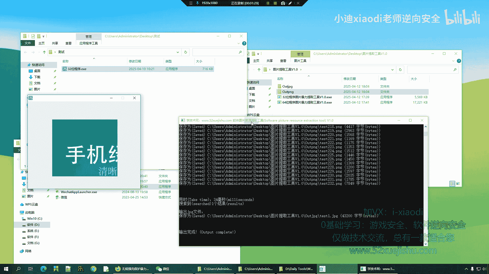

6. 工具提示输出完成后，打开输出目录检查图片。

提取完成后，原文打开输出目录进行检查，看到主目录里的图片没有问题，再查看另一个输出目录，里面的图片也没有问题。这说明 32 位程序的图片提取流程可以正常完成。到这里，32 位程序的图片提取测试就完成了。

完成 32 位程序测试后，需要清理输出结果，方便下一轮测试。下一节会先删除本次生成的两个文件夹，再关闭工具，然后转向微信测试。

## 💬 软件图片资源提取实战：05：测试微信 64 位程序

上一节完成了 32 位程序图片提取，本节测试微信这个 64 位程序。原文先删除刚才生成的两个文件夹，然后关闭提取工具，再开始测试微信。测试前，微信已经运行起来，原文随后双击运行相关程序，并确认微信是 64 位程序。

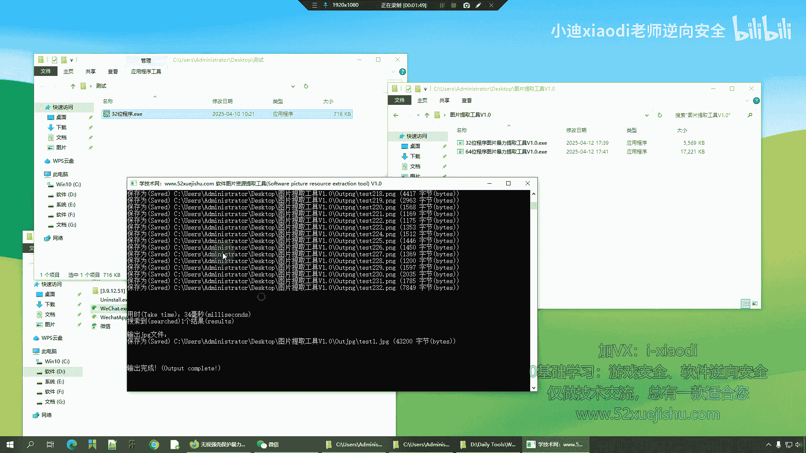

下面是测试微信时的操作步骤：

1. 删除 32 位程序测试中生成的两个图片输出文件夹。

2. 关闭提取工具。

3. 确认微信已经运行起来。

4. 双击运行需要处理的目标程序，原文此处说明它是 64 位程序。

5. 在提取工具中输入微信程序名，原文口述为 `Vchat.exe`，实际以本机微信可执行文件名和 `.exe` 后缀为准。

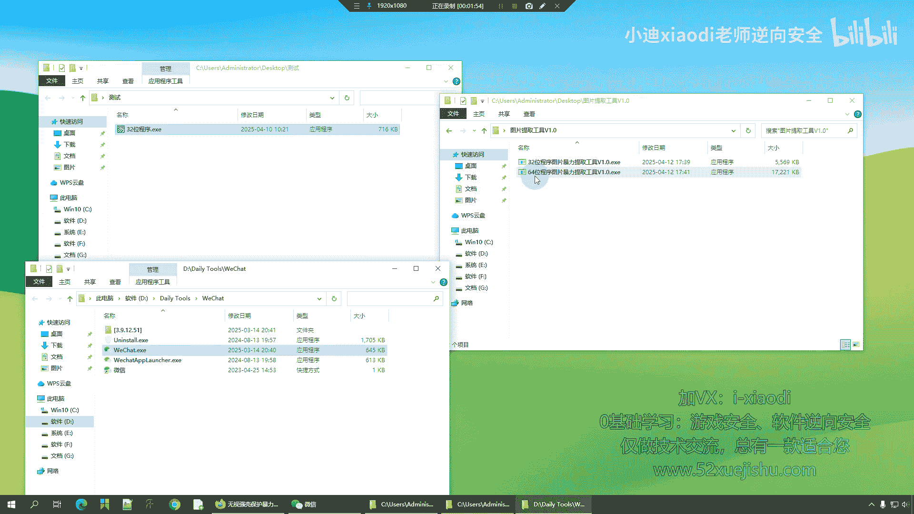

6. 粘贴程序名后按回车。

7. 等待工具提取，微信资源比较多，需要稍等。

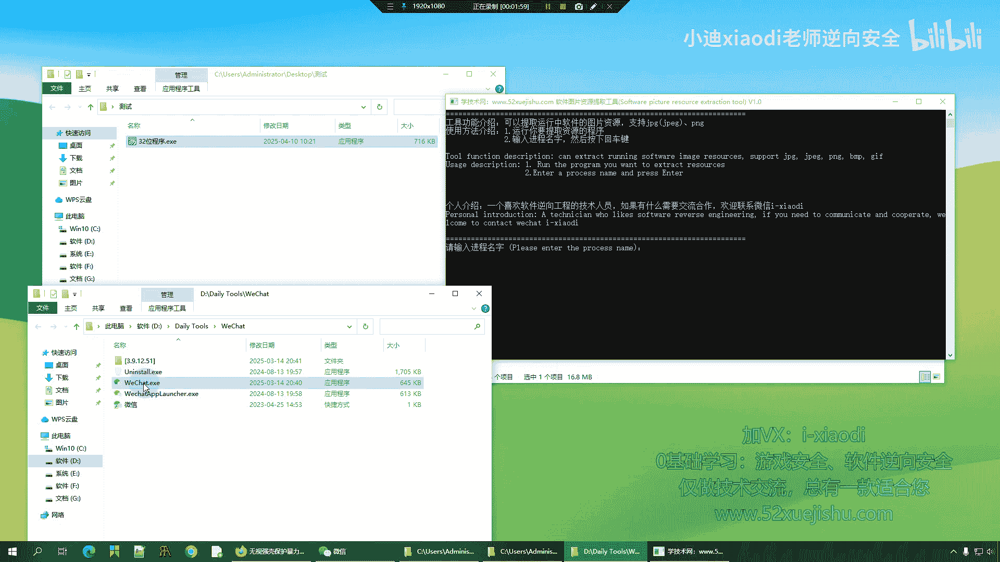

微信资源数量较多，所以提取过程会比 32 位程序稍微久一点。等待输出完成后，再检查输出目录即可。下一节重点查看微信的输出结果，并说明演示中出现的目录情况。

## 📁 软件图片资源提取实战：06：检查微信输出结果

上一节输入微信程序名并等待提取，本节检查输出结果。原文在提取完成后观察输出目录，发现没有 GPG 文件，也没有 JPG 文件，只有 `outPNG` 目录。打开 `outPNG` 目录后，可以看到里面正好包含微信的相关图片资源。

微信输出结果的观察要点可以用下面的代码概括：

```text
WeChat 输出结果 = outPNG 目录
演示观察：未发现 GPG 文件，未发现 JPG 文件
outPNG 内容：微信相关图片资源
```

下面是检查微信输出结果时的操作步骤：

1. 等待工具提示提取完成。

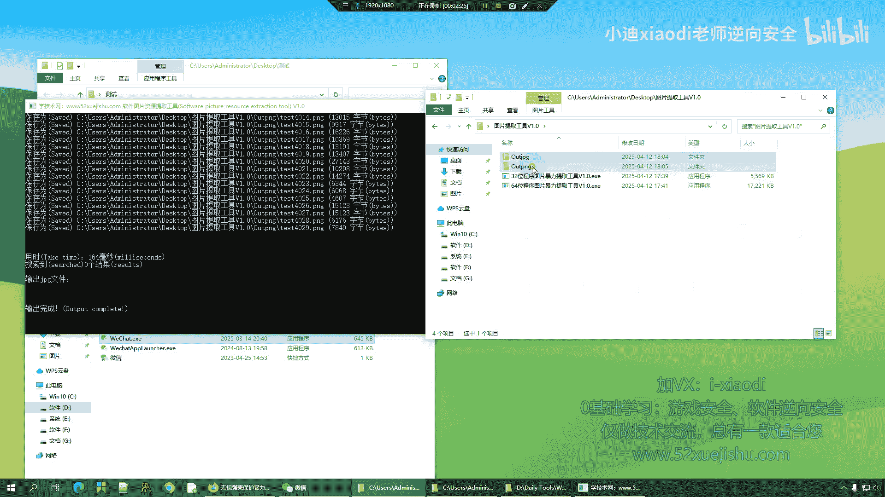

2. 打开目标程序同目录下的输出文件夹。

3. 检查是否存在 GPG 文件。

4. 检查是否存在 JPG 文件。

5. 打开 `outPNG` 目录，查看 PNG 图片资源。

6. 确认 `outPNG` 中是否包含微信相关图片。

检查完成后，原文说明 `outPNG` 里面刚好就是微信的所有一些图片资源。到这里，微信 64 位程序的图片提取测试也完成了。下一节说明工具的使用边界和获取方式。

## 🛡️ 软件图片资源提取实战：07：安全声明与获取方式

上一节完成了微信图片资源检查，本节说明使用边界。原文希望这款工具仅用于技术交流，不要用于违法途径，所有演示也仅用于技术交流。这个声明需要放在实际操作之前理解清楚，工具能力是一回事，合法合规使用是另一回事。

下面是原文给出的使用声明与获取方式：

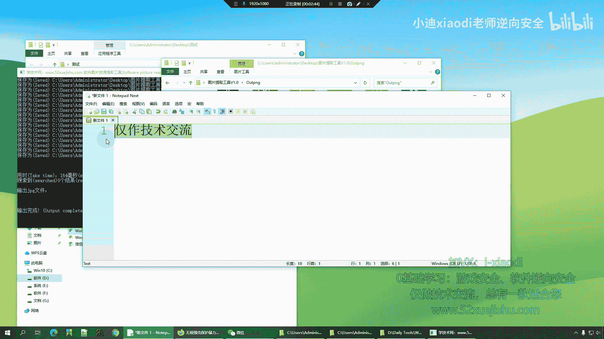

1. 工具仅用于技术交流。

2. 不要将工具用于违法途径。

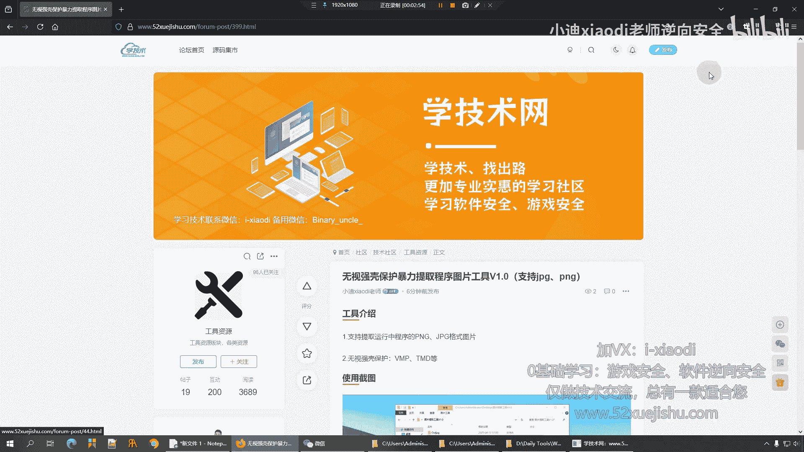

3. 所有演示仅用于技术交流。

4. 如果需要下载工具，可以前往原文提到的技术社区免费下载。

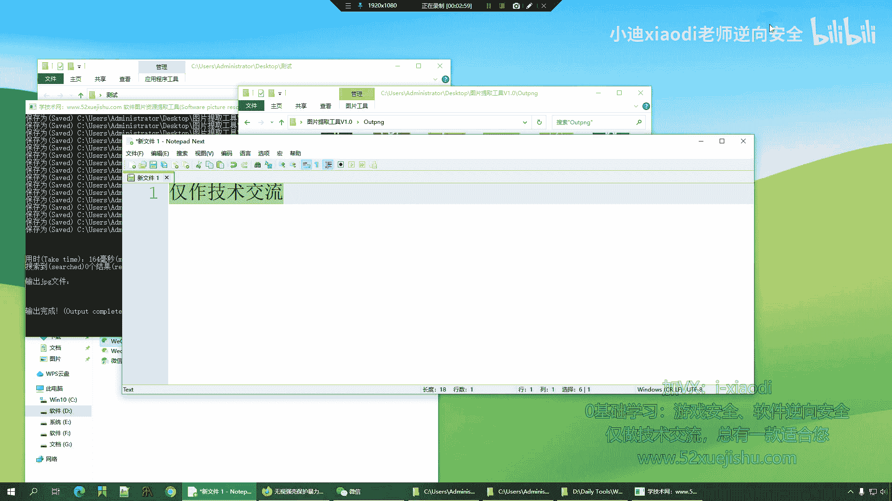

理解这些声明后，再回头看待整个提取流程，就能更清楚地知道哪些场景可以用于学习交流，哪些场景不能触碰。本节的安全声明完成后，下面进行整体总结。

## ✅ 软件图片资源提取实战：08：课程总结

本节课中我们一起学习了“无视强壳保护暴力提取程序图片工具 V1.0”的基本用法。我们首先认识了工具名称和特点，了解到它可以无视 VMP、TMD 这类强壳保护来提取程序图片；接着学习了用 sstardy P 工具判断程序是 32 位还是 64 位；然后按照“先运行目标程序，再运行提取工具”的顺序，输入带 `.exe` 后缀的程序名进行提取；最后分别检查了 32 位程序和微信的输出目录，并了解到微信演示中只出现 `outPNG` 目录，没有发现 GPG 文件和 JPG 文件。工具仅用于技术交流，不要用于违法途径，演示也仅用于技术交流，需要下载可以到技术社区免费获取。本期工具分享到此结束，下期再见。

