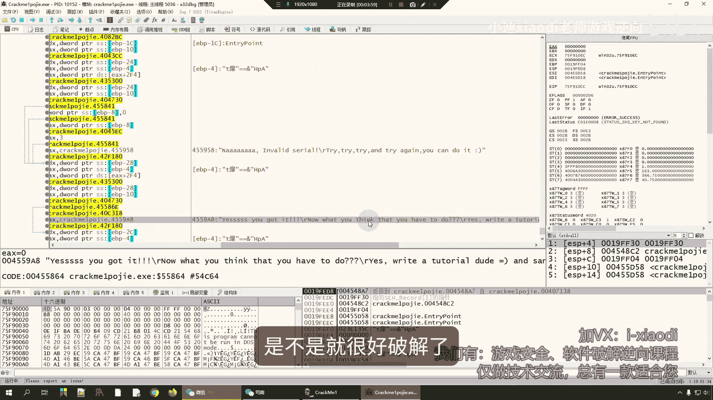

# 软件破解逆向基础：01：某Crackme软件的暴力破解与函数调用溯源 🛠️

## 软件破解逆向基础：01.1：课程概述 📌

在本节课中，我们将要学习一个 Crackme 软件的暴力破解过程，并整理函数调用溯源的几种方法。课程来源是一个社区视频，内容面向游戏安全、软件安全、网络安全和 CTF 比赛的基础学习，也适合小白学习软件破解、反汇编、逆向和安全工程师相关内容。本节课会围绕一个大学期末大作业程序展开，先查壳，再运行观察提示，然后通过字符串定位错误函数，最后介绍查看调用堆栈和查找引用两种溯源思路，并完成一个简单的补丁破解。

为了便于初学者理解，可以先把整体思路写成一个简单流程。这个流程也是后续操作的核心概念。

```text
错误弹窗 -> 内存字符串 -> 引用字符串的代码 -> 调用链 -> 跳过错误函数的分支
```

原视频标题如下，里面包含了课程主题和来源信息。

> 原视频标题：某Crackme软件的暴力破解，函数调用溯源的几种方法，社区成员【游戏安全，软件安全，网络安全，CTF比赛必备基础】小白软件破解反汇编逆向安全工程师2024最新--BV1rJ4m1g72v-

在明确课程目标之后，我们先从课程导入和程序背景开始。

## 软件破解逆向基础：01.2：课程导入与程序背景 🎼

大家好，我是小迪老师。今天来看这样一个程序。这个程序非常重要。它是同学的一个期末大作业，应该是一个大学生。这个期末作业拿到手之后，我们先不急着改代码，而是先观察程序状态，确认它有没有保护，再运行看提示。这样做的目的是让后续分析有清晰起点。

## 软件破解逆向基础：01.3：查壳与运行观察 🔍

上一节我们说明了程序背景，本节来看看程序有没有加壳，以及运行后的提示。先查一下壳，看看有没有壳。区段 code 一看，应该是一个 D 程序，原文口述为 de/d 程序。界面也显示它就是一个 D 程序。区段非常干净，这个程序没有壳。

查壳之后运行程序。运行后它会提示这个东西过期了，可以看到已经过期。我们的目的就是把它破解掉。这里的“查壳”可以直白理解为检查程序有没有被额外保护层包住，而“区段干净”说明当前没有明显的壳特征。

## 软件破解逆向基础：01.4：字符串定位错误代码的基本思路 🧭

在确认程序无壳并看到过期提示之后，本节进入定位错误代码的基本思路。怎么破解，首先打开调试工具，直接拖进去。也可以先把所有相关内容放开，还原到一个最原始的状况，全部删掉，重新来一遍。重新运行之后，它会有一个错误弹窗。

接下来思考一个问题：这个错误弹窗能不能在内存中查找相关字符串，然后根据字符串找到调用字符串的代码。这是基本思路。我们试一下，再重新跑一遍，鼠标右键当前模块字符串。找到错误的地方。这里有一个非常诡异的点：更改一个跳转，现在是往下跳，往下跳是错误；如果不往下跳，这里还是错误。也就是说，不管怎么跳都是错误，不管做什么都错，会让人觉得都是自己的错，太冤。那怎么办，需要找到调用这个函数的位置。

怎么找，很简单。在错误函数的头部打一个断点，然后运行。为了便于理解，可以把这一节的思路概括为下面的公式。

```text
错误函数入口断点 -> 触发错误弹窗 -> 回溯调用者 -> 找到决定是否进入错误函数的分支
```

## 软件破解逆向基础：01.5：方法一：查看调用堆栈 🧱

上一节介绍了字符串定位的基本思路，本节先看第一种函数调用溯源方法：查看调用堆栈。程序断在错误函数头部。第一种方法看调用堆栈。点击调用堆栈，双击过来，这是第一个调用位置。然后第二个到这儿来了。


这个位置有一个问题：这个代码里面进去看，它太大，东西特别多。这样一看会看不太明白，里面还有很多坑，每个坑里又有很多坎。因此这样去分析不太好分析。这是第一种查看函数调用的方法。第一种方法先排除。

以下是方法一的具体操作与观察过程。

1. 在错误函数头部下断点并运行，程序会断下。


2. 点击调用堆栈，双击第一层调用位置。

3. 继续查看第二个调用位置，到达对应代码区域。

4. 进入该代码后会发现它体积大、内容多、分支坑坎多，阅读不直观。

5. 因此第一种方法暂不采用。

## 软件破解逆向基础：01.6：方法二：查找引用并打补丁 🎯

方法一阅读量较大，本节来看看第二种方法：查找引用并打补丁。有没有第二种方法，有。第一种方法排除。第二种方法是对着它鼠标右键，查找引用，然后选择选定的地址。也就是去看谁引用了 `0x403FF8` 这个函数头部地址。选定地址后，就在这。

往上一看，这里是一个 `JMP`，会直接跳过去，原文口述为 GMP。然后看到这里有一个跳转。这个跳转就是决定跳过错误函数的跳转，因为这个东西一跳就跳到错误函数的位置。所以要让上面这个跳转跳过它。界面上小箭头可以往下跳，跳过它。因此可以把它改成 `JMP`。点击 `JMP`，然后打一个补丁。这是一个大学的期末大作业，名字也来破解。补丁已经应用成功，然后走一遍，运行，破解成功。

这里可以把补丁目标理解为一个简单公式。

```text
补丁目标 = 决定是否进入错误函数的分支跳转
```

以下是方法二查找引用并打补丁的步骤。

1. 右键目标位置，选择“查找引用”，再选择“选定的地址”。

2. 查看谁引用了错误函数头部地址 `0x403FF8`。

3. 在引用位置往上看，会看到一条 `JMP` 直接跳过去。

4. 找到决定跳过错误函数的那个跳转，把跳转改为 `JMP`，让流程跳过错误函数。

5. 打补丁并运行，程序破解成功。

关键代码概念可以写成下面的伪汇编形式。

```asm
; 错误函数入口
CALL 0x403FF8

; 补丁点：让流程跳过错误函数
JMP 跳过错误函数
```


## 软件破解逆向基础：01.7：俄罗斯套娃结构与后续观察 🪆

完成基本破解后，本节看看程序的俄罗斯套娃结构和后续观察。但是它是俄罗斯套娃，一层套一层。这个东西已经跟他说了，回去让他自己研究。当然，直接去破解也是可以的。它里面有很多东西，有很多关键提示，都可以做参考。

点击符号切换过来，执行检查，可以看到 check、try try，这个东西也是错误的。看它的字符串，里面肯定有相关字符串。去搜索一下字符串，可以看到这里是有的。因此根据这种跳转，包括 `yes, you got it`，这种跳转破解就很好破解。你已经成功了。根据上面这些跳转模式，原文口述为模具，再去破解就 OK。


以下是后续观察与扩展分析的要点。

- 该程序是俄罗斯套娃结构，一层套一层。


- 已经告知该同学回去自行研究。

- 直接破解也可以，程序里有很多关键提示可参考。

- 点击符号切换，执行 check、try 等检查位置，仍会看到错误。



- 查看字符串并搜索字符串，可以找到相关内容，例如 `yes, you got it`。

- 根据这些跳转模式继续破解即可，说明已经成功。

## 软件破解逆向基础：01.8：课程总结 🧾

本节课中，我们一起学习了某 Crackme 软件的暴力破解与函数调用溯源。课程从一个大学期末大作业程序开始，先查壳确认没有壳，再运行看到过期提示。随后通过错误弹窗和内存字符串定位错误函数，在错误函数头部下断点并查看调用堆栈，这是方法一。方法一代码内容多、坑坎多，阅读不直观，因此排除。方法二使用查找引用，查看谁引用了 `0x403FF8` 函数头部地址，找到决定跳过错误函数的跳转，将其改为 `JMP` 并打补丁，最终运行破解成功。之后还观察了俄罗斯套娃结构、check 和 try 等检查位置，以及 `yes, you got it` 等字符串提示，说明根据跳转模式继续破解即可。

今天的内容就是这些，课件可以发给大家，作为一个简单答疑。想学习软件安全方向，欢迎加入，下期再见。
